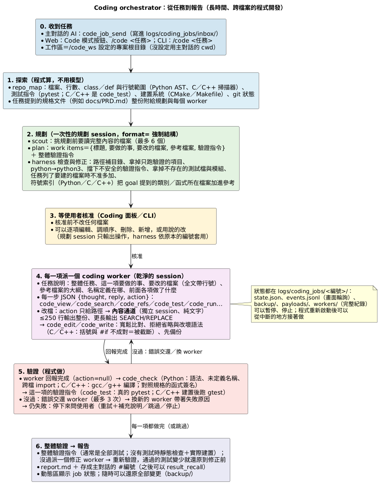
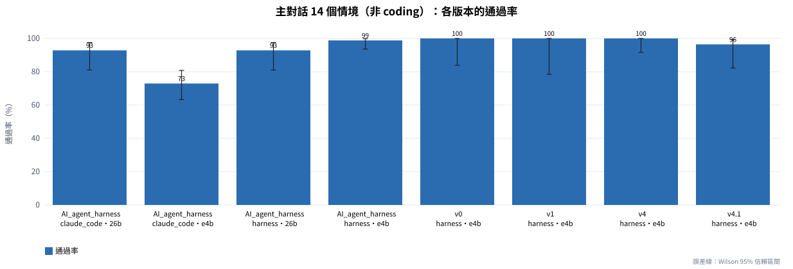
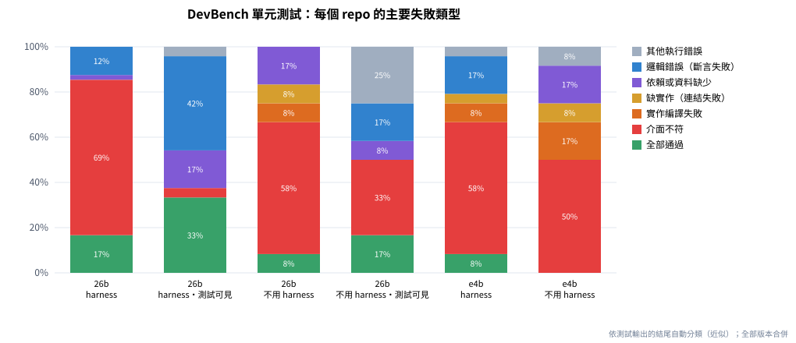

# 以本地小型語言模型驅動的 Coding Agent Harness：Python、C／C++、ROS 2 與長任務的實證評估

Coding_agent_harness 技術報告｜2026 年 10 月 8 日｜評測對象：harness v4（程式碼雜湊 1ff704a72cdc0733）與 v4.1（aa7126a221887d1e）｜模型：gemma4:e4b、gemma4:26b（本機 Ollama）

<strong>摘要</strong>　本報告評估 Coding_agent_harness——一個用本機小型開源模型（gemma4:e4b、gemma4:26b）做程式開發的 agent 框架——在三類任務上的能力：既有專案裡的日常修改（Python、C、C++、ROS 2，自建 14 個情境）、只給規格的長任務（公開基準 DevBench 的 12 個 repo）、以及非 coding 的主對話任務（19 個情境）。每一組都設有「不用 harness、直接用同一個模型」的對照組，並以重複執行、以 repo 為單位的 bootstrap 信賴區間與配對比較分析。主要發現：(1) 日常修改任務 harness 通過全部 37 次執行，對照組 71～82%；對照組寫出的功能大多正確（hidden tests 92～96%），harness 的貢獻是讓整個專案的測試保持通過。(2) 只給規格、看不到測試的長任務，harness＋26b 的單元測試通過率 9.5～24.1%（4 次）、驗收 21.6～35.3%，高於對照組（4.3%、17.6%；兩次 v4 共 11 個 repo 較好、0 個較差），但遠不到可以放手的程度；harness 的失敗有 83% 是介面（名稱、簽名、常數）與官方測試不符，編譯與連結錯誤則幾乎消失。(3) 官方測試看得到時，harness 的單元測試通過率 72～74%，對照組（看得到、不能執行）37%，差距 37 個百分點（9 勝 0 負）。(4) 用 DevBench 找到並修正了 8 類 harness 的問題，每一項都有測試證明修正本身有效；但 DevBench 的總分沒有可信的進步——同一版本重跑的差距（−13.8 個百分點）與版本之間的差距一樣大。(5) 非 coding：主對話 14 個情境維持滿分（v4：42/42）；從 coding 框架移植的把關讓模型呼叫減少約三成，但沒有提高成功率，並找到一個副作用；依此修正的 v4.1，在被針對的情境（要求重新啟動容器）從 5/10 提高到 9/10（機制吻合，但樣本仍小，p＝0.14），五個穩健性情境的整體成功率沒有可信的差異（78% 對 74%），把關最明確的效果是連續重複的工具呼叫從 20 次降到 2～4 次。結論：這個 harness 可以擔任「有測試的日常修改任務」的助手（仍需人審查），還不能擔任「只給規格的長任務」；首要的改進方向是規格介面的一致性檢查與「先寫測試」的長任務流程。

## 1. 引言

### 1.1 背景

Coding_agent_harness 從機器人維運用的 AI_agent_harness 延伸而來：主對話保留原本的技能系統與上下文管理，另外加上一個 **coding orchestrator**——先探索專案、列出計畫，使用者核准後派 coding worker 一項一項修改，每一項由程式驗證（語法、跨檔 import、C／C++ 編譯、真的 pytest 與 GoogleTest），失敗就交還、換 worker、停下來問人，最後跑整體驗證並產生報告。所有決策都用本機的小型模型。

小模型直接拿來改多檔案的專案並不可靠：會漏改呼叫端、寫錯測試、把錯誤的寫法輸出成看起來正確的程式碼、或宣稱做完卻什麼都沒做。harness 的假設是：**把「確認對不對」交給程式（編譯器、測試、靜態檢查），讓模型只負責「提出修改」**，小模型也能完成大部分日常的修改工作。這份報告檢驗這個假設在哪些範圍成立、在哪些範圍不成立。

### 1.2 研究問題

- **RQ1（日常規模的修改）**：在小到中型、已經有測試的專案裡（Python、C、C++、ROS 2），harness 能完成多少修改任務？比直接用同一個模型好多少？
- **RQ2（長任務）**：只給規格文件、從零寫出整個多檔案專案（DevBench 的實作任務），能做到多少？看得到官方測試時呢？
- **RQ3（數據集帶來的優化）**：用 DevBench 找到的框架問題修正之後，分數有沒有可信地變好？
- **RQ4（非 coding）**：從 coding 框架移植到主對話的把關，有沒有讓非 coding 的任務變好？根據量測再修正之後呢？
- **RQ5（限制與下一步）**：哪些地方還不夠、要怎麼改、還需要哪些評測？（第 6、7 節）

### 1.3 本報告的貢獻

1. 一套可以在單機（RTX 5090、不需要 Docker）重現的評測：12 個 DevBench repo（Python 7、C++ 5）、14 個自建 coding 情境（Python 6、C／C++ 5、ROS 2 3）、19 個主對話情境；全部用真的 pytest／GoogleTest 計分，評分用的測試 agent 看不到。
2. **「不用 harness」的對照組**：同一個模型、同樣的資訊、直接寫出檔案，用同一套測試計分——把 harness 本身的貢獻跟模型的能力分開。
3. 對同一個模型與版本重複執行、以 repo 為單位的 bootstrap 信賴區間、配對比較與符號檢定，讓「有沒有變好」可以用證據回答。
4. 一次完整的「量測 → 找到問題 → 修正 → 再量測」循環（v4 → v4.1，第 5.4 節），以及有量測目標的改進路線與評測計畫（第 7 節、《評估報告》）。

## 2. 相關研究與評測基準的選擇

### 2.1 程式生成與修改的評測基準

早期的基準（HumanEval、APPS）只要求寫出單一函式。**SWE-bench** [3] 改用真實 GitHub issue：給 repo 與 issue，要產生能讓隱藏測試通過的修改；每題要一個 Docker 環境，Epoch AI [8] 把全部 2290 題的映像最佳化後仍有 67 GiB（Verified 的 500 題 30 GiB），而且以 Python 為主。**SWE-bench Multilingual** [9] 有 300 題、42 個 repo、9 種語言（含 C／C++），同樣每題一個 Docker 容器。**Aider polyglot** [7] 選了 Exercism 最難的 225 題（C++、Go、Java、JavaScript、Python、Rust；其中 Python 34 題、C++ 26 題），是單一練習題的規模。

長任務方面，**DevBench** [1][2] 把軟體開發拆成設計、環境設定、實作、驗收測試、單元測試；「實作」任務只給 PRD、UML 與架構設計，從零寫出整個 repo，用官方的單元與驗收測試計分。DevEval 的公開結果中，GPT-4-Turbo-0125 的實作任務驗收測試通過率 7.1%、單元測試 8.0%（22 個 repo、四種語言、依程式碼行數加權）[2]。**NL2Repo-Bench** [6] 只給一份需求文件與空的工作區，要做出可安裝的 Python 函式庫；論文報告最強的 agent 平均測試通過率也低於 40%，失敗模式包括提早結束、失去全域一致性、跨檔依賴脆弱、規劃不足。

### 2.2 Agent 與工具介面

**SWE-agent** [4] 提出「agent-computer interface」：為模型設計專用的檔案檢視、搜尋、編輯工具（編輯時做語法檢查、輸出精簡），比直接給 shell 更有效。本 harness 的技能是同一個想法：`repo_map`、`code_view`、`code_refs`、`code_edit`（寬鬆比對、拒絕省略與改壞語法）、`code_test`（通過／失敗數由腳本算好）等，回傳第一行固定是 `[PASS]`／`[ERROR]`。DevBench 的基準 agent 是從 **ChatDev** [5]（多個角色對話的軟體開發 agent）改的。

### 2.3 為什麼選 DevBench 子集與自建情境

這台機器的條件是：單一 GPU（同時跑 Isaac Sim）、沒有 Docker 評測環境、要同時涵蓋 Python 與 C／C++、要用真的 pytest／gtest。DevBench 的實作任務剛好符合：每個 repo 只有幾十 KB、官方測試就是 pytest 與 GoogleTest、不需要容器。我們選了 12 個可以在這個環境穩定計分的 repo（排除參考實作本身就有測試失敗的、要連網站的、要 GPU 訓練的、Java／JavaScript 的），用參考實作驗證計分：單元 116/116、驗收 51/51 全部通過。

DevBench 量的是「從零寫出整個專案」，不是最常見的工作。日常更常見的是「在既有、有測試的專案裡修改」，所以另外建了 14 個情境，包含使用者實際會遇到的 ROS 2 colcon 工作區（這台主機沒有 ROS 2）。

## 3. 系統概述

### 3.1 兩層架構

- **主對話**（`agent_core/`、`web_app/`）：固定的 JSON 回覆協議（`thought`、`reply`、`action`，只有 `action` 會被執行）、技能索引＋按需載入的規格（兩階段揭露）、工具回傳存檔與回查、上下文壓縮、執行前確認、記憶、Plan 模式。42 份技能規格、41 支腳本。
- **Coding orchestrator**（`agent_core/coding_*.py`）：背景服務，一次一個 job，狀態全部寫在檔案裡（程式重新啟動可以接著做）。程式規模：`agent_core` 約 7,300 行、技能腳本約 8,800 行。

### 3.2 coding job 的流程

1. **探索**：`repo_map` 算出專案地圖（檔案、行數、類別與函式的行號、測試指令、建置系統；ROS 2 工作區列出套件）。
2. **規劃**：規劃 session 把任務拆成最多 10 項，每一項有目標、要改的檔案、參考檔案、驗證指令；harness 用程式修正計畫的常見錯誤（路徑補上目錄、拿掉只跑驗證的項目、驗證指令指向不存在的測試就拿掉、任務列出的檔案沒進計畫就補上、只准新建任務列出的檔案）。
3. **核准**：使用者在 Web 的 Coding 面板核准（評測時自動核准）。
4. **worker**：每一項派一個乾淨的 worker session（JSON 決定＋獨立的「內容通道」輸出程式碼——實測 e4b 把程式碼放進 JSON 字串時跳脫字元常出錯），最多 18 步；回報完成時由程式驗證：`code_check`（Python 的語法、未定義名稱、跨檔 import；C／C++ 用 gcc／g++ 編譯；任務附規格文件時對照函式簽名）＋這一項的驗證指令。沒過就交還；同一項最多 2 個 worker；同一個錯誤第三次就判定卡住。
5. **整體驗證**：跑整個專案的測試；沒過派一次「修正」worker，修正後通過的測試變少就還原到修正前。
6. **報告**：diff、每一項的嘗試次數與步數、驗證輸出，存成主對話可以引用的存檔。

### 3.3 程式驗證：真的 pytest 與 GoogleTest

`code_test` 一律用真的工具：Python 用專案的直譯器跑 pytest；C／C++ 依序找 CMake 註冊的測試（`cmake`→建置→`ctest`）、Makefile 的 `test` 目標、或直接用 g++ 編譯並連結 gtest。輸出由腳本整理：通過／失敗數、assert 的實際值、gtest 的期望值與實際值、編譯錯誤的「檔案:行號」與那一行原始碼。「沒有測試可跑」與「測試失敗」分得開（否則 worker 會去修不存在的問題）。工具鏈不需要 sudo（`datasets/toolchain/`）。

### 3.4 Python、C／C++、ROS 2

C／C++ 用只靠標準庫的輕量掃描器產生結構大綱與名稱索引（這台機器沒有 clang），正確性一律交給編譯器。ROS 2 的 colcon 工作區在沒有 ROS 2 的主機上：每個檔案依所屬套件決定 include 目錄；缺的標頭如果是 `package.xml`／CMake 宣告的外部依賴、或建置時才產生的（ROS 2 介面、CMake 產生的檔案），只做結構檢查並說明「不是程式的錯誤」；`code_test` 每個套件分開跑，需要 rclcpp／rclpy 的測試跳過並說明。

### 3.5 移植到主對話的把關

1. **卡住偵測**：同一回合裡同樣的動作得到同樣的結果，第 2 次附提醒；v4 在第 3 次停下這一回合；v4.1 改成第 3 次加強提醒（要它換技能或參數）、第 4 次才停，不連續但同樣的錯誤也提醒（第 5.4 節）。
2. **宣稱完成偵測**：這一回合一個工具都沒執行，回覆卻說「已經重新啟動了」之類，提醒一次。
3. **路徑建議**：`view_file`／`list_dir`／`change_dir`／`code_view` 找不到路徑時，列出相近的路徑。
4. **引號保留**：模型把指令拆成好幾個參數時，接回去要保留引號。
5. **（v4.1）`docker_runcmd` 的誤用提示**：被拿來跑 `docker start` 之類的 docker CLI 時，直接說明要用 `host_runcmd`。

## 4. 評測方法

### 4.1 模型與硬體

gemma4:e4b 與 gemma4:26b（Ollama，本機）；NVIDIA RTX 5090（32 GB，同時有 Isaac Sim 佔約 7 GB）。harness 的模型參數：num_ctx 32768；worker 的決定 temperature 0.2～0.3、內容通道 0.2；不用 harness 的對照組用跟內容通道一樣的參數。e4b 是主對話預設的模型，26b 是建議給 coding job 的模型。

### 4.2 基準與任務

| 代號 | 基準 | 規模 | 計分 |
|---|---|---|---|
| B1 | 自建 coding 情境（`datasets/custom_coding_scenarios/`） | 14 個：Python 6（新增方法＋改行為、跨檔改名＋CLI、照使用範例的多檔功能、除錯不能改測試、照規格建新模組、5 個檔案的長任務）、C／C++ 5（CMake＋gtest、Makefile＋gtest）、ROS 2 3（ament_cmake 與 ament_python 套件，主機沒有 ROS 2） | 全部檢查都成立才算通過：hidden tests（agent 看不到）、整個專案的測試、不准改的檔案、改名後舊名稱不能出現、檔案內容條件 |
| B2 | DevBench 實作任務子集（`datasets/devbench_subset/`） | 12 個 repo（Python 7、C++ 5，160～670 行），單元測試 116 個、驗收測試 51 個 | 官方測試換回原本的版本後計分：通過的測試數÷總數 |
| B3 | 主對話情境（`datasets/main_session_scenarios/`） | 14 個機器人維運情境（容器、ROS 2、調度系統、存檔回查、記憶、coding 路由；外部世界用假資料） | 每一句使用者訊息的條件（回覆內容、用了哪些工具、沒用哪些工具、有沒有經過確認…） |
| B4 | 主對話的穩健性情境 | 5 個：檔名大小寫打錯、目錄名稱少一個字、要讀的檔案不存在、要求重新啟動容器、指令裡有引號與分號 | 同上，另外記錄主模型呼叫次數、重複的工具呼叫、撞到步數上限、卡住偵測停下的次數 |

### 4.3 實驗條件

- **harness**：完整的 coding job（自動核准，失敗就跳過，不停下來問）。
- **不用 harness（對照組）**：同一個模型、同樣的任務文字與資訊，**沒有工具、沒有編譯與測試的回饋、沒有重試**。B2：照 DevBench 的檔案順序，一個檔案呼叫一次模型寫出整份檔案，前面寫好的檔案放進提示，最後再呼叫一次補上清單以外的檔案（`__init__.py`、makefile）；程式在 `evals/devbench/bare.py`。B1：把任務與專案全部檔案的內容給模型，一次輸出所有要新增或修改的檔案（`evals/bare_coding_baseline.py`）。這代表「把專案貼進聊天視窗請模型改」的做法。
- **官方測試看得到**（B2）：harness 組把官方測試放在工作區、可以用 `code_test` 執行（DevBench 基準 agent 的設定）；對照組把測試的內容放進提示（看得到、不能執行）。
- **把關開關**（B4）：環境變數 `AGENT_ABLATE=turn_guard,path_suggest,rejoin[,docker_hint]` 關掉第 3.5 節的把關；`AGENT_TURN_GUARD_RULE=v4` 換回 v4 的卡住規則（只給評測用）。

### 4.4 版本

| 版本 | 時間 | 內容 |
|---|---|---|
| v0 | 2026-10-07 | 第一版 coding orchestrator（只有 Python、內建的測試 runner） |
| v1 | 2026-10-08 凌晨 | C／C++、真的 pytest／gtest、規格文件整份給 worker 並對照簽名、計畫的程式修正 |
| v2 | 2026-10-08 清晨 | DevBench 找到的修正：任務清單的檔案進計畫、worker 不能新建清單外的檔案、指令的引號、物件檔清理 |
| v3 | 2026-10-08 上午 | 整體修正讓通過的測試變少就還原 |
| v4 | 2026-10-08 14:37 | ROS 2 工作區、.gitignore、套件內相對路徑的防呆、`-iquote`、評測用的對照開關（`artifacts/` 有快照） |
| v4.1 | 2026-10-08 19:54 | 卡住偵測第 4 次才停（第 3 次加強提醒）、`docker_runcmd` 誤用時的提示（`artifacts/` 有快照） |

### 4.5 指標與統計方法

- 通過率的 95% 信賴區間：二項比例用 **Wilson score interval**。
- DevBench：同一個 repo 的測試彼此高度相關（介面名稱錯了，整個 repo 的測試一起失敗），所以用「**以 repo 為單位重抽樣**」的 bootstrap（B＝10000，固定亂數種子）算合併通過率的 95% 區間；另外列「每個 repo 通過率的平均」（每個 repo 權重相同）與 DevBench 論文用的「依程式碼行數加權」。兩種條件的差用同一個 repo 配對的 bootstrap，再用**符號檢定**看「幾個 repo 變好、幾個變差」。
- 樣本數都小，所以報告一律附區間；區間重疊很多時，結論是「看不出差別」，不是「沒有差別」。
- 分析程式只用標準庫（`analysis/`），從原始紀錄（`results/raw/`）重新算出全部表格與圖。

### 4.6 實驗清單

| 代號 | 內容 | 條件與次數 |
|---|---|---|
| E1 | DevBench（官方測試看不到）、harness | e4b v1、v2 各 1 次；26b v1、v2 各 1 次、v4 2 次 |
| E2 | DevBench（看不到）、不用 harness | e4b、26b 各 1 次 |
| E3 | DevBench（官方測試看得到） | harness 26b v2、v4 各 1 次；不用 harness 26b 1 次 |
| E4 | 自建 14 個情境 | harness：各版本（v4：e4b 20 次、26b 17 次）；不用 harness：e4b、26b 各 28 次（每個情境 2 次） |
| E5 | 主對話 14 個情境（回歸） | 各版本；v4 42 次（3 輪）；v4.1 28 次（2 輪） |
| E6 | 穩健性 5 個情境（v4） | 把關開、關各 15 次 |
| E7 | 穩健性 5 個情境（v4.1） | v4.1、v4 的規則、全部關閉，各 50 次 |

## 5. 結果

### 5.1 RQ1：日常規模的修改任務（B1，自建 14 個情境）

表 1 是 v4 的結果（ROS 2 的 3 個情境多跑了幾次，所以次數不是 14 的倍數）。harness 在兩個模型上都通過了全部的執行（e4b 20/20、26b 17/17）。不用 harness 的對照組（每個情境 2 次）：e4b 20/28（71.4%）、26b 23/28（82.1%）。以情境配對：e4b 有 6 個情境 harness 較好、0 個較差（符號檢定 p＝0.031），26b 是 3 比 0（p＝0.25，樣本不足以下結論）。

**表 1　自建 14 個情境（v4）：harness 與不用 harness**

| 模型 | 條件 | 通過（全部檢查） | 通過率 [Wilson 95% CI] | hidden tests 通過 | 平均秒數 | 平均模型呼叫 |
|---|---|---|---|---|---|---|
| gemma4:e4b | harness | 20/20 | 100.0% [83.9, 100.0] | 19/19（100%） | 33 | 25 |
| gemma4:e4b | 不用 harness | 20/28 | 71.4% [52.9, 84.7] | 25/26（96.2%） | 5 | 1 |
| gemma4:26b | harness | 17/17 | 100.0% [81.6, 100.0] | 16/16（100%） | 27 | 19 |
| gemma4:26b | 不用 harness | 23/28 | 82.1% [64.4, 92.1] | 24/26（92.3%） | 5 | 1 |

（hidden tests 的次數比較少，是因為「除錯、不能改測試」的情境沒有 hidden tests，只檢查不准改的檔案與整個專案的測試。每個情境的結果在附錄 B。）

**失敗的類型比通過率更重要。**只看 hidden tests（功能本身對不對），對照組其實很高：e4b 25/26、26b 24/26。對照組的失敗大多不是「功能寫錯」，而是「整個專案沒有保持全部測試通過」：它自己加的測試有錯（測試裡用了沒有 import 的 `Item`、把邊界值的期望寫反），或多檔案的修改彼此不一致（e4b 的 5 個檔案長任務 `long_category_feature` 0/2、ROS 2 的 `ros2_cpp_compose` 0/2）。e4b 的 8 次失敗有 7 次屬於這一類、26b 的 5 次有 3 次。harness 的貢獻正是這一塊：每一項做完就由程式跑測試，錯了交還 worker 修，最後整個專案的測試要通過。

**這個比較低估了 harness 在真實專案的必要性。**對照組做得到，是因為範例專案很小（10～25 個檔案，整個專案可以放進提示）；真實的專案做不到（使用者的 ROS 2 工作區有 2,594 個檔案），這時 harness 的探索工具是前提。另一方面，這 14 個情境是本專案自己寫的、也被用來調整 harness（第 6.4 節），分數偏樂觀。

v4 的 ROS 2 情境本身經歷過一次「量測 → 修正」：第一次跑 e4b 只有 1/3（任務寫的是套件裡的相對路徑「在 test/test_battery.py 加測試」，`code_edit` 回「不存在，建立新檔請用 code_write」，worker 就在工作區根目錄另建了一個測試檔）；修正後（goal 的路徑補成完整路徑、新建既有檔案的結尾路徑時擋下並指出那個檔案）e4b 9/9、26b 6/6。

### 5.2 RQ2：長任務（B2，DevBench）

表 2 是全部的 DevBench 執行。「合併通過率」是通過的測試÷全部測試；「每個 repo 的平均」讓每個 repo 權重相同（graph-cpp 一個 repo 就有 22 個單元測試，合併通過率容易被它左右）。

**表 2　DevBench 的全部執行（12 個 repo，單元 116、驗收 51）**

| 模型 | 版本 | 條件 | 官方測試 | 單元 | 單元通過率 [95% CI] | 驗收 | 驗收通過率 [95% CI] | 每個 repo 的平均（單元／驗收） | 分鐘 | 模型呼叫 |
|---|---|---|---|---|---|---|---|---|---|---|
| 26b | — | 不用 harness | 看不到 | 5/116 | 4.3% [0.0, 17.2] | 9/51 | 17.6% [2.1, 40.4] | 8.3%／21.4% | 2.5 | 64 |
| 26b | v1 | harness | 看不到 | 14/116 | 12.1% [2.5, 30.5] | 18/51 | 35.3% [14.6, 62.8] | 23.2%／39.2% | 147 | 924 |
| 26b | v2 | harness | 看不到 | 11/116 | 9.5% [1.4, 26.0] | 11/51 | 21.6% [6.7, 42.2] | 19.9%／27.6% | 89 | 686 |
| 26b | v4 第 1 次 | harness | 看不到 | 28/116 | 24.1% [8.3, 44.8] | 14/51 | 27.5% [13.0, 46.7] | 30.8%／32.1% | 44 | 716 |
| 26b | v4 第 2 次 | harness | 看不到 | 12/116 | 10.3% [2.1, 27.6] | 14/51 | 27.5% [9.6, 50.8] | 22.0%／29.2% | 35 | 724 |
| e4b | — | 不用 harness | 看不到 | 1/116 | 0.9% [0.0, 3.2] | 7/51 | 13.7% [0.0, 36.2] | 1.2%／11.7% | 3.4 | 64 |
| e4b | v1 | harness | 看不到 | 22/116 | 19.0% [0.0, 46.1] | 0/51 | 0.0% [0.0, 0.0] | 13.5%／0.0% | 187 | 1310 |
| e4b | v2 | harness | 看不到 | 9/116 | 7.8% [0.0, 23.6] | 8/51 | 15.7% [0.0, 38.6] | 17.9%／20.0% | 141 | 1149 |
| 26b | — | 不用 harness | **看得到** | 43/116 | 37.1% [9.3, 61.7] | 16/51 | 31.4% [8.8, 57.9] | 32.5%／31.2% | 3.6 | 64 |
| 26b | v2 | harness | **看得到** | 84/116 | 72.4% [47.9, 88.1] | 18/51 | 35.3% [15.6, 59.5] | 67.7%／41.2% | 92 | 1574 |
| 26b | v4 | harness | **看得到** | 86/116 | 74.1% [46.9, 89.6] | 21/51 | 41.2% [21.2, 66.0] | 66.3%／49.0% | 118 | 1634 |

**(1) 看不到官方測試（只有規格）時，分數低而且變異大。**harness＋26b 四次的單元測試合併通過率 9.5～24.1%、驗收 21.6～35.3%；e4b 兩次單元 7.8～19.0%、驗收 0～15.7%。信賴區間都很寬，因為結果幾乎是「一個 repo 全過或全掛」。

**(2) harness 比直接用模型好，但只看規格時差距中等。**同一個模型直接寫：26b 單元 4.3%、驗收 17.6%；e4b 單元 0.9%、驗收 13.7%。以 repo 配對（表 3）：26b 的兩次 v4 都比直接寫好（單元 +19.8、+6.0 個百分點；兩次合計 11 個 repo 較好、0 個較差），驗收的差距不顯著。代價是時間與呼叫次數：harness 每個 repo 平均 57～77 次模型呼叫，直接寫 5.3 次。

**(3) 有測試可以對照時，情況完全不同。**官方測試放在工作區、可以執行時，harness＋26b 的單元測試 72.4%（v2）、74.1%（v4）；把測試的**內容**放進提示、但不能執行的直接寫：37.1%。可以拆成兩段來看：
- 只是「看得到」測試：從 4.3% 到 37.1%，多約 33 個百分點——測試告訴模型該用哪些名稱、簽名與行為。
- 再加上「能執行、看到錯誤、修改」（harness）：從 37.1% 到 74.1%，再多 37 個百分點（配對：9 個 repo 較好、0 個較差，p＝0.004）。

驗收測試在各條件下大多在 20～40% 之間，差距不顯著：驗收測試多半執行完整的命令列程式、逐字比對輸出，規格的細節比單元測試更難猜中。

**表 3　harness 與不用 harness 的配對比較（同一個模型、同樣的測試可見度；括號是 bootstrap 95% CI）**

| 模型 | 官方測試 | harness 的那一次 | 單元：harness − 不用 harness | 驗收：harness − 不用 harness |
|---|---|---|---|---|
| 26b | 看不到 | v4 第 1 次 | +19.8 個百分點 [5.7, 37.9]；勝 7／負 0／平 5（p＝0.02） | +9.8 [−19.6, 36.6]；勝 5／負 1／平 6（p＝0.22） |
| 26b | 看不到 | v4 第 2 次 | +6.0 [0.8, 16.3]；勝 4／負 0／平 8（p＝0.12） | +9.8 [−2.7, 27.6]；勝 3／負 1／平 8（p＝0.62） |
| 26b | 看得到 | v4 | +37.1 [18.3, 61.5]；勝 9／負 0／平 3（p＝0.004） | +9.8 [−13.5, 36.7]；勝 5／負 2／平 5（p＝0.45） |
| e4b | 看不到 | v2 | +6.9 [0.0, 22.6]；勝 2／負 0／平 10（p＝0.50） | +2.0 [0.0, 7.7]；勝 1／負 0／平 11（p＝1.00） |

### 5.3 RQ3：用 DevBench 找到的問題修正之後，有沒有變好？

**(a) DevBench 找到並修正的問題。**v1→v2→v4 之間，DevBench 的失敗讓我們找到並修正了下面這些 harness 的問題；每一項都有針對它的離線測試（`evals/coding_selftest.py`，假模型、真的 pytest／gtest），證明修正本身有效：

| 問題（在 DevBench 怎麼發現的） | 修正 | 怎麼確認修正有效 |
|---|---|---|
| 指令的引號被吃掉：worker 送 `python3 -c "…"`，harness 拆成好幾個參數再用空白接回去，引號不見——模型完全不可能修好（chakin 卡在這裡） | 接回去時保留引號（主對話的 `host_runcmd`／`docker_runcmd` 一起改） | 自我測試；E6／E7 的 `robust_quoting` |
| 規格裡的預設值被寫成必要參數（readtime 的 `of_text(text, wpm)`，PRD 說預設 265，8 個測試全部 TypeError） | 任務附的規格文件整份給每個 worker；驗證時對照規格的函式簽名 | 自我測試；12 個參考實作沒有誤報 |
| 任務列了 4 個要寫的檔案，計畫只做 1 個，job 卻顯示完成（hone 0/7） | 任務一行一個列出的檔案沒進計畫就補上 | 自我測試 `t_listed_files` |
| 計畫多加了官方建置檔不編的 `src/Circle.cpp`，測試連結失敗 | 任務明確列出檔案時，只准新建那些檔案（計畫與 worker 兩層） | 自我測試 `t_listed_files` |
| 驗證指令指向不存在的測試、或把 prompt 範例的 `python3 -m inventory.cli` 抄進 C++ 專案 | 規劃階段由程式拿掉 | 自我測試 |
| `makefile_test` 要的測試檔不存在，被當成程式寫錯，worker 去修不存在的問題 | 區分「沒有測試可跑」與「測試失敗」 | 自我測試 `t_cpp_scripts` |
| 測試在模組層級替換 `sys.modules`，污染同一次 pytest 的其他測試（換成真的 pytest 後才看得到） | `code_check` 報錯 | 自我測試 |
| 整體驗證的修正把程式改壞，報告卻寫著修正前的結果（測試可見的那一次） | 修正前記下狀態；修正後通過的測試變少就還原 | 自我測試 `t_fix_must_not_regress` |

**(b) 總分有沒有可信地變好？**表 4 把同一個模型、同樣條件的任兩次放在一起比。

**表 4　同一條件的任兩次執行之差（後 − 前，單位：百分點；括號是配對 bootstrap 95% CI）**

| 模型 | 官方測試 | 比較 | 類型 | 單元 | 驗收 |
|---|---|---|---|---|---|
| 26b | 看不到 | v1 → v2 | 不同版本 | −2.6 [−7.6, 0.0] | −13.7 [−35.6, 1.8] |
| 26b | 看不到 | v2 → v4 第 1 次 | 不同版本 | +14.7 [1.6, 32.3] | +5.9 [0.0, 11.4] |
| 26b | 看不到 | v2 → v4 第 2 次 | 不同版本 | +0.9 [0.0, 3.5] | +5.9 [−15.7, 30.0] |
| 26b | 看不到 | **v4 第 1 次 → v4 第 2 次** | **同一版本重跑** | **−13.8 [−31.3, 0.0]** | +0.0 [−21.4, 25.5] |
| 26b | 看得到 | v2 → v4 | 不同版本 | +1.7 [−10.1, 13.1] | +5.9 [−4.3, 20.8] |
| e4b | 看不到 | v1 → v2 | 不同版本 | −11.2 [−39.1, 12.5] | +15.7 [0.0, 38.9] |

- **同一版本重跑，單元測試就差了 13.8 個百分點**——跟 v2→v4 第 1 次的「進步」（+14.7）一樣大；v2→v4 第 2 次只有 +0.9。
- v1→v2：兩個模型的變化方向相反，區間都包含 0。看得到測試時 v2→v4：+1.7，區間包含 0。
- **單一 repo 的「名稱運氣」可以主導總分。**graph-cpp 的文件自己不一致（UML 類別圖寫 `setVexer`，架構設計與循序圖寫 `setVexes`，官方測試用後者）：v2 的兩個類別一個用 `setVexer`、一個用 `setVexes`，測試一編譯就失敗（0/22）；v4 第 1 次兩個都用 `setVexes`（12/22）；v4 第 2 次又回到 0/22；e4b 的 v1 也曾經 18/22。這 22 個單元測試佔全部的 19%。

**(c) 結論**：用 DevBench 找到的是真的問題，修正本身都有測試證明有效；但**這些修正沒有讓 DevBench 的總分出現可信的進步**——在目前的樣本數下，版本之間的差距落在同一版本重跑的變異之內。原因是這些修正處理的是「讓任務有機會做對」的必要條件（指令能執行、檔案有建立、測試結果判讀正確），而長任務最主要的失分——介面與規格／測試不一致（第 6.3 節）——還沒有被處理。要讓「有沒有變好」能被量出來，需要：每個版本至少 3 次、固定評測版本、改動直接針對主要失敗原因。

### 5.4 RQ4：非 coding 任務（B3、B4）

**主對話的 14 個情境已經在天花板。**表 5 是各版本的結果：v4 42/42（3 輪）、v4.1 27/28（2 輪；唯一的失敗是模型把 `Inventory` 說成定義在 `models.py`，讀錯了專案地圖，跟這次的修改無關）。加上 coding orchestrator 與第 3.5 節的把關之後沒有退步；但也因為已經接近 100%，這組情境**量不出改善**。（同一時期的參考：AI_agent_harness 的另一種上下文模式 claude_code 只有 70/96，是那個專案當時選擇 harness 模式的依據。）

**表 5　主對話 14 個情境（e4b 為主）**

| 版本 | 上下文模式 | 模型 | 通過 | 通過率 [Wilson 95% CI] | 每個情境的主模型呼叫 |
|---|---|---|---|---|---|
| AI_agent_harness（2026-09-27） | harness | e4b | 83/84 | 98.8% [93.6, 99.8] | 4.1 |
| AI_agent_harness（2026-09-27） | claude_code | e4b | 70/96 | 72.9% [63.3, 80.8] | 4.7 |
| AI_agent_harness（2026-09-27） | harness | 26b | 39/42 | 92.9% [81.0, 97.5] | 3.8 |
| v0 | harness | e4b | 20/20 | 100.0% [83.9, 100.0] | 3.4 |
| v1 | harness | e4b | 14/14 | 100.0% [78.5, 100.0] | 3.5 |
| v4 | harness | e4b | 42/42 | 100.0% [91.6, 100.0] | 3.6 |
| v4.1 | harness | e4b | 27/28 | 96.4% [82.3, 99.4] | 3.5 |

**把關的消融實驗（E6，v4）。**為了量把關本身的效果，設計了 5 個「小模型容易出錯」的穩健性情境（B4），把關開啟與關閉各跑 15 次（每個情境 3 次）：

- **成功率沒有變好**：開啟 11/15、關閉 13/15，區間大幅重疊。開啟時 `robust_typo_file` 的兩次失敗，模型看完專案地圖就停了、還沒碰到路徑錯誤——跟把關無關，是模型的隨機性。
- **效率變好**：每個情境的主模型呼叫從 7.5 次降到 5.3 次（−29%），連續重複同一個工具呼叫從 5 次降到 0 次。
- **找到一個副作用**：`robust_claim`（要求重新啟動停止的容器）有一次，模型連續用 `docker_runcmd`（在容器「裡面」執行）去跑 `docker start`，第 3 次同樣的錯誤時卡住偵測停下了這一回合；關閉把關時，模型多試幾次後自己改用 `host_runcmd` 就成功了。也就是「第 3 次就停」會切斷模型自己換做法的機會；而 `docker_runcmd` 的錯誤訊息沒有告訴它該用哪個技能。

**根據 E6 修正並再驗證（E7，v4.1）。**針對這兩點做了 v4.1（第 3.5 節：第 3 次加強提醒、第 4 次才停、不連續的同樣錯誤也提醒；`docker_runcmd` 誤用時提示改用 `host_runcmd`），用更大的樣本（每個條件 50 次，每個情境 10 次）比較三個條件：v4.1、v4 的規則（第 3 次就停、沒有 docker 提示）、把關全部關閉。

**表 7　穩健性情境（E7，e4b，每格 10 次）**

| 情境 | v4.1 把關開啟 | v4 的規則（第 3 次就停、沒有 docker 提示） | 把關全部關閉 |
|---|---|---|---|
| 要求重新啟動容器（claim，這次修正針對的情境） | **9/10** | 5/10 | 6/10 |
| 指令裡有引號與分號（quoting） | 10/10 | 10/10 | 9/10 |
| 要讀的檔案不存在（stuck_error） | 10/10 | 10/10 | 10/10 |
| 目錄名稱少一個字（typo_dir） | 5/10 | 7/10 | 4/10 |
| 檔名大小寫打錯（typo_file） | 5/10 | 5/10 | 8/10 |
| **合計** | **39/50（78.0% [64.8, 87.2]）** | **37/50（74.0% [60.4, 84.1]）** | **37/50（74.0% [60.4, 84.1]）** |
| 每個情境的主模型呼叫 | 6.3 | 5.8 | 7.1 |
| 連續重複同一個工具呼叫（合計） | 4 | 2 | 20 |
| claim：改用 `host_runcmd` 的次數 | 9/10 | 5/10 | 6/10 |
| claim：用 `docker_runcmd` 跑 docker CLI 的次數 | 4 | 11 | 8 |
| claim：被卡住偵測停下 | 0 | 1 | 0 |

- **被針對的情境變好了，機制也吻合**：要求重新啟動容器的情境，v4.1 9/10、v4 的規則 5/10、全部關閉 6/10。v4.1 下模型 9/10 次改用 `host_runcmd`（v4 的規則 5/10），誤用 `docker_runcmd` 4 次（11 次），沒有被卡住偵測切斷（1 次）。但每格只有 10 次，Fisher 檢定 p＝0.14，方向一致、還不到統計顯著。
- **整體成功率沒有可信的差異**：78%、74%、74%，區間大幅重疊（p＝0.82）。路徑打錯、引號、檔案不存在這幾個情境，模型多半自己就能處理。
- **效率是把關最明確的效果**：連續重複同一個工具呼叫，關閉時 20 次、開啟時 2～4 次；主模型呼叫少 11～18%。
- **一個尚未解釋的現象**：檔名打錯的情境，把關開啟時較差（E6＋E7 合計 11/23 對 11/13，單看 p＝0.039，但這是多個情境的多重比較之一，校正後不顯著）。失敗都發生在路徑錯誤之前：模型看完專案地圖就停下來問「要不要我查看檔案內容」，把關在那個時間點還沒有起任何作用，找不到因果機制。比較可能是模型「該做卻先問」的傾向；下一步要用更多次數、並針對這個傾向（使用者已經明確要求時直接做）再量一次。

**RQ4 的結論**：非 coding 任務方面，主對話維持滿分；從 coding 移植的把關主要提升效率（重複呼叫大幅減少），沒有提高整體成功率；根據量測做的 v4.1 修正讓被針對的情境改善，但要更大的樣本才能確認。

### 5.5 成本

| 任務 | harness | 不用 harness |
|---|---|---|
| 自建情境（每個情境） | 27～33 秒、19～25 次模型呼叫 | 5 秒、1 次 |
| DevBench，看不到測試（12 個 repo，26b） | 35～147 分鐘、686～924 次 | 2.5 分鐘、64 次 |
| DevBench，看得到測試（12 個 repo，26b） | 92～118 分鐘、1574～1634 次 | 3.6 分鐘、64 次 |
| 主對話（每個情境） | 3.6 次主模型呼叫（v4） | — |

harness 用的呼叫次數是直接寫的 10～25 倍。26b 是 MoE 模型，這台機器上每秒約 250 個 token，所以一個 DevBench repo 平均 3～10 分鐘；同一條件的時間差異（v1 147 分鐘、v4 35～44 分鐘）有一部分來自同時在跑的程式（Isaac Sim），時間只能當參考。

## 6. 討論

### 6.1 這個 harness 能不能擔任「大多數 coding」的角色？

**在「既有、有測試的中小型專案裡修改」這個範圍：可以，作為需要人審查的助手。**自建的 14 個情境（新增功能、跨檔改名、除錯、照規格建新模組、5 個檔案的長任務；Python、C、C++、ROS 2），v4 在兩個模型上全部的執行都通過（37/37），用的是 agent 看不到的測試；同一個模型直接寫是 71～82%。harness 的價值在「讓整個專案保持全部測試通過」。

這個結論有三個限制：(1) 情境是本專案自己寫的，偏樂觀；(2) 範例專案很小，沒有量到「在大專案裡找到該改的地方」（第 7 節的評測計畫）；(3) 只量功能，沒有量程式碼品質。準確的說法是：**這類任務它多半做得對，但仍要看 diff。**

### 6.2 長任務 coding 呢？

**只給規格、從零寫出整個專案（看不到測試）：還不行。**harness＋26b 的官方單元測試通過率 9.5～24.1%、驗收 21.6～35.3%。這個量級跟 DevEval 公開的 GPT-4-Turbo（驗收 7.1%、單元 8.0%）[2] 與 NL2Repo-Bench 的「最強的 agent 平均測試通過率也低於 40%」[6] 一致——長任務對所有模型都難；我們的數字不能直接跟它們比（子集、agent、協定都不同），只能說明難度的量級。harness 比直接用模型好（兩次 v4 共 11 個 repo 較好、0 個較差），但差距不足以改變結論。

**有測試可以對照時，情況完全不同**：單元測試 72～74%，是直接寫（看得到測試內容）的兩倍。實務上的意思是：**長任務要先準備測試（或由規格產生測試），再交給它**——這也是第 7 節路線第 2 項的依據。

### 6.3 失敗原因分析：長任務為什麼分數低

把 DevBench 每個 repo、每一次的單元測試輸出依結尾自動分類（`analysis/collect.py`；只看得到最後 3000 字，屬近似）：

**表 6　DevBench 單元測試的主要失敗類型（每個 repo、每一次一筆，全部版本合併）**

| 條件 | 筆數 | 全部通過 | 介面不符 | 實作編譯失敗 | 缺實作（連結失敗） | 依賴或資料缺少 | 邏輯錯誤（斷言失敗） | 其他 |
|---|---|---|---|---|---|---|---|---|
| 26b harness（看不到） | 48 | 8 | 33 | 0 | 0 | 1 | 6 | 0 |
| 26b 不用 harness（看不到） | 12 | 1 | 7 | 1 | 1 | 2 | 0 | 0 |
| e4b harness（看不到） | 24 | 2 | 14 | 2 | 1 | 0 | 4 | 1 |
| e4b 不用 harness（看不到） | 12 | 0 | 6 | 2 | 1 | 2 | 0 | 1 |
| 26b harness（看得到） | 24 | 8 | 1 | 0 | 0 | 4 | 10 | 1 |
| 26b 不用 harness（看得到） | 12 | 2 | 4 | 0 | 0 | 1 | 2 | 3 |

三個觀察：

1. **harness（26b）幾乎消除了「建置層級」的失敗。**直接寫時 11 次失敗有 4 次是實作編譯失敗、連結失敗（宣告了沒實作）、用了環境沒有的套件；harness 的 40 次失敗裡這類只有 1 次——每一項都要編譯、測試，這類錯誤會被交還修好。
2. **剩下的幾乎都是「介面不符」**（26b harness 40 次失敗裡 33 次，83%）：官方測試用到的類別、方法、常數、模組名稱或簽名，跟 agent 寫的對不上，整批測試在收集或編譯時就失敗。agent 自己寫的測試是照自己的介面寫的，所以全部通過——harness 的測試回饋對這種錯無能為力。
3. **官方測試看得到時，介面不符幾乎消失**（16 次失敗只剩 1 次），剩下的是邏輯錯誤與資料缺少。

再把「介面不符」的名稱抽出來，對照規格文件（26b harness v2 為例）：

| repo | 測試要、程式沒有（或簽名不同）的名稱 | 規格裡有沒有 | 屬於 |
|---|---|---|---|
| stocktrends | `PERIOD_CLOSE` | 有（UML 類別圖、PRD） | agent 漏做 |
| lice | `LICENSES` | 有（UML 類別圖） | agent 漏做 |
| hone | `hone.utils.test_utils` | 有（架構設計） | agent 漏做 |
| people_management | `Global::handle_options` 的簽名 | 有 | agent 寫錯 |
| readtime | `wpm`（預設值）、`split` | `wpm` 有、`split` 沒有 | 大多是 agent |
| graph-cpp | `setVexes` | 有，但 UML 類別圖寫 `setVexer`（文件自己矛盾） | 文件不一致 |
| chakin | 模組層級的 `urlretrieve`（測試用 mock 替換它） | 沒有 | 規格沒寫 |
| xlsx2csv | namespace `my_xlsx::xlsx_reader` | 沒有（文件說「不建 namespace 也可以」） | 規格與測試矛盾 |

8 個裡有 6 個的名稱寫在規格裡——**這是 harness 可以改進的地方**：規劃前把規格裡的介面抽成清單、每一項對照（第 7 節路線第 1 項）。另外 2 個是規格本身的缺口，只看規格的任何 agent 都做不到。

### 6.4 效度威脅

- **自建情境偏樂觀**：B1 的 14 個情境是本專案自己寫的，也被拿來找問題、改 prompt 與檢查規則；分數高代表「這些類型的任務做得到」，不代表陌生的專案同樣高。
- **DevBench 被用來開發**：v1→v2 的修正就是看 DevBench 的失敗找出來的，再用同一組 repo 量，有過度擬合的風險；而且只有 12 個 repo、每個條件 1～2 次。
- **樣本數小、模型有隨機性**：temperature 0.2～0.3 仍有變異；同一版本重跑，DevBench 的單元通過率就差 13.8 個百分點。
- **測試即標準**：hidden tests 與官方測試只檢查它們涵蓋到的行為；通過不等於程式碼品質好（可讀性、效能、安全性沒有量）。
- **單一環境**：一台機器、兩個模型（同一家族）、一種量化；換模型或硬體結果可能不同。
- **對照組的設計**：「不用 harness」是我們設計的單次生成流程，不是其他公開的 agent；它回答的是「harness 比直接用模型多做到多少」，不是「比別的 agent 好多少」。
- **失敗分類是近似的**：依測試輸出的結尾、用規則分類，個別 repo 可能分錯類。

### 6.5 安全觀察

評測中有一次 agent 執行的程式真的連上了網路：DevBench 的 chakin 是詞向量的下載工具，v4 第 2 次的 worker 為了驗證自己寫的程式，用 `code_run` 執行了 `python3 -c 'import chakin; …; chakin.download(number=0, save_dir="./test_out")'`，工作區留下 268 MB 從網路下載的資料檔（已從評測封存移除，留下說明檔）。`code_run` 的指令檢查擋得住 `curl`、`wget`、套件安裝這類指令，但擋不住「agent 自己寫的程式」去連網路。這不是 harness 的 bug，而是目前的設計沒有網路隔離；後續工作把它列為優先項目（agent 執行的程式預設沒有網路）。

## 7. 結論與後續工作

1. **日常修改任務（有測試的中小型專案）**：harness 可靠地完成任務、讓整個專案保持測試通過（37/37，對照組 71～82%）。可以交給它，但要審查 diff。
2. **長任務（只給規格）**：還不行（單元 10～24%、驗收 22～35%）；harness 比直接用模型好，但主要的失分——介面與規格／測試不一致（83%）——還沒有被處理。
3. **長任務（有測試）**：單元 72～74%，是 harness 最強的工作方式。
4. **數據集帶來的優化**：DevBench 找到並修好了 8 類真的問題，但總分沒有可信的進步（版本差距在重跑的變異之內）。真正的進步要針對主要失敗原因，並用重複執行與信賴區間來確認。
5. **非 coding**：主對話維持滿分（v4 42/42、v4.1 27/28）；把關主要提升效率（重複的工具呼叫從 20 次降到 2～4 次），沒有提高整體成功率；根據量測修正的 v4.1 讓被針對的情境從 5/10 提高到 9/10（方向與機制一致，樣本仍小）。

**後續工作**（詳見《評估報告》第六、七節）：

| 優先 | 項目 | 量測目標 |
|---|---|---|
| 1 | 規格的介面清單與一致性檢查（處理 83% 的長任務失敗） | DevBench（看不到測試、26b、3 次平均）單元 ≥ 25%、驗收 ≥ 35% |
| 2 | 長任務先由規格產生驗收測試，再實作 | 驗收 ≥ 40%，時間增加 ≤ 30% |
| 3 | agent 執行的程式加上網路隔離（第 6.5 節） | agent 的程式預設連不到外部網路 |
| 4 | 在 ROS 2 容器裡建置與測試（`colcon build`／`colcon test`） | ROS 2 情境的 rclcpp 測試可以執行 |
| 5 | 新的評測：Aider polyglot（Python 34 題＋C++ 26 題）、SWE-bench Verified 子集、NL2Repo-Bench 子集、使用者自己的 10～20 個任務 | 每個基準有 ≥ 2 次的基準線 |
| 6 | 模型比較：qwen2.5-coder:32b（已下載）、gemma4:31b、「規劃用大模型、worker 用小模型」 | 找出成功率／時間最好的組合 |

## 參考文獻

1. B. Li, W. Wu, Z. Tang, L. Shi, et al. *DevBench: A Comprehensive Benchmark for Software Development*. arXiv:2403.08604 v1, 2024（後續版本題為 *Prompting Large Language Models to Tackle the Full Software Development Lifecycle: A Case Study*）。本地：`references/papers/DevBench_2403.08604v1.pdf`
2. open-compass/DevEval（commit bb593c1f）：程式（Apache 2.0）與資料（CC BY 4.0），README 的評測結果表。https://github.com/open-compass/DevEval 。本地：`references/devbench_source/`
3. C. E. Jimenez, J. Yang, A. Wettig, et al. *SWE-bench: Can Language Models Resolve Real-World GitHub Issues?* ICLR 2024, arXiv:2310.06770。本地：`references/papers/SWE-bench_2310.06770.pdf`
4. J. Yang, C. E. Jimenez, A. Wettig, et al. *SWE-agent: Agent-Computer Interfaces Enable Automated Software Engineering*. arXiv:2405.15793。本地：`references/papers/SWE-agent_2405.15793.pdf`
5. C. Qian, W. Liu, H. Liu, et al. *ChatDev: Communicative Agents for Software Development*. arXiv:2307.07924。本地：`references/papers/ChatDev_2307.07924.pdf`
6. *NL2Repo-Bench: Towards Long-Horizon Repository Generation Evaluation of Coding Agents*. arXiv:2512.12730。本地：`references/papers/NL2Repo-Bench_2512.12730.pdf`
7. Aider. *o1 tops aider's new polyglot leaderboard*（polyglot 基準的說明），2024-12-21。https://aider.chat/2024/12/21/polyglot.html 。本地：`references/web/`
8. T. Adamczewski（Epoch AI）. *How to run SWE-bench Verified in one hour on one machine*, 2025-07-10。https://epoch.ai/blog/swebench-docker 。本地：`references/web/`
9. EvalScope 文件：*SWE-bench_Multilingual_Agentic*。https://evalscope.readthedocs.io/en/latest/benchmarks/swe_bench_multilingual_agentic.html 。本地：`references/web/`

## 附錄 A：DevBench 每個 repo 的結果

每格是「單元 通過/總數・驗收 通過/總數」；H＝harness、B＝不用 harness，v1／v2／v4 是版本，「見」＝官方測試看得到。

| repo | 26b Bv4 | 26b Hv1 | 26b Hv2 | 26b Hv4 | 26b Hv4 | e4b Bv4 | e4b Hv1 | e4b Hv2 | 26b Bv4·見 | 26b Hv2·見 | 26b Hv4·見 |
|---|---|---|---|---|---|---|---|---|---|---|---|
| area_calculation | 0/3・0/3 | 3/3・3/3 | 3/3・3/3 | 3/3・3/3 | 3/3・0/3 | 0/3・0/3 | 0/3・0/3 | 3/3・0/3 | 3/3・0/3 | 3/3・0/3 | 3/3・3/3 |
| chakin | 0/1・0/1 | 0/1・0/1 | 0/1・0/1 | 0/1・0/1 | 0/1・0/1 | 0/1・0/1 | 0/1・0/1 | 0/1・0/1 | 0/1・0/1 | 1/1・1/1 | 1/1・1/1 |
| geotext | 0/4・0/5 | 0/4・1/5 | 0/4・0/5 | 1/4・1/5 | 1/4・1/5 | 0/4・0/5 | 0/4・0/5 | 0/4・0/5 | 0/4・1/5 | 2/4・2/5 | 1/4・2/5 |
| graph-cpp | 0/22・5/5 | 0/22・5/5 | 0/22・0/5 | 12/22・0/5 | 0/22・5/5 | 0/22・5/5 | 18/22・0/5 | 0/22・5/5 | 0/22・5/5 | 21/22・2/5 | 21/22・2/5 |
| hone | 0/7・2/5 | 1/7・1/5 | 0/7・1/5 | 2/7・2/5 | 0/7・1/5 | 0/7・2/5 | 0/7・0/5 | 0/7・2/5 | 0/7・2/5 | 1/7・1/5 | 0/7・0/5 |
| lice | 0/25・1/6 | 0/25・1/6 | 0/25・1/6 | 0/25・1/6 | 0/25・1/6 | 0/25・0/6 | 0/25・0/6 | 0/25・0/6 | 19/25・6/6 | 21/25・6/6 | 24/25・6/6 |
| logistic_system | 0/17・0/7 | 0/17・0/7 | 0/17・1/7 | 0/17・1/7 | 0/17・1/7 | 0/17・0/7 | 0/17・0/7 | 0/17・0/7 | 13/17・1/7 | 17/17・1/7 | 17/17・1/7 |
| particle-swarm-optimization | 5/5・1/1 | 5/5・1/1 | 5/5・1/1 | 5/5・1/1 | 5/5・1/1 | 0/5・0/1 | 4/5・0/1 | 5/5・1/1 | 5/5・1/1 | 5/5・1/1 | 5/5・1/1 |
| people_management | 0/9・0/7 | 0/9・1/7 | 0/9・0/7 | 2/9・1/7 | 0/9・0/7 | 0/9・0/7 | 0/9・0/7 | 0/9・0/7 | 0/9・0/7 | 3/9・0/7 | 2/9・1/7 |
| readtime | 0/8・0/4 | 4/8・0/4 | 2/8・0/4 | 2/8・0/4 | 2/8・0/4 | 0/8・0/4 | 0/8・0/4 | 0/8・0/4 | 3/8・0/4 | 0/8・0/4 | 5/8・0/4 |
| stocktrends | 0/7・0/2 | 1/7・0/2 | 1/7・0/2 | 1/7・0/2 | 1/7・0/2 | 1/7・0/2 | 0/7・0/2 | 1/7・0/2 | 0/7・0/2 | 6/7・0/2 | 4/7・0/2 |
| xlsx2csv | 0/8・0/5 | 0/8・5/5 | 0/8・4/5 | 0/8・4/5 | 0/8・4/5 | 0/8・0/5 | 0/8・0/5 | 0/8・0/5 | 0/8・0/5 | 4/8・4/5 | 3/8・4/5 |

## 附錄 B：自建情境每個情境的結果（v4）

| 情境 | 26b harness v4 | 26b 不用 harness | e4b harness v4 | e4b 不用 harness |
|---|---|---|---|---|
| bugfix_textstats | 1/1 | 2/2 | 1/1 | 2/2 |
| c_bugfix_mean | 1/1 | 2/2 | 1/1 | 2/2 |
| c_ringbuf_api | 1/1 | 2/2 | 1/1 | 2/2 |
| cpp_bugfix_total | 1/1 | 0/2 | 1/1 | 2/2 |
| cpp_perimeter | 1/1 | 2/2 | 1/1 | 2/2 |
| cpp_triangle | 1/1 | 2/2 | 1/1 | 1/2 |
| feature_csv_export | 1/1 | 2/2 | 1/1 | 1/2 |
| feature_restock | 1/1 | 2/2 | 1/1 | 1/2 |
| long_category_feature | 1/1 | 2/2 | 1/1 | 0/2 |
| new_module | 1/1 | 0/2 | 1/1 | 2/2 |
| rename_cross_file | 1/1 | 2/2 | 1/1 | 2/2 |
| ros2_cpp_bugfix_angle | 2/2 | 2/2 | 3/3 | 2/2 |
| ros2_cpp_compose | 2/2 | 2/2 | 3/3 | 0/2 |
| ros2_py_battery | 2/2 | 1/2 | 3/3 | 1/2 |

各版本的彙整（不同版本跑的情境組不同：v0 只有 Python 的 5～6 個、v1 加入 C／C++、v4 加入 ROS 2，不能直接比較；「v4-」是 ROS 2 情境修正前的那一次）：

| 模型 | 條件 | 版本 | 通過（全部檢查） | 通過率 [Wilson 95% CI] | hidden tests 通過 | 平均秒數 | 平均模型呼叫 |
|---|---|---|---|---|---|---|---|
| gemma4:26b | 不用 harness | v4 | 23/28 | 82.1% [64.4, 92.1] | 24/26（92.3%） | 5 | 1 |
| gemma4:26b | harness | v0 | 12/12 | 100.0% [75.7, 100.0] | 10/10（100.0%） | 69 | 18 |
| gemma4:26b | harness | v1 | 10/11 | 90.9% [62.3, 98.4] | 9/10（90.0%） | 60 | 15 |
| gemma4:26b | harness | v2 | 5/5 | 100.0% [56.6, 100.0] | 5/5（100.0%） | 24 | 19 |
| gemma4:26b | harness | v4 | 17/17 | 100.0% [81.6, 100.0] | 16/16（100.0%） | 27 | 19 |
| gemma4:26b | harness | v4- | 3/3 | 100.0% [43.8, 100.0] | 3/3（100.0%） | 22 | 14 |
| gemma4:e4b | 不用 harness | v4 | 20/28 | 71.4% [52.9, 84.7] | 25/26（96.2%） | 5 | 1 |
| gemma4:e4b | harness | v0 | 18/22 | 81.8% [61.5, 92.7] | 16/18（88.9%） | 116 | 23 |
| gemma4:e4b | harness | v1 | 20/25 | 80.0% [60.9, 91.1] | 18/22（81.8%） | 124 | 27 |
| gemma4:e4b | harness | v2 | 5/5 | 100.0% [56.6, 100.0] | 5/5（100.0%） | 23 | 19 |
| gemma4:e4b | harness | v3 | 1/1 | 100.0% [20.7, 100.0] | — | 9 | 6 |
| gemma4:e4b | harness | v4 | 20/20 | 100.0% [83.9, 100.0] | 19/19（100.0%） | 33 | 25 |
| gemma4:e4b | harness | v4- | 12/14 | 85.7% [60.1, 96.0] | 13/13（100.0%） | 28 | 24 |

## 附錄 C：重現方法

- 資料：`datasets/`（DevBench 子集、自建情境與 hidden tests、主對話情境、工具鏈原始碼）。
- 程式：評測在專案的 `evals/`（`devbench/run.py`、`devbench/bare.py`、`run_coding_evals.py`、`bare_coding_baseline.py`、`run_evals.py`）；分析在 `analysis/`（`collect.py` → `analyze.py` → `figures.py` → `build_reports.py`）。
- 版本：`artifacts/` 有 v4 與 v4.1 的程式碼快照與雜湊。
- 原始紀錄：`results/raw/`（索引在 `results/INDEX.md`）。
- 指令：見本資料夾的 `README.md`。
