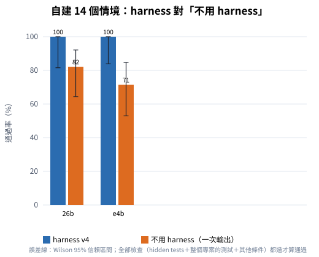
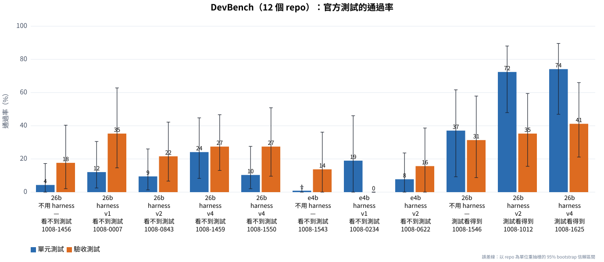
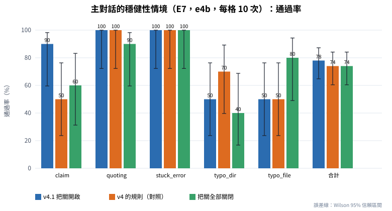

# Coding_agent_harness 能力評估報告

評估對象：Coding_agent_harness v4／v4.1（本機 Ollama：gemma4:e4b、gemma4:26b）｜評估日期：2026 年 10 月 8 日｜詳細證據見《技術報告》

## 一、結論摘要

**一句話**：這個 harness 可以擔任「**在已經有測試的專案裡做日常修改**」的 coding 助手（仍需人審查改動），**還不能**擔任「只給規格、從零完成整個專案」的長任務 coding；非 coding 的維運對話維持穩定。

**能力判定**

| 任務類型 | 可以交給它嗎 | 證據（重點數字） | 證據強度 |
|---|---|---|---|
| 在既有、有測試的專案裡修改（Python、C、C++，ROS 2 套件裡不依賴 ROS 的邏輯） | ✅ 可以，要審查改動 | 14 個情境、2 個模型：37/37 通過；同一個模型直接寫 71～82% | 中（情境是自建的、專案小） |
| 長任務：照規格從零寫出整個專案，**有測試可以對照** | ⚠️ 部分可以 | 官方單元測試 72～74%（同一個模型看得到測試、直接寫：37%）；驗收測試 35～41% | 中 |
| 長任務：**只給規格**、沒有測試 | ❌ 還不行 | 單元測試 10～24%、驗收 22～35%（直接寫：4%、18%） | 中高 |
| 需要 ROS 2 才能驗證的 C++ 修改 | ⚠️ 只能檢查結構 | 這台主機沒有 ROS 2；用到 rclcpp 的測試會跳過，要在容器裡建置測試 | 高 |
| 非 coding：主對話的維運操作 | ✅ 可以 | 14 個情境：v4 42/42、v4.1 27/28 | 中高 |

**「用數據集測試之後，有沒有變好？」**

- **coding（日常修改）：有，而且有證據。**例如 ROS 2 情境第一次 e4b 只過 1/3，查出是「任務寫的是套件裡的相對路徑、harness 卻建議新建檔案」的問題，修正後 9/9；其餘 11 個情境維持全部通過。
- **coding（長任務，DevBench）：找到並修好了 8 類真的問題，但總分沒有可信的進步。**每一項修正都有測試證明它本身有效；但同一個版本重跑，DevBench 的單元通過率就差了 13.8 個百分點，跟版本之間的差距一樣大，所以不能說分數變好了。原因是這些修正處理的是「讓任務有機會做對」的必要條件，而長任務 83% 的失敗是「介面名稱、簽名跟規格不一致」——這是下一步最重要的改進目標。
- **非 coding：DevBench 不測非 coding。**從 coding 框架移植過來的把關，讓模型呼叫減少約三成，但沒有提高成功率，還找到一個副作用（重試到第 3 次就停，切斷了模型自己換做法的機會）；修正為 v4.1 之後，被針對的情境（要求重新啟動容器）從 5/10 提高到 9/10，重複的工具呼叫從 20 次降到 4 次；但五個情境的整體成功率沒有可信的差異（78% 對 74%）。

**最重要的三個建議**：(1) 日常修改用 coding job（模型選 gemma4:26b），完成後看 diff；(2) 長任務先準備測試或介面清單再交給它；(3) 下一階段優先做「規格的介面清單與一致性檢查」，並用沒有拿來開發的基準（Aider polyglot、使用者自己的任務）驗證。

## 二、評估目的與範圍

**目的**：判斷這個 harness 目前能不能擔任「大多數 coding」與「長任務 coding」的角色；回答「用數據集測試之後，coding 與非 coding 的任務有沒有變好」；並列出接下來要怎麼改、還需要哪些評測。

**範圍**：

- 語言：Python、C、C++（含使用者實際的 ROS 2 colcon 工作區，這台主機沒有 ROS 2）。
- 任務類型：(1) 在既有、有測試的專案裡修改（新增功能、除錯、跨檔改名、新模組）；(2) 長任務：只給規格文件、從零寫出整個多檔案專案；(3) 非 coding：主對話的機器人維運操作。
- 模型與環境：gemma4:e4b（較小、主對話預設）與 gemma4:26b（建議給 coding），單一 RTX 5090，不用雲端模型。
- 不在範圍內：Java、JavaScript 等其他語言；需要 Docker 的大型基準（SWE-bench）；程式碼品質（可讀性、效能、安全性）——本次只量「功能對不對」。

## 三、評估方法（簡述）

| 評測 | 測什麼 | 規模 | 怎麼算分 |
|---|---|---|---|
| 自建 coding 情境 | 日常的修改任務 | 14 個（Python 6、C／C++ 5、ROS 2 3） | agent 看不到的測試（hidden tests）＋整個專案的測試要全部通過 |
| DevBench（公開基準） | 長任務：照規格從零寫出整個專案 | 12 個 repo（Python 7、C++ 5），116 個單元測試、51 個驗收測試 | 官方測試的通過率 |
| 主對話情境 | 非 coding 的維運操作 | 14 個＋5 個穩健性情境 | 回覆內容、用了哪些工具、有沒有經過確認 |

為了知道 harness **本身**的貢獻，每一組都有對照：
- **不用 harness**：同一個模型、同樣的資訊，直接請它寫出程式（沒有工具、沒有測試回饋、沒有重試）。
- **官方測試看得到／看不到**：看 harness 在「有測試可以對照」時能做到多少。
- **把關開啟／關閉**：看主對話的把關功能有沒有用。

每個數字都附 95% 信賴區間（樣本少時區間很寬，重疊就代表「看不出差別」）。全部的原始紀錄、分析程式、資料集都在這個資料夾，可以重新算出來。

## 四、主要發現

### 4.1 日常規模的修改任務

| 模型 | harness | 直接用模型（不用 harness） | 只看功能（hidden tests） |
|---|---|---|---|
| gemma4:e4b | **20/20** | 20/28（71%） | harness 19/19；直接用 25/26 |
| gemma4:26b | **17/17** | 23/28（82%） | harness 16/16；直接用 24/26 |

- 直接用模型時，**功能本身大多是對的**；失敗多半是它自己加的測試寫錯、或多個檔案的修改彼此不一致（例如 5 個檔案的長任務 0/2）。harness 每一項都跑測試、錯了交還修正，讓整個專案保持全部測試通過——這是它的主要價值。
- 代價：每個任務約 30 秒、20 幾次模型呼叫（直接用模型 5 秒、1 次）。
- 範例專案很小（整個專案放得進提示），所以這個比較**低估**了 harness 在大專案的必要性（大專案沒辦法整個貼給模型，要靠 harness 的探索工具）。

### 4.2 長任務（DevBench：照規格從零寫出整個專案）

| 條件（gemma4:26b） | 單元測試 | 驗收測試 |
|---|---|---|
| 直接用模型，只有規格 | 4.3% | 17.6% |
| harness，只有規格（v1、v2、v4 兩次） | 9.5～24.1% | 21.6～35.3% |
| 直接用模型，測試內容放在提示裡（看得到、不能執行） | 37.1% | 31.4% |
| **harness，測試在工作區（可以執行）**（v2、v4） | **72.4～74.1%** | **35.3～41.2%** |

- **只有規格時分數低**：失敗有 83% 是「介面名稱、簽名、常數跟官方測試不一致」——agent 自己寫的測試照自己的介面寫，所以都通過，harness 的測試回饋抓不到。這些名稱有六成以上其實寫在規格裡（例如 `PERIOD_CLOSE`、`LICENSES`），是可以改進的地方；少數是規格本身沒寫或互相矛盾。
- **harness 幾乎消除了編譯失敗、連結失敗、缺依賴這類錯誤**（直接用模型時佔失敗的三分之一以上）。
- **有測試時，harness 的價值最明顯**：從「看得到測試」的 37% 到「能執行測試並修正」的 74%，12 個 repo 有 9 個變好、0 個變差。
- 參考：DevBench 論文公開的 GPT-4-Turbo 是驗收 7.1%、單元 8.0%；另一個長任務基準 NL2Repo-Bench 報告最強的 agent 也低於 40%。長任務對所有模型都難（條件不同，數字不能直接比，只能看量級）。

### 4.3 數據集測試帶來的優化

| DevBench 找到的問題 | 修正 | 修正有沒有效 |
|---|---|---|
| 指令裡的引號被吃掉，模型不可能修好 | 保留引號（主對話一起改） | 自我測試通過 |
| 規格的預設值被寫成必要參數 | 規格整份給每個 worker、對照函式簽名 | 自我測試通過 |
| 計畫漏掉任務列出的檔案、或多加清單外的檔案 | 補項、只准新建列出的檔案 | 自我測試通過 |
| 驗證指令指向不存在的測試 | 規劃時拿掉 | 自我測試通過 |
| 「沒有測試可跑」被當成「程式寫錯」 | 分開判斷 | 自我測試通過 |
| 測試污染（替換 `sys.modules`） | 靜態檢查報錯 | 自我測試通過 |
| 修正把程式改壞，報告卻寫修正前的結果 | 通過的測試變少就還原 | 自我測試通過 |

**但 DevBench 的總分沒有可信的進步**：26b 的單元通過率 v1 12.1%、v2 9.5%、v4 兩次 24.1% 與 10.3%——同一版本兩次就差 13.8 個百分點，跟版本之間的差距一樣大。一個 repo（graph-cpp）的規格文件自己就寫了兩種名稱，模型這次選對就多 12～22 個測試通過、選錯就全掛，這種「運氣」主導了總分。結論：**修正是有效的、但不是造成分數差異的主因**；要讓進步量得出來，改動要針對主要的失敗原因（介面不一致），而且每個版本要跑 3 次以上。

### 4.4 非 coding 任務

- **主對話 14 個情境**：v4 42/42、v4.1 27/28（唯一的失敗是模型讀錯專案地圖，跟修改無關）——加入 coding 功能後沒有退步；但已經接近滿分，量不出改善。
- **穩健性情境（把關開／關的對照，E6）**：成功率沒有變好（開 11/15、關 13/15），但每個情境的模型呼叫從 7.5 次降到 5.3 次（−29%），重複的工具呼叫從 5 次降到 0。找到一個副作用：重試到第 3 次就停，會切斷模型自己換做法的機會。
- **修正後再驗證（E7，v4.1，每個條件 50 次）**：被針對的情境（要求重新啟動容器）v4.1 9/10、舊規則 5/10、全部關閉 6/10——模型改用正確技能的次數從 5 次變 9 次，誤用的次數從 11 次變 4 次，方向與機制都吻合，但樣本還小（p＝0.14）。整體成功率 78%、74%、74%，沒有差別；把關最明確的效果是重複的工具呼叫從 20 次降到 2～4 次。
- **一個要繼續追的現象**：「檔名打錯」的情境，把關開啟時反而較差（合計 11/23 對 11/13），但失敗都發生在把關起作用之前——模型看完專案地圖就停下來問「要不要我看檔案」，該做卻先問。這比較像模型本身的傾向，下一步要針對它改提示並用更多次數量。

## 五、使用建議與風險

### 5.1 適合交給它的工作

- **在既有、有測試的專案裡修改**：新增功能、修 bug、跨檔改名、加測試、建新模組；Python、C、C++，以及 ROS 2 套件裡「不依賴 ROS 的邏輯」。這是證據最充分、成功率最高的範圍。
- **主對話的維運操作**：查容器、ROS 2 的 topic／node、調度系統的狀態與派工（會先經過確認）。
- **照規格做新東西，但先準備好測試**：把驗收測試（或至少介面清單：類別、函式、參數、常數的名稱）放進工作區，harness 會一直改到測試通過——有測試可以對照時，長任務的單元測試通過率從約一成提高到七成。

### 5.2 目前不建議單獨交給它的工作

- **只給規格、從零寫整個專案，又沒有測試**：官方測試的通過率約一成（單元）到兩、三成（驗收），失分主要是介面名稱跟期待的不一樣。
- **需要 ROS 2 才能驗證的 C++ 修改**：這台主機沒有 ROS 2，用到 rclcpp 的檔案只能檢查結構，相關的測試會跳過；要在 ROS 2 的容器裡 `colcon build`／`colcon test` 確認。
- **完全沒有測試的專案**：harness 只能做靜態檢查與建置，功能對不對沒有人把關。

### 5.3 使用方式

1. coding job 的規劃與 worker 都用 **gemma4:26b**（Coding 面板 ⚙️），它在這台機器上不比 e4b 慢。
2. 核准前看一下計畫：每一項要改的檔案與驗證指令合不合理。
3. 完成後一定看 diff（Coding 面板）與 agent 寫的測試——測試可能寫得太鬆。
4. 重要的專案用 git；harness 的「還原」只還原這個 job 改過的檔案。
5. 失敗時看報告裡每一項的嘗試與錯誤：通常是規格不清楚、或環境缺東西（例如沒有 ROS 2）。

### 5.4 風險

| 風險 | 說明 | 降低的方法 |
|---|---|---|
| 測試寫錯或太鬆 | agent 自己寫的測試通過，不代表需求真的做到 | 看 diff 與測試；重要的行為自己寫驗收測試 |
| 介面跟期待不一致 | 長任務最常見的失分 | 先提供介面清單或測試（路線圖第 1、2 項） |
| 指令安全檢查是啟發式的 | 擋得住明顯危險的指令（sudo、刪除、網路、安裝），但不是沙盒 | 工作區設在專案目錄；重要的專案用 git |
| agent 執行的程式可以連網路 | 評測時實際發生：DevBench 的 chakin（詞向量下載工具），agent 為了驗證自己寫的程式，執行了它實作的下載函式，從網路下載了 268 MB 的資料到工作區。`code_run` 擋得住 `curl`／`wget`，但擋不住程式自己連網路 | 路線圖第 5 項：agent 執行的程式預設沒有網路；涉及下載的任務，要求測試用 mock |
| 評測的代表性 | 自建情境是本專案寫的，DevBench 也被用來找問題 | 用沒看過的基準與使用者自己的任務驗證（第七節） |
| 單一 GPU | coding job 與主對話共用模型，換模型要重新載入 | 全部用 26b，或 coding 期間少用主對話 |

## 六、改進路線圖

依「預期效果 ÷ 成本」排序；每一項都附可以量測的目標，改完用同一套評測（固定版本、每個條件至少 3 次、附信賴區間）確認，沒有達標就不算完成。

### 短期（1～2 週）

| # | 項目 | 為什麼（證據） | 怎麼做 | 量測目標 |
|---|---|---|---|---|
| 1 | **規格的介面清單與一致性檢查** | 長任務最大的失分是「名稱、簽名、常數跟規格對不上」：lice 少了模組常數 `LICENSES`（25 個單元測試全掛）、stocktrends 少了 `PERIOD_CLOSE`、graph-cpp 的文件自己不一致（`setVexer`／`setVexes`）；harness 的測試回饋抓不到這種錯（第四節 4.2） | 規劃前先從 PRD／UML／架構設計抽出「介面清單」（類別、方法與參數、模組常數、命令列用法、檔案路徑），每一項的驗證對照清單：名稱要存在、簽名要相容；文件之間不一致時兩個名稱都提供（別名）並在報告提醒 | DevBench（看不到測試、26b、3 次平均）單元通過率從約 10% 提高到 ≥ 25%、驗收 ≥ 35%，且不能低於目前的「不用 harness」對照組 |
| 2 | **長任務先寫驗收測試** | 官方測試看得到時，26b 的單元通過率從約 10% 跳到 72%（第四節 4.2）：有測試可以對照是 harness 最強的狀態 | 任務附規格時，第一項先依 PRD 的使用範例寫驗收測試（命令列、輸入輸出），之後每一項都要讓它們通過；測試由規格產生，不看官方測試 | 同上的基準，驗收通過率 ≥ 40%；時間增加 ≤ 30% |
| 3 | **主對話的把關（v4.1 已完成；下一步：該做卻先問）** | 第 3 次就停會切斷模型自己換做法；`docker_runcmd` 被誤用時沒有提示；模型常在使用者已經明確要求時還先問「要不要做」（第四節 4.4） | v4.1：第 3 次加強提醒、第 4 次才停，`docker_runcmd` 看到 docker CLI 直接說明要用 `host_runcmd`（已完成）；下一步：在主對話的規則加上「使用者已經明確要求時直接做」 | 穩健性情境每個條件 ≥ 20 次：整體成功率高於把關關閉、重複呼叫維持較少 |
| 4 | **評測流程的固定化** | 單次的分數變異很大（同一版本、同一個模型，一個 repo 可以 0/22 ↔ 18/22） | 每次改動跑「快速組」（自建 14 個＋穩健性 5 個，約 30 分鐘）；里程碑跑 DevBench 3 次；報告一律附區間（`benchmark_study/analysis/` 已經可以自動產生） | 每次改動都有可比較的前後數字 |
| 5 | **agent 執行的程式加上網路隔離** | 評測時 agent 執行自己寫的下載函式，實際下載了 268 MB 的資料（第五節 5.4） | `code_run`／`code_test` 預設在沒有網路的環境執行（例如 Linux 的 network namespace：`unshare -rn`，不需要 root）；真的需要時由使用者明確允許 | 評測與自我測試裡，agent 的程式連不到外部網路；需要網路的任務仍然能在允許後完成 |

### 中期（1～2 個月）

| # | 項目 | 為什麼 | 怎麼做 | 量測目標 |
|---|---|---|---|---|
| 6 | **在 ROS 2 容器裡建置與測試** | 這台主機沒有 ROS 2，用到 rclcpp 的程式只能做結構檢查、相關測試只能跳過 | `code_test`／`code_check` 偵測到 ROS 套件時，改在使用者的 ROS 2 容器裡跑 `colcon build --packages-select`、`colcon test`（需要知道工作區在容器裡掛載的路徑） | ROS 2 情境的 rclcpp 測試可以執行；C++ 檔案全部經過編譯器檢查 |
| 7 | **大型、真實專案的評測** | 自建情境的專案很小（整個專案放得進提示），量不到 harness 在大專案的必要性；使用者的工作區有 2,594 個檔案 | 從使用者的 `amr_base` 挑 10～20 個真實的修改任務，由人寫驗收標準與測試；記錄成功率、人工審查時間、改錯的檔案數 | 建立基準線；之後每個版本比較 |
| 8 | **更多公開基準**（見第七節） | 目前只有一個公開基準，且被用來開發 | Aider polyglot 的 Python＋C++ 子集、SWE-bench Verified 子集、NL2Repo-Bench 子集 | 每個基準有至少 2 次的基準線 |
| 9 | **模型的選擇** | 目前只比較同一家族的兩個模型 | 用同一套評測比較 qwen2.5-coder:32b（已經下載）、gemma4:31b（未下載）；也試「規劃用大模型、worker 用小模型」 | 找出這台機器上「成功率／時間」最好的組合 |

### 長期

10. **自我審查**：回報完成前，另一個 session 只看 diff 與規格找問題（不是只靠測試）。
11. **專案慣例的記憶**：記住專案的命名、建置與測試方式，下一個 job 不用重新摸索。
12. **獨立的項目平行做**：沒有依賴關係的項目同時派 worker（需要第二個 GPU slot 或較小的模型）。
13. **程式碼品質的評測**：加入靜態分析（例如 flake8、clang-tidy）與人工抽查，不只量「功能對不對」。

## 七、後續評測計畫

| 基準 | 測什麼 | 語言 | 規模與成本 | 需要 | 建議 |
|---|---|---|---|---|---|
| **Aider polyglot**（Python＋C++ 子集） | 一般的程式題（照說明完成 stub，有測試），最接近「大多數 coding」的單題能力 | Python、C++（也有 Go、Java、JS、Rust） | 全部 225 題，其中 Python 34 題、C++ 26 題 [7]；單機約 1～2 小時 | 不需要 Docker；C++ 用 CMake | **最先做**：成本低、跟公開排行榜有參考值（協定不同，只能當量級參考） |
| **SWE-bench Verified 子集** | 在大型真實 repo 修 issue（需要探索大專案） | Python | 全部 500 題；最佳化的映像約 30 GiB；挑 50 題約半天 | Docker、磁碟空間 | 量「大專案的探索與修改」，補自建情境的不足 |
| **SWE-bench Multilingual（C／C++ 子集）** | 修 issue | C、C++ 等 9 種語言 | 全部 300 題、每題一個容器 | Docker | C／C++ 的修 issue 能力 |
| **NL2Repo-Bench 子集** | 長任務：只給需求文件做出整個 Python 函式庫 | Python | 每題數小時 | 不需要 Docker | 當作長任務的「沒有用來開發的測試集」（DevBench 已經被用來開發） |
| **使用者自己的任務**（amr_base） | 最有代表性的日常工作 | Python、C++、ROS 2 | 10～20 個任務 | 人寫驗收標準；ROS 2 容器 | **最重要**：決定能不能真的交給它 |
| **重複與擴大樣本** | 讓結論可信 | — | 現有的評測每個條件 ≥ 3 次 | 時間 | 每個里程碑都做 |

## 附錄：名詞解釋

| 名詞 | 白話說明 |
|---|---|
| **Harness（框架）** | 包在語言模型外面的程式：給模型可以用的工具（看檔案、改檔案、跑測試…）、決定流程（先規劃、再一項一項做）、檢查模型的成果、出錯時要它重做。模型負責「想」，harness 負責「把關與執行」。 |
| **Coding agent** | 會自己規劃、使用工具、修改程式碼、跑測試的 AI 系統（相對於只回答問題的聊天機器人）。 |
| **Orchestrator／worker** | 本 harness 的分工：orchestrator 負責規劃與調度，把任務拆成幾項；每一項交給一個 worker（一個獨立的模型對話）去改程式。 |
| **長任務 coding** | 要改很多檔案、跨很多步驟才能完成的工作，例如照規格從零寫出整個專案；相對於「改一個函式」這種短任務。 |
| **評測基準（benchmark）／數據集** | 一組固定的題目＋固定的計分方式，讓不同系統、不同版本可以在同樣的條件下比較。 |
| **DevBench** | 2024 年發表的公開基準；我們用它的「實作」任務：只給需求文件（PRD）、UML 圖與架構設計，要寫出整個 repo，再用官方的測試計分。 |
| **Hidden tests（隱藏測試）** | 評分用、但 agent 從頭到尾看不到的測試。agent 自己寫的測試可能寫錯或寫得太鬆，所以要用它看不到的測試才公正。 |
| **單元測試／驗收測試** | 單元測試檢查個別函式、類別的行為（很依賴介面名稱有沒有照規格）；驗收測試從使用者的角度跑整個程式（例如執行命令列、看輸出對不對）。 |
| **通過率** | 通過的測試數 ÷ 測試總數（或通過的情境數 ÷ 情境總數）。 |
| **95% 信賴區間（CI）** | 「真正的通過率大概落在這個範圍」。樣本少時範圍很寬；兩個條件的區間大部分重疊，就代表數據還不足以說誰比較好。 |
| **Bootstrap（自助法）** | 一種估計誤差的方法：把手上的樣本（例如 12 個 repo）重複「有放回地抽樣」上萬次，看結果的變化範圍。不需要假設資料符合常態分布。 |
| **Wilson 區間** | 二項比例（例如 14 次中通過 13 次）的信賴區間算法，樣本少或接近 0%／100% 時比一般公式準。 |
| **對照組（baseline）** | 用來比較的參考條件。本研究的「不用 harness」對照組：同一個模型、同樣的資訊，直接請它寫出程式，沒有工具與測試回饋。harness 比對照組多做到的部分，就是 harness 的貢獻。 |
| **消融實驗（ablation）** | 把某個功能關掉再測一次，看那個功能到底有沒有用。本研究用環境變數 `AGENT_ABLATE` 關掉主對話的把關。 |
| **符號檢定** | 配對比較時，只看「幾個變好、幾個變差」，算出這種差距是不是可能只是運氣（p 值越小越不像運氣；通常 p < 0.05 才算有把握）。 |
| **過度擬合（overfitting）** | 一直看著同一組題目改系統，分數會變好，但換一組沒看過的題目不一定一樣好。 |
| **pytest／GoogleTest（gtest）** | Python 與 C++ 最常用的測試工具。本研究的測試一律用它們真的執行，不是用模型判斷。 |
| **CMake／Makefile／colcon** | C／C++ 的建置工具；colcon 是 ROS 2 用來建置整個工作區（很多套件）的工具。 |
| **Temperature（溫度）** | 模型輸出的隨機程度；本研究用 0.2～0.3，仍有隨機性，所以同一題每次結果可能不同，要重複測。 |
| **Token／num_ctx** | 模型處理文字的單位／一次能看到的最大長度（本研究 32768 個 token）。 |
| **e4b／26b** | 兩個 gemma4 模型：e4b 較小、較快，記憶體需求低；26b 較大（MoE 架構，實際每次只用一部分參數），在這台機器上速度跟 e4b 差不多。 |
