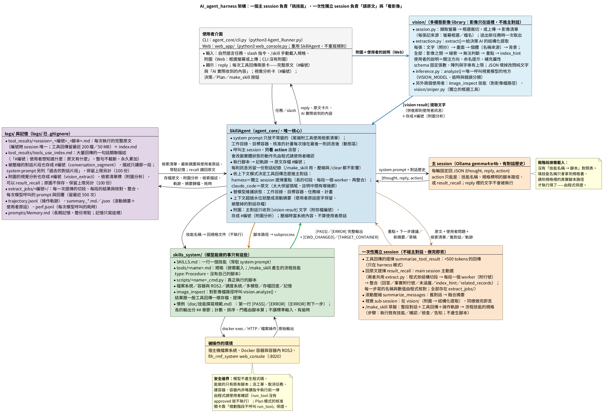
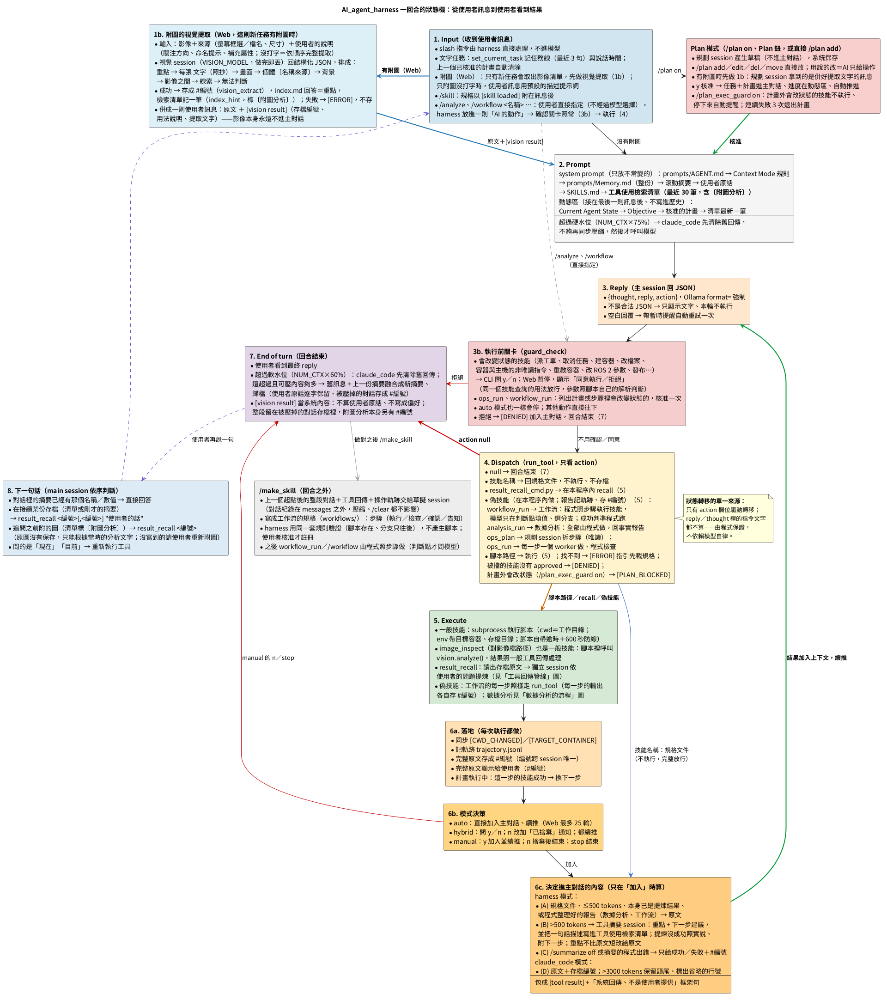
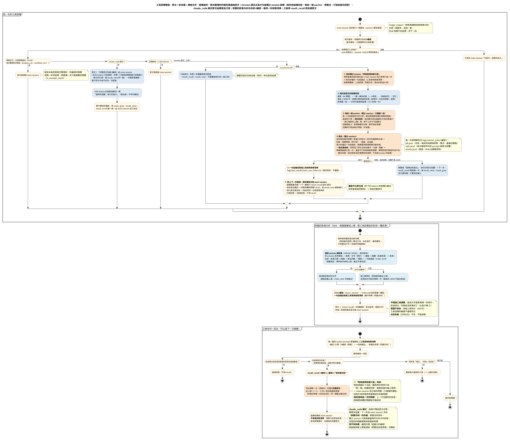
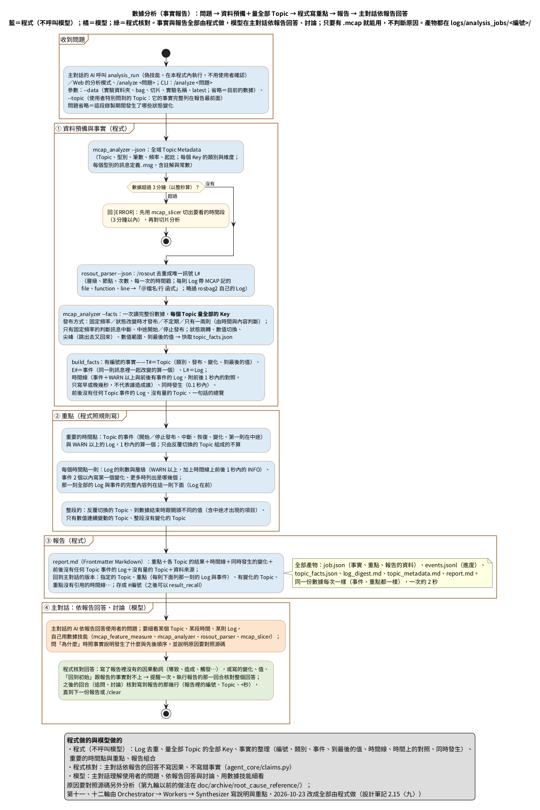

# 文件導覽

| 文件 | 給誰看 | 內容 |
|---|---|---|
| [架構說明](架構說明.md) | 想看懂或修改程式的人 | `agent_core/`、`web_app/` 由哪幾個模組組成、其他資料夾（§4.3）、兩種上下文模式、一回合怎麼跑、工具回傳管線、執行前關卡、狀態與持久化、CLI／Web 對照、常數、「要改什麼看哪裡」、評測（§12） |
| [架構說明 §13](架構說明.md#13-數據分析agent_coreanalysis_jobpy全部由程式做) | 想看懂或修改數據解析的人 | 全部由程式做的流程（事實 → 重要的時間點與重點 → 報告）、模組（含數據技能的共用層 `_ros2_data_common.py`）、主對話回答的核對、產物存在哪裡、常數、要改什麼看哪裡、報告的範例 |
| [設計筆記與已知限制](設計筆記與已知限制.md) | 想知道某個機制為什麼長這樣的人 | 每個機制的做法、理由與實測數據（數據解析在 2.15）；完整技能清單（§3，數據技能與 toolkit 的對照在 3.8）；驗證方法；已知限制（§6）；未來方向 |
| [待辦清單](待辦清單.md) | 要決定下一步做什麼的人 | 數據解析 agent 的下一步建議（都還沒開始） |
| [長期願景](長期願景.md) | 關心延伸方向的人 | AGV/AMR 車隊調度場景的構想（尚未實作）、實作心跳機制與定時任務時要注意的事 |
| [評測](../evals/README.md) | 改了程式或 prompt、想知道有沒有變好的人 | 主對話、數據解析、隨機情境產生器、多步驟維運四組評測：怎麼跑、怎麼加情境、怎麼讀報表 |
| [隨機情境的錄製產生器](../evals/datagen/README.md) | 要做大量數據測試的人 | 六個開發中套件的模擬、評分標準怎麼產生、三組數據 |
| [test_data](../test_data/README.md)（只在本機） | 要跑實機回歸的人 | 這台錄的 14 份數據、正確答案、回歸工具 |
| [archive/root_cause_reference](archive/root_cause_reference/README.md) | 要做根因 agent 的人 | 第一～九輪的源碼脈絡與因果推論（只供閱讀，不會被執行） |

## 圖

圖的來源（`.puml`）在 `diagrams/`，產生的 PNG 在 `images/`。

| 圖 | 來源 | 內容 |
|---|---|---|
|  | `diagrams/AI_agent_harness的說明.puml` | 元件與資料流；`vision/`（框選／上傳 → 結構化提取 → `[vision result]`）與使用者介面、SkillAgent、技能、存檔的關係 |
|  | `diagrams/AI_agent_harness的狀態轉移.puml` | 一回合的狀態機；附圖時的視覺提取（1b），以及附圖分析在 prompt、壓縮、下一句話裡的位置 |
|  | `diagrams/AI_agent_harness的工具回傳管線.puml` | 原文存檔 → 摘要 → 檢索清單 → result_recall；中段是附圖的影像分析（提取 → 存成 #編號 → 〔附圖分析〕進清單 → 併進訊息），同一套 recall |
|  | `diagrams/數據診斷的流程.puml` | 數據分析（事實報告）的完整流程（活動圖）：收到問題 → 資料預備與事實（超過 3 分鐘先切；程式量全部 Topic 的全部 Key、整理成有編號的事實）→ 重點（程式照規則寫：每個重要的時間點一則）→ 報告 → 主對話依報告回答與程式的核對（之後的回合也核對）；藍＝程式、橘＝模型、綠＝程式核對，底部是程式做的與模型做的；第九輪的流程圖在 `archive/root_cause_reference/doc/` |

改完 `.puml` 後重新產生 PNG。建議用本機離線渲染（不把圖的內容送到外部服務）。`~/tools/plantuml/` 放了 Temurin JRE 21 與
plantuml.jar（1.2026.8，從 Maven Central 下載）；這台機器沒有 Microsoft JhengHei，字型換成系統的 Noto Sans CJK TC 再渲染
（`.puml` 本身不改，照舊寫 JhengHei）：

```bash
cd doc && T=$(mktemp -d)
sed 's/"Microsoft JhengHei"/"Noto Sans CJK TC"/' diagrams/數據診斷的流程.puml > $T/數據診斷的流程.puml
~/tools/plantuml/jre/bin/java -Djava.awt.headless=true -DPLANTUML_LIMIT_SIZE=16384 -jar ~/tools/plantuml/plantuml.jar \
  -tpng -charset UTF-8 -failfast2 $T/數據診斷的流程.puml && cp $T/數據診斷的流程.png images/
```

有 Microsoft JhengHei 的機器（原作者的環境：`/home/david/Software_quality_checking_pipeline/tools` 有 PlantUML、字型與 fontconfig）：

```bash
cd doc
PH=/home/david/Software_quality_checking_pipeline/tools
FONTCONFIG_FILE=$PH/fontconfig/fonts.conf GRAPHVIZ_DOT=/usr/bin/dot \
  $PH/jre/bin/java -Djava.awt.headless=true -DPLANTUML_LIMIT_SIZE=16384 -jar $PH/plantuml.jar \
  -tpng -charset UTF-8 -failfast2 -o ../images diagrams/數據診斷的流程.puml
```

寫 `.puml` 時注意：字型沒有 emoji（📊 會變成方框，請用文字）、Noto Sans CJK 也沒有 ✗；同一行有兩個 `--`（例如 `--window --topics`）會被當成刪除線，要寫成 `~--`。

`diagrams/流程圖產生器.py` 是另一種做法：純標準庫，把 `.puml` 的內容送到 PlantUML 官方伺服器（plantuml.com）渲染，需要網路；圖的內容會離開這台機器：

```bash
python3 doc/diagrams/流程圖產生器.py                 # 全部
python3 doc/diagrams/流程圖產生器.py 某張圖.puml     # 只轉一張
```
