# 文件導覽

| 文件 | 給誰看 | 內容 |
|---|---|---|
| [架構說明](架構說明.md) | 想看懂或修改程式的人 | `agent_core/`、`web_app/` 由哪幾個模組組成、其他資料夾（§4.3）、兩種上下文模式、一回合怎麼跑、工具回傳管線、執行前關卡、給程式讀的收據（3.8）、狀態與持久化、CLI／Web 對照、常數、「要改什麼看哪裡」、評測（§12）、凍結的工具（§14）、單一迴圈（§15～§17，§15 開頭是從問題到答案的流程圖）：低階執行器（照收據執行工具節點的圖、第 1 級修正）、有骨架的技能（領域與技能的規格、合約、骨架、回退、need 交回領域 session）、交辦與領域 session（選領域、一次用一個技能、太長的結果提煉、回報的核對、依報告回答的核對與照項目排、帶著上一次的經過再交） |
| [架構說明 §13](架構說明.md#13-數據分析agent_coreanalysis_jobpy全部由程式做2026-11-17-起凍結第-14-節) | 想看懂或修改數據解析的人 | 全部由程式做的流程（事實 → 重要的時間點與重點 → 報告）、模組（含數據技能的共用層 `_ros2_data_common.py`）、主對話回答的核對、產物存在哪裡、常數、要改什麼看哪裡、報告的範例 |
| [設計筆記與已知限制](設計筆記與已知限制.md) | 想知道某個機制為什麼長這樣的人 | 每個機制現在的做法、理由與實測數據（主對話的程式把關在 2.12，數據解析在 2.15，工具回傳的提煉在 2.16，持續驗證在 2.17，給模型的字搬進 prompts/ 在 2.22，拿掉的功能在 2.25、2.26；三階層（2026-11-18～23）試過的與教訓在 2.55，單一迴圈（交辦與領域 session，含有骨架的技能、低階執行器、收據、依報告回答的核對、真實專案評測）在 2.56，跟 A 比與參數表單在 2.57、2.58，兩個模型各適合的場景在 2.59，彙整加回與工具表單的寫法在 2.60；中間空的編號是刪掉的舊紀錄）；完整技能清單（§3，數據技能與 toolkit 的對照在 3.8）；驗證方法；已知限制（§6）；未來方向 |
| [技能撰寫規範](技能撰寫規範.md) | 寫技能、改技能的人 | 規格文件的格式（給程式看的欄位 1.1、有骨架的技能 1.2）；腳本輸出的結構（第一行、章節、截斷的說明、狀態標記放最後；給程式讀的收據 2.1）；[ERROR] 要寫原因與下一步；可以自己用（不讀標準輸入、逾時、不留背景程序）；測試放 `evals/skills/` |
| [待辦清單](待辦清單.md) | 要決定下一步做什麼的人 | 已記錄、還沒做的：單一迴圈的步驟、每一步看到還沒做的與接下來的方向、架構整合驗證過要沿用的做法、凍結的工具的項目 |
| [框架討論紀錄](../docs/框架討論紀錄.md) | 參與定框架的人 | 單一迴圈（主 session、領域 session）的方向、已定與待討論的問題、步驟、每一輪的討論紀錄 |
| [長期願景](長期願景.md) | 關心延伸方向的人 | AGV/AMR 車隊調度場景的構想（尚未實作）、實作心跳機制與定時任務時要注意的事 |
| [評測](../evals/README.md) | 改了程式或 prompt、想知道有沒有變好的人 | 主對話、技能腳本、數據解析、隨機情境產生器、多步驟維運、提煉、真實專案、低階執行器、交辦與領域 session、評測的完整性各組，與每個階段結束時的 `phase_check.py`：怎麼跑、怎麼加情境、怎麼讀報表 |
| [隨機情境的錄製產生器](../evals/datagen/README.md) | 要做大量數據測試的人 | 六個開發中套件的模擬、評分標準怎麼產生、三組數據 |
| [test_data](../test_data/README.md)（只在本機） | 要跑實機回歸的人 | 這台錄的 14 份數據、正確答案、回歸工具 |
| [archive/root_cause_reference](archive/root_cause_reference/README.md) | 要做根因 agent 的人 | 第一～九輪的源碼脈絡與因果推論（只供閱讀，不會被執行） |

## 圖

圖的來源（`.puml`）在 `diagrams/`，產生的 PNG 在 `images/`。

| 圖 | 來源 | 內容 |
|---|---|---|
| 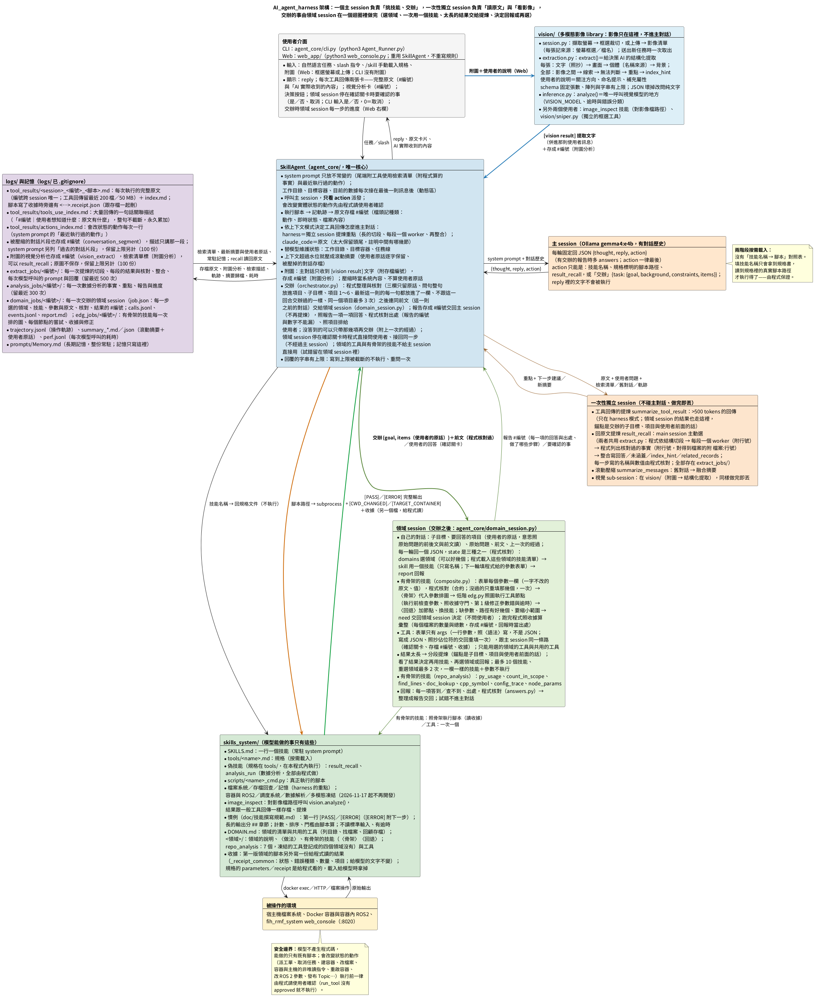 | `diagrams/AI_agent_harness的說明.puml` | 元件與資料流；`vision/`（框選／上傳 → 結構化提取 → `[vision result]`）與使用者介面、SkillAgent、技能、偽技能（result_recall、analysis_run）、一次性 session（提煉、滾動摘要、視覺）、`logs/` 底下各種存檔（含收據 `<存檔>.receipt.json`、領域 session 的 `domain_jobs/` 與低階的 `edg_jobs/`）、確認關卡的範圍；交辦：主 session 把子目標與要回答的項目（每一項附使用者的原話）交給領域 session（`domain_session.py`）→ 程式核對 → 選領域、一次用一個技能（只寫名稱，下一輪填程式給的參數表單；有骨架的技能由 `composite.py` 照骨架與回退、`edg.py` 執行；工具走主 session 同一條路）、太長的結果分段提煉、決定回報或再選 → 報告 #編號交回、停在確認關卡時程式直接問使用者 |
| 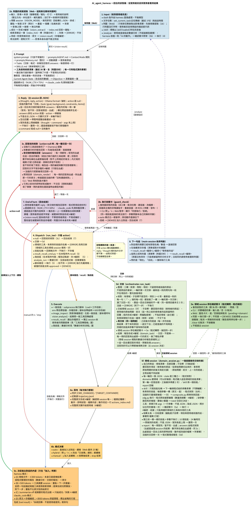 | `diagrams/AI_agent_harness的狀態轉移.puml` | 一回合的狀態機；`/analyze` 直接指定；確認關卡擋哪些；Dispatch 的偽技能；交辦（5d：核對（含每一項的原話是使用者說過的話）、交給領域 session、再交辦時帶著上一次的經過、報告存成 #編號交回）、領域 session（5f：每一輪回一個狀態——選領域、用一個技能、回報；選了技能的下一輪填參數表單、有骨架的技能的合約與 need、太長的結果提煉、上限與擋重複、回報的核對）與領域 session 停在確認關卡（5e：程式轉問、接回同一步）；回覆寫到長度上限被截斷的重問（3）；回答前的核對（3c：沒動作卻說做了、依數據分析的報告回答、依交辦的報告回答的 answers（含報告的編號與數字沒漏），沒過的交回修一次；依交辦的報告回答由程式照項目排、附出處那一行的原文）；附圖時的視覺提取（1b），以及附圖分析在 prompt、壓縮、下一句話裡的位置 |
| 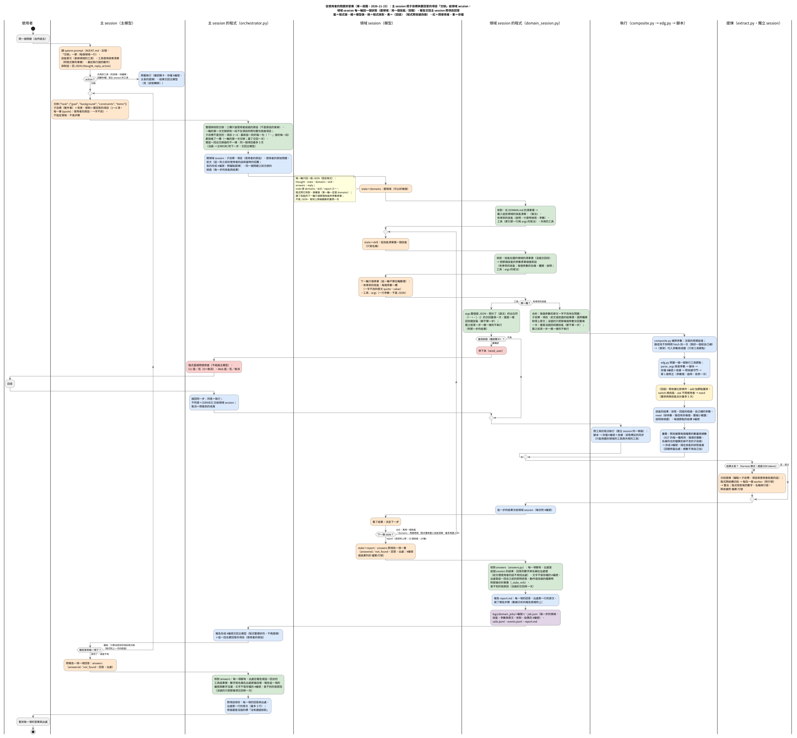 | `diagrams/從問題到答案的流程.puml` | 單一迴圈的動態流程（2026-11-23，泳道的活動圖）：使用者 → 主 session 交辦（子目標、要回答的項目，每一項附使用者的原話）→ 程式核對交辦（原話是使用者說過的話）→ 領域 session 選領域（程式載入這些領域的技能清單）→ 每一輪用一個技能（只寫名稱，下一輪填程式給的參數表單）：有骨架的技能（每個參數一欄、附原文，程式核對、沒過的重填一次；`composite.py` 照〈骨架〉排圖、`edg.py` 執行工具節點、〈回退〉加節點或換技能，缺參數、要縮小範圍時 need 交回領域 session；程式照收據算的彙整存成 #編號）或工具（args 寫成 JSON、照抄佔位符的交回重填；確認關卡、存檔 #編號、收據）→ 太長的結果分段提煉（錨點是子目標與項目）→ 看了結果再用技能、再選領域或回報（answers，程式核對）→ 報告存成 #編號交回 → 主 session 照報告一項一項回答（或只帶沒答到的再交辦）→ 程式核對 answers（含報告的編號與數字沒漏）、照項目排好給使用者；會改狀態的工具停下來由程式問使用者；藍＝程式、橘＝模型、綠＝程式核對、黃＝回退、紅＝問使用者、紫＝存檔 |
| 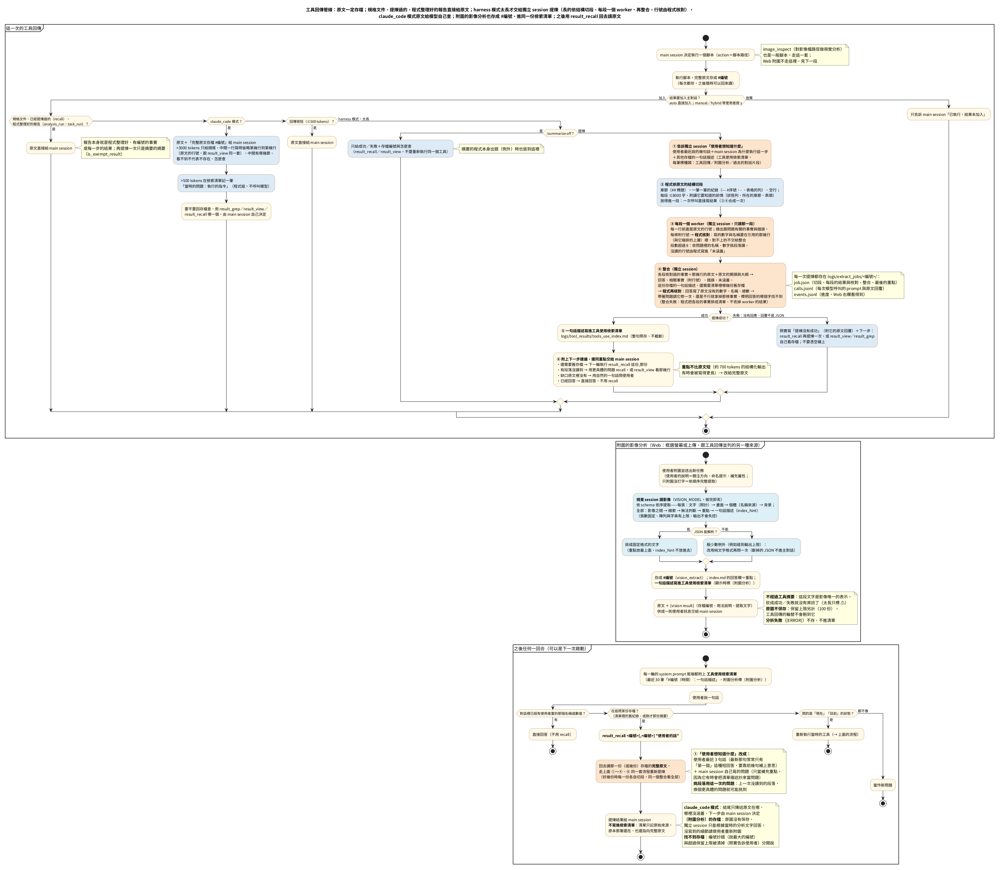 | `diagrams/AI_agent_harness的工具回傳管線.puml` | 原文存檔（第一版領域的腳本另外寫收據給程式讀）→ 規格文件、提煉過的、程式整理好的報告（數據分析）直接給原文 → 太長的提煉（程式切段 → 每段一個 worker（程式核對）→ 程式列出核對過的事實、整合只寫回答，程式核對回答與行號；照收據對得到檔案的事實附 `檔案:行號`、回答把存檔的行號寫成檔案的行號交回修）→ 檢索清單 → result_recall（好幾份加起來放得進一段時合成一段、一個 worker 一起讀）；退路（`/summarize off`、提煉沒成功、重點不比原文短）；領域 session 的結果也走這一套（錨點換成交辦的子目標與項目，下一步建議只寫它能用的 result_grep／result_view）；中段是附圖的影像分析（提取 → 存成 #編號 → 〔附圖分析〕進清單 → 併進訊息），同一套 recall |
|  | `diagrams/數據診斷的流程.puml` | 數據分析（事實報告）的完整流程（活動圖）：收到問題（交辦給領域 session 用 analysis_run，或 `/analyze` 直接指定）→ 資料預備與事實（超過 3 分鐘先切；字串裡的 JSON 展開成 Key；程式量全部 Topic 的全部 Key、整理成有編號的事實）→ 重點（程式照規則寫：每個重要的時間點一則）→ 報告（交辦時原樣附在領域 session 的報告裡）→ 主對話依報告回答與程式的核對（之後的回合也核對；要細看再交辦）；藍＝程式、橘＝模型、綠＝程式核對，底部是程式做的與模型做的；第九輪的流程圖在 `archive/root_cause_reference/doc/` |
| 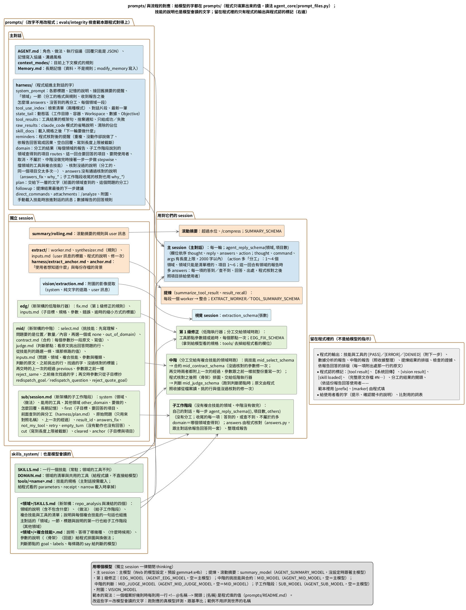 | `diagrams/prompts與流程的對應.puml` | 給模型的字都在 `prompts/`：主對話（AGENT.md、context_modes/、Memory.md、harness/，含 `system_prompt.md` 的「交辦」一節、交辦的結果與 answers 沒有通過核對的說明 `domain.md`）與各種獨立 session（summary/、extract/、vision/、低階執行器的第 1 級修正 edg/、領域 session `domain/session.md`；領域 session 的提煉與截斷說明 `followup.md` 的 `sub_*`、`reduced_sub`）各用哪些檔案，誰組 prompt、輸出的 schema（主對話的回覆在有交辦的報告時多 answers、action 一律最後；領域 session 每一輪一個 state：domains／skill／report，選了技能的下一輪填那個技能的參數表單）；`skills_system/` 的 SKILLS.md（拿掉領域的工具）、`DOMAIN.md`（給程式讀）、技能規格、領域與有骨架的技能（領域的說明也組進主對話的「交辦」一節；說明、〈什麼時候用〉、參數給領域 session，〈骨架〉〈回退〉給程式）也是模型會讀的；留在程式裡的只有程式的輸出（工具結果、報告、[ERROR]）與程式認的標記；各 session 用哪個模型 |
| 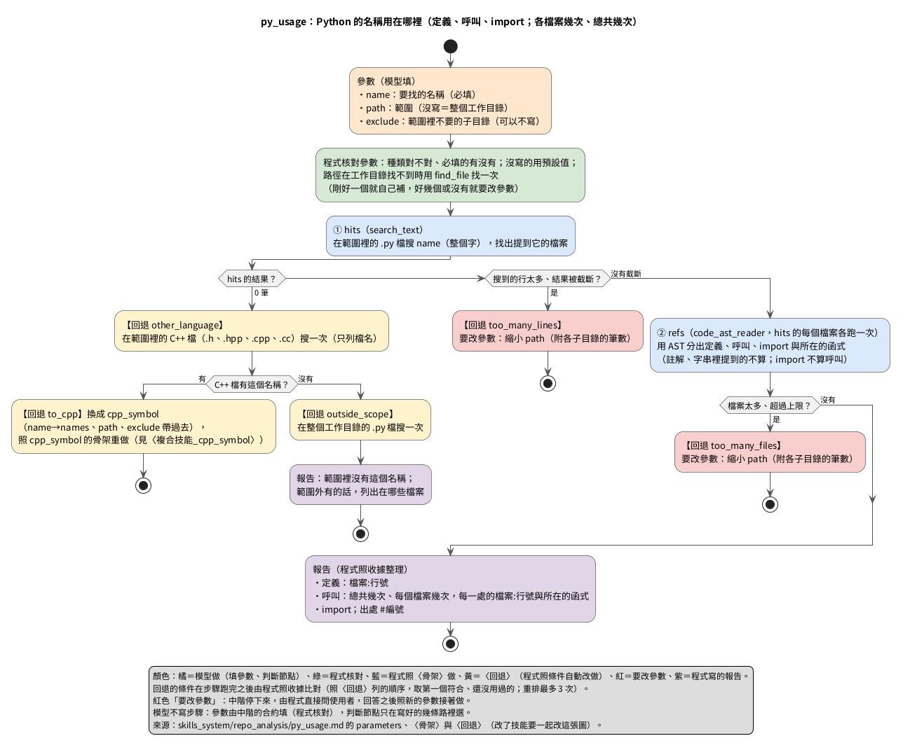 | `diagrams/複合技能_py_usage.puml` | 複合技能 py_usage（2026-11-23）：Python 的名稱用在哪裡：搜 .py（整個字）→ AST 分出定義、呼叫、import；回退：0 筆先看範圍裡的 C++ 檔（有就換成 cpp_symbol），沒有就搜整個工作目錄；太多行、太多檔案時 need 交回領域 session 縮小範圍（附各子目錄的筆數）；結果交回領域 session |
| 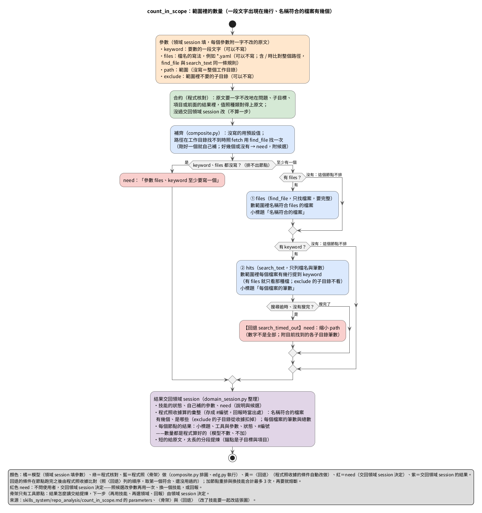 | `diagrams/複合技能_count_in_scope.puml` | 複合技能 count_in_scope（2026-11-23）：範圍裡的數量：檔名符合的檔案（find_file）、每個檔案提到一段文字的筆數（search_text）；數量是腳本算好的（files 含 / 時兩個節點都比對整個路徑）；兩個參數都沒寫、搜尋逾時時 need 交回領域 session |
| 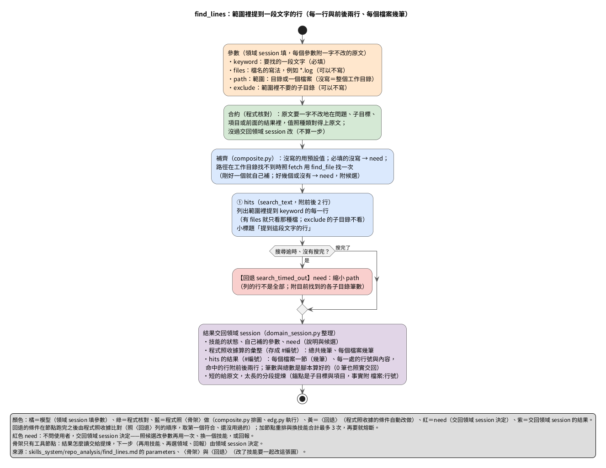 | `diagrams/複合技能_find_lines.puml` | 複合技能 find_lines（2026-11-23）：提到一段文字的每一行與前後兩行、每個檔案幾筆（search_text）；逾時時 need 交回領域 session 縮小範圍 |
| 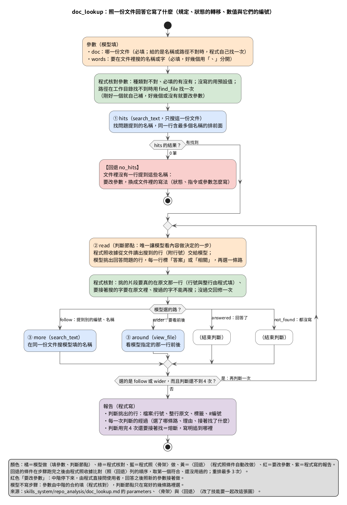 | `diagrams/複合技能_doc_lookup.puml` | 複合技能 doc_lookup（2026-11-23）：照一份文件回答：在指定的那一份文件裡搜問題提到的名稱（同一行含最多個名稱的先列）；0 筆時 need 交回領域 session 換字；看前後、照結果裡的名稱接著找由領域 session 決定 |
| 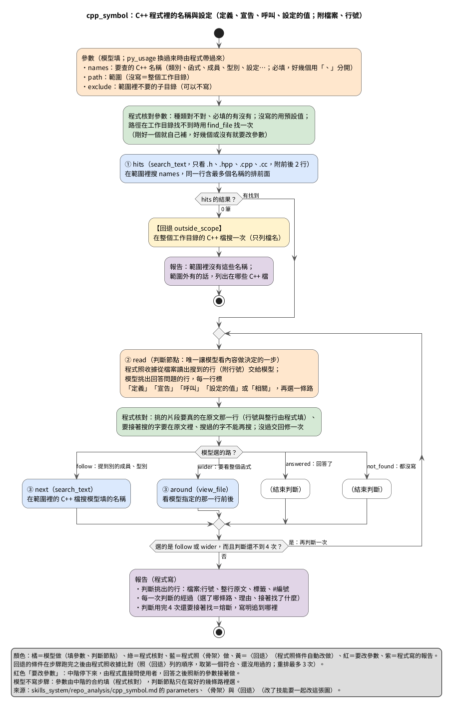 | `diagrams/複合技能_cpp_symbol.puml` | 複合技能 cpp_symbol（2026-11-23）：C++ 的名稱與設定：搜 C++ 檔（同一行含最多個名稱的先列，附前後 2 行）；0 筆搜整個工作目錄；看整個函式、接著找別的名稱由領域 session 決定 |
| 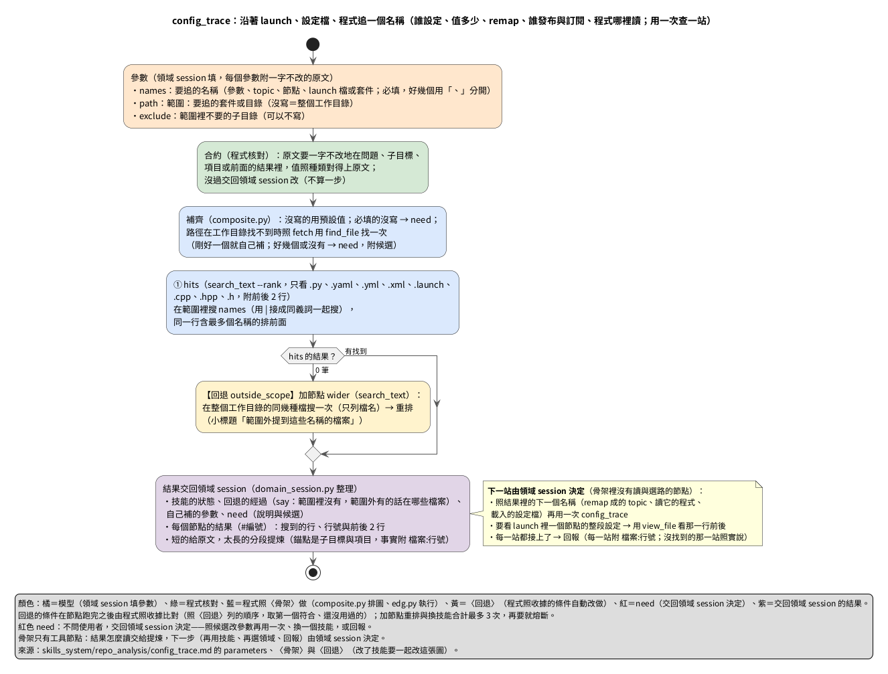 | `diagrams/複合技能_config_trace.puml` | 複合技能 config_trace（2026-11-23）：沿著 launch、設定檔、程式追一個名稱：在這幾種檔裡搜（附前後 2 行）；0 筆搜整個工作目錄；用一次查一站，下一站由領域 session 照結果裡的名稱再用 |

複合技能（有骨架的技能）的六張圖照 `skills_system/repo_analysis/<名稱>.md` 的 parameters、〈骨架〉與〈回退〉畫：橘＝模型（領域 session 填參數）、綠＝程式核對、藍＝程式照骨架做、黃＝回退（程式照條件自動改做）、紅＝交回領域 session 決定（need）、紫＝交回領域 session 的結果。改了技能要一起改圖。

改完 `.puml` 後重新產生 PNG，一律用本機離線渲染（不要用線上的 PlantUML 伺服器：圖的內容會離開這台機器）。`~/tools/plantuml/` 放了 Temurin JRE 21 與
plantuml.jar（1.2026.8，從 Maven Central 下載）；這台機器沒有 Microsoft JhengHei，字型換成系統的 Noto Sans CJK TC 再渲染
（`.puml` 本身不改，照舊寫 JhengHei）：

```bash
cd doc && T=$(mktemp -d)
sed 's/"Microsoft JhengHei"/"Noto Sans CJK TC"/' diagrams/數據診斷的流程.puml > $T/數據診斷的流程.puml
~/tools/plantuml/jre/bin/java -Djava.awt.headless=true -DPLANTUML_LIMIT_SIZE=16384 -jar ~/tools/plantuml/plantuml.jar \
  -tpng -charset UTF-8 -failfast2 $T/數據診斷的流程.puml && cp $T/數據診斷的流程.png images/
```

有 Microsoft JhengHei 的機器（原作者的環境：`/home/david/Software_quality_checking_pipeline/tools` 有 PlantUML、字型與 fontconfig）：

```bash
cd doc
PH=/home/david/Software_quality_checking_pipeline/tools
FONTCONFIG_FILE=$PH/fontconfig/fonts.conf GRAPHVIZ_DOT=/usr/bin/dot \
  $PH/jre/bin/java -Djava.awt.headless=true -DPLANTUML_LIMIT_SIZE=16384 -jar $PH/plantuml.jar \
  -tpng -charset UTF-8 -failfast2 -o ../images diagrams/數據診斷的流程.puml
```

寫 `.puml` 時注意：字型沒有 emoji（📊 會變成方框，請用文字）、Noto Sans CJK 也沒有 ✗；同一行有兩個 `--`（例如 `--data --topic`）會被當成刪除線，要寫成 `~--`。
