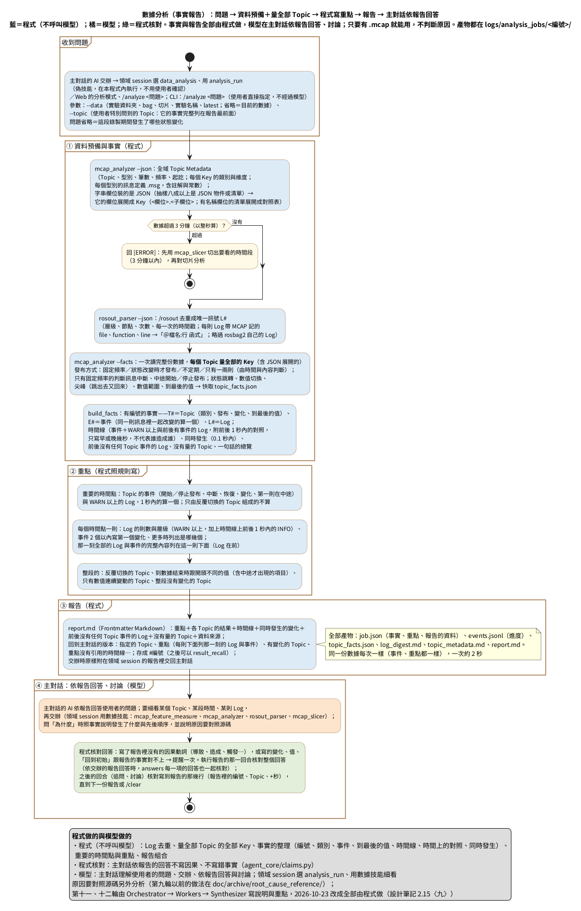

# 文件導覽

| 文件 | 給誰看 | 內容 |
|---|---|---|
| [架構說明](架構說明.md) | 想看懂或修改程式的人 | `agent_core/`、`web_app/` 由哪幾個模組組成、其他資料夾（§4.3）、兩種上下文模式、一回合怎麼跑、工具回傳管線、執行前關卡、給程式讀的收據（3.8）、狀態與持久化、CLI／Web 對照、常數、「要改什麼看哪裡」、評測（§12）、凍結的工具（§14）、新架構（§15～§18，§15 開頭是三層與流程的兩張圖）：低階執行器（照收據執行決策圖、第 1 級修正）、中階（複合技能、合約、判斷節點、第 2 級）、高階（分工交給領域、依報告回答的核對與照項目排、帶著上一次的經過再交）、子工作階段（沒有寫好的做法時用領域的工具一步一步做、查不到時寫明哪個領域查得到） |
| [架構說明 §13](架構說明.md#13-數據分析agent_coreanalysis_jobpy全部由程式做2026-11-17-起凍結第-14-節) | 想看懂或修改數據解析的人 | 全部由程式做的流程（事實 → 重要的時間點與重點 → 報告）、模組（含數據技能的共用層 `_ros2_data_common.py`）、主對話回答的核對、產物存在哪裡、常數、要改什麼看哪裡、報告的範例 |
| [設計筆記與已知限制](設計筆記與已知限制.md) | 想知道某個機制為什麼長這樣的人 | 每個機制現在的做法、理由與實測數據（主對話的程式把關在 2.12，數據解析在 2.15，工具回傳的提煉在 2.16，持續驗證在 2.17，給模型的字搬進 prompts/ 在 2.22，拿掉的功能在 2.25、2.26；新架構在 2.27～2.46：評測 2.27、收據 2.28、低階執行器 2.29、中階 2.30、Web 的決策圖 2.31、判斷節點與三個複合技能 2.32、高階接上主對話 2.33～2.35、子工作階段與凍結的四個領域 2.36～2.39、分工與交接 2.40～2.42、名稱要整個對上 2.43、方向的實驗與原型之後的第一批 2.44～2.46；中間空的編號是刪掉的舊紀錄）；完整技能清單（§3，數據技能與 toolkit 的對照在 3.8）；驗證方法；已知限制（§6）；未來方向 |
| [技能撰寫規範](技能撰寫規範.md) | 寫技能、改技能的人 | 規格文件的格式（給程式看的欄位 1.1、新架構的複合技能 1.2）；腳本輸出的結構（第一行、章節、截斷的說明、狀態標記放最後；給程式讀的收據 2.1）；[ERROR] 要寫原因與下一步；可以自己用（不讀標準輸入、逾時、不留背景程序）；測試放 `evals/skills/` |
| [待辦清單](待辦清單.md) | 要決定下一步做什麼的人 | 已記錄、還沒做的：新架構的步驟、每一步看到還沒做的與接下來的方向、架構整合驗證過要沿用的做法、凍結的工具的項目 |
| [新架構討論紀錄](../docs/新架構討論紀錄.md) | 參與定新架構的人 | 使用者的構想（`docs/` 的三份 HTML）的摘要、跟 HarnessMM 論文與現在程式的對照、已定與待討論的問題、評測的構想、每一輪的討論紀錄 |
| [長期願景](長期願景.md) | 關心延伸方向的人 | AGV/AMR 車隊調度場景的構想（尚未實作）、實作心跳機制與定時任務時要注意的事 |
| [評測](../evals/README.md) | 改了程式或 prompt、想知道有沒有變好的人 | 主對話、技能腳本、數據解析、隨機情境產生器、多步驟維運、提煉、真實專案（新架構的評測）、新架構的低階執行器、中階、高階、評測的完整性各組，與每個階段結束時的 `phase_check.py`：怎麼跑、怎麼加情境、怎麼讀報表 |
| [隨機情境的錄製產生器](../evals/datagen/README.md) | 要做大量數據測試的人 | 六個開發中套件的模擬、評分標準怎麼產生、三組數據 |
| [test_data](../test_data/README.md)（只在本機） | 要跑實機回歸的人 | 這台錄的 14 份數據、正確答案、回歸工具 |
| [archive/root_cause_reference](archive/root_cause_reference/README.md) | 要做根因 agent 的人 | 第一～九輪的源碼脈絡與因果推論（只供閱讀，不會被執行） |

## 圖

圖的來源（`.puml`）在 `diagrams/`，產生的 PNG 在 `images/`。

| 圖 | 來源 | 內容 |
|---|---|---|
|  | `diagrams/AI_agent_harness的說明.puml` | 元件與資料流；`vision/`（框選／上傳 → 結構化提取 → `[vision result]`）與使用者介面、SkillAgent、技能、偽技能（result_recall、analysis_run）、一次性 session（提煉、滾動摘要、視覺）、`logs/` 底下各種存檔（含收據 `<存檔>.receipt.json`、中階、子工作階段與低階的工作）、確認關卡的範圍；新架構的分工：主 session 分工交給領域（repo_analysis 與凍結的四個）→ 程式核對 → 有複合技能的由中階與低階照複合技能執行，沒有的（或中階沒有做完時）開子工作階段，用領域的工具一步一步做 → 報告 #編號（每個領域一份）與子工作階段寫的查得到的領域交回、要問使用者時程式直接問 |
|  | `diagrams/AI_agent_harness的狀態轉移.puml` | 一回合的狀態機；`/analyze` 直接指定；確認關卡擋哪些；Dispatch 的偽技能；分工（5d：核對、照順序做、後面的收到前面查到的、再交時帶著上一次的經過（合約只照新的子目標）、有沒有報告、子工作階段說別的領域查得到的項目）、子工作階段（5f：沒有複合技能或中階沒做完時一步一步做、只做自己的子目標、收尾寫哪個領域查得到、收尾的核對）與中階或子工作階段要問使用者（5e：程式轉問、接回）；回覆寫到長度上限被截斷的重問（3）；回答前的核對（3c：沒動作卻說做了、依數據分析的報告回答、依領域的報告回答的 answers，沒過的交回修一次；依領域的報告回答由程式照項目排、附出處那一行的原文）；附圖時的視覺提取（1b），以及附圖分析在 prompt、壓縮、下一句話裡的位置 |
|  | `diagrams/新架構的三層與決策圖.puml` | 新架構的結構（2026-11-21）：高階（主模型與 `orchestrator.py`、`answers.py`、`skills_system/DOMAIN.md`、`SKILLS.md`）→ 中階（`mid.py`、`judge.py`、中階的三種模型呼叫與 `prompts/mid/`，讀 `skills_system/repo_analysis/` 的 SKILLS.md 與複合技能：frontmatter 的 answers、parameters，〈什麼時候用〉〈骨架〉〈回退〉各給誰）→ 決策圖（工具節點與判斷節點、從收據帶入參數、第 1 版與重排的新版）→ 低階（`edg.py`、第 1 級修正的模型、`skills_system/tools/<工具>.md` 的 parameters／receipt／narrow）→ 腳本（parse_args、給模型的文字與收據、`_receipt_common`、`_path_common`）→ `logs/`（#編號與收據、mid／edg／sub 的工作）→ Web 的決策圖；子工作階段（`sub.py`）在旁邊：沒有複合技能、或中階沒報告時接手；箭頭寫誰讀誰、交什麼 |
|  | `diagrams/新架構從問題到答案的流程.puml` | 新架構的動態流程（2026-11-21，泳道的活動圖）：使用者 → 主模型分工 → 高階核對分工 → 中階挑技能、合約（程式核對）、照〈骨架〉排圖 → 低階照圖一個一個節點執行（parse_args、確認關卡、腳本、存檔與收據、守門、第 1 級）→ 中階的第 2 級、判斷節點、報告 → 高階把報告存成 #編號交回 → 主模型照報告一項一項回答 → 程式核對 answers、照項目排好給使用者；沒有複合技能或中階沒報告時走子工作階段；藍＝程式、橘＝模型、綠＝程式核對、紫＝存檔 |
|  | `diagrams/AI_agent_harness的工具回傳管線.puml` | 原文存檔（第一版領域的腳本另外寫收據給程式讀）→ 規格文件、提煉過的、程式整理好的報告（數據分析）直接給原文 → 太長的提煉（程式切段 → 每段一個 worker → 整合，程式核對行號）→ 檢索清單 → result_recall；退路（`/summarize off`、提煉沒成功、重點不比原文短）；中段是附圖的影像分析（提取 → 存成 #編號 → 〔附圖分析〕進清單 → 併進訊息），同一套 recall |
|  | `diagrams/數據診斷的流程.puml` | 數據分析（事實報告）的完整流程（活動圖）：收到問題 → 資料預備與事實（超過 3 分鐘先切；字串裡的 JSON 展開成 Key；程式量全部 Topic 的全部 Key、整理成有編號的事實）→ 重點（程式照規則寫：每個重要的時間點一則）→ 報告 → 主對話依報告回答與程式的核對（之後的回合也核對）；藍＝程式、橘＝模型、綠＝程式核對，底部是程式做的與模型做的；第九輪的流程圖在 `archive/root_cause_reference/doc/` |
|  | `diagrams/prompts與流程的對應.puml` | 給模型的字都在 `prompts/`：主對話（AGENT.md、context_modes/、Memory.md、harness/，含「領域」一節與分工的結果、answers 沒有通過核對的說明 `domain.md`、交給下一層的文字 `plan.md`）與各種獨立 session（summary/、extract/、vision/、新架構的第 1 級修正 edg/、中階的挑技能、合約與判斷 mid/，含再交時的上一次的經過與只從子目標抄參數、子工作階段 sub/）各用哪些檔案，誰組 prompt、輸出的 schema（主對話的回覆在有領域的報告時多 answers、action 一律最後；子工作階段收尾的查不到多寫哪個領域查得到）；`skills_system/` 的 SKILLS.md（拿掉領域的工具）、`DOMAIN.md`（給程式讀）、技能規格、新架構的領域與複合技能（領域的說明也組進主對話）（〈骨架〉〈回退〉給程式，判斷節點的 goal、種類與每條路的說明給判斷的模型）也是模型會讀的；留在程式裡的只有程式的輸出（工具結果、報告、[ERROR]）與程式認的標記；各 session 用哪個模型 |

改完 `.puml` 後重新產生 PNG，一律用本機離線渲染（不要用線上的 PlantUML 伺服器：圖的內容會離開這台機器）。`~/tools/plantuml/` 放了 Temurin JRE 21 與
plantuml.jar（1.2026.8，從 Maven Central 下載）；這台機器沒有 Microsoft JhengHei，字型換成系統的 Noto Sans CJK TC 再渲染
（`.puml` 本身不改，照舊寫 JhengHei）：

```bash
cd doc && T=$(mktemp -d)
sed 's/"Microsoft JhengHei"/"Noto Sans CJK TC"/' diagrams/數據診斷的流程.puml > $T/數據診斷的流程.puml
~/tools/plantuml/jre/bin/java -Djava.awt.headless=true -DPLANTUML_LIMIT_SIZE=16384 -jar ~/tools/plantuml/plantuml.jar \
  -tpng -charset UTF-8 -failfast2 $T/數據診斷的流程.puml && cp $T/數據診斷的流程.png images/
```

有 Microsoft JhengHei 的機器（原作者的環境：`/home/david/Software_quality_checking_pipeline/tools` 有 PlantUML、字型與 fontconfig）：

```bash
cd doc
PH=/home/david/Software_quality_checking_pipeline/tools
FONTCONFIG_FILE=$PH/fontconfig/fonts.conf GRAPHVIZ_DOT=/usr/bin/dot \
  $PH/jre/bin/java -Djava.awt.headless=true -DPLANTUML_LIMIT_SIZE=16384 -jar $PH/plantuml.jar \
  -tpng -charset UTF-8 -failfast2 -o ../images diagrams/數據診斷的流程.puml
```

寫 `.puml` 時注意：字型沒有 emoji（📊 會變成方框，請用文字）、Noto Sans CJK 也沒有 ✗；同一行有兩個 `--`（例如 `--data --topic`）會被當成刪除線，要寫成 `~--`。
