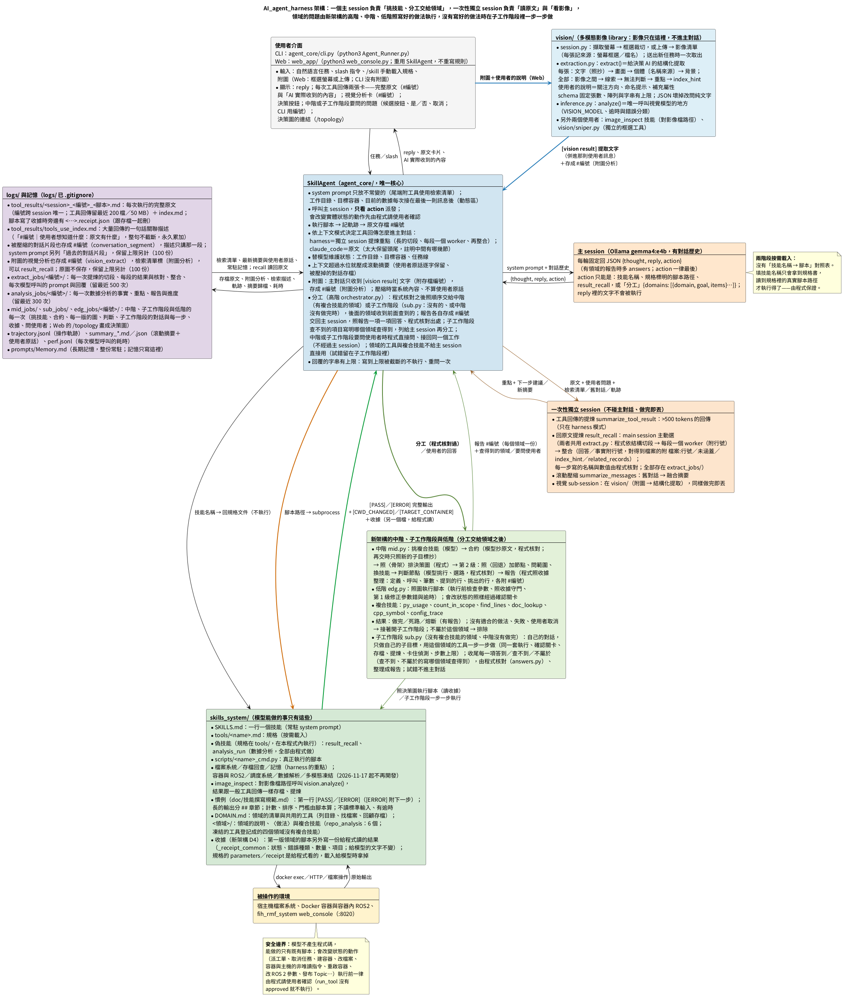
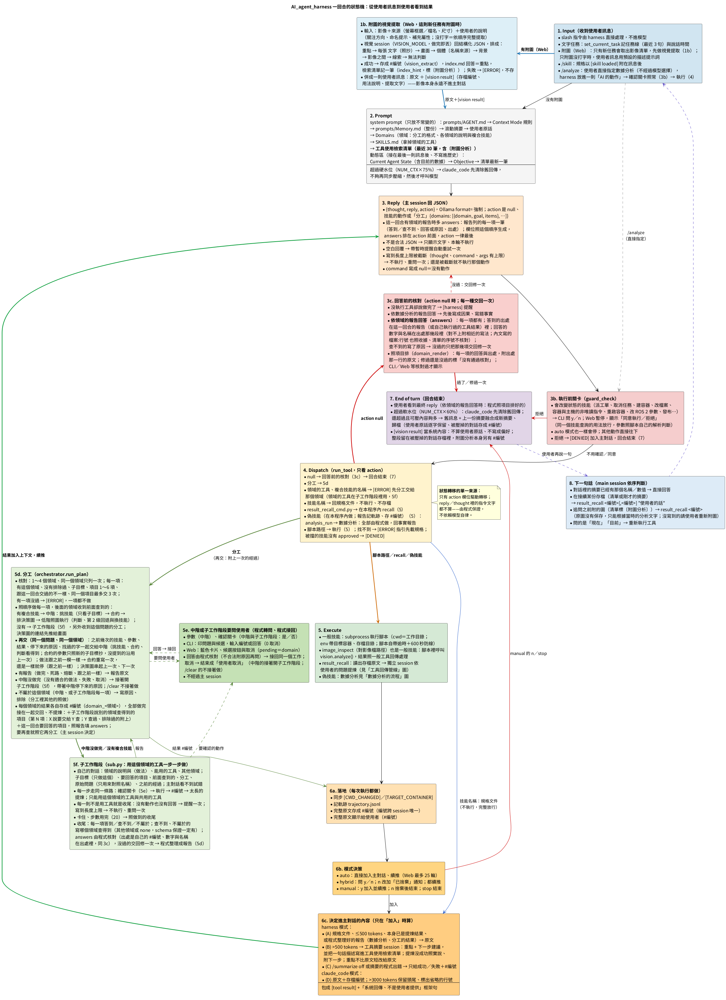
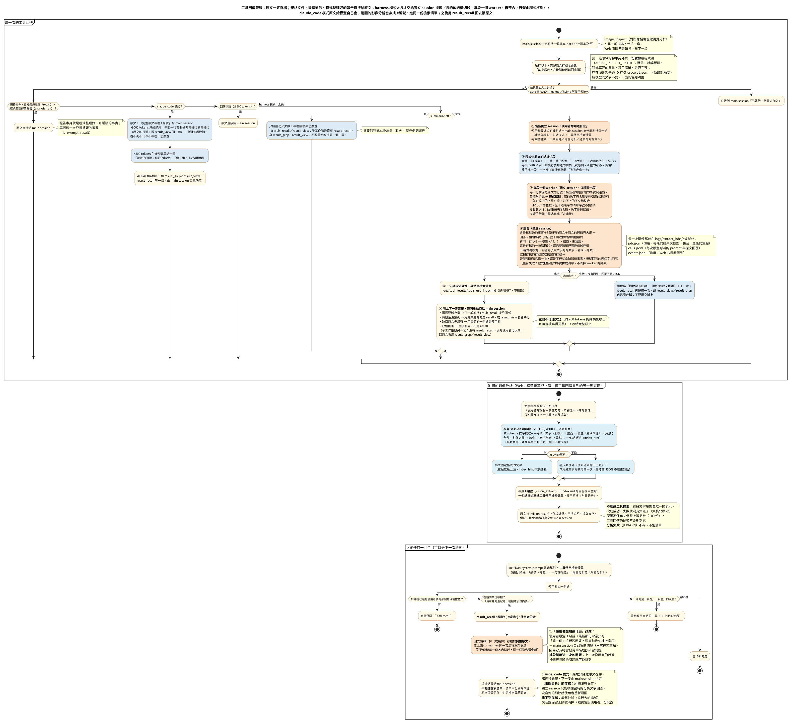
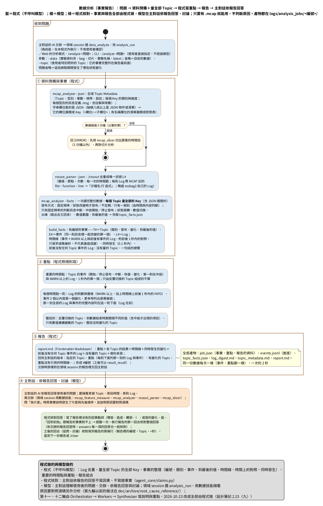
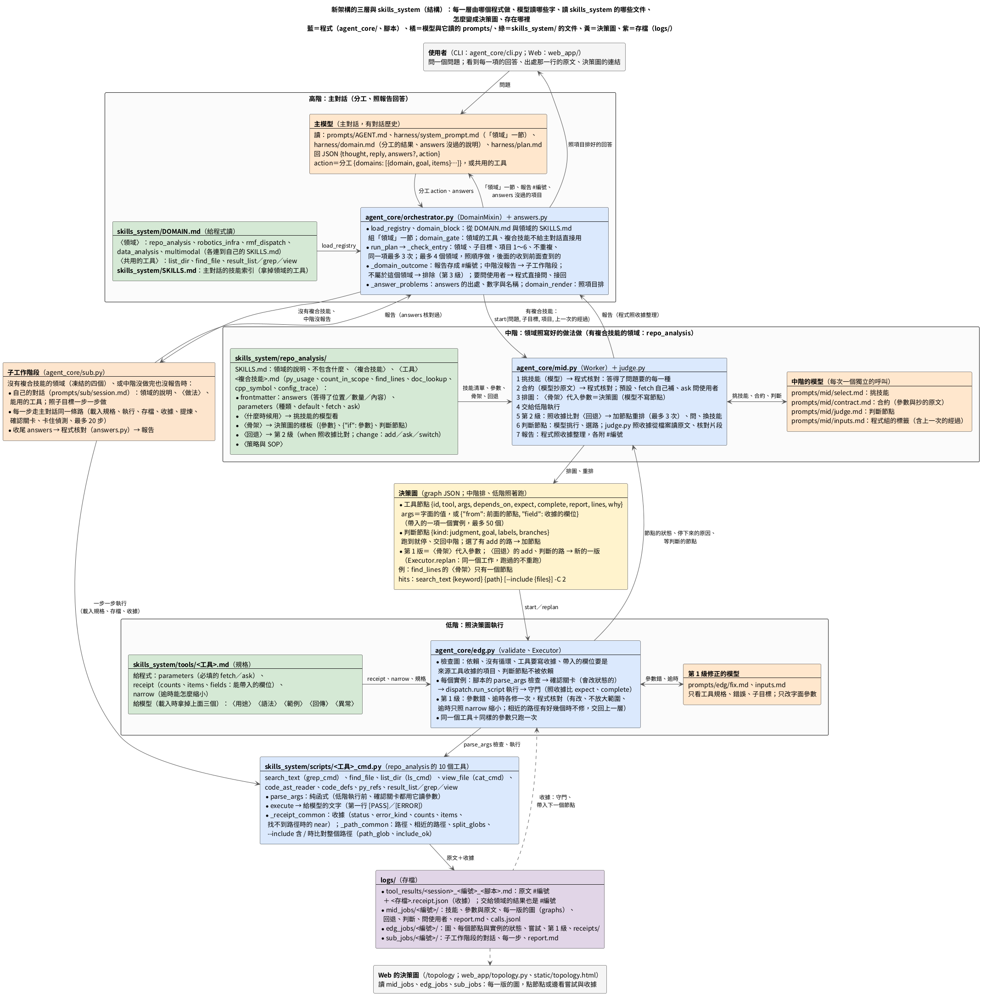
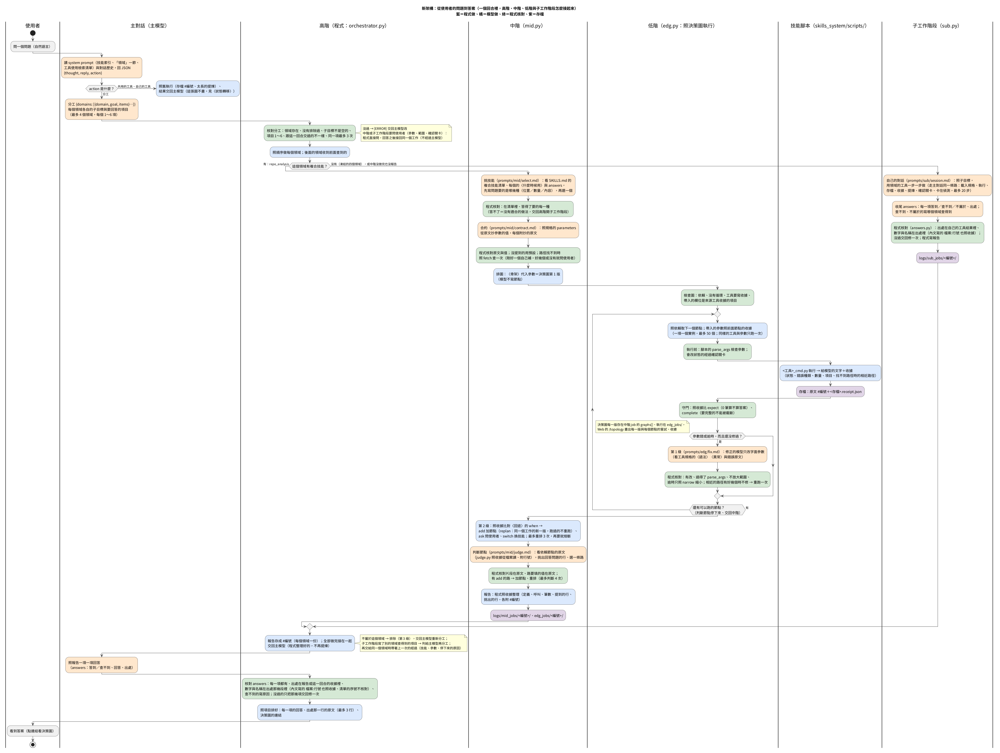

# 架構說明

> 寫給：想看懂或修改 harness 核心的人。這個資料夾是一個本地模型的 agent harness：主對話迴圈、確認關卡、多段處理長內容、存檔與回顧；目標是找檔案、文件與程式分析做到穩定，數據解析、機器人維運與視覺的工具**凍結**（第 14 節）。新架構由下往上實作（〈[新架構討論紀錄](../docs/新架構討論紀錄.md)〉；收據在 3.8、低階執行器在第 15 節、中階在第 16 節、高階在第 17 節、子工作階段在第 18 節，三層的圖在第 15 節開頭：主對話把要用到領域的問題分工交給領域（找檔案、讀文件與 log、分析程式的 repo_analysis，與凍結的工具登記成的四個領域），有寫好的做法的由中階與低階做，沒有的由程式開子工作階段、用這個領域的工具一步一步做（試錯留在裡面），程式整理成報告交回，主對話照報告一項一項回答、程式核對出處；子工作階段查不到的項目寫明哪個領域查得到，主對話照它再分工；沒答到的帶著上一次的經過再交），這份寫的是現在的程式。[README](../README.md) 是一頁總覽；這份講核心 `agent_core/` 與網頁 `web_app/`：由哪幾塊組成、一回合怎麼跑、工具回傳怎麼處理、狀態存在哪裡、要改某件事該看哪裡。每個機制「為什麼這樣做」與實測數據在〈[設計筆記與已知限制](設計筆記與已知限制.md)〉。文中的函式名稱都可以直接在 `agent_core/`、`web_app/` 裡搜尋，所在模組見第 4 節。

---

## 0. 先回答最常搞混的一題：工具回傳什麼時候會被提煉？

**每次執行腳本，完整原文一定會存檔（`#編號`）並顯示給使用者；要不要「提煉」看上下文模式與大小。** 下面講的是預設的 harness 模式；claude_code 模式（`/context_mode claude_code`）完全不提煉，原文直接進上下文、太大保留頭尾，見第 3.4 節。兩種模式的對照在第 1.1 節。

- **≤500 tokens**：原文直接進主對話，不開任何獨立 session。
- **>500 tokens**：harness 自動交給獨立 session 提煉（`summarize_tool_result` → `agent_core/extract.py`）：放得進一段（8000 字）就一次讀完；更長的由程式依結構切段，每段一個 worker、最後一個整合，主對話收到的是重點（每條事實附原文的行號，由程式核對）與下一步建議。auto 模式下立刻發生；manual／hybrid 模式下在你按「加入」之後才發生（按捨棄就不花模型呼叫）。
- **`result_recall` 不是自動的**：它是一個技能，由 main session 判斷「使用者在追問某份存檔」時主動選用；harness 回去讀那一份（或幾份）存檔的完整原文，用同一套提煉、以使用者現在的問題為錨點重新提煉。

兩者共用 `extract.py` 的 `Extraction`，差在觸發方式與錨點：

| | 工具回傳的提煉 `summarize_tool_result` | 回原文提煉 `result_recall` |
|---|---|---|
| 誰觸發 | harness 自動：回傳 >500 tokens 且要加入主對話 | main session 主動選（`action`） |
| 讀什麼 | 剛執行完的完整輸出 | 已存檔的 1～3 份完整原文（每一份各自切段，同一個整合看全部） |
| 錨點 | 使用者的目標（Objective、任務線）＋這一步的目的（thought／reply／action） | 任務線（最新一句＋前幾句）＋模型給的聚焦點 |
| 寫進檢索清單 | 會（只有原始工具的結果才寫） | 不會（它是衍生輸出） |
| 給 main session 的 | 重點（事實附行號）＋下一步建議 | 重點（事實附行號）＋下一步建議 |
| 存檔 | `logs/extract_jobs/<編號>/`：切段、每段的結果、核對、整合、每次模型呼叫 | 同左 |

---

## 1. 全貌



整個系統是「一個會挑技能的主 session，加上一群只負責讀原文的一次性 session」：

- **主 session**（Ollama `gemma4:e4b`，有對話歷史）每輪只回一個 JSON `{thought, reply, action}`（這一回合有領域的報告時多 `answers`，排在 action 前面：照報告一項一項回答，第 17 節）。它不寫程式、不直接讀大量原文；`action` 只能填技能的名稱、規格文件標明的腳本路徑、`result_recall`，或「分工」（`{"domains": [{"domain", "goal", "items"}, …]}`：要用的領域一次列出來，第 17 節）。
- **`SkillAgent`**（`agent_core/`）是唯一的核心：組 system prompt、呼叫主 session、依 `action` 派發、執行腳本、存檔、決定工具回傳怎麼進主對話、壓縮上下文、記操作軌跡。CLI（`agent_core/cli.py`，由 `Agent_Runner.py` 啟動）與 Web（`web_app/`，由 `web_console.py` 啟動）都只是它的外殼。
- **一次性獨立 session**：自己的 system／user prompt、不碰主對話、做完即丟（見第 7 節）；工具回傳的提煉是其中一種，長的輸出分給好幾個 worker 再整合。
- **視覺 `vision/`**（Web 附圖）：框選螢幕或上傳的影像只存在這裡；送出新任務時交給視覺 session 做結構化提取（文字 → 畫面 → 個體 → 背景、線索、重點），主對話只收到以 `[vision result]` 併進那則使用者訊息的文字，分析同時存成 `#編號`、以〔附圖分析〕記進檢索清單，之後跟工具回傳一樣可以 `result_recall`（見 3.7）。`image_inspect` 技能對影像檔路徑呼叫同一個 `vision.analyze()`，結果照一般工具回傳處理。
- **技能系統 `skills_system/`**：索引（`SKILLS.md`，常駐）→ 規格（`tools/<name>.md`，按需載入）→ 腳本（`scripts/<name>_cmd.py`，真正執行）。沒有「技能名稱 → 腳本」的對照表：模型必須先載入規格、讀到真實的腳本路徑才執行得了。新架構的領域在 `skills_system/<領域>/`（領域的說明與複合技能，中階讀；第 16 節），領域的清單與每一層都直接用的工具在 `skills_system/DOMAIN.md`（第 17 節）。
- **領域（新架構的高階，`orchestrator.py`、`skills_system/DOMAIN.md`）**：找檔案、讀文件與 log、分析程式（`repo_analysis`），以及凍結的工具登記成的四個領域（容器與 ROS 2、調度系統、錄製的數據、音檔與影像檔）的問題，主 session 填「分工」——要用的領域一次列出來，每個領域各自的子目標與要回答的項目——程式核對之後照順序交給中階（有複合技能的領域：挑複合技能、合約、判斷）與低階（照決策圖執行腳本），或**子工作階段**（沒有複合技能的領域，或中階沒有做完也沒有報告時：自己的對話，用這個領域的工具一步一步做，試錯留在裡面，第 18 節）；後面的領域收到前面查到的。報告由程式整理、各自存成 `#編號` 交回主 session 照報告一項一項回答（程式核對出處與數字、照項目排給使用者，每一項附出處那一行的原文）；子工作階段查不到、不屬於的項目寫了哪個領域查得到時，程式列給主 session 再分工；沒答到的可以再分工一次，程式把上一次的經過一起交過去（合約只照新的子目標抄參數）；中階或子工作階段要問使用者時程式直接問、接回同一個工作，不經過主 session。領域的工具與複合技能不給主 session 直接用（第 17 節）。三層的結構與一個問題怎麼走，見第 15 節開頭的兩張圖。
- **`logs/`**：每次工具回傳的原文存檔、工具使用檢索清單、操作軌跡、滾動摘要歸檔、每次模型呼叫的耗時、新架構的中階、子工作階段與低階的工作（見第 8 節）。
- **執行前關卡**（`guard.py`）：會改變實體／外部狀態的技能（派工單、取消任務、建容器、容器內非唯讀指令），執行前一律由程式要求使用者確認，任何模式都一樣。
- **數據分析**（`analysis_job.py`，`analysis_run` 偽技能，全部由程式做）：程式在容器裡量全部 Topic 的全部 Key（字串裡的 JSON 也展開），整理成有編號的事實（T#＝Topic、E#＝事件、L#＝Log；類別、時間線、時間上的對照）與重點，只做事實報告、不判斷原因；主對話依報告回答（見第 13 節）。
- **評測**（`evals/`）：主對話、技能腳本、數據解析、隨機情境產生器、多步驟維運、提煉、真實專案（新架構的評測）、低階執行器、中階、高階、評測的完整性十一組，改程式之後先跑不用模型的自我測試；每個階段結束時 `phase_check.py --model` 跑 harness 的真模型評測（含真實專案）、跟基準比（凍結的工具加 `--tools`；見第 12 節）。

### 1.1 兩種上下文模式（`/context_mode harness|claude_code`）

差別只在「誰決定上下文裡放什麼」。規則文字在 `prompts/context_modes/<模式>.md`，接在 `AGENT.md` 後面進 system prompt；程式的分岔在 `turn.py` 的 `_content_for_context`、`context_mode.py`、`tool_summary.py`（recall 的建議）與 `compression.py`（清除舊回傳）。

| | harness（預設） | claude_code |
|---|---|---|
| 想法 | harness 替模型做決定：小模型不擅長在一大段原文裡找東西，就先幫它找好 | 相信模型：原文給它，要查什麼、查多少自己決定；harness 只提供安全網 |
| 大量工具回傳（>500 tokens） | 獨立 session 依問題提煉重點（長的切段、每段一個 worker 再整合，事實附行號）＋下一步建議（第 3.1 節） | 原文直接進上下文；超過 `RAW_RESULT_MAX_TOKENS`（3000）保留頭尾，中間一行註明省略第幾行到第幾行、中間有哪幾節、存檔編號、怎麼查（第 3.4 節） |
| 查細節 | 獨立 session 的建議指定下一步（`result_recall …`、`result_view <編號> --from <行號>`） | 模型自己選 `result_grep`／`result_view`／`result_recall` |
| `result_recall` | 結尾下指令 | 結尾只陳述原文在哪、哪裡沒涵蓋 |
| 檢索清單的描述 | 獨立 session 寫的語意描述 | 程式組的「當時的問題：執行的指令」（不多花模型呼叫） |
| 上下文超過水位 | 滾動摘要 | 先把舊的工具回傳清成「原文在存檔 #N」的佔位（不呼叫模型、可取回），不夠才滾動摘要 |

兩種模式共用：原文存檔與 `#編號`、檢索清單、執行前關卡、長期記憶、滾動摘要（含使用者原話與對話片段存檔）、動態區。切換只影響之後的工具回傳，已經在上下文裡的內容不會回頭改寫。

---

## 2. 一回合怎麼跑（對照程式碼）



以 CLI 的 `main()`（`agent_core/cli.py`）為例（Web 的 `run_turn()`（`web_app/flows.py`）是同一套步驟，對照見第 9 節）：

1. **收訊息**：slash 指令在 `main()` 的 if 鏈直接處理、不進模型。文字任務呼叫 `set_current_task()` 記進任務線 `task_history`（最近 3 句）與說話時間 `_user_said`，`begin_turn()` 把這一回合的把關歸零（含交給領域的紀錄 `_reset_domain_turn`）；`/skill` 手動載入的規格用 `attach_skill_docs()` 附在訊息後；Web 有附圖時先做視覺提取（狀態機的 1b，見 3.7），提取文字以 `[vision result]` 併進這則訊息。
2. **組 prompt**：`ask_ai()` 每次都用 `get_system_prompt()` 重組第一則 system 訊息（只放不常變的內容，含「領域」一節與拿掉領域工具的技能索引，見第 6 節），再由 `ensure_context_budget()` 檢查硬水位（claude_code 模式先清除舊的工具回傳，不夠才同步壓縮）。送出前 `_with_state_tail()` 把動態區（`build_state_tail()`：Current Agent State、Objective、檢索清單最新一筆）接在最後一則訊息後面——只接在這次送出的副本上，不寫進 `messages`。
3. **呼叫主 session**：`_chat_once()` 以 `format=agent_reply_schema(領域, 項目數)` 強制 JSON（`action` 是 null、技能的動作或「分工」三種之一；這一回合有領域的報告時多 `answers`：每一項一筆，第 17 節；欄位依序 thought、reply、answers、action——Ollama 照 schema 的順序輸出，action 一律最後），`parse_agent_reply()` 解析成 `{thought, reply, action, answers, valid}`，並記一筆 `logs/perf.jsonl`。不是合法 JSON 就只顯示、不執行；`reply` 空且 `action` 為 null 時，帶暫時提醒自動重試一次。`thought`、`command`、`args` 有長度上限（`REPLY_*_CHARS`；Ollama 只套用 2000 字以內的上限，`reply` 是給使用者的回答、可能更長，不設）：寫到上限（`cut`，輸出失控，例如在參數裡一直重複同一段）時這一次不執行、帶暫時提醒重問一次，還是被截斷就不執行那個動作（`drop_cut`：存進對話的是不含截斷參數的 JSON）；`command` 寫成 null 跟 `action` 填 null 一樣。
4. **執行前關卡**：`guard_check()` 判斷這個 `action` 會不會改變實體／外部狀態（第 3.5 節）。會的話 CLI 問 y／n、Web 暫停顯示「同意執行／拒絕」（`pending["mode"] = "guard"`），任何模式都一樣；拒絕時把 `[DENIED]` 包成工具結果加入 `messages`，回合結束等使用者說明。
5. **派發**：`run_tool(parsed, approved)` 只看 `action`：
   - `null` → 回合結束；
   - `domains`（分工）→ `run_plan()`（第 17 節）：程式核對（1～4 個領域、同一個領域只出現一次；每一項：有這個領域、這個問題沒有排除過它、子目標、項目 1～6 項、跟這一回合交過的不一樣、同一個項目最多交 3 次；有一項沒過就一項都不執行）之後照順序交給中階（有複合技能的領域）或子工作階段（沒有的；中階沒有做完、也沒有報告時也接著開，第 18 節），後面的領域收到前面查到的，同一個問題再交給同一個領域時附之前幾次的經過；每個領域的結果存成 `#編號`，全部做完接在一起交回（`DOMAIN_RESULT_HEAD` 開頭，不提煉；子工作階段寫了哪個領域查得到的項目列在後面）；中階或子工作階段停下來要問使用者時設 `domain_pending`（分工停在那一項），CLI 直接問、Web 暫停（`pending["mode"]="domain"`），使用者的回答由程式交給它接回（`answer_domain`／`cancel_domain`）、接著做剩下的，不經過主模型；
   - 領域的工具（技能名稱、規格或腳本；`DOMAIN.md`〈共用的工具〉以外的）與領域的複合技能的名稱 → `domain_gate()` 回 `[ERROR]`（先分工交給那個領域）；子工作階段裡（`_sub_allowed`）只能用那個領域的工具與共用的工具；使用者直接指定的指令（`/analyze`，`direct=True`）不擋；
   - `command` 是技能名稱（`tools/<name>.md` 存在）→ 回傳規格文件，**不執行**；
   - `result_recall_cmd.py` → 在本程序內呼叫 `_result_recall()`（它要呼叫模型，不能包成 subprocess）；
   - 其他 → 當成腳本路徑；被擋的技能沒有 `approved=True` 就回 `[DENIED]`、不執行（CLI／Web 以外的呼叫端也擋得住）；偽技能 `analysis_run` 過了關卡後在本程序內執行（`AnalysisMixin`，一樣記軌跡、存檔）；其餘由 `_exec_script()` 以 subprocess 執行（用環境變數 `AGENT_RECEIPT_PATH` 指定收據檔，執行完讀回 `last_receipt`，見 3.8），找不到腳本就回可行動的 `[ERROR]`，提示先載入規格。
6. **落地**：`_sync_state_from_tool_output()` 讀輸出最後的狀態標記（`[CWD_CHANGED]`、`[TARGET_CONTAINER]`、`[ANALYSIS_DATA]`、`[ROS2_WORKSPACE]`…）更新狀態；`_record_trajectory()` 記軌跡、呼叫 `_archive_tool_result()` 把完整原文存成 `#編號`（有收據時旁邊另存 `<存檔>.receipt.json`，軌跡記收據的摘要）。
   **卡住偵測**（`turn_guard.py`，`run_tool` 的外層 `note_tool_result`）：同一個回合裡同樣的動作得到同樣的結果，第二次在回傳後面附「不要再重複、換個做法」，第三次加強提醒（換技能或參數），第四次（或同一個錯誤第四次；`AGENT_REPEAT_STOP_AT` 可調，評測的對照組用 `AGENT_TURN_GUARD_RULE=v4` 換回「第三次就停」）設 `agent.stuck`，回合迴圈加入這次結果後就停下來、推 ⛔ 通知交回使用者（存檔是原本的回傳，不含提醒）。
7. **模式決策**：auto 直接加入並續推；hybrid 問 y／n，n 改加「已捨棄」通知，兩者都續推；manual 按 y 加入並續推，n／stop 結束回合。
8. **決定進主對話的內容**（只有「加入」時才算）：`_content_for_context()` 依上下文模式決定給原文、摘要、原文頭尾或只給成功／失敗（見第 3 節）；`tool_result_message()` 包上 `[tool result]` 與「系統回傳、不是使用者提供」框架句，以 user 角色加入 `messages`，然後回到步驟 2。
9. **模型停下來（`action` 為 null；狀態機的 3c）**：先 `claim_without_action()`——這一回合一個工具都沒執行、回覆卻說「已經重新啟動／建立／刪除…」（條件句、疑問句、否定句不算；只認子句開頭或「我／我們」後面的說法），送一次 `[harness]` 提醒（要做就執行、沒做就照實說）、回到步驟 2，每回合最多一次（收到數據分析的報告之後，同一個位置還有 `analysis_reply_check`，見 13.3；收到領域的報告之後還有 `domain_reply_check`：`answers` 每一項都有、答到的出處在這一回合的報告或自己執行過的工具結果裡、回答的數字與名稱在出處那幾段裡、查不到的寫了原因，沒過的只把那幾項交回修一次，見第 17 節）。依領域的報告回答時，CLI 與 Web 等核對過才顯示，顯示的是 `domain_render` 照項目排好的回答（每一項附出處那一行的原文，修過還是沒過的標出來）。
10. **回合結束**：`after_turn_compression()` 檢查軟水位：claude_code 模式先清除舊的工具回傳，清完還超過、而且可壓的內容夠多，才把舊訊息融合成滾動摘要（第 3.6 節）。

---

## 3. 工具回傳管線



3.1～3.3 是 harness 模式（預設，也是上圖畫的流程）；claude_code 模式在 3.4；3.5 是兩種模式共用的執行前關卡，3.6 是壓縮，3.7 是附圖的視覺分析（圖的中段），3.8 是給程式讀的收據。

### 3.1 這一次的工具回傳（圖的第一段）

用一個實際例子走一遍：使用者問「哪幾台車的電量低於 40%？」，main session 執行 `ROS2_topic_echo /fleet_states_json`，輸出是 120 台車的狀態、約 2.2 萬字，超過 500 tokens，於是交給 `summarize_tool_result`：

1. **① 告訴獨立 session「使用者想知道什麼」**：使用者最近說的幾句話、main session 為什麼執行這一步（它的 thought／reply），以及檢索清單上其他存檔的一句話描述（只用來判斷還需要哪幾份舊存檔）。
2. **② 程式依原文的結構切段**（`_results_common.chunk_lines`）：每段不超過 8000 字，切在章節、一筆紀錄（這裡是 `- name: amr_41` 這種一台車的開頭）、空行；不切在縮排的中間。每段附前情：第一行（狀態列）、所在的章節、表格的表頭。這個例子切成 3 段；放得進一段的輸出不切，③④合成一次呼叫。
3. **③ 每段一個 worker**：只讀那一段，每一行前面是原文的行號（`  34→  battery_percent: 20.6`），摘出跟問題有關的事實（「amr_03 的 battery_percent 為 20.6」，行 34）。程式核對每一條的數字與名稱真的在引用的那幾行（前後 2 行、縮排的上層——名字 `- name: amr_03` 在上面幾行——與下層），對不上的不交給整合。段數超過 8 時依問題裡的字挑段落讀，沒讀的行號寫進「未涵蓋」。
4. **④ 整合**：拿各段核對過的事實、那幾行的原文、原文的開頭與大綱，寫成回答、相關事實（附行號）、錯誤、未涵蓋、這份存檔的一句話描述、還需要哪幾份舊存檔（程式只留清單裡真的有的編號）。程式再核對一次：回答寫了原文沒有的數字、名稱或總數（「共 N 台」不是原文也不是事實的條數），或把存檔的行號寫成檔案的行號 → 帶著問題請它修一次；還是不行就拿掉那條事實、在回答下面標明。
5. **⑤ 一句話描述寫進工具使用檢索清單**（`tools_use_index.md`），之後每一輪都看得到。
6. **⑥ 附上下一步建議**，連同重點交給 main session：30 台車每台一行、附行號；建議裡寫「要看某一條的原文：`result_view <編號> --from <行號>`」。

對照程式碼：

| 步驟 | 函式 | 做什麼 |
|---|---|---|
| 存檔 | `_record_trajectory` → `_archive_tool_result` | 每次執行都存 `logs/tool_results/<session>_<編號>_<腳本>.md`（key: value 檔頭＋原文），`index.md` 追加一行（上鎖：背景壓縮也會寫）；腳本寫了收據時另存 `<…>.receipt.json`（3.8） |
| 判斷 | `_content_for_context`、`is_exempt_result` | 規格文件、≤500 tokens、本身已是提煉結果（`TOOL_SUMMARY_TAG` 開頭）、或程式整理好的報告（數據分析、交給領域的結果）→ 原文；`/summarize off` 或提煉失敗 → 只給成功／失敗（附 `result_recall`／`result_view --outline` 的用法；子工作階段沒有 `result_recall`，附 `result_grep`／`result_view`：`reduced_sub`） |
| 組錨點 | `summarize_tool_result`、`_build_task_anchor_text`、`_last_assistant_step` | 使用者的目標＋這一步的目的 |
| 提煉 | `extract.Extraction.run`：`_direct`（一段）或 `_merge`（`_select` 挑段落 → `_worker` → `_merge_input` → 整合） | 切段（`chunk_lines`、`chunk_context`）、worker（`prompts/extract/worker.md`，`EXTRACT_WORKER_SCHEMA`）、整合（`prompts/extract/synthesizer.md`，`TOOL_SUMMARY_SCHEMA`：answer／facts[{text, lines, record}]／errors／not_covered／suggested_questions／index_hint／related_records） |
| 核對 | `missing_tokens`、`_has_name`、`_drop_ordinals`、`evidence_lines`、`Extraction._ground`、`_misplaced`、`_finish`、`_repair` | 每條事實的數字與名稱要在引用的行（與上下層）裡，名稱要整個對上（`_has_name`：開頭、結尾是英數字的，前後不能接英數字——`av2_test` 不算 `nav2_test` 裡有；底線、斜線、點、冒號照舊算分隔；行號的寫法不吃名稱裡的字，數字開頭的名稱連數字一起比；待辦 4j ①）；10 以下的整數與清單的序號不核對（`_drop_ordinals`：從 1 開始照順序的 `1.` `2.` … `13.`，又從 1 開始是另一張清單；清單裡寫的數字、單獨一個 `13.`、跳號之後的照樣核對；待辦 4m ①）；回答的字要在原文裡、總數要有根據；回答寫的行號是事實引用的那一行的存檔行號、不是它在檔案裡的行號（`_misplaced`，待辦 4k ②）也算對不上；對不上請整合修一次，還是不行就拿掉或標明 |
| 檔案的行號 | `_results_common.file_lines`、`ToolSummaryMixin._file_lines`、`Extraction._at` | 照存檔的收據把原文的每一行對到檔案（view_file、search_text 每一行的 `N→` 是檔案的行號，提煉再加一層存檔的行號，模型會搞混）：收據只有一個檔案就是它，好幾個就是上面最近一行寫到的那一個（長的路徑先比）；只認收據裡的絕對路徑（result_grep 記的是存檔編號）。交給整合與交給主對話的事實都附「行 149＝<檔案>:49」（待辦 4k ②） |
| 存檔 | `JobStore`（`jobstore.py`） | `logs/extract_jobs/<編號>/`：`job.json`、`calls.jsonl`（每次呼叫的 prompt 與回覆）、`events.jsonl`（進度，開頭 📑） |
| 驗證 | `_validate_related` | related_records 只留清單裡真的有的編號，最多 2 筆 |
| 寫清單 | `_append_tool_use_index`、`tidy_hint` | 只有原始工具的結果才寫一行進 `tools_use_index.md`（`result_*` 這類衍生輸出不寫）；描述整句照存、**不截斷** |
| 排版 | `_render_tool_summary`、`_followup_guidance` | 回答／相關事實（附行號，對得到檔案的接著寫 `＝檔案:行號`）／錯誤／未涵蓋／還需要的舊存檔／之後可能想知道的，結尾附下一步建議；回答把存檔的行號寫成檔案的行號、修一次還是一樣的，標「程式核對：回答寫的「第 149 行」是存檔原文的行號，那一行在檔案裡是 …」 |

下一步建議（`_followup_guidance`）依序判斷：

1. 還需要之前的存檔 → 直接給合併指令 `result_recall 這份,那份 "<使用者的話>"`（幾份交給同一次提煉，才比得了）；
2. 有段落沒讀到 → 已經回答的直接回答；使用者要的正好在沒讀到的行時，用更具體的問題 recall（會重新挑段落）或 `result_view` 看那幾行；
3. 原文裡沒有的缺口 → 用自然的一句話問使用者；
4. 已經回答 → 直接回答，不必 recall。
提煉沒有成功（回覆不是 JSON、模型沒有回應）時照實說，不寫成「已經回答」；整合失敗但各段有結果時，交給 main session 的是程式排出的各段事實。

子工作階段（第 18 節）的提煉另有一套說法（`sub=True`，`prompts/harness/followup.md` 的 `sub_*`）：它沒有 `result_recall`、也沒有使用者可以問——回原文看用共用的 `result_grep`、`result_view`，還要一起看之前的存檔就列出編號、一樣用這兩個看；也不寫「完整內容已顯示給使用者」（子工作階段的工具輸出使用者沒看到）。主對話的說法不變（待辦 4k ①）。

「什麼時候不需要 recall」由看過完整原文的獨立 session 明說，main session 不必自己猜。

### 3.2 之後任何一回合（圖的最後一段）

`get_system_prompt()` 尾端由 `_tool_use_index_block()` 注入檢索清單最近 30 筆（格式 `#編號（時間）：描述`；原始檔已經被清掉的不列），並附上依序判斷的規則：對話裡已經有答案 → 直接回答；在接續某份存檔 → `result_recall`；問「現在」的狀態 → 重新執行工具；都不像 → 當作新問題。清單一千多 tokens、只在跑完提煉時多一筆，所以留在 system prompt（KV cache 大多命中）；對話一長，system prompt 的尾端會落在整段上下文的中間，所以動態區另外用一行（`tool_use_index_pointer`）提示最新一筆。

main session 執行 `result_recall <編號>[,<編號>] "<使用者的話>"` 時，`_result_recall()` 回去讀那一份（或幾份）存檔的完整原文，走上面 ①～④、⑥ 同一套流程重新提煉。跟 3.1 不同的地方：

- **①「使用者想知道什麼」怎麼給**：用 harness 自己記的使用者最近 3 句話（任務線），最新一句當問題、前兩句當背景。因為使用者回答追問時常常只說「第一個」「好」「那溫度呢」，單看這一句不知道在問什麼，要靠前幾句補上意思。
- **main session 寫的那段問題只當補充重點**：`result_recall 12 "哪些檔案跟記憶有關"` 引號裡是 main session 自己寫的，harness 不直接拿它當使用者的問題，只附在後面當「要特別注意的點」。原因：小模型有時會把清單上的描述抄進引號，拿它當問題就錨錯了；跟使用者原話或清單描述一模一樣時，乾脆不附。
- **好幾份一起讀**：每一份各自切段、各自的 worker，同一個整合看全部；事實的行號寫成「#12 行 40」。挑段落用的是這一次的問題，所以上一次沒讀到的段落，換個更具體的問題就可能挑到。
- **找不到存檔**：分清楚是編號抄錯（說目前最大的編號）、超過保留上限被清掉（照實告訴使用者），還是參數順序錯；一次超過 3 份時說哪幾份沒讀。

**提煉結果不寫進檢索清單。**清單記的是「原始來源」：每一筆代表一份原始工具輸出、指向它的完整原文。recall 沒有產生新資料，只是換一個問題重讀已經存在的原文。如果把它也寫進去：

- 同一份來源會在清單上佔兩格（例如 #12 是 tools 清單，recall 後的 #13 又描述一次 tools 清單），30 筆的顯示視窗很快被重複的內容佔滿；
- recall 的存檔裡只有「提煉後的重點」，不是完整原文。之後如果有人 recall 到這一筆，讀到的是摘要的摘要，資訊比直接 recall #12 少。

所以原本那一筆（#12）留在清單上、繼續指向完整原文；recall 本身仍然記進操作軌跡和 `index.md`（所有執行的稽核清單），只是不進檢索清單。另外，recall 的輸出開頭是 `TOOL_SUMMARY_TAG`，交給 `_content_for_context` 時會被判定成「已經提煉過」，直接給 main session，不會再提煉一次（Web 上也只顯示一張卡片）。

**行號**：`result_view`、`result_grep`、提煉結果、claude_code 模式的截斷說明用的都是原文的行號（工具輸出的第 1 行＝行 1，不含存檔的檔頭），寫成 `120→內容`。`result_view <編號> --outline` 列出原文的章節與行號（`_results_common.outline`）。view_file、search_text 的每一行本身也有 `N→`（檔案的行號）；提煉的事實對得到檔案時另寫檔案的位置（`行 149＝<檔案>:49`，3.1 表格的〈檔案的行號〉）。

### 3.3 為什麼編號跨 session 唯一

`SkillAgent.__init__` 從既有存檔的最大編號續編（`_max_archived_id`），所以清單上的 `#16` 在任何一次啟動都只指向同一份存檔，模型只要抄數字。要整個重來，請刪整個 `logs/tool_results/`（連同 `tools_use_index.md`）；只刪存檔會讓編號重新從 1 起算，跟清單對不上。配號一律走 `_next_id()`：上鎖（背景壓縮也會為被壓縮的對話片段配號），而且每次都看一下存檔目錄裡最大的編號（CLI 與 Web 同時開著時，另一個 process 剛存的也算），不會配到同一個編號。刪舊存檔照（session、編號）排（`_archived_names`）。

### 3.4 claude_code 模式

`_content_for_context()` 在 claude_code 模式把所有工具回傳交給 `raw_result_for_context()`，不呼叫任何模型：

1. 第一行註明 `（完整原文存檔 #N，約 X tokens）`，接著是完整原文。
2. 超過 `RAW_RESULT_MAX_TOKENS`（3000）：開頭改成 `[tool result - 原文頭尾]`，在行的邊界只留頭 60%、尾 40%，中間換成一行「中間第 a～b 行省略、約多少 tokens、中間有哪幾節（章節標題與行號）；完整原文在 #N：找字串用 `result_grep`、看這一段用 `result_view N --from a`、要依問題整理用 `result_recall`」（子工作階段不寫最後這一句：它沒有 `result_recall`，`gap_recall`）——行號是原文的行號，跟 `result_view` 同一套。
3. 超過 500 tokens 的回傳照樣記進檢索清單，描述由程式組：`<當時使用者的問題>：<技能 參數>`。

要不要回存檔查、用哪一個工具查，由模型自己決定；規則在 `prompts/context_modes/claude_code.md`（三個存檔工具的語法直接寫在裡面，不必先載入規格）。`result_recall` 在這個模式下仍然是「把一大份原文交給獨立 session 依問題提煉」，也就是模型自己選擇委派的 subagent；差別是結尾不下指令（`_followup_guidance(directive=False)`）。

**實測提醒**（〈設計筆記〉限制 19）：gemma4:e4b 在這個模式下，要找的東西落在被截掉的中段時幾乎都不會回存檔查，而是回答「資料裡沒有」；把 `AGENT_RAW_RESULT_MAX_TOKENS` 調到常見輸出放得下（例如 6000）時才可靠。

原文直接進上下文，上下文漲得比 harness 模式快，所以超過水位時先做最輕量、可還原的壓縮：`clear_old_tool_results()` 把較舊的工具回傳（最新 `CLEAR_KEEP_RECENT_RESULTS` 則以外、每則至少 300 tokens、帶存檔編號的）換成 `[tool result - 已清除]` 佔位，內容是「原文在 #N（當時執行什麼），需要時用 result_view／result_grep／result_recall 取回」，保留 `[tool result]` 第一行與框架句。清完還超過才做滾動摘要。清除會讓 KV cache 從被清的那一則開始失效，所以只在超過水位時做，不是每輪都做。

### 3.5 執行前關卡（兩種模式共用）

`guard_check(parsed)` 回傳 `None`（不用確認）或 `{skill, script, command, reason}`：

- 只看要執行的腳本：技能名稱（載入規格）、找不到的腳本、偽技能（`result_recall`）都不用確認。
- 被擋的技能：`GUARDED_SKILLS`（預設 `workpackage_send`、`workpackage_cancel`、`overpending_cancel`、`docker_est`、`docker_runcmd`、`host_runcmd`、`docker_ctl`、`file_ops`、`ROS2_param`、`ROS2_topic_pub`、`ROS2_domain_id`、`ROS2_workspace_env`、`rmf_handshake`，`AGENT_GUARDED_SKILLS` 可覆寫）。
- **參數一律照腳本自己的解析判斷**（`_guard_parse`：各腳本的 `parse_args`／`parse_cli`，純函式、不執行任何動作），關卡不另外解析——另外解析時跟腳本不一致就會被繞過（例如 `WP1 a3 --desc --dry-run` 真的送出）。腳本本來就會拒絕的參數（用法錯、不會自己結束的指令）不必問；`docker_runcmd`／`docker_ctl` 的確認說明寫出實際會操作的容器。
- 例外（查詢用法）：`workpackage_send --dry-run`（只顯示不送）、`docker_ctl status／logs／inspect／env`、`ROS2_param list／get`、`ROS2_domain_id` 查詢、`ROS2_workspace_env` 不帶指令或唯讀的指令、`rmf_handshake status`；`docker_runcmd`／`host_runcmd` 的指令通過 `is_readonly_shell()`：每一段（`&&`、`||`、`;`、`|`、單一個 `&`、換行分隔）的第一個字在唯讀白名單裡（`ls`、`cat`、`grep`、`cd`…），而且沒有寫檔的轉向（`/dev/null` 除外）、反引號或 `$( )`。有些指令要看參數：`ros2` 只認查詢類的動作（`topic list/echo/info`、`node list/info`、`param get`…）；`source` 只認 `setup.bash` 這類環境設定檔；`find` 不能帶 `-delete`／`-exec`／`-fprint`；`git` 只認 status／log／diff／show 這類查詢；`sort -o`、`tree -o`、`date -s`、`uniq 輸入 輸出` 會寫檔或改狀態；`env`、`hostname` 只有不帶參數時算唯讀。判斷不了的一律要確認。
- `/guard off` 只對目前 session 關閉；`AGENT_GUARD=0` 改預設值。

確認由程式路徑保證：CLI／Web 先問，同意後才以 `run_tool(parsed, approved=True)` 執行；`run_tool` 自己也會再檢查一次，沒有 `approved` 就回 `[DENIED]`，所以評測、其他呼叫端漏接確認時也不會執行。

### 3.6 壓縮：使用者原話與對話片段存檔（兩種模式共用）

滾動摘要是「上一份摘要＋要壓的舊訊息 → 新的一份」（`summarize_messages`，`SUMMARY_SCHEMA`；長度目標 `SUMMARY_MAX_CHARS`＝1500 字）。`_apply_compression()` 另外做三件事：

1. **使用者原話由程式逐字保留**（`_keep_user_words`）：被壓掉的訊息裡使用者自己打的字（`_user_text_of`：去掉附圖分析、手動載入的規格，規劃請求取出裡面的原話），附上說話時間，放進 system prompt 的「使用者說過的話」一節；總字數超過 `USER_WORDS_MAX_CHARS`（2000）丟最舊的並註明還有幾則。摘要模型只需要寫歸納後的偏好，不必照抄原話。
2. **被壓掉的對話片段存成一份存檔**（`_archive_conversation_segment`）：跟工具回傳同一套 `#編號`、同一個目錄（腳本欄寫 `conversation_segment`），內容保留 AI 的想法、回覆、action 與工具回傳全文，並記進檢索清單，描述是摘要模型另外寫的 `segment_hint`——**只描述被壓掉的這一段**（談了什麼、查到什麼、決定了什麼），不是滾動摘要的 overview（那是融合後的整段歷史，每份片段都差不多，認不出是哪一段）；模型沒給時退回這一段裡使用者的原話（`_segment_hint`）。存檔檔頭的 `task` 欄也寫這一句。
3. **對話片段跟工具回傳分開呈現、分開保留**：編號仍是同一個序列（一個 `#編號` 只對應一份存檔，`result_recall` 兩種都能用，小模型不必多學技能），但 system prompt 另有「過去的對話片段」一節（`_conversation_index_block`，最近 `CONVERSATION_ARCHIVES_SHOW`＝10 份，每份附描述），不跟工具回傳搶那 30 筆名額；清單行以檔名的 `_conversation_segment.md` 區分種類，舊的清單行也分得出來。保留上限也分開：工具回傳 200 檔／50 MB 的輪替不會刪對話片段，對話片段另外只留最近 `CONVERSATION_SEGMENTS_KEEP`＝100 份。`result_recall` 取回對話片段時會告訴獨立 session「這是過去的對話，不是工具輸出」，要它回答當時談了什麼、決定了什麼、使用者怎麼說——這就是工具回傳那套可還原壓縮，用在對話本身。附圖的視覺分析結果也照同一套存檔（腳本欄 `vision_extract`，見 3.7），三種存檔的種類一律看檔名判斷（`result_kind`）。

使用者原話與對話片段編號跟滾動摘要一起寫進 `logs/summary_*.json`，下次啟動時由 `_load_latest_summary_state()` 接回。接回的摘要在這次 session 壓縮之前，system prompt 會註明它是之前的對話留下的、可能過時（`summary_carried_from`）；摘要裡提到已經不存在的技能的行，注入前與交給下一次壓縮前都會拿掉（`clean_summary`），避免模型照舊摘要去叫已移除的技能。

### 3.7 附圖的視覺分析也是一份存檔（Web，圖的中段）

Web 附圖時，`_run_vision_subsession` 先交給 `vision.extract()` 做結構化提取（〈設計筆記〉2.9「視覺提取」），分析成功就由 `archive_vision_result` 存成一份存檔：跟工具回傳同一套 `#編號`、同一個目錄（腳本欄寫 `vision_extract`，內容是交給 main session 的那份文字，檔頭的 `task` 是使用者的說明、`command` 列出每張影像的來源），`index.md` 的「回答」欄填視覺模型的重點，並記進 `tools_use_index.md`——描述是視覺模型自己寫的 `index_hint`（它看過影像、也知道使用者問什麼），system prompt 的工具使用檢索清單顯示時前面加〔附圖分析〕，交給獨立 session 的清單標「附圖分析」。主對話那則訊息裡也寫明「這份分析存檔為 #編號」。

所以之後不論那則訊息有沒有被壓縮、是不是同一個 session，main session 都能像工具回傳一樣從清單認出它、`result_recall` 取回；獨立 session 摘要別的工具回傳時，也能在 `related_records` 建議「還需要之前那張圖的分析」。原圖不保存，`_result_recall` 取回這種存檔時會告訴獨立 session「這是過去附圖的影像分析，只能根據這份文字回答，沒寫到的細節要請使用者重新附圖」。分析失敗（`[ERROR]`）不存；不記進操作軌跡（它不是執行腳本）；保留上限另外算（`VISION_RESULTS_KEEP`＝100，工具回傳的輪替不會刪到它）。

### 3.8 收據：給程式讀的結果（新架構 D4，兩種模式共用）

給模型的文字照舊（上面 3.1～3.4 的管線都不變）；第一版領域的腳本（search_text、find_file、list_dir、view_file、code_ast_reader、code_defs、py_refs、result_list／grep／view）
另外寫一份給程式讀的**收據**，新架構的低階執行器照它守門（第 15 節；〈設計筆記〉2.28）。

1. **指定**：`_exec_script()` 每次執行都建一個暫存檔名（先刪掉檔案），用環境變數 `AGENT_RECEIPT_PATH` 交給腳本。
2. **寫**：腳本的進入點 `_receipt_common.main(execute, 技能)` 先把收據寫到這個檔（`.part` 再換名），再印出給模型的文字；錯誤出口
   `fail(文字, 種類)`、成功出口 `result(狀態, counts, items, truncated, 其他欄位)`。沒有設定環境變數（直接在終端機跑）就不寫。
3. **讀**：`_read_receipt()` 讀回、刪掉暫存檔，放在 `last_receipt`（這一次 `run_tool` 的收據，每次呼叫都重設；沒寫收據的腳本是 None）。
4. **存**：`_record_trajectory()` 在軌跡記摘要（`status`、`error_kind`、`counts`、`truncated`），`_write_archive()` 把全文存成存檔旁邊的
   `<…>.receipt.json`；`_prune_tool_results()` 刪存檔時一起刪（`_results_common.FILE_RE` 只認 `.md`，收據不會被當成存檔）。評測的 worker
   在每個工具呼叫附收據摘要。

欄位：`status`（pass／empty／error）、`error_kind`（args／env／timeout／parse）、`near`（error 時有才記：找不到路徑時相近的路徑，
`_path_common.near_paths` 的候選，由 `ToolError` 帶進收據；低階執行器的第 1 級照它判斷，第 15 節）、`counts`、`items`（最多 `ITEMS_MAX`＝1000 筆，超過時
`truncated` 為真）、`truncated`、`tool`、`version`、`cwd`，加上各工具自己的欄位（寫在規格的 `receipt`）。腳本沒記收據、或記的跟回傳的文字
對不上（回 `[ERROR]` 卻記成 pass）時當成腳本的錯（parse）。定義的行號與範圍（code_ast_reader、code_defs、py_refs 的收據）從 `def`／`class`
那一行算，有裝飾器的另記 `decorator`（第一個裝飾器的行，`_decorator_line`）。

規格的 frontmatter 另有兩個給程式看的欄位（一行 JSON）：`parameters`（每個參數怎麼取得：`fetch` 用哪個技能查、`ask` 要使用者決定什麼）、
`receipt`（收據的欄位）。`_load_skill_doc()` 交給模型前用 `skill_spec.for_model()` 拿掉這兩行，模型讀到的規格裡沒有它們；
`skill_spec.contract()` 給程式讀。寫法見〈技能撰寫規範〉1.1、2.1。

---

## 4. 模組地圖

根目錄的 `Agent_Runner.py`、`web_console.py` 只有幾行，負責啟動：

```
Agent_Runner.py   → agent_core/cli.py 的 main()                   （python3 Agent_Runner.py）
web_console.py    → web_app/server.py 的 main()                   （python3 web_console.py）
```

### 4.1 `agent_core/`：核心

`SkillAgent` 是把幾個 mixin 組起來的類別（`agent.py`）。每個 mixin 只負責一件事，方法之間一律透過 `self` 呼叫，所以不論方法放在哪個檔案，用起來都是 `agent.run_tool(...)`。

| 模組 | 行數 | 內容 |
|---|---|---|
| `agent.py` | 283 | `SkillAgent`：組合各 mixin（含高階的 `DomainMixin`）；`__init__`（所有狀態的初始值，見第 5 節）、主對話的模型與 thinking 設定（`set_main_model`、`save_model_settings`／`load_model_settings`）與 token 計量（`count_tokens`、`context_tokens`、`_record_usage`） |
| `conversation.py` | 174 | `ConversationMixin`：`set_current_task`（任務線、說話時間）、`reset_conversation`（/clear；中階或子工作階段的問題一起取消、不再接著做）、`ask_ai`（動態區、空白回覆與寫到長度上限被截斷時的重試；回覆的 schema 帶領域的名稱與這一回合要回答的項目數）、`_with_state_tail`、`_chat_once`（含耗時紀錄）、`parse_reply` |
| `prompt.py` | 217 | `PromptMixin`：`get_system_prompt`（不常變的部分；「領域」一節 `domain_block` 與拿掉領域工具的技能索引 `skills_index_text` 由高階組）、滾動摘要一節 `_summary_block`（`clean_summary` 拿掉提到已不存在技能的行、接回的舊摘要註明可能過時）、`build_state_tail`（動態區）、`load_long_term_memory`、「使用者說過的話」區塊、任務錨點 `_build_task_anchor_text` |
| `dispatch.py` | 362 | `DispatchMixin`：`run_tool`（`_run_tool_once`＋卡住偵測）、`_run_tool_once`（「分工」交給 `run_plan`、領域的工具與複合技能先問 `domain_gate`（使用者直接指定的 `/analyze` 不問，`direct`）、兩階段揭露、偽技能攔截、不存在的技能明說不存在、沒核准就不執行被擋的技能、未預期的例外回 `[ERROR]`）、`run_script`（執行一支腳本、同步狀態、記軌跡與存檔；主對話與低階執行器共用）、`_exec_script`（環境變數、收據檔 `AGENT_RECEIPT_PATH` → `last_receipt`（`_read_receipt`）；工作目錄不能用時換回專案目錄並回 `[ERROR]`，`_usable_cwd`）與 `_run_script_process`（subprocess、不讀標準輸入、600 秒防線）、`_load_skill_doc`（給模型的規格拿掉 `parameters`、`receipt`）、`list_skills`、狀態標記同步（只認輸出最後的標記，`_trailing_markers`） |
| `turn_guard.py` | 210 | `RepeatTracker`（卡住偵測的計數：主對話的一個回合、子工作階段各用一個）；`TurnGuardMixin`：一個回合裡的程式把關——`begin_turn`（`set_current_task` 呼叫；交給領域的紀錄也歸零）、`note_tool_result`（同樣的動作得到同樣的結果：第 2 次附提醒、第 3 次加強提醒、第 4 次設 `stuck`）、`note_analysis_report`（記下數據分析的報告：這一回合的與最近一份；主對話自己執行的與子工作階段裡執行、原樣附在報告裡交回的都走這裡）、`claim_without_action`（沒執行任何工具卻宣稱做完了、或說要做卻沒有動作：提醒一次）、`analysis_reply_check`（依數據分析的報告回答時把先後寫成因果、或寫錯事實：提醒一次；回答寫在 answers 的也一起核對；之後的回合核對寫到報告的那幾行，見 13.3） |
| `guard.py` | 264 | `GuardMixin`：執行前關卡 `guard_check`、查詢用法的放行 `_guard_exempt`（參數照腳本自己的解析 `_guard_parse`）、唯讀指令判斷 `is_readonly_shell`、給使用者與模型的說明文字 |
| `context_mode.py` | 139 | `ContextModeMixin`：`set_context_mode`、各模式的規則文字、claude_code 模式的 `raw_result_for_context`（原文／頭尾，註明省略的行號與中間的章節；子工作階段不寫 result_recall）與 `clear_old_tool_results`（清除舊回傳） |
| `tool_summary.py` | 333 | `ToolSummaryMixin`：`summarize_tool_result`（子工作階段另給它的錨點 `anchor`）、`_result_recall`（錨點、讀存檔、找不到的原因 `_missing_reason`），以及它們共用的 `_extract`（跑 `extract.Extraction`）、`_validate_related`、`_followup_guidance`（下一步建議；claude_code 模式只陳述；子工作階段照它能用的工具寫）、`_render_tool_summary`（事實附行號，對得到檔案的附 `檔案:行號`）、`_file_lines`（照存檔的收據把每一行對到檔案） |
| `extract.py` | 669 | `Extraction`：工具回傳的提煉——切段、worker、整合、核對（`missing_tokens`（清單的序號不核對 `_drop_ordinals`）、`evidence_lines`、`_ground`、回答把存檔的行號寫成檔案的行號 `_misplaced`）、事實在檔案裡的位置（`_at`）、修正一次（`_repair`）、整合失敗時程式排出各段的事實（`_fallback`）、存檔；prompt 在 `prompts/extract/` |
| `jobstore.py` | 132 | `JobStore`：一次多步驟工作的存檔（`logs/<種類>/<編號>/` 的 job.json、events.jsonl、calls.jsonl、其他產物；建編號、原子寫入、列出、標中斷、只留最近幾個）；提煉、數據分析、低階、中階、子工作階段共用 |
| `tool_use_index.py` | 177 | `ToolUseIndexMixin`：`tools_use_index.md` 的寫入（`_append_tool_use_index`、`tidy_hint`，不截斷）、依種類讀取（`result_kind`：工具回傳／附圖分析／對話片段；`_index_entries`、`_tool_use_index_rows(kind=…)`）、system prompt 的兩區（工具回傳與〔附圖分析〕`_tool_use_index_block`，依模式不同；過去的對話片段 `_conversation_index_block`）、交給獨立 session 的清單（`_tool_use_catalog`，每筆標種類）與動態區的最新一筆（`tool_use_index_pointer`） |
| `archive.py` | 181 | `ArchiveMixin`：原文存檔 `_archive_tool_result`（有收據時另存 `<…>.receipt.json`，`receipt_file`）、附圖分析存檔 `archive_vision_result`、`index.md`（寫入上鎖 `ARCHIVE_LOCK`）、保留上限 `_prune_tool_results`（工具回傳、對話片段、附圖分析分開算；照編號排；收據一起刪 `_remove_with_receipt`）、`_max_archived_id`（跨 session 續編）、`result_file_path`（Web 開原文用） |
| `trajectory.py` | 125 | `TrajectoryMixin`：`_next_id`（全域配號）、`_record_trajectory`（每執行一支腳本記一筆、有收據時記摘要、觸發存檔）、起點（/clear）、`/trajectory` 的顯示；同時追加到 `logs/trajectory.jsonl` |
| `skill_spec.py` | 121 | 技能規格裡給程式看的部分（frontmatter 裡一行 JSON 的 `parameters`、`receipt`、`narrow`，複合技能另有 `topology`、`answers` 與正文的〈骨架〉〈回退〉，`MACHINE_SECTIONS`）：`for_model`（交給模型前拿掉）、`contract`（讀成 dict）、`script`（技能執行的腳本）、`sections`（正文的各節）、`composite`（複合技能讀成 dict）；純函式 |
| `edg.py` | 674 | 新架構的低階執行器（第 15 節；主對話透過中階用它）：`validate`（檢查圖）、`Executor`（`start`／`resume`：照圖執行、守門、第 1 級、往上交、存檔；`replan`：中階的第 2 級與判斷換成新的圖，跑過的不重跑，重跑的收據照版本另存）、`ModelFixer`（第 1 級修正的模型呼叫）、`parse`（腳本的 `parse_args`）、`narrowed`／`widened`（核對修正） |
| `mid.py` | 1449 | 新架構的中階（第 16 節；主對話透過高階用它）：`load_domain`（領域的 `SKILLS.md` 與複合技能；高階分流看的 `catalog`；換技能的對象與參數的對應 `_switch_problems`）、`validate_skill`（複合技能的規格寫得對不對，含判斷節點 `_judgment_problems`）、`expand_nodes`（〈骨架〉代入參數排成圖）、`verify_param`／`check_answer`（合約的值與使用者的回答由程式核對）、`Worker`（`start`（高階交下來的子目標與要回答的項目（挑技能、判斷屬不屬於這個領域只看子目標，原始問題是背景）、同一個問題之前幾次的經過 `previous` 與這是第幾次 `attempt`、工作建好就通知 `on_start`）／`resume`／`cancel`（使用者取消）：挑技能、合約（再交時都附上一次的經過 `_previous_part`；參數只從這一次的子目標抄 `_quote_source`，子目標沒提到的沿用之前同一個技能的值 `_carry_over`）、跟之前某一次一模一樣的做法先把合約交回重寫一次、還是一樣就停（`_same_as_before`、`_recontract`、`repeated`）、補參數、交給低階、第 2 級與換技能 `_switch`、判斷節點 `_judgment`（交給模型的原文、挑行選路 `_judge`、選的路會不會有新的結果 `_stale`、接著排下一版 `_next_round`）、報告、存檔）、`ModelCaller`（挑技能、合約與判斷的模型呼叫）、`REPORTERS`（照收據整理報告的工具；search_text 的節點寫 `lines` 的再列提到的行 `_hit_lines`）、`searched`（一個工作找過的字：高階交上一次的經過用） |
| `judge.py` | 263 | 新架構的中階的判斷節點：原文與核對（第 16 節）——`rows`（照收據從檔案讀原文的行：search_text 的命中與前後行、view_file 看的那一段；不解析給模型的文字；中階的報告列提到的行也用它）、`select`／`render`（交給模型的原文：含最多個搜尋字的命中先放，最多 `MID_JUDGE_CHARS` 字，放不下的寫明省略幾行）、`check_line`（挑的行的片段在原文的某一行：不看格式、內容一樣的行用行號分；整行由程式填）、`check_params`（分支的參數在原文裡）；只讀檔案，不用 agent |
| `orchestrator.py` | 685 | 新架構的高階（第 17 節）：`load_registry`（`DOMAIN.md` 的領域與共用的工具、領域的工具 `hidden` 與複合技能 `skills` 各屬於哪個領域；規格有問題的領域不列、它的工具也不擋）、`DomainMixin`（`domain_block`：system prompt 的「領域」一節；`skills_index_text`：技能索引拿掉領域的工具（整節都是的連說明都不列）；`_index_lines`：子工作階段的工具清單（帶那一節的說明）；`domain_gate`：擋主模型直接叫領域的工具與複合技能（寫成腳本 `<名稱>_cmd.py` 的也認）、子工作階段裡只放行它的工具；`run_plan`：分工的核對（`_check_entry`：含同一個項目的上限）→ 照順序做（`_plan_run`、`_start_entry`：帶著之前幾次的經過交給 `mid.Worker`，沒有複合技能的領域開子工作階段 `_sub_start`；後面的領域收到前面查到的 `_known_text`，子工作階段另外收到這個問題的分工 `_division_text`）→ 每個領域的結果存成 #編號 → 接在一起交回（`_plan_done`；子工作階段寫了哪個領域查得到的項目 `_routes`）；`_domain_outcome`：有報告的交回、中階沒有做完的接著開子工作階段（`stepwise`；之前的經過 `_attempt_infos`：中階那一筆帶著它用的參數）、不屬於這個領域的排除；`domain_ask_text`／`answer_domain`／`cancel_domain`：中階或子工作階段要問使用者時程式轉問、接回（`/clear` 取消時不接著做，`follow=False`）；依報告回答：`domain_items`（這一回合要回答的項目）、`domain_reply_check`／`_answer_problems`（answers 的核對，用 `answers.answer_problems`：出處 `_cited`（報告，或這一回合自己執行過的工具結果 `_turn_results`；#編號 只收 `_known_ids`））、`domain_render`（照項目排、附出處那一行的原文，原文用 `_quote` 挑））；給模型的字在 `prompts/harness/domain.md`、交給下一層的在 `prompts/harness/plan.md` |
| `sub.py` | 431 | 新架構的子工作階段（第 18 節）：`Session`（`start`：子目標、要回答的項目、前面的領域查到的、這個問題的分工、原始問題（只用來對照名稱）、之前的經過 → 自己的對話（system prompt 列其他領域 `others`）；`resume`／`cancel`：確認關卡接回或取消；`_loop`：一步一步做——每一步走 agent 的 `_run_tool_once`（`_execute`，`agent._sub_allowed` 限定這個領域的工具）、卡住偵測、步數上限、沒有動作也沒有回答提醒一次、收尾的核對交回修一次；`_ask`：模型一次（不是 JSON、寫到長度上限被截斷的重問一次）；`_fit`：對話太長時送出的那一份清掉舊的工具結果；`_report`：程式整理的報告（查不到、不屬於的寫查得到的領域 `_route`））、`searched`、`calls`（高階交上一次的經過、評測的記法用）、`analysis_reports`（子工作階段裡執行的數據分析的報告：原樣附在報告最後）；給模型的字在 `prompts/sub/session.md` |
| `answers.py` | 170 | 依報告回答的核對（主對話）與子工作階段收尾的核對共用的部分：出處的寫法（`REF`、`CITE`、`ID`）、照收據從檔案讀那幾行（`rows_from_archives`、`line_of`）、`answer_problems`（每一項都有、答到的有出處、出處在該在的地方、數字與名稱在出處那幾段裡（內文寫的 `檔案:行號` 先照收據核對，`_located`）、查不到的寫了原因）、相近的寫法 `near`、顯示用的出處 `ref_label`；說法在 `prompts/harness/domain.md` 的 `why_*` |
| `compression.py` | 493 | `CompressionMixin`：`_split_for_compression`（保留區切點）、`summarize_messages`（滾動摘要 session）、使用者原話與對話片段存檔（依報告回答的 `answers` 也寫進去）、`compress_context_to_file`、背景壓縮、`ensure_context_budget`（硬水位）、`_load_latest_summary_state`（啟動時接回） |
| `model_caps.py` | 52 | 模型能力（Ollama `/api/show` 的 capabilities，依名稱快取）：`supports_thinking`、`think_arg`（使用者打開而且模型支援才送 think=True）、`thinking_text`（回應裡的思考內容）。主對話的 thinking 開關與 Web 的 🧠 設定都經過它 |
| `perf.py` | 57 | `PerfMixin`：`_timed_chat`（獨立 session 呼叫模型都走這裡）、`_perf_record`（寫 `logs/perf.jsonl`） |
| `turn.py` | 134 | CLI、Web 與子工作階段共用的回合函式：`_content_for_context`（工具回傳進對話的幾條路；子工作階段另給這一步與錨點，`sub` 讓提煉與截斷的說明只寫它能用的工具）、`oversized_notice`、`context_kind`、`after_turn_compression`（軟水位）、`_append_discarded_tool_result` |
| `protocol.py` | 181 | 回覆協議與訊息包裝：`parse_agent_reply`（「分工」整理成 `{domains: [{domain, goal, items}, …]}`，`_domain_entry`；依報告回答的 `answers` 整理成每一項 `{item, status, text, refs, domain}`，`_answers`（domain＝子工作階段寫的哪個領域查得到，答到的是空的）；`command` 寫成 null 當成沒有動作；寫到字串上限的欄位記在 `cut`）、`drop_cut`（重問之後還是被截斷：動作不執行、存進對話的是不含截斷參數的 JSON，跟 schema 同一個順序）、`answers_text`（answers 的純文字：壓縮與對話片段用）、`action_text`、`tool_result_message`、`attach_skill_docs`、`is_exempt_result`（交給領域的結果也不提煉） |
| `prompt_files.py` | 82 | 讀 `prompts/` 的範本：`load(路徑, 段名, 名稱=值…)`——一個檔案好幾則時每則用 `<!-- @名稱 -->` 開頭、`{名稱}` 一次填完（其他大括號照留）、讀不到回空字串、檔案改了就重讀；`sections`、`fill`、`exists`。只依賴 `config`；寫法見 `prompts/README.md` |
| `schemas.py` | 197 | Ollama `format=` schema：`agent_reply_schema(領域, 項目數, others)`（主對話與子工作階段的回覆；欄位依序 thought、reply、answers、action（Ollama 照這個順序輸出，action 一律最後）；thought、command、args 有長度上限 `REPLY_*_CHARS`，每個上限都在 `SCHEMA_MAX_CHARS` 以內，`_text` 把關；有領域時 `action` 多「分工」：1～`DOMAIN_PLAN_MAX` 項，領域只能是清單裡的、項目 1～`DOMAIN_ITEMS_MAX` 項；這一回合有領域的報告時多 `answers`：item 只能是 1～項目數、status 是 answered／not_found、text、refs；子工作階段（`others`＝其他領域）的每一項是兩種形狀之一：答到的，或查不到／不屬於（out_of_domain）的多 `domain`＝其他領域之一或 `none`（`NO_ROUTE`））、`SUMMARY_SCHEMA`、`TOOL_SUMMARY_SCHEMA`（提煉的整合；事實附行號）、`EXTRACT_WORKER_SCHEMA`、`EDG_FIX_SCHEMA`（第 1 級修正：理由、修不修得好、參數）、`mid_select_schema`（中階挑技能：理解、問題要的種類、技能只能是清單裡的）、`mid_contract_schema`（合約：每個參數的原文與值）、`mid_judge_schema`（判斷：理解、挑的行（來源、檔案、行號、片段、標籤，都只能是列出的）、選的路只能是列的、那條路的值；修的時候只放沒過的部分），以及數據分析用的 |
| `config.py` | 338 | 所有常數與環境變數（第 10 節），以及 `PROJECT_ROOT`（專案根目錄，`skills_system/`、`logs/` 都以它為準）、`PROMPTS_DIR`（`prompts/`：給模型的文字） |
| `analysis_job.py` | 1054 | `AnalysisMixin`：數據分析（`analysis_run` 偽技能，全部由程式做）——事實（程式量全部 Topic）、重要的時間點與重點（照規則寫）、報告、設定、進度、job 檔案（`JobStore`，見第 13 節） |
| `claims.py` | 535 | 句子的意思跟事實核對（主對話依數據分析報告的回答）：`reply_problems`、`problems`；純函式，只依賴 facts（見 13.3） |
| `cli.py` | 369 | CLI：`main()`（slash 指令、回合迴圈、執行前確認、中階要問使用者時直接問（輸入編號或回答、0 取消）、依報告回答時核對過、照項目排好才印、auto／hybrid／manual 決策）、`execute_turn`（一個回合）、`/analyze`（不經過模型選擇、直接執行） |

依賴方向是單向的：`config`、`schemas`、`jobstore`、`claims`、`model_caps`、`skill_spec` 不依賴其他模組，`prompt_files` 只依賴 `config`、`protocol` 只依賴這兩個；給模型的字由各模組用 `prompt_files` 從 `prompts/` 讀（`vision/extraction.py`、`web_app/` 也是）；各 mixin 只依賴這些（`tool_summary` 用 `extract`、`turn_guard` 用 `claims`），另外 `compression`、`context_mode` 借用 `tool_use_index.tidy_hint` 這個純函式（`archive` 借用 `result_kind`；`tool_use_index` 寫入時在函式裡借用 `archive.ARCHIVE_LOCK`），mixin 類別之間不互相 import；`agent` 組合所有 mixin；`cli` 在最上層，`turn`（只依賴 `config`、`prompt_files`、`protocol`）給 CLI、Web 與子工作階段共用。沒有循環 import。`edg` 只依賴 `config`、`schemas`、`jobstore`、`prompt_files`、`skill_spec`，透過傳進來的 agent 用 `run_script`、`guard_check`、`_timed_chat`；
`mid` 另外只多依賴 `edg`（工具的執行全部交給它）與 `judge`（只依賴 `config`、`prompt_files`），自己透過 agent 用 `_timed_chat`；`orchestrator`（mixin）只多依賴 `mid`、`sub` 與 `answers`；`sub` 另外依賴 `answers`、`jobstore`、`protocol`、`schemas`、`turn_guard` 的 `RepeatTracker` 與 `turn` 的 `_content_for_context`，工具的執行透過 agent 的 `_run_tool_once`；`answers` 只依賴 `prompt_files` 與 `extract` 的 `missing_tokens`。
技能那一側只借用 `skills_system/scripts/` 的共用模組（`_results_common`、`_shell_common`）與各腳本的參數解析（關卡與低階執行器用）。

### 4.2 `web_app/`：網頁介面

| 模組 | 行數 | 內容 |
|---|---|---|
| `state.py` | 90 | 全域狀態：唯一的 `SkillAgent` 實例（啟動時套用 `logs/model_settings.json`）、模式開關 `state`（含 📊 分析模式）、待決策事項 `pending`（工具結果、執行前關卡的待確認動作，或中階、子工作階段要問使用者的問題 `mode="domain"`）、附件、手動載入的技能規格 |
| `flows.py` | 408 | 回合流程：`run_turn`（ask_ai → 執行前關卡 → run_tool 迴圈；中階或子工作階段要問使用者時 `_await_domain` 停下來、`_ask_domain` 推問題；依報告回答時核對過、照項目排好才推（`domain_reply_check`、`domain_render`））、`answer_domain_turn`（使用者回答或取消中階、子工作階段的問題：交給它接回，做完再回到主模型）、`_handle_tool_result`（執行後的共用處理）、`apply_decision`（guard／manual／hybrid 的決策）、`run_analysis_turn`（/analyze：不經過模型選擇）、附圖的視覺 sub-session、狀態列 `build_stats` |
| `commands.py` | 302 | slash 指令：`handle_slash_command`（含 `/context_mode`、`/guard`；`/clear` 一起取消中階或子工作階段的問題，不再接著做）、「/」選單清單 `SLASH_COMMANDS`、`/menu` 的說明文字 |
| `server.py` | 453 | HTTP：`ConsoleHandler`（`/`、`/topology`、`/api/*`、`/static/vision/*` 路由；決策圖的查詢 `_handle_topology_get`；中階的問題等回答時，`/api/send` 的文字當成回答（斜線指令只收 `/clear`）、`/api/decision` 收候選或取消）、NDJSON 串流 `EventStream`、`main()` |
| `analysis.py` | 139 | 📊 數據分析面板的後端：`analysis_state`（`/api/analysis/state` 輪詢）、`analysis_file`、`analysis_action`（設定、目前的數據）、`/analysis*` 指令；`/analyze` 與 📊 分析模式的回合在 `flows.run_analysis_turn` |
| `models.py` | 62 | 「🧠 模型」設定：`model_view`（主對話的模型與 thinking、Ollama 裡的模型、每個模型支不支援 thinking）、`model_update`（一次套用、存檔）、`describe`；`GET`／`POST /api/models` 與 `/model`、`/think` 指令共用 |
| `static/index.html` | 1092 | 網頁本身（HTML／CSS／JS 都在這一個檔案，無外部依賴）；執行前確認列、中階的問題（藍色卡片、候選按鈕與取消 `sendDomain`）、進度裡的決策圖網址變成連結（`appendLinkified`）、標題列的上下文模式、目標容器、ROS 2 Workspace、目前的數據、「🔗 決策圖」的連結；右欄的「📊 數據分析」面板（`renderAnalysisPanel`）與檔案檢視視窗 |
| `topology.py` | 377 | 🔗 決策圖的後端（新架構的中階、子工作階段與低階的工作，唯讀；不 import `state`）：`sources`（正式的 `logs/` 與評測結果）、`jobs`（中階與子工作階段的工作，加上沒有被中階用到的低階工作）、`job_view`（一個工作整理成每一版的圖：當時每個節點的狀態與嘗試，重排換掉的從低階的 `replans` 找回 `_state_at`；跟上一版比；回退、換技能與問使用者 `_marks`；每一版跑完時的判斷 `_judgments`，判斷加的節點在之後的每一版都從那個判斷節點畫虛線；同一個問題的幾次交給領域串起來 `_chain`：第幾次、上一次、下一次，跨中階與子工作階段；子工作階段整理成每一步與收尾的回答、核對 `_sub_view`）、`receipt`（收據全文）；路徑由程式組，不合規則回 None（路由回 404）。`GET /api/topology/sources`、`jobs?src=`、`job?src=&ref=`、`receipt?src=&ref=&file=` |
| `static/topology.html` | 1052 | 決策圖的頁面 `/topology`（無外部依賴）：工作清單（中階與子工作階段）、流程列（挑技能 → 合約 → 補參數 → 每一版的圖（含判斷）→ 結果）、分層排的決策圖（HTML 節點＋SVG 邊；回退與問使用者畫成虛線；判斷節點是另一種節點 `judgmentNodeHtml`，從它到它加的節點畫青色虛線）、點節點／邊／流程的細節（判斷：挑出的行、沒過核對的、選的路與值、模型呼叫，`judgmentDetailHtml`）；開頭的「第 N 次交給這個領域」與上一次、下一次的連結（`chainHtml`）；子工作階段的頁面：每一步（想法、動作、結果的狀態、`#編號`、確認關卡的決定）與每一項的回答（查不到、不屬於的附查得到的領域）、核對；網址帶 `src`、`ref`、`v` |

各模組共用 `state.py` 裡的同一批物件（都是可變的 dict／物件，沒有任何地方重新賦值），所以拆開後大家看到的仍是同一份狀態。依賴方向：`flows` 與 `commands` 各自只依賴 `state`（和 `agent_core`），`server` 再把三者接起來。

### 4.3 其他資料夾

| 資料夾 | 內容 |
|---|---|
| `prompts/` | 給模型的文字，**全部**在這裡（可以直接改，不用改程式；每一個檔案給哪一種 session 見 `prompts/README.md` 與第 7 節的圖）：`AGENT.md`（主對話的 system prompt）、`Memory.md`（長期記憶）、`context_modes/`（兩種上下文模式的規則）、`harness/`（程式組進主對話的字：system prompt 各節（含「領域」一節）、檢索清單、動態區、工具結果的包裝、載入規格的下一步、程式核對後的提醒、提煉的下一步建議、直接指令與附圖的訊息、交給領域的結果與核對 `domain.md`、交給下一層的文字 `plan.md`）、`summary/`（滾動摘要）、`extract/`（工具回傳的提煉：worker、整合、user 訊息的標籤）、`vision/`（附圖的影像提取）、`edg/`（低階執行器的第 1 級修正）、`mid/`（中階的挑技能、合約與判斷）、`sub/`（子工作階段的 system prompt、第一則訊息、收尾的核對與提醒）。讀法在 `prompt_files.py`；留在程式裡的只有程式的輸出（工具結果、報告、`[ERROR]`）、程式認的標記與給使用者看的字。讀不到時程式不會報錯（內容是空的）：`evals/integrity/selftest.py` 檢查程式用到的每一則都在、填的名稱範本裡都有、沒有沒人用的一則 |
| `skills_system/` | 技能：`SKILLS.md`（索引，常駐 system prompt）、`tools/<name>.md`（規格，按需載入；第一版領域的規格另有給程式看的 `parameters`、`receipt`）、`scripts/`（腳本與共用模組；`_receipt_common.py` 是收據的共用層，見 3.8）；新架構的領域 `<領域>/`（`SKILLS.md`：領域的說明、複合技能與工具的清單；複合技能的規格；中階讀，第 16 節），第一版是 `repo_analysis/`；領域的清單與每一層都直接用的工具 `DOMAIN.md`（高階讀，第 17 節） |
| `vision/` | 視覺模態：擷取、影像處理、推論、結構化提取、Web 的框選（`web/`）；`sniper.py` 是獨立的框選小工具（`python3 -m vision.sniper`） |
| `evals/` | 評測（第 12 節）：`chat/`、`skills/`、`analysis/`、`datagen/`、`ops/`、`extract/`、`repo/`、`edg/`、`mid/`、`orch/`、`integrity/`；`phase_check.py`（每個階段結束時跑）與 `baselines/`（基準，進版控）；結果寫到 `evals/results/`（.gitignore） |
| `doc/` | 文件；`diagrams/`（圖的 .puml）、`images/`（產生的 PNG）、`archive/root_cause_reference/`（第一～九輪的根因版本，只供閱讀） |
| `test_data/`、`logs/` | 只在本機（.gitignore）：實機錄製與正確答案、回歸工具；執行時產生的紀錄 |

---

## 5. SkillAgent 的狀態

| 類別 | 屬性 | 說明 |
|---|---|---|
| 對話 | `messages`、`messages_lock` | 第一則永遠是 system prompt（每次 `ask_ai` 重組），之後是 user／assistant；工具回傳以 user 角色、`[tool result]` 開頭。動態區不在這裡（只接在送出的副本上） |
| 模型 | `model`、`summary_model`、`main_think`、`last_thinking` | 主對話的模型（`set_main_model`；Web 的 🧠 設定存在 `logs/model_settings.json`）、獨立 session 用的模型（沒有另外設定時跟著主模型）、主對話的 thinking 開關與最近一次的思考內容 |
| 模式與關卡 | `context_mode`、`guard_enabled` | 上下文模式（`/context_mode`，預設 `AGENT_CONTEXT_MODE`）、執行前關卡（`/guard`，預設 `AGENT_GUARD`） |
| 任務錨點 | `current_task`、`task_history`、`_user_said`、`sticky_objective` | 給獨立 session 當「使用者的目標」；`_user_said` 記每句話的時間（壓縮時保留原話用） |
| 數據分析 | `analysis_data`、`analysis_cfg`、`analysis_last`、`_analysis_lock`、`progress_callback` | 目前分析的數據（`[ANALYSIS_DATA]` 標記同步，比照目標容器；以環境變數傳給腳本）、數據根目錄與預設容器（`logs/analysis_settings.json`）、最近一次 job、寫進度用的鎖、執行中回報進度的 callback（Web 設定；提煉也用） |
| 環境狀態 | `current_cwd`、`container_cwd`、`target_container`、`current_ros2_workspace` | 由腳本輸出的狀態標記同步（`[CWD_CHANGED]`、`[TARGET_CONTAINER]`、`[ROS2_WORKSPACE]`）；顯示在動態區的 Current Agent State，並以 cwd／環境變數傳給腳本 |
| token 計量 | `chars_per_token`、`last_prompt_tokens`、`last_tail_chars`、`total_*_tokens` | 估算與校準（Ollama 沒有 tokenize API）；`context_tokens()` 會加上動態區的大小 |
| 壓縮 | `rolling_summary`、`user_words`、`user_words_dropped`、`conversation_archives`、`_compress_thread`、`last_compression`、`last_clearing` | 最新一份滾動摘要、逐字保留的使用者原話、被壓縮的對話片段存檔編號（三者啟動時從最新的 `summary_*.json` 接回）、背景壓縮執行緒、claude_code 模式最近一次清除的統計 |
| 記憶 | `memory_dropped`、`_memory_warning` | `Memory.md` 超過載入上限沒載入的條數，與待送給 UI 的提醒 |
| 存檔與軌跡 | `session_id`、`trajectory`、`trajectory_seq`、`_id_lock`、`last_result_id`、`last_result_file`、`last_receipt`、`last_tool_summary` | 編號＝軌跡 id，跨 session 續編，`_next_id()` 上鎖配號；`last_receipt` 是這一次 `run_tool` 執行的腳本寫的收據（3.8） |
| 耗時 | `perf_calls`、`last_perf`、`_side_calls_since_main`、`_last_main_sys_hash`、`_history_rewritten` | 最近 200 次模型呼叫的計量，以及判斷 KV cache 能不能命中的三個旗標 |
| 領域（高階） | `_domain_cache`、`_domain_turn`、`domain_pending`、`_sub_allowed` | `DOMAIN.md` 與領域的檔案讀成的清單（檔案改了才重讀）；這一回合交過的領域（每一次：子目標、項目、第幾次、之前的工作、中階與子工作階段的工作與狀態、技能與參數、停下來的原因、找過的字、用到的工具、子工作階段一項一項的回答、交給它的前面查到的與分工、報告、結果的 #編號）、排除的領域與理由、收到的報告、answers 交回修過了沒、做到一半的分工（`plan`：每一項、做到第幾項、做完的結果、這次分工從第幾次交給領域開始）、分工執行期間的軌跡範圍（`spans`：中階與子工作階段的工具不算主對話自己做的）、這一回合的工具結果從軌跡的第幾筆開始（使用者送出新的問題時歸零）；中階或子工作階段停下來要問使用者的問題（領域、工作、哪一種（`worker`：mid／sub）、問題、候選、上一次的回答為什麼不行、決策圖的連結；第 17、18 節）；子工作階段執行這一步時能用的工具（只在 `sub.Session._execute` 裡設，`domain_gate` 看它） |

`/clear`（`reset_conversation`）只清對話、任務線與「之後的回答對照最近一份數據分析報告」，中階或子工作階段等回答的問題一起取消（不再接著開子工作階段）；滾動摘要、使用者原話、工作目錄、目標容器、Objective、存檔與檢索清單都不清。

---

## 6. system prompt 與動態區

Ollama 只重用跟上一次請求相同的開頭，從第一個不同的 token 開始全部重算，所以內容依「多久變一次」排列。

**system prompt**（`get_system_prompt()`，只放不常變的）依序是：

1. `prompts/AGENT.md`：角色、數據解析與維運的做法、執行協議（JSON 回覆格式、安全原則）、系統產生的訊息、記憶協議、溝通風格
2. Context Mode：目前模式的規則（`prompts/context_modes/<模式>.md`）
3. `prompts/Memory.md`：整份（以條目計，超過 `MEMORY_MAX_CHARS` 才丟最舊的並註明），開頭一句說明寫入時間的意義
4. 最新一份滾動摘要
5. 使用者說過的話、過去的對話片段（被壓縮掉的原話；對話片段的編號與描述；壓縮過才出現）
6. Domains（領域）：分工的格式與規則（用到幾個領域就列幾項、照順序做；goal、items 怎麼寫；收到報告之後怎麼填 answers、沒答到的只帶那幾項再分工、同一個項目最多交幾次；Available Skills 列的可以直接用），加上每個領域的說明（含不包含什麼）與複合技能各一句話（沒有複合技能的領域寫明在子工作階段裡一步一步做，`domain_no_skill`）——程式從 `DOMAIN.md` 列的每個領域的 `SKILLS.md` 組（`domain_block`，第 17 節；沒有 `DOMAIN.md` 就沒有這一節）
7. `SKILLS.md` 技能索引：拿掉領域讀內容的工具（`DOMAIN.md`〈共用的工具〉以外的，`skills_index_text`）
8. 工具使用檢索清單（最近 30 筆，有存檔時才出現）

這些只在壓縮、寫記憶、註冊技能、改領域的檔案、檢索清單多一筆、切換模式時才變。各節的標題、長期記憶開頭的說明、接回舊摘要的提醒在 `prompts/harness/system_prompt.md`，兩個清單（工具使用檢索清單依模式各一則、過去的對話片段）在 `harness/tool_use_index.md`。

**動態區**（`build_state_tail()`，每次送出時接在最後一則訊息後面，以 `[harness state]` 開頭）：

1. Current Agent State：工作目錄、容器內目錄、目標容器；ROS 2 Workspace（只有屬於目標容器時才能沿用）；目前分析的數據（CURRENT_ANALYSIS_DATA）與最近一次數據分析 job
2. Objective（有設定時）
3. 檢索清單最新一筆（有存檔時）

這幾行的說法在 `prompts/harness/state_tail.md`（最新一筆在 `tool_use_index.md`）。動態區很小（通常幾百 tokens），每次都要重算，但換來切目錄、勾任務時不必讓整段歷史重算，而且它離生成點最近，小模型最看得到。它不寫進 `messages`，所以歷史一個字都沒變，壓縮也沖不掉它（每次都重新產生）。實際的 cache 效果用 `evals/chat/perf_report.py` 看（第 12 節）。

---

## 7. 一次性獨立 session

| session | 方法 | 什麼時候跑 | 輸入 | 輸出（Ollama `format=`） |
|---|---|---|---|---|
| 工具回傳的提煉 | `summarize_tool_result` → `extract.Extraction` | harness 模式、工具回傳 >500 tokens 且要加入主對話 | 一段：原文（附行號）＋使用者目標＋這一步的目的＋檢索清單；分段：每段一個 worker（那一段＋前情），再一個整合（各段核對過的事實＋引用的原文＋開頭與大綱＋檢索清單） | worker：`EXTRACT_WORKER_SCHEMA`；整合：`TOOL_SUMMARY_SCHEMA` |
| 回原文提煉 | `_result_recall` → `extract.Extraction` | main session 執行 `result_recall` | 1～3 份存檔原文（各自切段）＋任務線＋聚焦點＋檢索清單 | 同上 |
| 滾動壓縮 | `summarize_messages`（`prompts/summary/rolling.md`） | 回合結束超過軟水位、呼叫前超過硬水位、或 `/compress` | 上一份摘要＋要壓的舊訊息 | `SUMMARY_SCHEMA` |
| 第 1 級修正（新架構的低階執行器） | `edg.ModelFixer`（`prompts/edg/fix.md`、`inputs.md`） | 決策圖的工具節點參數錯或逾時、還沒修過時（每個節點一次；第 15 節） | 給模型看的工具規格＋錯誤的原文＋子目標與這一步的目的＋這一次的參數（逾時另附規格 `narrow` 列的縮小方式）；不給使用者的原始問題 | `EDG_FIX_SCHEMA`（程式再核對：有改、沒有多包引號、過得了 `parse_args`、逾時照 `narrow` 縮小、範圍不換成上層） |
| 挑技能（新架構的中階） | `mid.Worker._select`（`prompts/mid/select.md`、`inputs.md`） | 中階收到問題時：主對話分工交給領域（第 17 節）或評測（第 16 節） | 子目標（判斷只看它）與原始問題（背景；後面接前面的領域查到的）＋領域的說明＋每個複合技能的說明、答得了的種類、〈什麼時候用〉＋同一個問題再交時的「上一次的經過」（每一次的技能、參數、結果、停下來的原因、找過的字、項目；第一次交的沒有） | `mid_select_schema`（技能只能是清單裡的或 none、out_of_domain；程式再核對技能答得了問題要的每一種） |
| 合約（新架構的中階） | `mid.Worker._contract_call`（`prompts/mid/contract.md`、`inputs.md`） | 挑好技能之後；沒過核對的參數修一次（`contract_fix`）；再交時參數跟之前某一次一模一樣，整份重寫一次 | 問題（與子目標）＋技能的說明＋每個參數的名稱、種類、說明、預設值（修的時候只給沒過的參數與沒過的原因）＋再交時的「上一次的經過」（整份重寫時再附跟哪一次一樣、那一次的結果，`reject_same`） | `mid_contract_schema`（每個參數的原文與值；程式再核對原文在問題裡、值對得上原文） |
| 判斷（新架構的中階） | `mid.Worker._judge`（`prompts/mid/judge.md`、`inputs.md`；原文與核對在 `judge.py`） | 低階跑到判斷節點時（每個工作最多 `MID_JUDGE_MAX` 次）；挑的行或參數沒過核對時修一次（`judge_fix`） | 問題（與子目標）＋判斷節點的 goal＋之前的判斷挑出的行＋這個工作已經找過的字（再交的另附之前幾次找過的字）＋原文（照收據從檔案讀：來源 #編號、檔案、行號、內容，最多 `MID_JUDGE_CHARS` 字，省略的寫明）＋可以標的種類＋看完之後可以選的路與要填的值（修的時候再附沒過的原因） | `mid_judge_schema`（理解、挑的行、選的路、那條路的值、理由；程式再核對片段在原文的某一行（整行由程式填）、值在原文裡、選的路會有新的結果） |
| 子工作階段（新架構，第 18 節） | `sub.Session`（`prompts/sub/session.md`） | 沒有複合技能的領域一交就開；中階沒有做完、也沒有報告時（沒有適合的做法、失敗、使用者取消） | 自己的對話：system prompt（領域的說明與〈做法〉、能用的工具、其他領域、要做的、怎麼回覆、長期記憶）＋第一則訊息（子目標、要回答的項目、前面的領域查到的、這個問題的分工、原始問題（只用來對照名稱）、之前的經過）＋之後每一步的工具結果（太長的照舊提煉，錨點是子目標與項目）；最後一則接動態區 | `agent_reply_schema((), 項目數, others=其他領域)`（沒有分工；收尾的每一項：答到的，或查不到、不屬於的多寫哪個領域查得到；程式再核對收尾的 answers、交回修一次） |
| 視覺 | `web_app/flows.py` 的 `_run_vision_subsession`（`vision.extract` → `vision.analyze`；`prompts/vision/extraction.md`） | Web 附圖時 | 影像＋來源（框選／檔名）＋使用者的說明（關注方向、命名提示） | `extraction_schema(張數)`，排成文字（重點；每張的文字→畫面→個體→背景；線索；無法判斷）後以 `[vision result]` 附在訊息後，並存成 `#編號`、記進檢索清單（`index_hint`） |

前三種用 `summary_model`（`AGENT_SUMMARY_MODEL`，預設同主模型；沒有設定時「跟著主模型」，Web 的 🧠 換主模型時一起換）；第 1 級修正用 `EDG_MODEL`（`AGENT_EDG_MODEL`，空＝主模型）、中階的挑技能與合約用 `MID_MODEL`（`AGENT_MID_MODEL`，空＝主模型）、判斷用 `MID_JUDGE_MODEL`（`AGENT_MID_JUDGE_MODEL`，空＝中階的模型）、子工作階段用 `SUB_MODEL`（`AGENT_SUB_MODEL`，空＝主模型）；全部關閉 thinking（`think=False`）。提煉分段時一次會跑段數＋1（整合修一次再＋1）個 session，`perf.jsonl` 分別記成 `tool_summary_worker`／`_synth`／`_repair`（recall 同理）。與主模型相同時，Ollama 單 slot 會讓它們跟主對話依序執行，每次多等幾秒，而且會把主對話的 KV cache 洗掉，下一次主對話整段重算。除了視覺，都經過 `_timed_chat()` 記進 `logs/perf.jsonl`。

`prompts/` 的每一個檔案給哪一種 session、模型還會讀哪些文字（技能的規格）、哪些留在程式裡（程式的輸出與程式認的標記）——細節見 `prompts/README.md`：


---

## 8. 存在哪裡、活多久

| 路徑 | 內容 | 誰寫 | 保留 |
|---|---|---|---|
| `logs/tool_results/<session>_<編號>_<腳本>.md` | 每次執行腳本的完整原文（技能規格載入不存）；被壓縮的對話片段（腳本欄 `conversation_segment`）、附圖的視覺分析（腳本欄 `vision_extract`）與交給領域的結果（腳本欄 `domain_<領域>`：中階的報告、要問使用者、沒有做完的原因）也存在這裡 | `_archive_tool_result`、`_archive_conversation_segment`、`archive_vision_result` | 工具回傳最近 200 檔／50 MB；對話片段、附圖分析各自另外最近 100 份，互不影響 |
| `logs/tool_results/<…>.receipt.json` | 那份存檔的收據全文（`id` 加上腳本寫的欄位；只有寫收據的腳本有，見 3.8） | `_write_archive` | 跟著存檔一起刪 |
| `logs/tool_results/index.md` | 每份存檔一行（編號、腳本、狀態、任務、摘要回答；任務與回答整句照存、不截斷），`result_list` 讀它 | `_archive_tool_result`、`update_result_answer` | 跟著存檔一起刪 |
| `logs/tool_results/tools_use_index.md` | 大量回傳、附圖分析與被壓縮的對話片段的一句話描述，整句不截斷；system prompt 分兩區顯示：工具回傳與〔附圖分析〕最近 30 筆、對話片段最近 10 份（原始檔已經被清掉的不列；只讀檔案最後 256 KB） | `_append_tool_use_index` | 永久累加 |
| `logs/extract_jobs/<編號>/` | 每一次工具回傳的提煉與 recall：`job.json`（切段、每段的結果與拿掉的事實、整合、修正、最後的重點）、`calls.jsonl`（每次模型呼叫的 prompt 與原文回覆）、`events.jsonl`（進度） | `extract.Extraction`（`JobStore`） | 最近 500 次（`EXTRACT_JOBS_KEEP`） |
| `logs/analysis_jobs/<編號>/` | 數據分析的 job（見 13.4） | `analysis_job.py`（`JobStore`） | 最近 300 次（`ANALYSIS_JOBS_KEEP`） |
| `logs/edg_jobs/<編號>/` | 低階執行器的每一次執行：`job.json`（圖、每個節點與實例的狀態、每次嘗試的參數與收據摘要、`#編號`、修正、確認關卡的決定 `decisions`；中階重排過的另有 `replans`：每次保留、重跑、新加、拿掉的節點與它們原本的狀態）、`receipts/`（每次嘗試的收據全文：`<節點>_<實例>_<嘗試>.json`，重排之後跑的加上第幾版 `_v2`…，不蓋掉前一版的）、`events.jsonl`（進度）、`calls.jsonl`（修正的模型呼叫） | `edg.Executor`（`JobStore`） | 最近 300 次（`EDG_JOBS_KEEP`） |
| `logs/mid_jobs/<編號>/` | 中階的每一次：`job.json`（高階交下來的子目標 `goal` 與要回答的項目 `items`、這是第幾次 `attempt` 與之前幾次的經過 `previous`（之後再交的那幾次記在 `next`）、跟之前一模一樣的做法 `same_as`、挑技能的理解與理由、合約的參數與原文、沒過核對的、自己補的與查的、每一版的圖 `graphs`（為什麼排這一版、跑完時每個節點的狀態與 `#編號`）、用過的回退、換技能 `switched`（從哪個換到哪個、哪個回退、帶過去的參數）、判斷 `judgments`（每一次：交給模型的原文多少與省略的、挑出的行（檔案、行號、整行、#編號、標籤）與沒過核對的、選的路與值、結果）、要問使用者的事、問過使用者的紀錄 `asked`（每次的問題、候選、不合法的回答、最後的回答或同不同意、取消）、結果）、`report.md`（程式整理的報告）、`events.jsonl`、`calls.jsonl`（挑技能、合約與判斷的模型呼叫）；工具的執行在它的 `edg_job`（與查路徑的 `fetches`）。Web 的決策圖（`web_app/topology.py`）用這兩種 `job.json` | `mid.Worker`（`JobStore`） | 最近 300 次（`MID_JOBS_KEEP`） |
| `logs/sub_jobs/<編號>/` | 子工作階段的每一次：`job.json`（領域、原始問題、子目標 `goal`、要回答的項目 `items`、第幾次 `attempt` 與之前的經過 `previous`（之後再交的記在 `next`）、前面的領域查到的 `known` 與這個問題的分工 `division`（交給它的文字）、能用的工具、system prompt `system`、對話 `messages`、每一步 `steps`（想法、動作、工具、腳本、參數、狀態、`#編號`、收據摘要、確認關卡的決定）、問過使用者的紀錄 `asked`、交回修過了沒 `nudged`、上一次「沒有動作也沒有回答」的提醒在第幾步 `empty_at`、收尾的 `answers`（每一項的回答；查不到、不屬於的 `domain`＝哪個領域查得到）與沒過核對的 `problems`、結果 `result`（狀態、說明、報告、用到的 `#編號`））、`report.md`（程式整理的報告）、`calls.jsonl`（每次模型呼叫只記送出的最後一則與回覆：前面的在 `system`、`messages`）、`events.jsonl` | `sub.Session`（`JobStore`） | 最近 300 次（`SUB_JOBS_KEEP`） |
| `logs/model_settings.json`、`logs/analysis_settings.json` | Web 的 🧠 設定的主對話模型與 thinking；📊 面板的數據根目錄與預設容器（只存跟預設不同的值） | `save_model_settings`、`save_analysis_settings` | 每次設定覆寫 |
| `logs/trajectory.jsonl` | 每次執行與起點（/clear） | `_append_trajectory_log` | 永久累加 |
| `logs/summary_*.md`／`.json` | 滾動摘要歸檔；`.json` 另存使用者原話與對話片段編號；啟動時接回最新一份 | `_archive_summary` | 最近 30 份 |
| `logs/perf.jsonl` | 每次模型呼叫的種類、token、毫秒、呼叫前 system prompt 有沒有變等（`AGENT_PERF_LOG=0` 關閉） | `_perf_record` | 永久累加 |
| `prompts/Memory.md` | 全域記憶（使用者明確要求時寫入），整份進 system prompt（超過 `MEMORY_MAX_CHARS` 才丟最舊的並提醒） | `modify_memory` | 手動管理 |

`logs/` 在 `.gitignore`（工具輸出可能含敏感內容）。

---

## 9. CLI 與 Web Console 的對應

`web_app/` 不重寫任何規則，只把同一套步驟改成「每個 HTTP 請求處理一段、以 NDJSON 串流逐筆推事件」：

| 步驟 | CLI（`agent_core/cli.py`） | Web（`web_app/`） |
|---|---|---|
| 收訊息 | `input()` 迴圈 | `POST /api/send` → `server.py` 的 `_handle_send` |
| slash 指令 | `main()` 的 if 鏈 | `commands.py` 的 `handle_slash_command` |
| 回合迴圈 | `while True`（沒有輪數上限） | `flows.py` 的 `run_turn`（auto 最多 25 輪） |
| 執行前確認 | `guard_check` → `input()` 問 y／n | `run_turn` 暫停（`pending["mode"]="guard"`）→ 「同意執行／拒絕」→ `POST /api/decision` → `apply_decision` 的 guard 分支 |
| 工具結果決策 | `input()` 問 y／n／stop | `POST /api/decision` → `flows.py` 的 `apply_decision` |
| 交給領域：中階或子工作階段要問使用者（參數、確認關卡） | `run_tool` 之後 `while agent.domain_pending`：印 `domain_ask_text()`、`input()`（編號選候選或直接回答、確認關卡回答是／否、0 取消、空白再問）→ `answer_domain`／`cancel_domain` | `run_turn` → `_await_domain`（`pending["mode"]="domain"`、推 `domain_ask` 事件：藍色卡片、候選按鈕與取消）→ 打字回答走 `POST /api/send`、按鈕走 `POST /api/decision` → `answer_domain_turn`（不合法就再問；做完回到主模型） |
| 決策圖的連結 | 中階或子工作階段的工作一建好就印 `🔗 決策圖：/topology?…` | 同一行推成進度事件，頁面把網址變成連結；同一個問題的幾次交給領域在決策圖頁面的開頭串起來（上一次、下一次） |
| 依報告回答 | 回覆先不印；`domain_reply_check` 沒過印「🔎 回答沒有通過程式的核對，交回 AI 修一次。」再問一次；最後印 `domain_render` 排好的回答 | `run_turn` 同樣的判斷：沒過推一則系統訊息，最後推排好的回答（取代模型的 reply） |
| 切換上下文模式／關卡 | `/context_mode`、`/guard` | 同名 slash 指令；標題列顯示 `ctx-mode` |
| 進主對話的內容 | `_context_content_for_cli` → `_content_for_context` | `_content_for_context` ＋ `_emit_context_event` |
| /analyze（直接交給數據分析） | `main()` 的 `/analyze` 分支（`run_tool(approved=True)`） | `server._handle_send` → `flows.run_analysis_turn`（📊 分析模式也走它） |
| /analyze 的參數 | 兩邊共用 `SkillAgent.analyze_command_args`（`--data`、`--topic` 照原樣交給 analysis_run，沒給 `--data` 補目前的數據） | 同左 |
| 附圖 | 無 | `_run_vision_subsession` |
| 回合結束 | `after_turn_compression` | `after_turn_compression` |

---

## 10. 常數與環境變數

| 常數 | 預設 | 環境變數 | 作用 |
|---|---|---|---|
| `NUM_CTX` | 32768 | `AGENT_NUM_CTX` | 每次請求的 context 上限，所有 session 共用 |
| `TOKEN_THRESHOLD`／`SOFT_TOKEN_THRESHOLD` | NUM_CTX×0.75／×0.60 | `AGENT_HARD_RATIO`／`AGENT_SOFT_RATIO` | 硬水位（呼叫前一定壓）／軟水位（回合結束後壓） |
| `KEEP_RECENT_TOKENS` | NUM_CTX×0.15 | — | 壓縮時保留最新這麼多 token 的原文 |
| `TOOL_RESULT_TOKEN_THRESHOLD` | 500 | — | 工具回傳超過就交給提煉 |
| `TOOL_SUMMARY_DEFAULT` | 開 | `AGENT_TOOL_SUMMARY` | `/summarize` 的啟動值 |
| `EXTRACT_CHUNK_CHARS` | 8000 | `AGENT_EXTRACT_CHUNK_CHARS` | 提煉每段最多幾個字（放得進一段就一次寫完） |
| `EXTRACT_MAX_CHUNKS` | 8 | `AGENT_EXTRACT_MAX_CHUNKS` | 一次提煉最多讀幾段（更長的依問題挑段落，沒讀的行號寫進未涵蓋） |
| `EXTRACT_PARALLEL` | 2 | `AGENT_EXTRACT_PARALLEL` | 同時送出幾個 worker |
| `EXTRACT_SUMMARY_MIN_CHARS`／`EXTRACT_SUMMARY_MAX_CHARS` | 400／1500 | — | 交給主對話的重點的長度目標：原文的四分之一，介於兩者之間 |
| `EXTRACT_WORKER_FACTS`／`EXTRACT_EVIDENCE_CHARS` | 12／12000 | — | 每個 worker 最多摘幾條／交給整合的引用原文最多幾個字 |
| `EXTRACT_JOBS_KEEP` | 500 | `AGENT_EXTRACT_JOBS_KEEP` | 提煉的存檔留最近幾次 |
| `EDG_JOBS_KEEP` | 300 | `AGENT_EDG_JOBS_KEEP` | 低階執行器的存檔留最近幾次 |
| `EDG_EACH_MAX` | 50 | `AGENT_EDG_EACH_MAX` | 參數從收據帶入時，一個節點最多跑幾個實例（多的不跑、寫明共幾個；資源的上限） |
| `EDG_MODEL` | 空＝主模型 | `AGENT_EDG_MODEL` | 第 1 級修正用的模型（D8：每一層可以分開設定） |
| `MID_JOBS_KEEP` | 300 | `AGENT_MID_JOBS_KEEP` | 中階的存檔留最近幾次 |
| `MID_REPLAN_MAX` | 3 | — | 中階一個工作最多重排幾次（第 2 級的回退加節點、使用者回答之後重新排），再要重排就熔斷 |
| `MID_MODEL` | 空＝主模型 | `AGENT_MID_MODEL` | 中階挑技能與合約用的模型 |
| `MID_REPORT_LINES` | 120 | — | 中階的報告每一節最多列幾行（多的看 `#編號` 的原文，報告寫明省略了幾行） |
| `MID_JUDGE_MAX` | 4 | — | 判斷節點每個工作最多判斷幾次（另外算，不佔 `MID_REPLAN_MAX`），用完了還要接著做就熔斷 |
| `MID_JUDGE_CHARS`／`MID_JUDGE_LINE_CHARS`／`MID_JUDGE_LINES` | 16000／400／12 | — | 交給判斷的原文最多幾個字（放不下的寫明省略了哪些檔案幾行）／原文的一行最多幾個字／一次最多挑幾行 |
| `MID_JUDGE_MODEL` | 空＝`MID_MODEL` | `AGENT_MID_JUDGE_MODEL` | 判斷用的模型（`MID_MODEL` 也空就是主模型） |
| `MID_SELECT_PREDICT`／`MID_CONTRACT_PREDICT`／`MID_JUDGE_PREDICT` | 600／900／2000 | — | 中階挑技能、合約、判斷的輸出上限（`num_predict`） |
| `DOMAIN_INDEX_NAME` | `DOMAIN.md` | — | `skills_system/` 底下領域的清單（〈領域〉每個領域一行、〈共用的工具〉；沒有這個檔案＝沒有領域，主對話照舊） |
| `DOMAIN_RESULT_HEAD` | `[PASS] 🗺️ ` | — | 交給領域的結果的開頭：程式整理好的，不再提煉（`is_exempt_result`） |
| `DOMAIN_GOAL_CHARS`／`DOMAIN_ITEM_CHARS`／`DOMAIN_ITEMS_MAX` | 300／120／6 | — | 分工時每個領域的子目標、每一項的長度上限與最多幾項（回覆的 schema） |
| `DOMAIN_PLAN_MAX` | 4 | — | 一次分工最多幾個領域（領域有 5 個；一個問題要查的系統通常 1～3 個） |
| `DOMAIN_KNOWN_CHARS` | 1500 | — | 交給後面的領域「前面的領域查到的」：中階的報告沒有一項一項的回答，取報告的前面這麼多字（全文在 `#編號`） |
| `DOMAIN_ANSWER_CHARS`／`DOMAIN_REFS_MAX` | 1500／6 | — | 依報告回答時每一項的回答最多幾個字／出處最多幾個（回覆的 schema；回答要放得下報告列的 20 個左右的檔案與次數） |
| `DOMAIN_QUOTE_LINES` | 3 | — | 使用者看到的回答，每一項最多附幾行出處的原文 |
| `DOMAIN_ITEM_TRIES` | 3 | — | 同一個項目在一個問題裡最多交給同一個領域幾次（再多程式擋下來、附這幾次的經過，不執行中階） |
| `SUB_JOBS_KEEP` | 300 | `AGENT_SUB_JOBS_KEEP` | 子工作階段的存檔留最近幾次 |
| `SUB_STEPS_MAX` | 20 | — | 一個子工作階段最多幾步（資源的上限，跟主對話一個回合的步數上限同一級；用完了照做到的收尾） |
| `SUB_MODEL` | 空＝主模型 | `AGENT_SUB_MODEL` | 子工作階段用的模型（D8 第一版都用主模型） |
| `SCHEMA_MAX_CHARS` | 2000 | — | schema 的字串上限最多寫多少：Ollama（llama.cpp 的文法）不套用超過 2000 的 maxLength（實測 1999 照截、2001 不截），`schemas._text` 寫大了就報錯 |
| `REPLY_THOUGHT_CHARS`／`REPLY_COMMAND_CHARS`／`REPLY_ARGS_CHARS` | 2000／200／2000 | — | 主對話與子工作階段回覆的 thought、command、args 最多幾個字（schema 的上限；寫到上限＝被截斷：重問一次，還是被截斷就不執行那個動作）。2026-11-19 全部評測紀錄裡最長的是 1444／35／971；reply 不設上限 |
| `TOOL_USE_INDEX_SHOW` | 30 | `AGENT_TOOL_USE_INDEX_SHOW` | 檢索清單顯示筆數；0 關閉顯示（寫入不受影響） |
| `TOOL_USE_INDEX_HINT_TARGET` | 60 | — | prompt 要求的描述長度（中文字數，一段英數算 1 字）；只是給模型的目標，程式不截斷 |
| `CONVERSATION_ARCHIVES_SHOW` | 10 | `AGENT_CONVERSATION_ARCHIVES_SHOW` | system prompt「過去的對話片段」顯示幾份 |
| `RECALL_MAX_RECORDS` | 3 | — | `result_recall` 一次最多讀幾份 |
| `TOOL_RESULTS_KEEP`／`TOOL_RESULTS_MAX_MB` | 200／50 | `AGENT_TOOL_RESULTS_KEEP`／`AGENT_TOOL_RESULTS_MAX_MB` | 工具回傳原文存檔的保留上限（不含對話片段） |
| `CONVERSATION_SEGMENTS_KEEP` | 100 | `AGENT_CONVERSATION_SEGMENTS_KEEP` | 對話片段存檔的保留上限，跟工具回傳分開算 |
| `VISION_RESULTS_KEEP` | 100 | `AGENT_VISION_RESULTS_KEEP` | 附圖分析存檔的保留上限，跟工具回傳分開算（原圖不保存，這份文字重跑不回來） |
| `SUMMARY_ARCHIVE_KEEP` | 30 | `AGENT_SUMMARY_KEEP` | 滾動摘要歸檔份數 |
| `SUMMARY_MAX_CHARS`／`SUMMARY_MAX_PREDICT` | 1500 字／2500 tokens | — | 滾動摘要的長度目標／輸出上限 |
| `USER_WORDS_MAX_CHARS`／`USER_WORD_MAX_CHARS` | 2000／300 | `AGENT_USER_WORDS_MAX_CHARS` | 逐字保留的使用者原話總字數／每則上限 |
| `MEMORY_MAX_CHARS` | 4000 | `AGENT_MEMORY_MAX_CHARS` | `Memory.md` 載入上限（字元；超過丟最舊的並提醒） |
| `CONTEXT_MODE_DEFAULT` | harness | `AGENT_CONTEXT_MODE` | 啟動時的上下文模式 |
| `RAW_RESULT_MAX_TOKENS` | 3000 | `AGENT_RAW_RESULT_MAX_TOKENS` | claude_code 模式單一回傳進上下文的上限（超過保留頭尾） |
| `CLEAR_KEEP_RECENT_RESULTS`／`CLEAR_MIN_TOKENS` | 3／300 | `AGENT_CLEAR_KEEP_RESULTS` | claude_code 模式清除舊回傳時保留最新幾則／小於多少不清 |
| `GUARDED_SKILLS` | workpackage_send、workpackage_cancel、overpending_cancel、docker_est、docker_runcmd、host_runcmd、docker_ctl、file_ops、ROS2_param、ROS2_topic_pub、ROS2_domain_id、ROS2_workspace_env、rmf_handshake（查詢用法不用問，照腳本的解析判斷；數據技能都不擋） | `AGENT_GUARDED_SKILLS`（逗號分隔，none＝不擋） | 執行前要確認的技能 |
| `GUARD_DEFAULT` | 開 | `AGENT_GUARD` | 執行前關卡的啟動值 |
| `REPEAT_STOP_AT`（turn_guard） | 4 | `AGENT_REPEAT_STOP_AT` | 同一個回合裡同樣的動作得到同樣的結果（或同一個錯誤）第幾次停下來（第 2 次起提醒）；評測的對照組另有 `AGENT_TURN_GUARD_RULE=v4`（第 3 次就停）、`AGENT_ABLATE=turn_guard`（關掉把關），平常不要設 |
| `PERF_LOG_ENABLED` | 開 | `AGENT_PERF_LOG` | 寫不寫 `logs/perf.jsonl` |
| `SUMMARY_MODEL` | 同主模型 | `AGENT_SUMMARY_MODEL` | 獨立 session（摘要、提煉、整合）用的模型；沒有設定時跟著主模型（`set_main_model` 一起換） |
| `MAIN_THINK_DEFAULT` | 關 | `AGENT_MAIN_THINK` | 主對話的 thinking 模式（`agent.main_think`；Web 的 🧠、`/think main on`）。思考內容放 `agent.last_thinking`，Web 推成右欄的「🧠 模型的思考」卡片，不進對話 |
| `MODEL_SETTINGS_NAME` | `model_settings.json` | — | `logs/` 下：Web 設定的主對話模型與 thinking（`save_model_settings`／`load_model_settings`；Web 啟動時載入，比 `WEB_CONSOLE_MODEL` 優先，模型已經不在 Ollama 裡就不套用） |
| `PARALLEL_CAL_DEFAULT` | 關 | `AGENT_PARALLEL_CAL` | 軟水位壓縮改在背景執行緒 |
| `TOOL_EXEC_TIMEOUT` | 600 秒 | — | 單一腳本的最後防線逾時 |

`config.py` 以外的環境變數：`WEB_CONSOLE_MODEL`（Web 的主模型，預設 gemma4:e4b；🧠 設定過的以 `logs/model_settings.json` 為準）、`WEB_CONSOLE_HOST`／`WEB_CONSOLE_PORT`（127.0.0.1／8765）、`VISION_MODEL`／`VISION_TIMEOUT`（gemma4:e4b／180 秒）、`RMF_WEB_CONSOLE_URL`（調度系統技能，預設 http://localhost:8020）；數據分析的在 13.5。

---

## 11. 要改某件事，該看哪裡

| 想做的事 | 看哪裡 |
|---|---|
| 改主模型的行為規則 | `prompts/AGENT.md`（整份進 system prompt）；只跟某個上下文模式有關的放 `prompts/context_modes/<模式>.md`；只跟某個技能有關的引導放 `tools/<name>.md` |
| 改程式給模型的提醒、說明、標籤的說法（不改什麼時候給） | `prompts/harness/*.md`（主對話）、`extract/inputs.md`、`summary/`、`vision/`——範本，程式只填值（寫法 `prompts/README.md`）；什麼時候給、給哪一則在程式（`turn_guard.py`、`extract.py`…） |
| 改兩種上下文模式的差別 | `turn.py` 的 `_content_for_context`、`context_mode.py`（原文／頭尾、清除）、`tool_summary.py` 的 `_result_recall` 與 `_followup_guidance` |
| 改哪些動作要先確認 | `config.py` 的 `GUARDED_SKILLS`（或 `AGENT_GUARDED_SKILLS`）、`guard.py` 的 `_guard_exempt` 與唯讀白名單 |
| 改動態區放什麼 | `prompt.py` 的 `build_state_tail`；接到哪裡在 `conversation.py` 的 `_with_state_tail` |
| 調門檻、保留上限、模型 | `agent_core/config.py`（或對應的環境變數） |
| 新增技能 | `skills_system/tools/<name>.md` ＋ `scripts/<name>_cmd.py` ＋ `SKILLS.md` 一行（寫法：`doc/技能撰寫規範.md`） |
| 改工具回傳的提煉要擷取什麼 | `prompts/extract/worker.md`、`prompts/extract/synthesizer.md`；`schemas.py` 的 `EXTRACT_WORKER_SCHEMA`、`TOOL_SUMMARY_SCHEMA` |
| 改切段、核對、修正 | `_results_common.py` 的 `boundary_strength`／`chunk_lines`／`chunk_context`／`outline`；`extract.py` 的 `missing_tokens`（序號 `_drop_ordinals`）、`evidence_lines`、`Extraction._ground`／`_finish`／`_misplaced`；存檔的行對到檔案在 `_results_common.file_lines`；段數與長度在 `config.py` 的 `EXTRACT_*` |
| 改提煉結尾的下一步建議 | `tool_summary.py` 的 `_followup_guidance`（說法在 `prompts/harness/followup.md`；子工作階段的是 `sub_*`） |
| 寫新技能的腳本與規格 | `doc/技能撰寫規範.md`（輸出的結構、[ERROR] 的下一步、不讀標準輸入、逾時、狀態標記放最後）；測試放 `evals/skills/<組>_test.py` |
| 改低階執行器（圖的檢查、守門、第 1 級的核對、重排、存檔） | `agent_core/edg.py`（第 15 節）；修正的說法在 `prompts/edg/`；測試 `evals/edg/selftest.py`，真模型 `evals/edg/run.py` |
| 改中階（挑技能、合約的核對、補參數、排圖、第 2 級、換技能、判斷、報告） | `agent_core/mid.py`（第 16 節；判斷的流程在 `Worker._judgment`）；判斷的原文怎麼讀、怎麼放進上限、片段與值怎麼核對在 `agent_core/judge.py`；挑技能、合約與判斷的說法在 `prompts/mid/`（`judge.md`、`inputs.md` 的 `judge_*`、`reject_*`）；測試 `evals/mid/selftest.py`，真模型 `evals/mid/run.py` |
| 改分流、分工的核對、交給下一層的文字、擋哪些工具與複合技能、問使用者的接回、依報告回答的核對與照項目排、帶著上一次的經過再交、查得到的領域怎麼列 | `agent_core/orchestrator.py`（第 17 節；分工在 `run_plan`、`_check_entry`、`_plan_run`、`_start_entry`，前面查到的與分工在 `_known_text`、`_division_text`，交回在 `_plan_done`、`_routes`；answers 的核對在 `_answer_problems`、`_cited`，每一項怎麼核對在 `answers.py` 的 `answer_problems`（子工作階段也用），排版在 `domain_render`）；擋一樣的做法在 `mid.py` 的 `_same_as_before`、`_recontract`，再交時合約只照子目標抄在 `_quote_source`、`_carry_over`；領域與共用的工具在 `skills_system/DOMAIN.md`；說法在 `prompts/harness/domain.md`（answers 的說明 `answers_fix`、`why_*`；查得到的領域 `routes`、`route*`；擋 `tool_blocked`、`skill_blocked`）、`plan.md`（交給下一層的前面查到的、分工）與 `system_prompt.md` 的 `domains`、`domain_entry`，給中階的經過在 `prompts/mid/inputs.md` 的 `previous`、`reject_same`、`redispatch_goal`、`redispatch_question`、`reject_quote_goal`、`judge_searched_before`；Web 的接回在 `web_app/flows.py`（`_await_domain`、`answer_domain_turn`）、`server.py`、`index.html`，CLI 在 `cli.py`；測試 `evals/orch/selftest.py`，真模型 `evals/repo/run.py`（主對話接上中階）、`chat/`、`ops/` 看有沒有退步 |
| 改子工作階段（什麼時候開、能用的工具、其他領域、步數、回覆的協議、收尾的核對、報告） | `agent_core/sub.py`（第 18 節）；什麼時候開在 `orchestrator.py` 的 `_start_entry`、`_domain_outcome`、`_sub`（其他領域的清單也在這裡組）；收尾的 schema 在 `schemas.agent_reply_schema` 的 `others`；說法在 `prompts/sub/session.md`（中階沒做完時交回主模型的那一行在 `harness/domain.md` 的 `stepwise`）；卡住偵測在 `turn_guard.RepeatTracker`；測試 `evals/orch/selftest.py`（`t_no_skill_sub`、`t_sub_*`），真模型看 `evals/repo/run.py`、`ops/` |
| 新增或改複合技能、領域 | `skills_system/<領域>/SKILLS.md` 一行＋`<領域>/<名稱>.md`（寫法：`doc/技能撰寫規範.md` 1.2，含〈骨架〉的判斷節點與〈回退〉的換技能；載入時 `mid.validate_skill`、`_switch_problems` 檢查；`evals/mid/selftest.py` 核對 `repo_analysis` 的規格過得了，新的領域也加進去） |
| 改收據的欄位、錯誤的種類 | 共用層 `skills_system/scripts/_receipt_common.py`、各腳本的 `fail`／`result`、規格的 `receipt`（`evals/skills/receipt_test.py` 核對兩者一致）；harness 這一側在 `dispatch.py` 的 `_exec_script`、`archive.py`、`trajectory.py`（3.8） |
| 改檢索清單的顯示或判斷規則 | `tool_use_index.py` 的 `_tool_use_index_block` |
| 改 recall 的錨點或多份讀取 | `tool_summary.py` 的 `_result_recall` |
| 改什麼時候摘要 | `config.py` 的 `TOOL_RESULT_TOKEN_THRESHOLD`、`protocol.py` 的 `is_exempt_result`、`turn.py` 的 `_content_for_context` |
| 改滾動壓縮 | `compression.py`（`_summary_prompts`、`_split_for_compression`）、`config.py` 的水位常數、`turn.py` 的 `after_turn_compression` |
| 改回覆協議 | `schemas.py` 的 `agent_reply_schema`（字串的上限 `REPLY_*_CHARS`）、`protocol.py` 的 `parse_agent_reply`（依報告回答的 `answers`：`_answers`；寫到上限的 `cut`、`drop_cut`）、寫到上限時的重問在 `conversation.py` 的 `ask_ai` 與 `sub.py` 的 `_ask`、`AGENT.md`〈執行協議〉第 2、3 條（分工的格式另見 `prompts/harness/system_prompt.md` 的 `domains`；欄位的順序就是生成的順序，`evals/orch/selftest.py` 的 `t_reply_order` 核對 schema 與每個範例） |
| 改附圖的視覺提取（提取順序、使用者說明的用法、輸出格式） | `vision/extraction.py`（`EXTRACTION_SYSTEM_PROMPT`、`extraction_schema`、`render_extraction`）；交給 main session 的包裝與用法說明在 `web_app/flows.py` 的 `_run_vision_subsession` |
| 改 Web 畫面 | `web_app/static/index.html`（HTML／CSS／JS 都在這一個檔案）；後端路由在 `web_app/server.py` |
| 改 Web 的決策圖（新架構的工作怎麼畫、點了看什麼） | 資料怎麼整理在 `web_app/topology.py`（`job_view`；子工作階段 `_sub_view`、幾次串起來 `_chain`；來源與路徑的規則在 `_src_dir`、`_job_dir`），畫法在 `web_app/static/topology.html`（版面 `layout`、節點 `nodeHtml`、判斷節點 `judgmentNodeHtml`、細節 `renderDetail`、幾次交給領域的連結 `chainHtml`）；測試在 `evals/mid/selftest.py`（`t_topology_view`、`t_topology_http`、`t_topology_judgment`） |
| 重畫文件的圖 | 改 `doc/diagrams/*.puml`，用本機的 PlantUML 重新產生 PNG（指令見〈[文件導覽](README.md)〉；不要用線上的 PlantUML 伺服器，圖的內容會離開這台機器） |

改完先跑離線的 `python3 evals/phase_check.py`（約 2 分鐘）；行為有沒有變好，跑第 12 節的真模型評測（假 `ollama.chat` 的驗證做法見〈設計筆記與已知限制〉5.4）。

---

## 12. 評測（`evals/`）

評測依對象分成十一組（另有每個階段結束時跑的總執行器 `phase_check.py` 與基準 `baselines/`）；不用模型的自我測試（假的 `ollama.chat` 照劇本回答、或直接執行腳本，幾秒到一分鐘，改程式之後先跑），加上真模型（或真的容器）的評測。
每一次都在臨時目錄複製一份專案來跑，不碰正式的 `logs/` 與 `prompts/Memory.md`；結果寫到 `evals/results/`（.gitignore）。
用法、情境清單、怎麼加情境見 `evals/README.md`。

`phase_check.py`：預設跑全部的離線自我測試（凍結的工具的也跑）；`--model` 加 harness 的真模型評測——提煉、主對話、低階執行器的第 1 級修正、中階、
真實專案（主對話接上新架構，每個模型各跑 3 次）、維運的「檔案與調查」（`fs`、`investigate`、`report` 三個領域，23 個情境）；`--tools` 加凍結的工具要容器與沙盒的測試，`--tools --model` 再加維運的其他 54 個情境。
維運的基準記每個情境每一次的結果（`results`），只跑一部分時總分跟基準裡同一組情境的每一次比，只更新一部分的基準時其他情境不動
（`evals/baselines/README.md`）。

| 組 | 不用模型 | 真模型 | 測什麼 |
|---|---|---|---|
| `chat/` 主對話 | `selftest.py`（直接驅動 Web 的 `run_turn`；CLI 的 `cli.main()` 也跑一次確認關卡）、`extract_selftest.py`（工具回傳的提煉與存檔回查） | `run.py`（`scenarios.py` 的 15 個情境＋5 個穩健性情境；`worker.py` 跑一個情境） | 選技能、兩階段揭露、大量回傳與回存檔查、執行前確認、記憶、程式把關（卡住、宣稱做完、相近路徑、回覆寫到長度上限被截斷）、prompts 讀得到、對數據技能的路由（`analysis_*` 情境）；提煉的切段、核對、存檔、行號；兩種上下文模式比較 |
| `skills/` 技能腳本 | `selftest.py`（每一組 `<組>_test.py`：直接執行腳本，檢查 [PASS] 與每一種 [ERROR] 的寫法、截斷的說明、不讀標準輸入、逾時；需要容器的在沙盒裡跑，沒有就略過） | — | 每個技能自己用得了：參數、錯誤與下一步、輸出的結構（`doc/技能撰寫規範.md`） |
| `analysis/` 數據分析 | `selftest.py`（數據技能用錄下的真實輸出 `fixtures/`，含 `--facts`） | `regression.py`（評分標準 `regression_cases.json`；這台的數據用 `test_data/cases_5090.json`；數據分析本身不呼叫模型，幾秒一份）、`tools_live.py`（在真的容器裡對真的實驗資料夾跑數據技能） | 量測的特徵、事實的整理、重要的時間點與重點、報告、主對話回答的核對（含之後的回合）；回歸評分只評事實 |
| `datagen/` 隨機情境的錄製產生器 | `check_facts.py`（只驗程式那一層） | 產生的錄製交給 `analysis/regression.py` 評分 | 六個開發中套件的模擬，評分標準由注入的事件自動產生（`evals/datagen/README.md`） |
| `ops/` 多步驟維運 | `selftest.py`（file_ops、維運技能的確認關卡、沙盒 daemon 怎麼起：停著的容器刪掉重建） | `run.py`（`dataset/` 的主要 50＋保留 20＋調查與報告 7 個情境（`--set main／holdout／inv／all`），在 Docker-in-Docker 沙盒裡真的執行；`worker.py` 跑一個情境） | 主對話在真的環境裡做完多步驟的維運、調查、整理報告（選技能、確認關卡、做完了沒、回答、報告檔的內容） |
| `extract/` 提煉 | —（在 `chat/extract_selftest.py`） | `run.py`（已知答案的長輸出：車隊、20 萬字 Log、recall） | 找到幾個、多列幾個、數量、切段 |
| `repo/` 真實專案（新架構的評測） | `selftest.py`（核對的規則、每一題答得出來、人看過的真實回覆維持判斷、`answers.json` 跟快照一致、碰不到真的容器；在 `phase_check` 的離線組） | `run.py`（amr_base 固定在 `6d91797a` 的快照，30 題：五種各 5＋保留組 1；借用 `ops/worker.py` 跑一題，確認關卡一律拒絕、Docker 與調度系統的位址指走；`--rescore` 用存下來的回覆重新計分） | 在真實專案裡找檔案與計數、讀長文件、Python 的定義與呼叫、C++、跨檔案的調查；答案由程式從快照算（`questions.py` → `answers.json`），最後的回覆由程式核對（`checks.py`）。在 `phase_check --model`：每個模型各跑 3 次（`--tag phase1～3`），每一題的通過率與主要組每一次的通過數跟基準 `repo.json` 比；`runs.jsonl` 另記每一次依報告回答的 answers、沒過核對的項目與交回修的次數 |
| `edg/` 低階執行器（新架構） | `selftest.py`（寫好的圖、假的修正模型：檢查圖、守門、帶入參數、第 1 級的核對、確認關卡停下來與接回、存檔；在 `phase_check` 的離線組） | `run.py`（第 1 級修正：一個工具節點故意錯一個參數，工作目錄是真實專案評測的快照；9 題＋保留組 2 題；`--rescore`；在 `phase_check --model`，基準 `edg.json`） | 修得好的有沒有修好（收據的欄位與範圍由程式核對）、修不好的（要換工具、要使用者決定）有沒有往上交 |
| `mid/` 中階（新架構） | `selftest.py`（假的模型、真的工具與低階執行器：領域與複合技能的檢查、合約的核對與修一次、自己查路徑與問使用者、排圖、第 2 級的回退與熔斷、換技能、判斷節點（原文怎麼讀與放進上限、片段與值的核對、修一次、接著排、不收斂與上限）、報告、上一次的經過與擋一樣的做法、存檔、Web 的決策圖；在 `phase_check` 的離線組） | `run.py`（題目沿用真實專案評測的 30 題，`cases.py` 標每一題該用的複合技能與參數；`--rescore`；在 `phase_check --model`，每個模型各跑 3 次，基準 `mid.json`） | 每一層分開量：挑技能（沒有技能做得到的要說 none）、合約（參數與原文）、最後的報告（`repo/checks.py`） |
| `orch/` 高階（新架構） | `selftest.py`（假的主模型與中階的模型、真的中階、低階與工具，直接驅動 Web 的回合、Web 伺服器與 CLI；在 `phase_check` 的離線組） | —（真模型看 `repo/run.py`：主對話接上中階之後的結果；`chat/`、`ops/` 看有沒有退步） | 領域的清單與 system prompt 的「領域」一節、擋領域的工具（共用的列目錄、找檔案照舊）、中階沒有做完時接著開子工作階段、交給領域的核對、報告存成 #編號 交回主模型、find_lines 的報告照「檔案:行號」寫出處、決策圖的連結、問使用者的接回（Web、HTTP、CLI、取消、/clear）、第 3 級的排除、依報告回答的核對（answers 的 schema、少了的項目、出處在報告或這一回合自己執行過的工具結果裡、數字與名稱、修一次、修過還是沒過的標出來）與照項目排、帶著上一次的經過再交與決策圖的串連、跟之前一樣就停（repeated）、同一個項目的上限、評測的 worker 怎麼記；子工作階段（沒有複合技能的領域直接開、只能用領域的工具、確認關卡停下來與接回、步數用完、卡住、收尾的核對、沒有動作也沒有回答、`{"command": "null"}`、寫到長度上限被截斷、決策圖）；凍結的四個領域（「領域」一節、索引拿掉它們的工具、〈做法〉、數據分析的報告原樣附上）；分工（兩個領域照順序做、前面查到的與分工交給下一層、分工的核對、停在確認關卡之後接著做、子工作階段一項一項回不屬於、不收舊的 #編號）；回覆的欄位順序；查得到的領域（子工作階段查不到、不屬於的寫哪個領域查得到、列給主模型、照它再分工）；擋複合技能的名稱 |
| `integrity/` 評測的完整性 | `selftest.py` | — | 模型會讀的文字（技能規格、SKILLS.md、prompts、程式回給模型的字）沒有評測世界的名稱（從評測的來源自動取）；`prompts/` 的範本跟程式對得上（用到的每一則都在、填的名稱都有、沒有沒人用的）；讀範本；沒人用的程式（定義了沒人用的函式、類別、常數，import 了沒用的）；階段驗證的維運比對（只跑一部分時跟同一組情境比） |

主對話的情境：外部世界（docker、ROS2、調度系統）用固定的假輸出，存檔工具、`modify_memory` 與本機檔案類技能真的執行；條件（`expect`）
可以檢查回答含有／不含某些字、執行了哪些技能、有沒有回存檔查（`result_*`）與查了哪幾份、有沒有觸發執行前確認。
`chat/perf_report.py` 讀 `logs/perf.jsonl` 或評測的 `runs.jsonl`，依「呼叫前發生了什麼」分組比較 prompt 毫秒，看 KV cache 實際省了多少。

---

## 13. 數據分析（`agent_core/analysis_job.py`，全部由程式做；2026-11-17 起凍結，第 14 節）

> **全部由程式做**：只做事實報告（只要有 .mcap 就能用，不判斷原因）。讀者只看報告答題時，程式寫的重點跟模型寫的一樣好，事實性的說明
> 本身就不能錯，所以報告全部由程式產生；模型在主對話依報告回答、討論，要細看時自己用數據技能。設計理由與實測在〈設計筆記與已知限制〉
> 2.15〈七～九〉；第九輪以前的源碼脈絡與因果推論在 `doc/archive/root_cause_reference/`。

### 13.1 全貌

```
主對話的 AI（analysis_run 技能）／/analyze 指令／📊 分析模式（web_app/flows.py 的 run_analysis_turn）
      │ 偽技能：dispatch 攔下 analysis_run_cmd.py，在本 process 呼叫 AnalysisMixin.analysis_run（同 result_recall）
      │ 選項：--data、--topic；拿掉的 --workers、--rounds、--source、--no-source、--before、--after 回 [ERROR] 說明
      ▼
0. _analysis_prepare：mcap_analyzer --json（全域 Topic Metadata＋msg_definitions；索引已建立就讀快取）→ 數據超過 ANALYSIS_MAX_SECONDS
   （以整秒算）回 [ERROR]（先用 mcap_slicer 切）；有 Topic 但一個都解不開回 [ERROR]（要先確認 Workspace）→ rosout_parser --json --all-nodes
   （唯一訊號 L#，每個訊號帶 /rosout 的 file、function、line）；沒有可以解碼的 Topic、也沒有 Log 才回 [ERROR]——只有 Log 的錄製照樣出報告
   （例如只錄到 bridge 的 /rosout：Log 的時間線與重點）
   → mcap_analyzer --facts --json（容器內 scan_facts：一次讀完整份數據，每個可解碼的 Topic 量全部的 Key 與訊息流；快取 topic_facts.json）
   → build_facts(job) → topic_facts.json、log_digest.md（_digest_text）、topic_metadata.md（_facts_overview：全部 Topic 的事實總表）
1. 重點：_program_highlights（照規則寫，見 13.3）→ _render_note（時間依編號算；那一刻的 Log 與事件的內容列在每一則下面）
2. 報告：_report_data → job["report"]、_render_report → report.md、_report_for_main → 回到主對話
      ▼
回傳 _report_for_main（ANALYSIS_REPORT_HEAD 開頭：is_exempt_result 放行，不再摘要；dispatch 記軌跡、存成 #編號；最後一行是 ANALYSIS_ANSWER_NOTE
開頭的回答規則）→ 主對話依報告回答、討論；turn_guard.analysis_reply_check 核對回答（見 13.3）
```



（圖的來源：`doc/diagrams/數據診斷的流程.puml`；離線渲染的指令見 [doc/README.md](README.md)。）

### 13.2 模組

| 模組 | 內容 |
|---|---|
| `agent_core/analysis_job.py` | `AnalysisMixin`：設定（`analysis_defaults`、`load_analysis_settings`、`save_analysis_settings`——只存跟預設不同的值：數據根目錄、預設容器）、給腳本的環境變數（`analysis_env`）、動態區的一行（`analysis_state_line`）、job 的檔案與進度（`_job_save`、`_analysis_note`→`progress_callback`）、Web 面板讀的清單與內容（`analysis_list_jobs`、`analysis_job_detail`）、主流程（`analysis_run`、`_analysis_prepare`、`_digest_text`）、報告（`_render_report`、`_report_for_main`）。事實（`build_facts`、`_topic_entry`、`_key_values`、`_msg_aliases`、`_log_events`、`_near_text`、`_overview`、`_facts_overview`、`_top_rows`）；重要的時間點（`_moments`）；重點（`_program_highlights`、`_event_brief`、`_event_head`、`_top_highlights`、`_render_note`、`_note_line`）；`_report_data`；回歸評分用的詞表（`_NOT_FACT_WORDS`、`_not_fact_words`） |
| `agent_core/claims.py` | 句子的意思跟事實核對（主對話依報告的回答）：`reply_problems`（一行一行）、`problems(text, refs, facts)`（變化、某一刻與到最後的值、沒有變化、回到初始）、`same`（值的比對）、`key_match`、`value_at`；只依賴 facts（`values`、`events`、`topics`） |
| `agent_core/turn_guard.py` | `analysis_reply_check`：主對話依數據分析的報告回答時，回答寫了報告裡沒有的因果動詞（`_CAUSAL_WORDS`：導致、造成、引起、引發、觸發、使得、歸因、根因；「可能」「是否」這類 `_CAUSAL_HEDGE` 開頭的子句不算）、或寫的事實跟報告對不上（`claims.reply_problems`）就提醒一次（同 `claim_without_action`，每回合最多一次）；`note_tool_result` 記下報告（去掉回答規則那一行）與 job 編號：這一回合的（核對整個回答）與最近一份（`_analysis_ctx`：之後的回合核對寫到報告的那幾行，`_about_report`），`/clear`（`reset_conversation`）清掉 |
| `skills_system/scripts/_ros2_data_common.py` | 數據技能的共用層。主機端：`run_in_container`（腳本＋本模組＋附檔打包成 tar.gz、base64 經 stdin 送進容器的暫存目錄執行，載入 `ROS2_ENV_FALLBACK` 與 harness 記錄的 Workspace）、`container_mounts`／`to_container_path`、`CliParser`、`finalize_output`。容器端：`resolve_data`、`bag_overview`、`build_index`（全域 Topic Metadata，快取 `topic_metadata.json`，`INDEX_VERSION`）、`describe_keys`、`extract`／`flatten`、`array_point`（陣列只取長度與元素平均）、Log（`parse_rosout_file`、`rosout_from_bag`、`load_log_events`、`dedup_events`）、時間（`parse_time`、`parse_window`）、量測（`collect_series`、`publish_pattern`、`rate_features`、`find_spikes`、`numeric_features`、`state_features`、`array_features`、`measure_key`、`change_times`、`trim_changes`）、全部 Topic 的事實（`scan_facts`、`fact_item`、`load_scan`，快取 `topic_facts.json`，`SCAN_VERSION`） |
| `skills_system/scripts/{mcap_recorder,rosout_parser,mcap_analyzer,mcap_feature_measure,mcap_slicer}_cmd.py` | 五支數據技能：同一個檔案有 `host_main`（主機端解析參數、換算路徑、送進容器）與 `worker_main`（容器內真正做事，`ROS2_TOOL_WORKER=1`）；`mcap_analyzer --facts` 是全部 Topic 的事實；`analysis_run_cmd.py` 只是偽技能的佔位 |
| `web_app/analysis.py` | 📊 數據分析面板的後端：`analysis_state`（job 清單＋目前 job 的 job.json、事件、檔案）、`analysis_file`（只認 job 資料夾內的路徑）、`analysis_action`（設定、目前的數據）、`header_label`、`/analysis*` 指令 |

依賴方向：`analysis_job` 只依賴 `config` 與 `jobstore`，透過 `self` 用 `_exec_script`、`_sync_state_from_tool_output`；跟其他 mixin 一樣不互相 import。
數據技能的腳本不 import agent_core（只靠環境變數：TARGET_CONTAINER、ANALYSIS_DATA、ANALYSIS_DATA_ROOT、ROS2_WORKSPACE）。

### 13.3 事實、重點與核對

**事實（程式，`build_facts`）**：`mcap_analyzer --facts` 每個 Topic 的 `rate`（訊息流）與 `items`（每個 Key 的量測）→ `_topic_entry`：
- **發布方式**（`publish_pattern`）：不到 3 則＝只有一兩則；第一則之後一半以上的訊息帶著狀態改變（狀態跳轉、數值切換的時間，`change_times`）
  ＝狀態改變時才發布；四分之三以上的間隔落在中位數週期的 0.5～1.5 倍＝固定頻率；其他＝不定期。**只有固定頻率的 Topic 判斷訊息中斷**
  （間隔超過週期 3 倍且 ≥0.5 秒）與中途開始／停止發布（頭尾沒有訊息超過週期 10 倍且 ≥1 秒；第一則在錄製開始 5 秒內不算）；
  其他的列出每一則的時間（20 則以內），第一則在錄製開始 5 秒之後的標「第一則在中途」（事件 `first`）。
- **項目**：狀態跳轉（全部列）、數值切換（≤4 種值的數值，例如速度指令）、連續變化的數值（範圍、最小與最大的時間）、尖峰（`find_spikes`：
  跟前後 9 筆的中位數差超過殘差 MAD 的 6 倍、又回到原來的水準、夠陡——三個條件都要）、陣列（長度、元素平均）。依名稱展開的項目
  （DiagnosticArray 的 status…）只留有變化的，沒變的記數量與值（`quiet`）。
- **事件 E#**：開始／停止發布、中斷與恢復、第一則在中途、一則訊息（不是固定頻率、沒有狀態的 Topic）、同一則訊息裡的變化（同一個時間的
  跳轉與切換合成一個事件，項目全部列）、尖峰（每個 Key 前 3 個）。依時間編號；同一個 Topic 反覆切換的只編前 5 個與最後 2 個（`_FLAP_KEEP`）。
- **Topic T#**：類別（沒有變化／狀態改變／數值切換／數值變動／尖峰／開始或停止發布／訊息中斷／第一則在中途／沒有訊息）、發布、變化、
  數值範圍、到最後的值、沒有變化的項目、事件編號。順序：有事件的依第一個事件的時間、只有數值連續變動的、沒有變化的、沒有訊息的。
  **到最後的值**（`end`）只列變過的項目，跟開頭不同的排前面：「mode＝ESTOP_LATCHED（開頭 NORMAL）」；變過又回來的「（中間變過，
  最後回到開頭的值）」；中途才出現的項目（DiagnosticArray 在故障時才加進來的那一項，量測的 `first_t` 比 Topic 的第一則晚）
  「（+16.53s 才出現，那時是 2）」——不寫成錄製開始時的值。
  **每個 Key 的值**（`values`，`_key_values`）：開頭與最後的值、每一次變化的 +秒與前後的值、變化的總次數、有沒有變過、是不是中途才出現、
  是不是連續變動的數值——核對句子的意思用（`agent_core/claims.py`），不進報告。
- **時間線**：事件＋Log（WARN 以上、前後 1 秒內有事件的；出現 3 次以上的只取第一次與最後一次），每一列附前後 1 秒內的對照；
  同時發生（0.1 秒內不同 Topic）；`unmatched_logs`（WARN 以上的 Log，每一次出現的前後都沒有任何 Topic 的事件）；
  `unreadable`（沒有訊息、無法解碼、ROS 2 框架的 Topic：/parameter_events、/clock、/events/write_split）；`overview`（一句話的總覽）。

各種資料怎麼處理：

| 資料類型 | 誰處理 | 怎麼處理 |
|---|---|---|
| String／Log（/rosout、自由文字） | 程式去重 | rosout_parser 去重成唯一訊號；自由文字欄位只量訊息流；字串裡裝的 JSON（抽樣八成以上是 JSON 物件／清單，`JSON_MIN_SHARE`）展開成 Key，照下面的類型量 |
| Scalar／Float／Vector（數值） | 程式量 | 極值與時間、均值、標準差、尖峰（跳出去又回來）；只有幾種值的（速度指令 0／0.1）列每次切換；向量每個分量各自量；陣列量長度與元素平均 |
| UINT8／Enum／bool／列舉字串／代碼集合（狀態） | 程式量 | 狀態跳轉（時間、從哪個值到哪個值、集合增減、各狀態的時間占比）；同一則訊息裡一起改變的項目合成一個事件 |
| DiagnosticArray 這類「訊息的序列」 | 程式量 | 依名稱展開（`status.level` 對每個 `status.name` 各一項），只列有變化的，沒變的記數量與值 |

**重要的時間點**（`_moments`）：Topic 的事件（開始／停止發布、中斷、恢復、變化、第一則在中途）與 WARN 以上的 Log，依時間排，跟前一個差不到
1 秒的算同一個時間點（M#）；只由反覆切換的 Topic 的事件組成的時間點不算（例如計數在 299／300 之間跳，總是單獨出現），反覆切換的 Topic 另外一則。

**重點**（`_program_highlights`，照規則寫，不呼叫模型）：
- 每個重要的時間點一則：Log 的則數與層級（WARN 以上的，加上時間線上前後 1 秒內的 INFO——例如故障清除的 MON_FAULT_CLEARED）；事件 2 個以內
  寫第一個變化（`_event_brief`：「/gate mode：A → B（另 1 項）」），更多時列出是哪幾個（`_event_head`：「6 個事件：/diagnostics 開始發布、
  /diagnostics_agg、…」）。refs＝那一刻全部的編號；`_render_note` 依 refs 算時間（E# 的時間；L# 取最接近同一則裡 E# 的那一次），那一刻
  每則 Log（層級、節點、原文前 120 字）與每個事件的完整內容列在這一則下面（Log 在前）。
- 整段的：反覆切換的 Topic 各一則（次數）；到數據結束時跟開頭不同的值（一則，依 Topic 分組、每個 Topic 前 2 項，其餘寫「另 N 項」——只照項目
  排時，一個診斷 Topic 的十幾項會把安全閘的 ESTOP_LATCHED 擠出去）與中途才出現的項目（每個 Topic 幾項，值在各 Topic 的結果）；只有數值連續
  變動的 Topic、整段沒有變化的 Topic（各一則）。
- 回到主對話的版本（`_report_for_main`）：最多 `_MAIN_HIGHLIGHTS_MAX`＝24 則（`_top_highlights`：整段的都留，時間點依重要性——ERROR、WARN 的
  Log 多、編號多的先留，照時間排），每則下面最多列 10 行（重點超過 10 則時 5 行，每行截到 110 字）；時間線只列重點沒有引用的列。

**主對話的回答**（`turn_guard.analysis_reply_check`，CLI、Web、評測共用：`claim = claim_without_action(parsed) or analysis_reply_check(parsed)`）：
收到數據分析的報告之後，模型停下來回答時，回答裡有報告沒有的因果動詞（報告的原文、Log 原文裡本來就有的不算；回答規則那一行不算），
或回答寫的變化、值、「回到初始」跟那份報告的事實對不上（`claims.reply_problems`；事實從報告開頭的 job 編號讀 `logs/analysis_jobs/<job>/job.json`）
→ 送一次 `[harness]` 提醒（只陳述事實、先後不是因果、原因要對照源碼；對不上的那幾句列出寫了什麼、事實是什麼）並在畫面附 ⚠️ 說明，
每回合最多一次。執行報告的那一回合核對整個回答；之後的回合（追問、討論那份報告）只核對寫到報告的那幾行（`_about_report`：有報告裡出現過的
編號、Topic 名稱或 +秒），跟報告無關的回答不核對；最近一份報告一直算數，直到下一份報告或 `/clear`。例（lidar）：回答寫
「/diagnostics 的 status.level 從 0 變為 2（E6）」（E6 是 2 → 0）會被提醒；追問「為什麼一直鎖著」的回答寫「觸發了緊急停止鎖定機制」也會。

**句子的意思**（`agent_core/claims.py`：`reply_problems` 一行一行、每一行用它自己寫到的編號，`problems(text, refs, facts)`）：
  - 認得的說法：「mode 從 NORMAL 變成 LIMITED」「level：0 → 2」「變為 HARD_STOP」→ 引用的事件裡要有這個 Key 的這個變化（「從 0 增加到 2」
    ＝引用的幾次變化合起來也算：0 → 1 → 2）；「error_code 為 0x04100101」→ 引用的那一刻之前或之後的值（寫在「到最後」「數據結束時」後面的、
    或「到數據結束時回到 X」＝最後的值；寫在它前面的「此時 linear.x 為 0.35」仍是那一刻）；「整段沒有變化」「之後沒有再改變」
    「中間數值沒有變化」（引用的兩個事件之間）→ 那段時間沒有事件（說的是數值、狀態、項目的，只算值的變化）；「回到初始狀態」→ 那一刻之後
    （寫「最後回到」＝錄製結束時）每個變過的項目都等於開頭的值。寫了「…後 X 為 V」（「恢復發布後 linear.x 為 0.0」）＝引用的第一個事件起
    出現過的值都算；「變為 HARD_STOP 後維持不變」＝那之後沒有變化；「在停止發布前沒有變化」＝那個 Topic 第一次停止或中斷之前，值沒有變化
    （停止那一則不算）；句子自己寫出的發布事件（「在發布期間沒有變化，最後停止發布」「中間中斷一次，…均沒有變化」）不算進「沒有變化」；
    一個子句裡「為 X」之後才寫「沒有變化」的（「/a 的 data 為 FAIL、/T16、/T17 整段沒有變化」），說的是最後一個「為 X」後面列的。
  - 主詞：事實裡的 Key 名稱、Topic 名稱、句子裡寫的 T#（「T8 至 T16 整段沒有變化」）；一句寫了好幾個 Topic，「是／變成」的主詞取前面最近的
    那個，並列的主詞（「/route_status 與 /bt_active_node 第一則訊息（data=DONE、NotifyDone）」）有一個對得上就不擋；接著前一個子句說的（以「最後、之後、且、沒有、以上…」或軸名開頭）沿用前一個子句的主詞，有自己的中文主詞的不沿用，自己寫了 Key 的
    只沿用 Topic（「…最後回到開頭的值，且 active_error_tasks 沒有變化」說的是 active_error_tasks）；寫的是一組 Key 的共同開頭的（「/system/safety_command
    的 winning 項目回到初始值」＝winning_task、winning_level、winning_reason）只核對那幾項；沒寫出 Topic 時，
    「沒有變化」「回到初始」只核對引用的 T#，或只引用了一個 Topic 的——一刻裡好幾個 Topic 的事件（「各項診斷層級回到初始值」）不核對。
    句子裡寫的 E#（「E50 之後…」）也算引用。
  - 寫明的例外：同一句或下一句開頭的「但／不過／只是／然而…」（子句中間的「但」「然而」也算：「回到初始值（mode、…）但 reset_request_count
    與開頭不同」）寫到的 Key、Topic，以及那時的值就是例外寫的值的項目（「…最後回到開頭的值，但 primary_reaction 仍是 HARD_STOP」
    「…，但仍是 HARD_STOP」）不算進「回到初始」；有例外的那一句，「沒有變化」不核對（「整段沒有變化，但中斷了一次」說的是其他的變化）。
    例外那個子句自己的說法照常核對。
  - 不核對：中文的主詞（「安全閘恢復正常」）、部分的說法（整句有其餘、其他、僅、「…中的 3 項」、照抄事實的「回到開頭的值 4 項」）、
    列舉（「回到初始值或變更」「0 或空值」「沒有變化或沒有訊息」）、疑問與條件句、否定的「回到初始」（「沒有回到初始」「並未恢復到開頭的值」
    ——說的是相反的事，lidar 正確的寫法就是這句）、值後面直接接中文的描述（「變成 LiDAR 相關任務」）、值是編號的（「維持在 E7 之後的值」）、
    一個字母的名稱（「x、y 軸」）、核對不了的欄位（文字、陣列、沒有變化的群組）、連續變動的數值的「從 A 變成 B」（中間的值不知道）；
    「回到初始」「沒有變化」不比反覆切換的 Key（變化超過 7 次，`_FLAP`：EKF 的計數這種雜訊）；「回到初始」也不比中途才出現的項目、
    錄製中途才開始發布的 Topic。
  - 值的比對：數字照數值比；文字不分大小寫，可以只寫開頭（3 個字以上，或剛好是一個詞）；訊息定義的常數名稱算對（level 的 0 寫 OK：每個 Topic 的
    `aliases`，`_msg_aliases` 從 .msg 讀，巢狀的型別一起看）；JSON 字串寫裡面的某一個值算對；路段「2->2」寫端點算對；中途才出現的項目與
    錄製中途的第一則訊息，「出現」也算一次「變成」。
  - 只會漏抓、不會把對的擋掉是設計的方向：上面每一條「不核對」與比對的規則，都來自在實錄與產生器的輸出上實測到的誤擋
    （設計筆記 2.15〈八〉）。對不上的問題寫「寫了什麼、事實是什麼」，模型照著改。

### 13.4 存在哪裡

| 路徑 | 內容 |
|---|---|
| `logs/analysis_jobs/<編號>/job.json` | job 的狀態（preparing／done／failed）、問題、數據、選項、`generated_by: "program"`、事實（`facts`）、報告（`report`：overview、highlights、summary、topics、timeline、same_time、unmatched_logs、unreadable）、量測的來源（`scan_info`）；以前由模型寫說明的 job 另有 workers 等欄位，面板照樣讀得出來 |
| `logs/analysis_jobs/<編號>/events.jsonl` | 進度（Web 面板與右欄的 📊 卡片） |
| `logs/analysis_jobs/<編號>/topic_facts.json` | 程式量的事實（`mcap_analyzer --facts --json` 的原始輸出） |
| `logs/analysis_jobs/<編號>/log_digest.md`、`topic_metadata.md` | 去重後的 Log、全部 Topic 的事實總表（給人看） |
| `logs/analysis_jobs/<編號>/report.md` | 事實報告（Frontmatter Markdown：`artifact: fact_report`、`generated_by: program`；回到主對話的重點也存成 #編號） |
| `logs/analysis_settings.json` | 數據根目錄、預設容器——**只存跟預設不同的值**（`analysis_defaults()`；舊版的其他欄位讀的時候略過） |
| `<bag 資料夾>/topic_metadata.json`、`.yaml` | 全域 Topic Metadata 的快取（mcap_recorder 錄完、或 mcap_analyzer 第一次讀時建立；來源檔案變了或 `INDEX_VERSION` 改了自動重建） |
| `<bag 資料夾>/topic_facts.json` | 全部 Topic 的事實的快取（第一次 `--facts` 時建立；來源檔案、`SCAN_VERSION` 或 `INDEX_VERSION` 改了自動重建；`--refresh` 強制重量） |

### 13.5 常數（`config.py`、`analysis_job.py`、`_ros2_data_common.py`）

| 常數 | 預設 | 環境變數 | 作用 |
|---|---|---|---|
| `ANALYSIS_DATA_ROOT` | 空＝自動尋找 | `AGENT_ANALYSIS_DATA_ROOT` | 數據根目錄（錄製位置、實驗名稱與 latest 的基準） |
| `ANALYSIS_MAX_SECONDS` | 180 | `AGENT_ANALYSIS_MAX_SECONDS` | 一次最多分析幾秒的數據（以整秒算；更長的先用 mcap_slicer 切） |
| `ANALYSIS_ALIGN_SEC`／`ANALYSIS_SAME_TIME_SEC` | 1.0／0.1 秒 | — | 事實的對照：事件與 Log 前後多少秒內列在一起、算同一個時間點／不同 Topic 多少秒內一起變化算「同時」 |
| `ANALYSIS_REPORT_HEAD`／`ANALYSIS_ANSWER_NOTE` | `[PASS] 📊 數據事實報告`／`（依這份報告回答使用者` | — | 報告的開頭（`is_exempt_result` 放行）／報告最後的回答規則（主對話的核對認得這一行、不拿它當報告內容） |
| `_MAIN_TIMELINE_MAX`／`_MAIN_HIGHLIGHTS_MAX`／`_FLAP_KEEP`（analysis_job） | 15／24／(5, 2) | — | 回到主對話的時間線列數／重點則數（依重要性留，報告是完整的）／反覆切換的事件只編頭尾 |
| `_MOMENT_KINDS`／`_HL_CHANGES`／`_HL_LIST`（analysis_job） | 開始、停止、中斷、恢復、變化、第一則／1／8 | — | 算「重要的時間點」的事件種類（WARN 以上的 Log 也算）／事件少時每個事件寫幾個變化／整段的那幾則最多列幾個 Topic |
| `PATTERN_*`、`GAP_PERIODS`、`GAP_MIN_SEC`、`EDGE_SILENCE_PERIODS`、`RECORDING_WARMUP_SEC`（_ros2_data_common） | 見 13.3 | — | 發布方式、中斷、中途開始／停止 |
| `SPIKE_K`／`SPIKE_HALF_WINDOW`、`STEP_MAX_LEVELS` | 6／4、4 | — | 尖峰（Hampel）、只有幾種值的數值列每次切換 |
| `SCAN_VERSION`／`INDEX_VERSION` | 5／5 | — | 量測或 Key 分類的規則改了就加一（快取自動重建；5＝字串裡的 JSON 也展開成 Key、照樣量） |

### 13.6 要改某件事，該看哪裡

| 想做的事 | 看哪裡 |
|---|---|
| 改事實的整理（類別、事件、對照、時間線的取捨） | `_topic_entry`、`_log_events`、`build_facts`、`_near_text`、`_top_rows`、`_FLAP_KEEP`、`_FRAMEWORK_TOPICS` |
| 改重要的時間點與重點的寫法 | `_moments`、`_MOMENT_KINDS`、`_program_highlights`、`_event_brief`、`_event_head`、`_HL_CHANGES`、`_HL_LIST`、`_render_note` |
| 改報告的格式、回到主對話的內容 | `_render_report`、`_report_for_main`、`_report_data`、`_note_line`、`_top_highlights`、`_MAIN_HIGHLIGHTS_MAX`、`_MAIN_TIMELINE_MAX` |
| 改主對話回答的核對 | `turn_guard.analysis_reply_check`（`_CAUSAL_WORDS`、`_CAUSAL_HEDGE`、`_about_report`、`_REPORT_REF`）、`claims.reply_problems` |
| 改句子意思的核對（認得哪些說法、值怎麼比） | `agent_core/claims.py`（`_FROM_TO`、`_ARROW`、`_TO_ONLY`、`_IS`、`_NO_CHANGE`、`_BEFORE_STOP`、`_DESCRIBED`、`_PRED`、`_BACK`、`_NOT_BACK`、`_BACK_ALT`、`_EXCEPT`、`_MID_EXCEPT`、`_END`、`_PARTIAL`、`_HEDGE`、`_CONTINUATION`、`same`、`key_match`、`_group`）；改了之後加進 `evals/analysis/selftest.py` 的 `t_claims`（放行與照樣擋的各一組）；它用的事實在 `_key_values`（量測要多記什麼改 `_ros2_data_common.fact_item`，`SCAN_VERSION` 加一） |
| 跑回歸測試、改評分標準 | `evals/analysis/regression.py`、`evals/analysis/regression_cases.json`（這台的數據：`test_data/cases_5090.json`；產生器：`evals/datagen/`，見 `evals/datagen/README.md`） |
| 改 Key 的分類（數值／向量／狀態／文字…） | `_ros2_data_common.describe_keys`、`_walk`（改了把 `INDEX_VERSION` 加一） |
| 改量測（發布方式、中斷、尖峰、狀態判斷） | `_ros2_data_common.publish_pattern`、`rate_features`、`find_spikes`、`numeric_features`、`state_features`、`entry_kind`；改了把 `SCAN_VERSION` 加一 |
| 改全部 Topic 的量測範圍（哪些 Key 量） | `_ros2_data_common.scan_facts`（`SCAN_CATEGORIES`、header 與矩陣除外）、`fact_item` |
| 改 Log 去重 | `_ros2_data_common.dedup_events`（`_NUM_RE`）、`load_log_events`、`is_recorder_node` |
| 改腳本怎麼送進容器、載入哪個 Workspace | `_ros2_data_common.run_in_container`；`_docker_common.ros2_env_prefix`、`workspace_source`、`ROS2_ENV_FALLBACK`（ROS2_* 技能共用同一套） |
| 改 📊 面板 | `web_app/static/index.html`（`renderAnalysisPanel`、`renderAnalysisSettings`）、`web_app/analysis.py` |
| 加評測 | 離線：`evals/analysis/selftest.py`（假資料在 `evals/analysis/fixtures/`）；實機：`evals/analysis/tools_live.py`；主對話的路由：`evals/chat/scenarios.py` 的 `analysis_*` 情境；大量數據：`evals/datagen/` |

### 13.7 報告長什麼樣（範例）

**重點與事實**（exp_5090_lidar：LiDAR 斷線 4 秒，安全閘鎖住到錄完；程式整理，摘錄）：

```markdown
## 重點
**總覽**：6 個 Topic：有事件的 5 個（開始或停止發布 1、狀態改變 5）、只有數值連續變動的 0 個、沒有變化的 1 個、沒有量的 4 個；Log 8 個訊號（WARN 以上 5 個）

- **+16.50s～+16.53s**　5 則 Log（ERROR 3、WARN 2）；5 個事件：/diagnostics 開始發布、/diagnostics_agg、/diagnostics_toplevel_state、/system/safety_command、/system/safety_gate_status（E1、E2、E3、E4、L16、L17、L18、L19、E5、L20）
  - L16 ERROR system_health_monitor：event=MON_FAULT_RAISED code=0x04100101 severity=ERROR task="/Sensors/Other Sensors/sensor_lidar_front"
  - L19 ERROR system_health_monitor：event=MON_REACTION_CHANGED from=NONE to=HARD_STOP latched=true latched_codes=[0x04100101] …
  - L20 WARN safety_motion_controller：event=GATE_STATE_CHANGED mode=ESTOP_LATCHED latched=true reasons=[ESTOP_LATCHED,NO_CMD_VEL_RAW] reaction=HARD_STOP
  - E4 /system/safety_command：primary_reaction：NONE → HARD_STOP；winning_level：0 → 2；…
  - E5 /system/safety_gate_status：mode：NORMAL → ESTOP_LATCHED；estop_latched：False → True；stop_reasons：[NO_CMD_VEL_RAW] → [ESTOP_LATCHED, NO_CMD_VEL_RAW]；…
  - …
- **+20.51s～+20.53s**　2 則 Log（INFO 2）；4 個事件：/diagnostics、/diagnostics_agg、/diagnostics_toplevel_state、/system/safety_command（E6、E7、E8、E9、L21、L22）
  - L21 INFO system_health_monitor：event=MON_FAULT_CLEARED code=0x04100101 severity=ERROR task="/Sensors/Other Sensors/sensor_lidar_front"
  - E6 /diagnostics：status.level[sensor_lidar_front]：2 → 0；status.message[sensor_lidar_front]：LiDAR disconnected → OK；…
  - …
- **整段**　到數據結束時跟開頭不同：/diagnostics：status.level[sensor_lidar_front]＝0（開頭 2）、status.message[sensor_lidar_front]＝OK（開頭 LiDAR disconnected）（另 1 項）；/system/safety_command：primary_reaction＝HARD_STOP（開頭 NONE）；/system/safety_gate_status：mode＝ESTOP_LATCHED（開頭 NORMAL）、estop_latched＝True（開頭 False）（另 2 項）；中途才出現：/diagnostics_agg 8 項（T1、T4、T5、T2）
- **整段**　整段沒有變化：/cmd_vel（T6）
```

| 編號 | Topic | 類別 | 發布 | 變化 | 到最後 |
|---|---|---|---|---|---|
| T1 | /diagnostics | 開始或停止發布、狀態改變 | 118 則，固定頻率（週期 0.2003 秒）；+16.50s 才開始發布 | status.level[sensor_lidar_front]：2 → 0（+20.51s）；… | status.level[sensor_lidar_front]＝0（開頭 2）；… |
| T5 | /system/safety_gate_status | 狀態改變 | 只有：2 則（+0.00s、+16.53s） | mode：NORMAL → ESTOP_LATCHED（+16.53s）；estop_latched：False → True（+16.53s）；… | mode＝ESTOP_LATCHED（開頭 NORMAL）；estop_latched＝True（開頭 False）；… |

| 編號 | 時間 | 來源 | 事件 | 前後 1 秒內 |
|---|---|---|---|---|
| L16 | +16.53s | L16 ERROR system_health_monitor | event=MON_FAULT_RAISED code=0x04100101 … ＠system_health_monitor_node.cpp:165 logEvent | E2 /diagnostics_agg（同時）、E3 /diagnostics_toplevel_state（同時）…共 5 個 |
| E5 | +16.53s | T5 /system/safety_gate_status | mode：NORMAL → ESTOP_LATCHED；estop_latched：False → True；… | L16（同時）、L17（同時）、L18（同時）…共 5 個 |

---

## 14. 凍結的工具（2026-11-17 起不再開發）

目標是找檔案、文件與程式分析做到穩定，下面這些工具**照現在的樣子保留、能用**，壞了才修，新功能記進
〈待辦清單〉的〈凍結的工具〉；為什麼見設計筆記 2.25。

| 工具 | 技能 | 程式與評測 |
|---|---|---|
| 數據分析（第 13 節） | `analysis_run`、`mcap_recorder`、`rosout_parser`、`mcap_analyzer`、`mcap_feature_measure`、`mcap_slicer` | `analysis_job.py`、`claims.py`（也給 `turn_guard` 核對數據分析的回答）、`skills_system/scripts/_ros2_data_common.py`、Web 的 📊 面板（`web_app/analysis.py`）；`evals/analysis/`、`evals/datagen/` |
| 容器 | `docker_containers`、`docker_images`、`docker_est`、`docker_open`、`docker_runcmd`、`docker_ctl`、`ROS2_workspace_env` | `_docker_common.py`；`evals/skills/`（開發用沙盒 `cah_dev_dind`） |
| ROS 2（容器內） | `ROS2_domain_id`、`ROS2_topic_list`、`ROS2_topic_echo`、`ROS2_node_list`、`ROS2_node_info`、`ROS2_param`、`ROS2_topic_pub` | `_docker_common.py`；維運沙盒 `cah_ops_dind` |
| 調度系統 | `workpackage_send`、`workpackage_status`、`workpackage_cancel`、`overpending_cancel`、`semantic_map`、`rmf_handshake` | `_rmf_common.py`、`mock_server.py`；`evals/skills/rmf_test.py`、維運沙盒的 rmf_sim |
| 多模態 | `stt_engine`、`image_inspect` | `vision/`（附圖、框選小工具） |

- **登記成領域**（D10 第 5 步 5-2）：上面的工具照 D2 登記成四個領域（`robotics_infra` 容器與 ROS 2、`rmf_dispatch` 調度系統、`data_analysis` 錄製的數據、
  `multimodal` 音檔與影像檔；`skills_system/<領域>/SKILLS.md`，沒有複合技能），主對話不直接用它們，交給它們的問題在子工作階段裡一步一步做
  （第 17、18 節）；做法寫在各領域的〈做法〉。`/analyze` 照舊直接執行數據分析。工具本身不改。
- **怎麼測**：它們的離線自我測試照跑（`phase_check.py` 預設），harness 改壞它們還是擋得到；要容器、沙盒、實機的測試與維運評測的其他情境
  （容器、ROS 2、調度交握、複合任務）放在 `phase_check.py --tools`（加 `--model` 才跑維運的那 54 個）。

---

## 15. 新架構的低階執行器（`agent_core/edg.py`；D10 第 2 步，主對話透過中階用它）

新架構（第 15～18 節）的三層：每一層由哪個程式做、模型讀哪些字、讀 `skills_system/` 的哪些文件、怎麼變成決策圖、存在哪裡
（圖的來源：`doc/diagrams/新架構的三層與決策圖.puml`）：



一個問題從使用者到答案怎麼走：一個回合裡，高階、中階、低階與子工作階段怎麼接起來（圖的來源：`doc/diagrams/新架構從問題到答案的流程.puml`）：



新架構（〈新架構討論紀錄〉）由下往上做：第 1 步是收據（3.8），第 2 步是這裡的低階執行器。中階（第 16 節）排好決策圖交給它；主對話把領域的問題
交給中階（第 17 節），不直接用它。為什麼、取捨與實測在〈設計筆記〉2.29。

**圖**（JSON）：`goal`（子目標）與 `nodes`。
- 工具節點：`id`、`tool`（寫收據的技能）、`args`（字串，或 `{"from": 節點, "field": 收據項目的鍵}`：從前一個節點的收據帶入，每一項一個實例）、
  `depends_on`、`expect`（收據的狀態，預設 `["pass"]`；0 筆也算答案寫 `["pass", "empty"]`）、`complete`（要完整的結果）、`why`。
- 判斷節點（`kind: judgment`，寫 `goal`、`depends_on`）：圖的終點，交回中階（中階看完原文再決定要不要加節點、重排，第 16 節）。

**流程**（`Executor.start(graph)`；停在確認關卡時 `resume(編號, approve)`）：
1. `validate`：id、依賴、沒有循環；工具存在而且寫收據；帶入的來源在 `depends_on` 裡、欄位是來源工具規格 `receipt.items` 的鍵；判斷節點不被依賴。沒過就不執行（`invalid`）。
2. 照依賴的順序跑工具節點；依賴的節點沒成功就跳過（`blocked`），不相干的照跑。每個實例：
   1. 執行前用腳本的 `parse_args` 檢查參數（`edg.parse`）；
   2. `guard_check` 要確認時停下來（`need_user`），存檔後等 `resume`；
   3. 同一張圖裡同一個工具＋同樣的參數已經跑過就沿用；
   4. 否則 `run_script`（存檔、`#編號`、收據、軌跡跟主對話一樣），工作目錄是排圖時的。
3. 守門：收據的狀態不在 `expect`、或要完整卻 `truncated`，是 `unexpected`，交回中階。
4. 第 1 級：參數錯（含執行前的檢查擋下來的）與逾時，每個實例修一次（`ModelFixer`，第 7 節）。程式核對：有改、沒有多包一層引號、過得了 `parse_args`、
   逾時只照規格 `narrow` 縮小、參數錯的修正不能把範圍（`narrow` 標 inside 的路徑）換成上層；過了才重跑。環境（env）、腳本的錯（parse）不修。
   找不到路徑而收據的 `near`（3.8）有好幾個相近的路徑時也不修：要哪一個是上一層的決定，候選附在原因裡交回上一層（`_fix`）。
5. 往上交：`status`（`done`、`judgment`、`stopped`、`need_user`、`invalid`）、每個節點與實例的狀態與原因、每次嘗試的收據摘要與 `#編號`、
   修正的紀錄、`stops`、`judgments`（附它要看的節點的 `#編號`）。
6. 重排（`replan(編號, 新的圖)`，中階的第 2 級、換技能與判斷用）：同一個工作換成新的圖接著跑。定義（工具、參數、依賴、預期…）沒變、狀態已經是最後的、依賴的也都保留的節點沿用，其他的重跑；同一個工具＋同樣的參數之前成功過的（含重排前的）也沿用收據。每次重排記在 `replans`（保留、重跑、新加、拿掉的節點與它們原本的狀態）；重排之後跑的收據檔名加上第幾版（`_v2`…），重跑同一個節點不會蓋掉前一版的（中階與決策圖照版本讀）；新的圖沒通過檢查就不執行（`invalid`）。

**存檔**：`logs/edg_jobs/<編號>/`（第 8 節）。**常數**：`EDG_JOBS_KEEP`、`EDG_EACH_MAX`、`EDG_MODEL`（第 10 節）。
**規格**：寫收據的腳本都有純函式 `parse_args`；逾時能縮小範圍的工具在規格寫 `narrow`（〈技能撰寫規範〉1.1）。
**測試**：`evals/edg/`（第 12 節）。

---

## 16. 新架構的中階（`agent_core/mid.py`、`judge.py`；D10 第 3 步（3a、3b），主對話透過高階用它）

一個領域收到問題之後挑一個寫好的做法（複合技能），程式照它排出決策圖交給低階（第 15 節）執行，出了狀況照它寫的回退換做法或換技能；
要看內容才能決定下一步的地方是判斷節點：模型看原文挑出回答問題的行、從技能列的路選一條，程式核對之後照那條路接著排。最後由程式照收據
與挑出的行整理報告。主對話分工交給領域時由高階執行（第 17 節：子目標與要回答的項目一起傳，原始問題後面接前面的領域查到的；挑技能、判斷屬不屬於這個領域只看子目標，原始問題是背景；同一個問題再交時附之前幾次的經過；報告交回主對話；中階沒有做完、也沒有報告時高階接著開子工作階段，第 18 節）；中階的評測直接用它。為什麼、取捨與實測在〈設計筆記〉2.30（3a）、2.32（3b）、2.34（find_lines）、2.35（上一次的經過）、2.37（再交時合約照新的子目標）。

**領域**：`skills_system/<領域>/SKILLS.md`——第一行是名稱，接著是領域的說明（含「不包含」什麼），`## 複合技能` 與 `## 工具` 兩節各列一行一個。
第一版是 `repo_analysis`（工作目錄底下的程式碼、文件、設定檔與文字的 log 檔；不包含正在跑的系統與錄製的數據（MCAP）；工具 10 個），複合技能六個：
- `py_usage`（答得了：位置、數量）：Python 的名稱定義在哪、哪裡用到——`search_text` 找出提到它的 .py 檔，`code_ast_reader --refs` 每個檔案照語法分出
  定義、呼叫、import 與所在的函式；回退：範圍裡的 .py 找不到時先看範圍裡的 C++ 檔（有就換成 `cpp_symbol`），沒有再到範圍外找一次；
  命中太多就問要縮小到哪個子目錄（附各子目錄的筆數）。
- `count_in_scope`（答得了：數量）：範圍裡一段文字出現在幾行、或名稱符合的檔案有幾個；回退：搜尋逾時就問範圍。
- `find_lines`（答得了：位置、內容、數量）：範圍裡的文字檔提到一段文字的每一行與前後兩行——`search_text -C 2`，報告由程式照收據從檔案讀出那幾行（`檔案:行號：內容`）與每個檔案的筆數；沒有判斷節點（答案就在提到的那幾行）；回退：搜尋逾時就問範圍。
- `doc_lookup`（答得了：內容、位置）：照指定的一份文件回答——`search_text --rank` 在文件裡搜問題提到的名稱，判斷節點挑出回答問題的行；
  可以接著在同一份文件找原文提到的編號或名稱（`follow`）、看某一行前後（`wider`：`view_file --around`）；回退：文件裡沒有一行提到就問要找什麼字。
- `cpp_symbol`（答得了：位置、內容）：C++ 的類別、函式、成員或設定——在範圍裡的 C++ 檔搜名稱（附前後 2 行），判斷挑出定義、宣告、呼叫或設定的值；
  可以接著找原文提到的成員函式或型別、看某一行前後；回退：範圍裡沒有就在整個工作目錄找一次。
- `config_trace`（答得了：內容、位置）：參數、topic、節點或 launch 檔在 launch、設定檔（yaml、xml）與程式（.py、C++）裡怎麼接起來——搜名稱，
  判斷一站一站接著找、看某一行前後；回退同 `cpp_symbol`。

**複合技能的規格**（`<領域>/<名稱>.md`，寫法〈技能撰寫規範〉1.2）：frontmatter 的 `answers`（答得了問題要的哪幾種：位置、數量、內容）、
`topology`（`sub_skills`；`depends_on` 現在一律要空的）、`parameters`（名稱、種類 `name`／`text`／`path`／`glob`／`names`／`words`、必填的寫 `ask`、
有預設的寫 `default`、路徑可以寫 `fetch`：`{value}` 是原文的最後一段、`{stem}` 是它去掉副檔名）；正文的〈什麼時候用〉〈策略與 SOP〉給模型讀，
〈骨架〉與〈回退〉給程式讀：
- 〈骨架〉是決策圖的樣板：節點的參數寫 `{參數}`（搜尋的字 `words` 是清單，用 `|` 接成 search_text 的一個參數；名稱清單 `names` 也用 `|` 接，
  檔名寫法的參數（`--include`、`--exclude-dir`…）的值有 `|` 時，search_text、code_defs、py_refs 拆成幾個 glob：`_path_common.split_globs`；`--include` 含 `/` 時比對整個路徑，跟 find_file 的名稱關鍵字同一條規則：`path_glob`、`include_ok`，待辦 4l ②）、`{"if": 參數, "args": [...]}` 有值才放、
  節點寫 `if` 的參數沒有值就不排；`report` 標要寫進報告的節點（search_text 的節點再寫 `lines: true` 時報告也列出提到的每一行與前後行）。最多一個判斷節點（`kind: judgment`）：`goal`、`depends_on`（判斷讀得懂的工具節點：
  `search_text`、`view_file`）、`labels`（挑出的行可以標的種類）、`branches`（看完之後可以選的路：`id`、`say`、`need_lines`（選這條要有挑出的行）、
  `params`（要填的值：`words` 搜尋的字、`path` 原文裡的檔案、`line` 那個檔案列出的行號）、`add`（接著做的工具節點，參數用這條路的值；
  沒有 `add` 的路是結束，至少要有一條））。
- 〈回退〉：`when` 比對節點的狀態、收據的欄位或實例超過上限；`change` 是 `add`（加節點）、`ask`（問參數）或 `switch`（換成同一個領域的另一個
  複合技能，`params` 寫參數的對應）；`say` 是說明。

`load_domain` 讀的時候用 `validate_skill` 檢查（參數的寫法、骨架的工具都在 `sub_skills` 裡、報告的工具有整理的方法、判斷節點與每條路、
最後用假的參數排一次圖（每條路加的節點也排）交給低階的 `validate`），換技能的對象與參數的種類用 `_switch_problems` 檢查；有問題的領域不執行。

**流程**（`Worker(agent, 領域).start(問題, 子目標, items=要回答的項目, on_start=…, previous=之前幾次的經過, attempt=第幾次)`；停下來要問人時 `resume(編號, approve=…)`（確認關卡）或 `resume(編號, answer=…)`（參數），使用者不回答時 `cancel(編號)`（結束成 `cancelled`））：
1. 挑技能（`_select`，模型一次，`prompts/mid/select.md`）：先寫理解，再寫問題要的是哪幾種（位置、數量、內容，`KINDS`），再選一個複合技能；
   沒有做得到的寫 `none`、不屬於這個領域寫 `out_of_domain`。程式核對選的在清單裡，而且它的 `answers` 包含問題要的每一種，答不了也是 `no_skill`。
   同一個問題再交時多一節「上一次的經過」（`_previous_part`，`prompts/mid/inputs.md` 的 `previous`：每一次的技能、參數、結果、停下來的原因、
   找過的字、那一次的項目；第一次交的沒有這一節，不影響平常的挑技能），照停下來的原因換技能或改參數。
2. 合約（`_contract`，`prompts/mid/contract.md`）：每個參數抄一段原文並寫值；`verify_param` 核對原文一字不改地在問題裡、值對得上原文
   （名稱要原樣在原文裡；路徑的每一段都是原文裡的名稱；文字與檔案名稱的寫法每一段英數字都在原文裡；名稱清單與搜尋的字可以抄原文裡不同地方的
   幾段，用「、」分開，搜尋的字每一個都原樣在原文裡、沒有 `|` 與括號）。沒過的與漏了的必填參數交回修一次（`contract_fix`），還是沒過的不用。再交時也有「上一次的經過」；附了上一次的經過時（第 5 步 G9），
   合約的輸入分成「這一層的子目標」（參數只從這裡抄，`redispatch_goal`）與「使用者的原始問題」（背景，`redispatch_question`），核對只認子目標
   （`_quote_source`；抄了原始問題的交回時寫明，`reject_quote_goal`）；子目標沒提到的參數沿用之前最近一次同一個技能的值（`_carry_over`，
   記成 `source: previous`），之後照舊補預設值、自己查、問使用者。
3. 補參數（`_complete`）：沒提到的用預設值；路徑在工作目錄找不到時照 `fetch` 查一次（另開一個低階的工作；路徑結尾一樣、或檔名就是查的名稱而且
   原文前面的目錄照順序都在路徑裡的剛好一個就自己補，記在 `auto_filled`），好幾個或沒有就問使用者（附候選）；必填的沒提到也問。使用者的回答由
   `check_answer` 核對（路徑要找得到）。
4. 排圖（`expand_nodes`）：〈骨架〉代入參數就是決策圖，模型不寫節點。再交的工作排第一版之前先跟之前幾次比（`_same_as_before`）：技能與參數
   跟某一次一模一樣，合約整份交回重寫一次（`_recontract`，附那一次的結果，`reject_same`；之前補的、查的不留，照原本的核對重來）；
   還是一樣就停（`repeated`，寫明跟第幾次一樣、那一次的結果），不交給低階。
5. 執行：交給 `edg.Executor`（第 15 節）；停在確認關卡時中階也停下來等。
6. 第 2 級（`_after`）：照〈回退〉列的順序，取第一個條件符合、還沒用過的。`add` 在圖上加節點，交給低階的 `replan` 接著跑同一個工作；
   `ask` 問使用者，回答之後照新的參數重新排圖（之前用過的回退可以再用）；`switch` 換技能（`_switch`）：換過去的技能答不了問題要的每一種就不換，
   否則參數照對應帶過去（名稱換成清單），照它補參數、照它的骨架重排（算一次重排，記在 `switched`）。加的節點全都跑過＝不收斂，不重排；
   重排超過 `MID_REPLAN_MAX` 次就熔斷。
7. 判斷（`_judgment`；回退照舊先比）：低階跑到判斷節點就停下來交回。
   1. 原文（`judge.rows`）：判斷節點依賴的節點，每個實例最後一次嘗試是一份（`#編號`）；行由程式照收據從檔案讀（search_text 命中的行與前後行、
      view_file 看的那一段），不解析給模型的文字。交給模型的最多 `MID_JUDGE_CHARS` 字（`judge.select`：含最多個搜尋字的命中先放，前後行跟著它；
      放不下的寫明省略了哪些檔案幾行）。全部 0 筆就不判斷（`no_input`）。
   2. 模型一次（`_judge`，`prompts/mid/judge.md`）：看問題、子目標、節點的 goal、之前挑出的行、這個工作已經找過的字（再交的另附之前幾次找過的字，`judge_searched_before`）與原文，挑出回答問題的行
      （來源 `#編號`、檔案、行號、一字不改的片段、標籤，最多 `MID_JUDGE_LINES` 行）、選一條路、填那條路的值。
   3. 程式核對（`judge.check_line`、`check_params`、`_stale`）：片段要在那份原文的某一行裡（不看格式：全形半形、Markdown 的 `*`、`` ` ``、
      表格的 `|`、空白；可以是同一行裡照順序的幾段）；內容一樣的行用模型寫的行號分；整行內容由程式填。值要在原文裡（搜尋的字原樣出現、
      檔案是原文裡的、行號是那個檔案列出的）；選的路照值排出來要有新的結果（字都找過、加的節點都跑過的不算）。沒過的交回修一次
      （`judge_fix`：只重寫沒過的；值沒過時可以重選路）。
   4. 結束的路（沒有 `add`）就結束（`need_lines` 的路要有挑出的行，之前的判斷挑的也算）；有 `add` 的（`_next_round`）照值加節點（id 加上
      `_第幾次`）、後面接同一個判斷（`template` 記原本的節點），交給低階重排（跑過的不重跑）；判斷過的判斷節點留在圖上。判斷每個工作最多
      `MID_JUDGE_MAX` 次（另外算，不佔重排的次數），用完了還要接著做就熔斷；排下一版之前再核對一次有沒有新的結果，沒有就停（死路）。
8. 報告（`_finish`、`_report`）：程式照收據整理標了 `report` 的節點（`REPORTERS`：`code_ast_reader` 的定義、呼叫、import 與每一處，
   `search_text` 每個檔案的筆數與總數（節點寫 `lines` 的再列提到的每一行與前後行，`_hit_lines`：超過 `MID_REPORT_LINES` 行先拿掉前後行，還是列不下的寫明還有幾處），`find_file` 的檔案清單；各附 `#編號`）；報告開頭列問題、子目標與要回答的項目（再交的寫明第幾次與之前幾次的結果）；判斷挑出的行（檔案:行號、標籤、`#編號`、整行；每一次的合起來）
   與每一次判斷的經過（選的路、值、挑了幾行、沒過的、結果、理由；`_render_judgments`）；再加用了哪些回退與換技能、沒有做完的節點、自己補的參數。

**結果的狀態**：`done`（做完）、`dead_end`（照回退或判斷都沒有可以接著做的）、`circuit_break`（熔斷：重排超過 `MID_REPLAN_MAX` 次，或判斷超過
`MID_JUDGE_MAX` 次）、`no_skill`（沒有適合的複合技能）、`out_of_domain`（不屬於這個領域）、`failed`（挑技能或判斷的模型沒有回覆或選了清單外的、
排出的圖沒過檢查、領域的規格有問題）、`need_user`（等 `resume`）、`cancelled`（使用者不回答、取消；報告寫做到哪裡）、`repeated`（再交時的技能與參數
合約重寫一次之後還是跟之前某一次一樣：再跑一次結果也一樣，停；高階當成有報告）。`no_skill`、`failed`、`cancelled`（沒有報告）之後，高階接著開子工作階段（第 18 節）。

**還沒有的**：`depends_on`（硬性前置的複合技能；這個領域都是唯讀的，目前的技能用不到，有技能用到時再做），現在 `validate_skill` 會擋下來；
判斷還做不好的（多站的追查、打開原文提到但還沒列出的檔案）記在〈待辦清單〉4c。

**存檔**：`logs/mid_jobs/<編號>/`（第 8 節）；每一版的圖存在 `graphs`（為什麼排這一版：第一版、哪個回退加了哪些節點、換了技能、判斷選了哪條路、
使用者回答了什麼；跑完時每個節點的狀態與 `#編號`），換技能在 `switched`、判斷在 `judgments`，工具的執行在 `edg_job` 指的 `logs/edg_jobs/`；
同一個問題的幾次之間：這是第幾次 `attempt`、之前幾次的經過 `previous`、之後再交的 `next`（決策圖照這幾個串起來），跟之前一樣的在 `same_as`。
**常數**：`MID_JOBS_KEEP`、`MID_REPLAN_MAX`、`MID_MODEL`、`MID_REPORT_LINES`、`MID_JUDGE_*`（第 10 節）。
**測試**：`evals/mid/`（第 12 節）。

---

## 17. 新架構的高階（`agent_core/orchestrator.py`、`skills_system/DOMAIN.md`；D10 第 4 步：4-1、4-2，第 5 步：5-1～5-4）

主對話就是高階（D1）：要用到領域的問題，主模型在回覆的 `action` 填「分工」——要用的領域一次列出來，每個領域各自的子目標與要回答的項目——
程式核對之後照順序交給中階（有複合技能的領域，第 16 節）或子工作階段（沒有的，第 18 節），後面的領域收到前面查到的；每個領域的結果各自存成
`#編號`，全部做完接在一起交回主模型。主模型照報告一項一項回答（`answers`），程式核對每一項的出處與數字、照項目排給使用者；子工作階段查不到、
不屬於的項目寫了哪個領域查得到時，程式列在報告後面，主模型照它再分工；報告沒答到的可以只帶那幾項再分工一次，程式把上一次的經過一起交過去，
中階從挑技能、合約重新規劃。中階沒有做完、也沒有報告時，程式接著開子工作階段，用這個領域的工具一步一步做。中階或子工作階段要問使用者時，
程式直接把問題給使用者、接回同一個工作，不經過主模型（D7）。為什麼、取捨與實測在〈設計筆記〉2.33（4-1）、2.34（領域的說明、共用的工具、
find_lines）、2.35（4-2：依報告回答的核對與照項目排、帶著上一次的經過再交）、2.37（5-1：子工作階段取代放行、再交時合約照新的子目標）、
2.39（5-2：凍結的工具登記成領域）、2.40（5-3：分工與交接）、2.41（回覆的欄位順序）、2.42（5-4：查不到時寫明誰查得到、擋複合技能的名稱）；
決定在〈新架構討論紀錄〉第 4 節〈第 4 步〉〈第 5 步〉。

**領域的清單**（`skills_system/DOMAIN.md`，`load_registry`）：
- 〈領域〉每個領域一行，連到它的 `SKILLS.md`：`repo_analysis`（找檔案、讀文件與 log、分析程式；有複合技能，第 16 節），與凍結的工具登記成的四個
  （第 14 節；沒有複合技能，交給它們的在子工作階段裡一步一步做）——`robotics_infra`（容器與 ROS 2）、`rmf_dispatch`（調度系統）、`data_analysis`
  （錄製的數據）、`multimodal`（音檔、影像檔）。每個領域的 `SKILLS.md`：名稱與標題、說明（含「不包含」什麼）、〈做法〉（凍結的領域現在的做法，
  只給子工作階段看）、〈複合技能〉、〈工具〉（一個工具可以列在好幾個領域：調度的做法要先查容器，`rmf_dispatch` 也列
  `docker_containers`）。
- 〈共用的工具〉每一層都直接用：回顧存檔（`result_list`、`result_grep`、`result_view`）、列目錄與找檔案（`list_dir`、`find_file`：只看有什麼、在哪裡）。
- 領域〈工具〉裡共用的以外（`hidden`：工具 → 領域）與領域的複合技能（`skills`：名稱 → 領域）不給主對話直接用（〈擋〉）。
- 規格有問題的領域不列、它的工具也不擋（主對話照舊能用），問題放進通知；沒有 `DOMAIN.md` 就沒有領域（主對話照舊）。檔案改了才重讀（`domain_registry`）。

**主對話看到的**：
- system prompt 的「領域」一節（`domain_block`；`prompts/harness/system_prompt.md` 的 `domains`、`domain_entry`）：分工的格式（用到幾個領域就列幾項，
  1～`DOMAIN_PLAN_MAX` 項、同一個領域只列一項；照順序做，後面的領域收到前面查到的；goal 照使用者的原話寫這個領域要找什麼、做什麼；items 是要回報的，
  1～`DOMAIN_ITEMS_MAX` 項）、收到報告之後怎麼填 answers、沒答到的只帶那幾項再分工（同一個項目最多 `DOMAIN_ITEM_TRIES` 次）、Available Skills 列的
  可以直接用（要寫進檔案的結果等報告回來再寫），加上每個領域的標題、說明與複合技能各一句話（都從領域的 `SKILLS.md` 取；沒有複合技能的領域寫明在
  子工作階段裡一步一步做，`domain_no_skill`）。
- 技能索引拿掉領域的工具（`skills_index_text`；一節的工具全部交給領域時，連那一節的標題與說明都不列）。
- 回覆的 schema（`agent_reply_schema(領域, 項目數)`）：欄位依序 thought、reply、（answers）、action——Ollama 照 schema 的順序輸出，action 一律最後、
  寫完 action 就結束，跟 `AGENT.md` 的範例一樣（answers 排在 action 後面時，模型照範例收尾的 `"}}` 不合法，結尾的符號寫進了參數；〈設計筆記〉2.41）。
  `action` 是 null、技能的動作或「分工」`{"domains": [{"domain", "goal", "items"}, …]}`（領域只能是清單裡的）；這一回合有領域的報告時多 `answers`：
  每一項一筆 `item`（只能是 1～項目數）、`status`（answered／not_found）、`text`（回答，查不到寫原因；最多 `DOMAIN_ANSWER_CHARS` 字）、`refs`（出處，
  最多 `DOMAIN_REFS_MAX` 個），還要做別的動作時填 []。

**一個問題怎麼走**：

| 步驟 | 誰 | 做什麼 |
|---|---|---|
| 1 分工 | 主模型 | `action` 填 `{"domains": [{"domain", "goal", "items"}, …]}` |
| 2 核對 | 程式（`run_plan`、`_check_entry`） | 1～`DOMAIN_PLAN_MAX` 項、同一個領域只出現一次；每一項：有這個領域、這個問題沒有排除過它（第 3 級）、子目標不是空的、項目 1～6 項、跟這一回合交過的不一樣（領域、子目標、項目都一樣＝再交一次結果也一樣）、每一項這一回合交給這個領域還不到 `DOMAIN_ITEM_TRIES` 次（照文字比，不看空白與大小寫；擋下來時附那幾次的經過，G5）。有一項沒過就回 `[ERROR]`（寫明第幾項、附下一步），一項都不執行 |
| 3 照順序做 | 程式（`_plan_run`、`_start_entry`） | 每一項記一筆交給領域的紀錄。有複合技能的領域交給中階：`mid.Worker(agent, 領域).start(原始問題＋前面的領域查到的, 子目標, items=…, previous=…, attempt=…)`；沒有的開子工作階段（`_sub_start`，第 18 節），另外收到這個問題的分工（每個領域的子目標、哪一項是它、做完了沒）與主對話這一回合已經做過的（`_division_text`、`_main_calls`）。前面的領域查到的（`_known_text`）：子工作階段一項一項的回答（答到的附出處；查不到、不屬於的附原因），中階的報告取前面 `DOMAIN_KNOWN_CHARS` 字。這一回合交過這個領域、那一次沒有做完或這次的項目那一次也交過的，那幾次的經過一起交（〈帶著上一次的經過再交〉）；工作一建好就把決策圖的連結（`/topology?src=logs&ref=mid_jobs/<編號>` 或 `sub_jobs/<編號>`）推給畫面 |
| 4 問使用者 | 程式 | 中階或子工作階段停下來要問（參數、確認關卡）：設 `domain_pending`，分工停在 `_domain_turn["plan"]`；CLI 印問題與候選、`input()`；Web 推 `domain_ask`（藍色卡片、候選按鈕、取消）。回答由 `answer_domain` 交給它 `resume`（候選的編號換成候選；確認關卡照「是／否」），做完接著做分工裡剩下的（`_plan_next`）；不合法就附原因再問；取消（CLI 輸入 0、Web 的取消、`/clear`）由 `cancel_domain` 結束成 `cancelled`（中階取消之後接著開子工作階段；`/clear` 的不接著做、分工裡剩下的也不做） |
| 5 每個領域的結果 | 程式（`_domain_outcome`） | 有報告的（中階：做完、死路、熔斷、跟之前一樣 `repeated`；子工作階段結束了都有，每一項都不屬於的除外；`_reported`）：報告原文；中階沒有做完、也沒有報告的（沒有適合的做法、失敗、使用者取消）：接著開這個領域的子工作階段（中階這一次放進之前的經過），一行 `stepwise`（中階停下來的原因、決策圖）接著子工作階段的報告；不屬於這個領域（中階挑技能時、或子工作階段每一項都回不屬於）：寫原因並排除這個領域（第 3 級；分工裡其他的領域照樣做）。每個領域的結果各自存成 `#編號`（`_domain_finish`；腳本欄 `domain_<領域>`） |
| 6 交回 | 程式（`_plan_done`） | 每個領域的結果接在一起，開頭是 `DOMAIN_RESULT_HEAD`（不提煉）；接著是子工作階段說別的領域查得到的項目（`_routes`，5-4：「第 N 項（項目）：X 說要交給 Y 查」；Y 這一回合查過這一項的附結果、說過不屬於它的附「不能再交給它」；每一項都不屬於的子工作階段沒有報告、項目不在編號裡，只寫項目）；最後是「這一回合要回答的項目」（`domain_items`：有報告的那幾次的項目合起來，一樣的只列一次）與 answers 的寫法（`answer_hint`） |
| 7 回答 | 主模型 | 照報告填 `answers`，`reply` 寫一句總結；報告沒答到、或列了查得到的領域的項目，可以只帶那幾項再分工一次（回到步驟 1；分工還是主模型決定，程式不自己再交） |
| 8 核對 | 程式（`domain_reply_check`） | 〈依報告回答〉的核對；沒過的只把那幾項交回修一次（`answers_fix`，每回合最多一次） |
| 9 顯示 | 程式（`domain_render`） | 照項目排好給使用者（CLI、Web 都等核對過才顯示；修過一次還是沒過的標出來） |

**依報告回答**（4-2，G4；`_answer_problems`，每一項的核對在 `answers.answer_problems`，子工作階段收尾也用）：
- 每一項都要有一筆；查不到（`not_found`）的要寫原因。
- 答到的要有出處，出處要在這一回合的報告裡（`_cited`）：
  - `檔案:行號`（也可以寫一段：`a.py:31-35`）要在報告的某一行，前面是路徑的分隔或行首、後面不再接數字（`a.py:4` 不算 `a.py:48`，`od.py` 不算
    `mod.py`）；目錄寫錯或省略、但檔名與行號在報告裡只對到一個檔案的也算；
  - `#編號` 要是交給領域的結果本身，或這一回合執行過的工具結果（子工作階段與中階執行的也在軌跡裡；`_known_ids`）——報告文字裡出現、但不是這些的
    不算（5-3：子工作階段引用之前的存檔時，自己的核對標了沒過，主對話不能因為報告裡寫了那個編號就收）；
  - 報告裡沒有的，這一回合主對話自己執行過的工具結果也算（`_turn_results`：共用的工具等主對話自己執行的）——`#編號` 是這一回合的存檔，
    `檔案:行號` 要在那些工具的收據裡（search_text 命中的行、view_file 看的那一段、code_ast_reader 的定義與呼叫），那一行的原文由程式從檔案讀。
- 回答裡的數字與名稱要在出處那幾段裡（`extract.missing_tokens`，名稱要整個對上，4j ①；那幾段＝出處那幾行所在的整節（`##` 到下一個 `##`），`#編號` 另加那份存檔的原文；
  使用者的問題、項目、子目標裡本來就有的字與清單的序號不核對，4m ①）；對不上的附那幾段裡相近的寫法（`answers.near`：拼錯一兩個字母的檔名、名稱）。
- 回答的內文寫的 `檔案:行號` 跟出處一樣照收據核對（`answers._located`，4l ①）：對到的從內文拿掉，那幾段與行號加進核對的原文；對不到的留著、
  照舊當成名稱核對（還是擋）。內文只認英數字的路徑（`_TEXT_CITE`：「定義在<檔案>:3」不會連前面的中文當成路徑）。
- `reply` 裡寫的 `檔案:行號` 也要在報告裡。
- 依子工作階段裡執行的數據分析的報告回答（5-2，G4）：報告原樣附在子工作階段的報告最後，程式記下它（`note_analysis_report`），回答（含 answers 的文字）
  照第 13 節的 `analysis_reply_check` 核對。

**照項目排**（`domain_render`）：`reply` 那一句，接著每一項——答到的寫回答與出處（只顯示 `檔案:行號` 或 `#編號`：模型常把報告的整行抄進 refs），
下面附出處那一行的原文（`   > 檔案:行號：內容`，最多 `DOMAIN_QUOTE_LINES` 行）；查不到的寫原因；修過一次還是沒過的標「⚠️ 沒有通過核對」與原因，
附報告的 `#編號`；最後是決策圖的連結。壓縮與對話片段存檔也把 answers 寫進去（`protocol.answers_text`）。

**帶著上一次的經過再交**（4-2，I）：
- 經過（`_start_entry` 交給 `Worker.start` 或子工作階段的 `previous`）：同一個領域這一回合交過、那一次沒有做完（含使用者取消）或這次的項目那一次也
  交過的，每一次的技能、參數、結果、停下來的原因、找過的字（`mid.searched`、`sub.searched`）與那一次的項目。換一個領域再交的，那個領域收到的是
  前面的領域查到的（步驟 3）。
- 中階挑技能與合約多一節「上一次的經過」（第一次交的沒有這一節，不影響平常的挑技能），判斷多一行之前找過的字；合約的參數只從這一次的子目標抄，
  沒提到的沿用之前的值（第 16 節，G9）。中階沒做完、接著開了子工作階段的那一次，之後再交時兩筆都給：中階用的參數與停下來的原因（跟它一模一樣的也擋得到）、子工作階段做到哪裡
  （`_attempt_infos`）；「之前交給這個領域 N 次」照次數算。
- 參數補齊之後跟之前某一次的技能與參數一模一樣：合約整份交回重寫一次（附那一次的結果）；還是一樣就停，結果是 `repeated`（「跟第 N 次一樣」；
  算有報告：照報告回答）。
- 串起來：中階與子工作階段的工作記這是第幾次 `attempt` 與之前的 `previous`，之前的工作記 `next`；決策圖頁面的開頭寫「這是第 N 次交給這個領域」，
  附上一次、下一次的連結（`web_app/topology.py` 的 `_chain`，跨中階與子工作階段；`topology.html` 的 `chainHtml`）。

**擋**（`domain_gate`）：主模型直接叫領域的工具（技能名稱、`.md`、腳本路徑都認）回 `[ERROR]`：先分工交給那個領域（`tool_blocked`）；叫領域的複合技能的
名稱（或 `.md`、寫成腳本的 `<名稱>_cmd.py`）也一樣（`skill_blocked`：複合技能由那個領域的中階挑選、執行，不是工具；錯誤寫明要交給哪個領域，5-4）。中階沒有做完時也不把
領域的工具放行給主模型：試錯都留在子工作階段裡（5-1）。子工作階段執行時（`agent._sub_allowed`）只能用那個領域的工具與共用的工具，
其他的（含複合技能的名稱）回 `[ERROR]`（`not_my_tool`）。使用者直接指定的指令（`/analyze`，`run_tool(direct=True)`）照舊直接執行、不擋。

**第 3 級**：中階回不屬於這個領域、或子工作階段每一項都回不屬於時，記下排除的領域與理由（分工裡其他的領域照樣做完，理由跟報告一起交回主模型
重新分工）；這個問題再交給它，程式回 `[ERROR]` 並附這一回合交過的領域、做法、狀態與決策圖（`_domain_history`，高 4）。

**存檔**：交給領域的結果在 `logs/tool_results/`（腳本欄 `domain_<領域>`，每個領域一份），中階的工作在 `logs/mid_jobs/`（`goal`、`items`、`asked`、
`attempt`、`previous`、`next`、`same_as`），子工作階段在 `logs/sub_jobs/`，低階在 `logs/edg_jobs/`（第 8 節）。
**常數**：`DOMAIN_*`（第 10 節）。**說法**：`prompts/harness/domain.md`（報告、子工作階段說別的領域查得到的 `routes`（`route`、`route_where_n`、
`route_where`、`route_tried`、`route_excluded`）、這一回合要回答的項目 `answer_hint`、要問使用者、取消、不屬於、中階沒做完時接著一步一步做 `stepwise`、
擋領域的工具 `tool_blocked` 與複合技能 `skill_blocked`、核對沒過的 `[ERROR]`（分工的 `err_plan_*`、同一個項目交太多次的 `err_item_tries`…）、
answers 沒有通過核對的說明 `answers_fix`、`why_*`）；交給下一層的文字在 `prompts/harness/plan.md`（前面的領域查到的 `known*`、這個問題的分工
`division*`）；`system_prompt.md` 的 `domains`、`domain_entry`、`domain_no_skill`；給中階的上一次的經過在 `prompts/mid/inputs.md`（`previous`、
`previous_attempt`、`reject_same`、`redispatch_goal`、`redispatch_question`、`reject_quote_goal`、`judge_searched_before`）。
**評測的 worker**（`evals/domain_calls.py`）：中階問參數時取消（評測裡沒有人回答，記下問了什麼；之後跟使用者取消一樣接著開子工作階段），確認關卡照情境的
guard 回答（維運同意、主對話不同意，`settle`）；分工的每個領域記一筆（領域、子目標、項目、中階與子工作階段的狀態、做法、工作編號、步數、那個領域的
結果 `#編號`），領域裡用到的工具也各記一筆（`via`，子工作階段的每一步也是），情境的「用了哪個工具」條件不用改；依報告回答的那一步記 answers 與沒過
核對的項目（`record_answers`），最後的回覆換成程式排好的那一份（`finalize`）。
**測試**：`evals/orch/`（第 12 節）；真模型看 `evals/repo/run.py`（`phase_check --model` 每個模型各跑 3 次）、`chat/`、`ops/`（凍結的領域：`--tools --model`）。

---

## 18. 新架構的子工作階段（`agent_core/sub.py`、`answers.py`；D10 第 5 步：5-1～5-4）

架構圖的「主對話與子工作階段完全隔離，試錯留在裡面，只回傳整理好的結果」：領域沒有寫好的做法時，程式開一個子工作階段，用這個領域的工具照主對話的
方式一步一步做（D2：不寫 SOP），只做高階分給它的子目標，做完由程式核對回答、整理成報告交回主對話，主對話照第 17 節依報告回答。為什麼、取捨與實測在
〈設計筆記〉2.37（5-1）、2.38（5-1b：回覆的協議）、2.39（5-2：凍結的領域）、2.40（5-3：只做自己的子目標、一項一項回不屬於）、2.41（欄位順序）、
2.42（5-4：查得到的領域）（〈新架構討論紀錄〉第 4 節〈第 5 步〉）。

**什麼時候開**（`orchestrator.py` 的 `_start_entry`、`_domain_outcome`、`_sub`）：
- 沒有複合技能的領域（凍結的四個）：分工的那一項一交就開，不挑技能。
- 中階沒有做完、也沒有報告（`no_skill`、`failed`、`cancelled`）：接著開，中階這一次放進之前的經過（停下來的原因）；交回主模型的是一行 `stepwise`
  接著子工作階段的報告。
- 不開：中階回不屬於這個領域（排除）、`/clear` 取消（`cancel_domain(follow=False)`）。

**自己的對話**（`Session.start`）：
- system prompt（`prompts/sub/session.md` 的 `system`）：這個領域的標題與說明、〈做法〉（`SKILLS.md` 的那一節，`practice`）、能用的工具（這個領域的工具
  加上共用的工具；工具所在那一節的說明跟著列，`_index_lines`）、其他領域（`others`：每個一行，標題與說明的第一行，`other_domain`；查不到、不屬於的
  那一項從這裡選哪個領域查得到，5-4）、要做的（只做子目標、原始問題只用來對照名稱；做不到的不要用這個領域的工具繞過去，寫查不到與哪個領域查得到；
  不屬於的寫 out_of_domain；現在的狀態要用工具重查；前面的領域查到的直接用）、怎麼回覆（每一則只回一個 JSON：thought、reply、answers、action；
  兩階段協議的那幾行照抄 `AGENT.md`；`[ERROR]` 照下一步做；最多 `SUB_STEPS_MAX` 步；收尾怎麼寫 answers）、長期記憶。
- 第一則訊息（`first`）：子目標（放最前面）、要回答的項目、前面的領域查到的（`known`）、這個問題的分工（`division`）、使用者的原始問題（只用來對照
  子目標裡的名稱、路徑、數值，裡面其他的事分給了別的領域或主對話）；再交的加上之前的經過（`previous`：每一次的做法、參數、結果、停下來的原因、
  找過的字）。
- 主對話看不到這段對話；存在 `logs/sub_jobs/<編號>/job.json` 的 `messages`。

**每一步**（`_loop`、`_step`）：
- 模型一次（`_ask`；`format=agent_reply_schema((), 項目數, others=其他領域)`：沒有分工；最後一則接動態區）：不是 JSON 或是空的，附上那一則與提醒
  （`retry`）再問一次，兩次都不行就收尾（`failed`）；寫到字串上限被截斷（`cut`）：不執行，只接提醒（`cut`）再問一次，還是被截斷就 `drop_cut`
  （動作不執行）。
- 有動作：先過確認關卡（`guard_check`）；再走主對話的 `_run_tool_once`（`_execute`：載入規格、執行、存檔 `#編號`、收據、狀態標記的同步），
  `agent._sub_allowed` 只放行這個領域的工具與共用的工具（其他的回 `[ERROR]`，`not_my_tool`）。工具結果照主對話的路進這段對話
  （`turn._content_for_context(sub=True)`：太長的提煉，錨點是這一層的子目標與項目（`_anchor`）與這一步的目的；結尾的下一步建議、怎麼回存檔看只寫它能用的 `result_grep`、`result_view`，3.1），前面標存檔的 `#編號`（`result_id`）。
- 卡住偵測：`turn_guard.RepeatTracker` 照之前每一步重算（停在確認關卡、接回之後也接得上）；卡住就收尾（`stopped`）。
- 對話太長（超過 `TOKEN_THRESHOLD`）：送出的那一份把舊的工具結果（最新 3 份不動）換成一行「第 n 步的結果清掉了、原文在 #編號、第一行」
  （`_fit`，`cleared`），存著的對話不改。
- 步數用完（`SUB_STEPS_MAX`）：照做到的收尾（`stopped`）。

**每一則不是用工具就是收尾**：
- action null 加 answers：收尾，程式核對（下面）。
- action null、answers 也是空的（沒有動作也沒有回答）：不算收尾，提醒一次（`empty_turn`；上一步之後只提醒一次，記在 `empty_at`，不算交回修）；
  提醒之後還是一樣就照收尾核對。
- `command` 寫成 null：跟 action null 一樣（`parse_agent_reply`）。

**收尾的回答**：answers 照要回答的項目一項一筆，每一項是兩種形狀之一（`anyOf`，文法保證；5-4）——答到的 `{item, status: answered, text, refs}`；
查不到、不屬於這個領域的 `{item, status: not_found／out_of_domain, text, refs, domain}`：`domain` 是其他領域之一或 `none`（`NO_ROUTE`），排在 text
後面（先寫原因再選）。每一項都回不屬於＝這個子工作階段不屬於這個領域（`out_of_domain`：沒有報告，高階排除這個領域、交回主模型重新分工）。

**確認關卡**（G6）：會改狀態的動作停下來（`need_user`，`_wait`），高階轉問（`domain_pending`，`worker` 是 `sub`）；同意之後 `resume` 接回同一步執行，
不同意把 `[DENIED]` 交給模型接著做；取消（`cancel`）照做到的收尾（`cancelled`）。

**收尾的核對**（`_problems`，用 `answers.answer_problems`，跟主對話依報告回答同一套）：每一項都有；答到的有出處，出處是這個子工作階段的存檔 `#編號`，
或那些存檔的收據裡的 `檔案:行號`（`_cited`）；回答裡的數字與名稱在出處的原文裡（內文寫的 `檔案:行號` 也照收據核對、清單的序號不核對，同第 17 節〈依報告回答〉）；查不到、不屬於的寫了原因。沒過的交回修一次（`answers_fix`，`nudged`），
還是沒過的在報告裡標出來。只核對數字與名稱在出處裡：要算的值（最小值、加總）核對不出算得對不對（〈設計筆記〉2.37 的限制）。

**報告**（`_report`，`report.md`；交回主模型時存成 `#編號`，跟中階的報告同一種開頭，不提煉）：問題、子目標、要回答的項目、第幾次交與之前的經過、
做法（一步一步，幾步）、說明（停下來的原因）、總結；每一項的回答與出處（`檔案:行號` 附那一行的原文，最多 `DOMAIN_QUOTE_LINES` 行；查不到、不屬於的
寫原因與「查得到的領域：Y」（Y 是其他領域才寫，`_route`）；沒過核對的標「⚠️ 沒有通過核對」）；每一步（動作、結果的第一行、`#編號`、確認關卡的決定）；
子工作階段裡執行的 `analysis_run` 的事實報告原樣附在最後（`analysis_reports`，5-2，G4）。

**結果的狀態**（`STATUS_TEXT`）：`done`（模型收尾）、`stopped`（步數用完或卡住）、`cancelled`（使用者取消）、`failed`（模型沒有回覆或回覆不是 JSON）、
`out_of_domain`（每一項都不屬於這個領域）、`need_user`（等使用者回答）。

**存檔**：`logs/sub_jobs/<編號>/`（第 8 節）；同一個問題的幾次跟中階串在一起（`previous`、`next`）。**決策圖**：子工作階段的頁面（`topology._sub_view`；
每一項的回答，查不到、不屬於的附查得到的領域），上一次、下一次的連結（`_chain`）。
**常數**：`SUB_JOBS_KEEP`、`SUB_STEPS_MAX`、`SUB_MODEL`、`REPLY_*_CHARS`（第 10 節）。**說法**：`prompts/sub/session.md`；交給它的前面查到的與分工在
`harness/plan.md`；中階沒做完時交回主模型的那一行在 `harness/domain.md` 的 `stepwise`。
**評測的 worker**（`evals/domain_calls.py`）：分工的那個領域記一筆子工作階段的狀態、工作編號、步數，每一步執行的工具記成 `via` 的一筆；確認關卡照情境的
guard 回答。
**測試**：`evals/orch/`（第 12 節：`t_no_skill_sub`、`t_sub_domain_guard`、`t_sub_limits`、`t_sub_protocol`、`t_sub_topology`、`t_frozen_domains`、
`t_sub_analysis`、`t_plan_two_domains`、`t_sub_out_of_domain`、`t_sub_prompt`、`t_reply_order`、`t_sub_route`、`t_gate_composite`、`t_sub_followup`、`t_sub_inline_cite`）；真模型看
`evals/repo/run.py`、`ops/`（`phase_check --tools --model`）。
