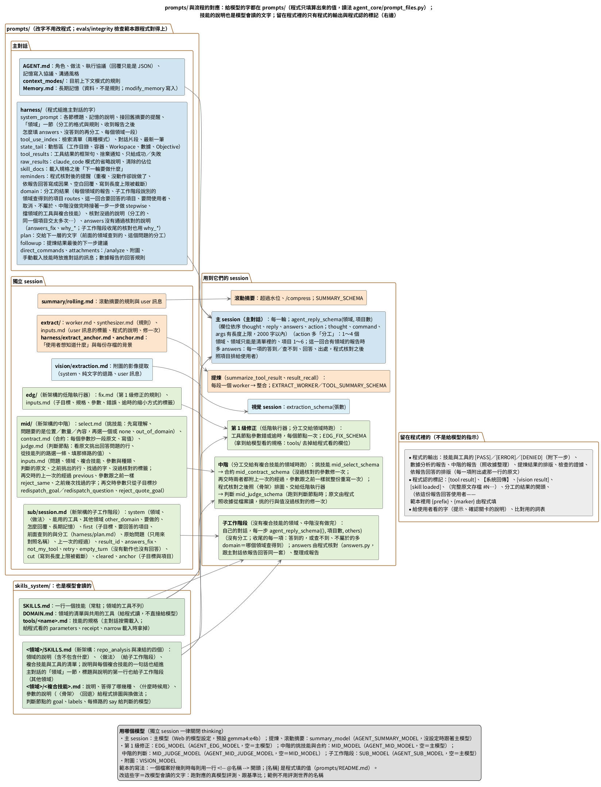
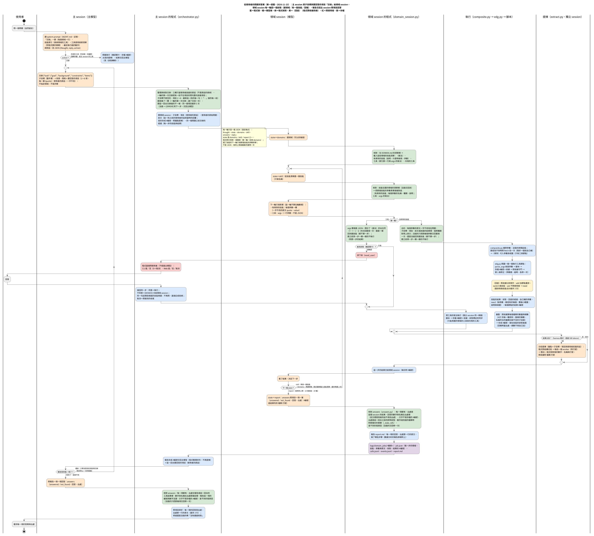

# 架構說明

> 寫給：想看懂或修改 harness 核心的人。這個資料夾是一個本地模型的 agent harness：主對話迴圈、確認關卡、多段處理長內容、存檔與回顧；目標是找檔案、文件與程式分析做到穩定，數據解析、機器人維運與視覺的工具**凍結**（第 14 節）。框架是單一迴圈（〈[框架討論紀錄](../docs/框架討論紀錄.md)〉）：主對話把要用領域的技能的事「交辦」給領域 session（找檔案、讀文件與 log、分析程式的 repo_analysis，與凍結的工具登記成的四個領域），領域 session 選領域、一次用一個技能（有骨架的技能由程式照骨架與回退執行，骨架裡的工具交給低階執行器照收據守門；單步的工具跟主對話同一條路），結果太長就分段提煉，看了結果再決定下一步，最後一項一項回報（程式核對出處）；報告交回主對話，主對話照報告一項一項回答、程式核對出處，沒答到的帶著之前的經過再交辦。收據在 3.8、低階執行器在第 15 節、有骨架的技能在第 16 節、交辦與領域 session 在第 17 節；這份寫的是現在的程式。[README](../README.md) 是一頁總覽；這份講核心 `agent_core/` 與網頁 `web_app/`：由哪幾塊組成、一回合怎麼跑、工具回傳怎麼處理、狀態存在哪裡、要改某件事該看哪裡。每個機制「為什麼這樣做」與實測數據在〈[設計筆記與已知限制](設計筆記與已知限制.md)〉。文中的函式名稱都可以直接在 `agent_core/`、`web_app/` 裡搜尋，所在模組見第 4 節。

---

## 0. 先回答最常搞混的一題：工具回傳什麼時候會被提煉？

**每次執行腳本，完整原文一定會存檔（`#編號`）並顯示給使用者；要不要「提煉」看上下文模式與大小。** 下面講的是預設的 harness 模式；claude_code 模式（`/context_mode claude_code`）完全不提煉，原文直接進上下文、太大保留頭尾，見第 3.4 節。兩種模式的對照在第 1.1 節。

- **≤500 tokens**：原文直接進主對話，不開任何獨立 session。
- **>500 tokens**：harness 自動交給獨立 session 提煉（`summarize_tool_result` → `agent_core/extract.py`）：程式依結構切段（每段 8000 字以內，放得進一段的就是一段），每段一個 worker 摘事實、程式核對過的全部列出，最後一個整合只寫回答；主對話收到的是重點（每條事實附原文的行號，由程式核對）與下一步建議。auto 模式下立刻發生；manual／hybrid 模式下在你按「加入」之後才發生（按捨棄就不花模型呼叫）。
- **`result_recall` 不是自動的**：它是一個技能，由 main session 判斷「使用者在追問某份存檔」時主動選用；harness 回去讀那一份（或幾份）存檔的完整原文，用同一套提煉、以使用者現在的問題為錨點重新提煉。

兩者共用 `extract.py` 的 `Extraction`，差在觸發方式與錨點：

| | 工具回傳的提煉 `summarize_tool_result` | 回原文提煉 `result_recall` |
|---|---|---|
| 誰觸發 | harness 自動：回傳 >500 tokens 且要加入主對話 | main session 主動選（`action`） |
| 讀什麼 | 剛執行完的完整輸出 | 已存檔的 1～3 份完整原文（加起來放得進一段的合成一段、一個 worker 一起讀；放不進的每一份各自切段；同一個整合看全部） |
| 錨點 | 使用者的目標（Objective、任務線）＋這一步的目的（thought／reply／action） | 任務線（最新一句＋前幾句）＋模型給的聚焦點 |
| 寫進檢索清單 | 會（只有原始工具的結果才寫） | 不會（它是衍生輸出） |
| 給 main session 的 | 重點（事實附行號）＋下一步建議 | 重點（事實附行號）＋下一步建議 |
| 存檔 | `logs/extract_jobs/<編號>/`：切段、每段的結果、核對、整合、每次模型呼叫 | 同左 |

---

## 1. 全貌


整個系統是「一個會挑技能的主 session，加上一群只負責讀原文的一次性 session」：

- **主 session**（Ollama `gemma4:e4b`，有對話歷史）每輪只回一個 JSON `{thought, reply, action}`（這一回合有交辦的報告時多 `answers`，排在 action 前面：照報告一項一項回答，第 17 節）。它不寫程式、不直接讀大量原文；`action` 只能填技能的名稱、規格文件標明的腳本路徑、`result_recall`，或「交辦」（`{"task": {"goal", "background", "constraints", "items"}}`：子目標、使用者說明的背景、要求的限制與要回答的項目——每一筆 `{quote}`，就是使用者的原話——不指定領域，第 17 節）。
- **`SkillAgent`**（`agent_core/`）是唯一的核心：組 system prompt、呼叫主 session、依 `action` 派發、執行腳本、存檔、決定工具回傳怎麼進主對話、壓縮上下文、記操作軌跡。CLI（`agent_core/cli.py`，由 `Agent_Runner.py` 啟動）與 Web（`web_app/`，由 `web_console.py` 啟動）都只是它的外殼。
- **一次性獨立 session**：自己的 system／user prompt、不碰主對話、做完即丟（見第 7 節）；工具回傳的提煉是其中一種，長的輸出分給好幾個 worker 再整合。
- **視覺 `vision/`**（Web 附圖）：框選螢幕或上傳的影像只存在這裡；送出新任務時交給視覺 session 做結構化提取（文字 → 畫面 → 個體 → 背景、線索、重點），主對話只收到以 `[vision result]` 併進那則使用者訊息的文字，分析同時存成 `#編號`、以〔附圖分析〕記進檢索清單，之後跟工具回傳一樣可以 `result_recall`（見 3.7）。`image_inspect` 技能對影像檔路徑呼叫同一個 `vision.analyze()`，結果照一般工具回傳處理。
- **技能系統 `skills_system/`**：索引（`SKILLS.md`，常駐）→ 規格（`tools/<name>.md`，按需載入）→ 腳本（`scripts/<name>_cmd.py`，真正執行）。沒有「技能名稱 → 腳本」的對照表：模型必須先載入規格、讀到真實的腳本路徑才執行得了。領域在 `skills_system/<領域>/`（領域的說明、〈做法〉、有骨架的技能與工具的清單，領域 session 讀；第 16 節），領域的清單與主 session、領域 session 都直接用的共用的工具在 `skills_system/DOMAIN.md`（第 17 節）。
- **交辦與領域 session**（`orchestrator.py`、`domain_session.py`、`skills_system/DOMAIN.md`）：找檔案、讀文件與 log、分析程式（`repo_analysis`），以及凍結的工具登記成的四個領域（容器與 ROS 2、調度系統、錄製的數據、音檔與影像檔）的事，主 session 在 `action` 填「交辦」——子目標與要回答的項目（每一項是使用者的原話，程式核對是使用者說過的話、最新這一則的問句都放進了項目），不指定領域——程式核對之後連同這一則之前的對話（前文）交給**領域 session**：自己的對話，每一輪回一個 JSON，狀態是選領域（程式列出那些領域的技能清單）、用一個技能（只寫名稱，下一輪填程式給的參數表單；有骨架的技能由程式照骨架與回退執行，第 16 節；單步的工具跟主對話同一條路執行）或回報（每一項附出處、程式核對）三種之一；技能的結果太長照舊分段提煉；程式管上限、擋一模一樣的技能＋參數，全部存檔。報告存成 `#編號` 交回主 session，主 session 照報告一項一項回答（程式核對出處與數字、報告這一項的編號與數字沒有漏掉，照項目排給使用者，每一項附出處那一行的原文）；沒答到的可以只帶那幾項再交辦，程式把之前幾次的經過一起交下去；領域 session 碰到確認關卡時程式直接問使用者、接回同一步，不經過主 session。領域的工具與有骨架的技能不給主 session 直接用（第 17 節）。
- **`logs/`**：每次工具回傳的原文存檔、工具使用檢索清單、操作軌跡、滾動摘要歸檔、每次模型呼叫的耗時、領域 session 與低階執行器的工作（見第 8 節）。
- **執行前關卡**（`guard.py`）：會改變實體／外部狀態的技能（派工單、取消任務、建容器、容器內非唯讀指令），執行前一律由程式要求使用者確認，任何模式都一樣。
- **數據分析**（`analysis_job.py`，`analysis_run` 偽技能，全部由程式做）：程式在容器裡量全部 Topic 的全部 Key（字串裡的 JSON 也展開），整理成有編號的事實（T#＝Topic、E#＝事件、L#＝Log；類別、時間線、時間上的對照）與重點，只做事實報告、不判斷原因；主對話依報告回答（見第 13 節）。
- **評測**（`evals/`）：主對話、技能腳本、數據解析、隨機情境產生器、多步驟維運、提煉、真實專案、低階執行器、交辦與領域 session、評測的完整性十組，改程式之後先跑不用模型的自我測試；每個階段結束時 `phase_check.py --model` 跑 harness 的真模型評測（含真實專案）、跟基準比（凍結的工具加 `--tools`；見第 12 節）。

### 1.1 兩種上下文模式（`/context_mode harness|claude_code`）

差別只在「誰決定上下文裡放什麼」。規則文字在 `prompts/context_modes/<模式>.md`，接在 `AGENT.md` 後面進 system prompt；程式的分岔在 `turn.py` 的 `_content_for_context`、`context_mode.py`、`tool_summary.py`（recall 的建議）與 `compression.py`（清除舊回傳）。

| | harness（預設） | claude_code |
|---|---|---|
| 想法 | harness 替模型做決定：小模型不擅長在一大段原文裡找東西，就先幫它找好 | 相信模型：原文給它，要查什麼、查多少自己決定；harness 只提供安全網 |
| 大量工具回傳（>500 tokens） | 獨立 session 依問題提煉重點（長的切段、每段一個 worker 再整合，事實附行號）＋下一步建議（第 3.1 節） | 原文直接進上下文；超過 `RAW_RESULT_MAX_TOKENS`（3000）保留頭尾，中間一行註明省略第幾行到第幾行、中間有哪幾節、存檔編號、怎麼查（第 3.4 節） |
| 查細節 | 獨立 session 的建議指定下一步（`result_recall …`、`result_view <編號> --from <行號>`） | 模型自己選 `result_grep`／`result_view`／`result_recall` |
| `result_recall` | 結尾下指令 | 結尾只陳述原文在哪、哪裡沒涵蓋 |
| 檢索清單的描述 | 獨立 session 寫的語意描述 | 程式組的「當時的問題：執行的指令」（不多花模型呼叫） |
| 上下文超過水位 | 滾動摘要 | 先把舊的工具回傳清成「原文在存檔 #N」的佔位（不呼叫模型、可取回），不夠才滾動摘要 |

兩種模式共用：原文存檔與 `#編號`、檢索清單、執行前關卡、長期記憶、滾動摘要（含使用者原話與對話片段存檔）、動態區。切換只影響之後的工具回傳，已經在上下文裡的內容不會回頭改寫。

---

## 2. 一回合怎麼跑（對照程式碼）


以 CLI 的 `main()`（`agent_core/cli.py`）為例（Web 的 `run_turn()`（`web_app/flows.py`）是同一套步驟，對照見第 9 節）：

1. **收訊息**：slash 指令在 `main()` 的 if 鏈直接處理、不進模型。文字任務呼叫 `set_current_task()` 記進任務線 `task_history`（最近 3 句）與說話時間 `_user_said`，`begin_turn()` 把這一回合的把關歸零（含這一回合交辦的紀錄 `_reset_domain_turn`）；`/skill` 手動載入的規格用 `attach_skill_docs()` 附在訊息後；Web 有附圖時先做視覺提取（狀態機的 1b，見 3.7），提取文字以 `[vision result]` 併進這則訊息。
2. **組 prompt**：`ask_ai()` 每次都用 `get_system_prompt()` 重組第一則 system 訊息（只放不常變的內容，含「交辦」一節與拿掉領域工具的技能索引，見第 6 節），再由 `ensure_context_budget()` 檢查硬水位（claude_code 模式先清除舊的工具回傳，不夠才同步壓縮）。送出前 `_with_state_tail()` 把動態區（`build_state_tail()`：Current Agent State、Objective、檢索清單最新一筆）接在最後一則訊息後面——只接在這次送出的副本上，不寫進 `messages`。
3. **呼叫主 session**：`_chat_once()` 以 `format=agent_reply_schema(有沒有領域, 項目數)` 強制 JSON（`action` 是 null、技能的動作或「交辦」三種之一；這一回合有交辦的報告時多 `answers`：每一項一筆，第 17 節；欄位依序 thought、reply、answers、action——Ollama 照 schema 的順序輸出，action 一律最後），`parse_agent_reply()` 解析成 `{thought, reply, action, answers, valid}`，並記一筆 `logs/perf.jsonl`。不是合法 JSON 就只顯示、不執行；`reply` 空且 `action` 為 null 時，帶暫時提醒自動重試一次。`thought`、`command`、`args` 有長度上限（`REPLY_*_CHARS`；Ollama 只套用 2000 字以內的上限，`reply` 是給使用者的回答、可能更長，不設）：寫到上限（`cut`，輸出失控，例如在參數裡一直重複同一段）時這一次不執行、帶暫時提醒重問一次，還是被截斷就不執行那個動作（`drop_cut`：存進對話的是不含截斷參數的 JSON）；`command` 寫成 null 跟 `action` 填 null 一樣。
4. **執行前關卡**：`guard_check()` 判斷這個 `action` 會不會改變實體／外部狀態（第 3.5 節）。會的話 CLI 問 y／n、Web 暫停顯示「同意執行／拒絕」（`pending["mode"] = "guard"`），任何模式都一樣；拒絕時把 `[DENIED]` 包成工具結果加入 `messages`，回合結束等使用者說明。
5. **派發**：`run_tool(parsed, approved)` 只看 `action`：
   - `null` → 回合結束；
   - `task`（交辦）→ `run_task()`（第 17 節）：程式整理與核對（三欄只留使用者說過的原話、不是原話的拿掉；一輪的第一次交辦，最新這一則的問句有一段不在項目的由程式整句放進項目；有領域、子目標不是空的、項目 1～`DOMAIN_ITEMS_MAX` 項、最新這一則的每一段都放進了一欄、子目標與項目跟這一回合交辦過的不一樣、同一個項目最多交辦 `DOMAIN_ITEM_TRIES` 次；沒過回 `[ERROR]` 附下一步，不執行）之後交給領域 session（`domain_session.DomainSession`；同一個問題之前交辦過的經過一起交下去）；報告存成 `#編號`，交回的文字是 `DOMAIN_RESULT_HEAD` 開頭（不提煉），後面接這一回合要回答的項目與 answers 的寫法；領域 session 停在確認關卡時設 `domain_pending`，CLI 直接問、Web 暫停（`pending["mode"]="domain"`），使用者的回答由程式交給它接回同一步（`answer_domain`／`cancel_domain`），不經過主模型；
   - 領域的工具（技能名稱、規格或腳本；`DOMAIN.md`〈共用的工具〉以外的）與有骨架的技能的名稱 → `domain_gate()` 回 `[ERROR]`（先交辦）；寫的是領域的名稱 → `[ERROR]` 說明領域不是技能、要交辦（`domain_named`）；領域 session 執行工具時（`_sub_allowed`）只能用它選的領域的工具與共用的工具；使用者直接指定的指令（`/analyze`，`direct=True`）不擋；
   - `command` 是技能名稱（`tools/<name>.md` 存在）→ 回傳規格文件，**不執行**；
   - `result_recall_cmd.py` → 在本程序內呼叫 `_result_recall()`（它要呼叫模型，不能包成 subprocess）；
   - 其他 → 當成腳本路徑；參數由 `_parse_script_args` 拆開（shlex；空字串丟掉，每一個都只有反引號的「``」當成沒有參數，〈設計筆記〉2.91；確認關卡用同一套）；被擋的技能沒有 `approved=True` 就回 `[DENIED]`、不執行（CLI／Web 以外的呼叫端也擋得住）；偽技能 `analysis_run` 過了關卡後在本程序內執行（`AnalysisMixin`，一樣記軌跡、存檔）；其餘由 `_exec_script()` 以 subprocess 執行（用環境變數 `AGENT_RECEIPT_PATH` 指定收據檔，執行完讀回 `last_receipt`，見 3.8），找不到腳本就回可行動的 `[ERROR]`，提示先載入規格。
6. **落地**：`_sync_state_from_tool_output()` 讀輸出最後的狀態標記（`[CWD_CHANGED]`、`[TARGET_CONTAINER]`、`[ANALYSIS_DATA]`、`[ROS2_WORKSPACE]`…）更新狀態；`_record_trajectory()` 記軌跡、呼叫 `_archive_tool_result()` 把完整原文存成 `#編號`（有收據時旁邊另存 `<存檔>.receipt.json`，軌跡記收據的摘要）。
   **卡住偵測**（`turn_guard.py`，`run_tool` 的外層 `note_tool_result`）：同一個回合裡同樣的動作得到同樣的結果，第二次在回傳後面附「不要再重複、換個做法」，第三次加強提醒（換技能或參數），第四次（或同一個錯誤第四次；`AGENT_REPEAT_STOP_AT` 可調，評測的對照組用 `AGENT_TURN_GUARD_RULE=v4` 換回「第三次就停」）設 `agent.stuck`，回合迴圈加入這次結果後就停下來、推 ⛔ 通知交回使用者（存檔是原本的回傳，不含提醒）。
7. **模式決策**：auto 直接加入並續推；hybrid 問 y／n，n 改加「已捨棄」通知，兩者都續推；manual 按 y 加入並續推，n／stop 結束回合。
8. **決定進主對話的內容**（只有「加入」時才算）：`_content_for_context()` 依上下文模式決定給原文、摘要、原文頭尾或只給成功／失敗（見第 3 節）；`tool_result_message()` 包上 `[tool result]` 與「系統回傳、不是使用者提供」框架句，以 user 角色加入 `messages`，然後回到步驟 2。
9. **模型停下來（`action` 為 null；狀態機的 3c）**：`reply_check()`（CLI、Web、評測共用）依序核對，第一個沒過的送一次 `[harness]` 提醒、回到步驟 2。先是 `claim_without_action()`：這一回合一個工具都沒執行、回覆卻說「已經重新啟動／建立／刪除…」（條件句、疑問句、否定句不算；只認子句開頭或「我／我們」後面的說法），提醒要做就執行、沒做就照實說，每回合最多一次（收到數據分析的報告之後，同一個位置還有 `analysis_reply_check`，見 13.3；收到交辦的報告之後還有 `domain_reply_check`：`answers` 每一項都有、答到的出處在這一回合的報告或自己執行過的工具結果裡、回答的數字與名稱在出處那幾段裡、查不到的寫了原因，沒過的只把那幾項交回修一次，見第 17 節）。回覆引用了之前存的即時狀態或動作的紀錄不交回：清單與讀回寫了程式算的事實，問的是現在還是當時由模型判斷（3.2）。依交辦的報告回答時，CLI 與 Web 等核對過才顯示，顯示的是 `domain_render` 照項目排好的回答（每一項附出處那一行的原文，修過還是沒過的標出來）。
10. **回合結束**：`after_turn_compression()` 檢查軟水位：claude_code 模式先清除舊的工具回傳，清完還超過、而且可壓的內容夠多，才把舊訊息融合成滾動摘要（第 3.6 節）。

---

## 3. 工具回傳管線


3.1～3.3 是 harness 模式（預設，也是上圖畫的流程）；claude_code 模式在 3.4；3.5 是兩種模式共用的執行前關卡，3.6 是壓縮，3.7 是附圖的視覺分析（圖的中段），3.8 是給程式讀的收據。

### 3.1 這一次的工具回傳（圖的第一段）

用一個實際例子走一遍：使用者問「哪幾台車的電量低於 40%？」，main session 執行 `ROS2_topic_echo /fleet_states_json`，輸出是 120 台車的狀態、約 2.2 萬字，超過 500 tokens，於是交給 `summarize_tool_result`：

1. **① 告訴獨立 session「使用者想知道什麼」**：使用者最近說的幾句話、main session 為什麼執行這一步（它的 thought／reply），以及檢索清單上其他存檔的一句話描述（只用來判斷還需要哪幾份舊存檔）。
2. **② 程式依原文的結構切段**（`_results_common.chunk_lines`）：每段不超過 8000 字，切在章節、一筆紀錄（這裡是 `- name: amr_41` 這種一台車的開頭）、空行；不切在縮排的中間。每段附前情：第一行（狀態列）、所在的章節、表格的表頭。這個例子切成 3 段；放得進一段的輸出就是一段，一樣交給一個 worker（以前由一次呼叫寫完，篇幅只有原文的四分之一、只挑幾條，〈設計筆記〉2.65）。
3. **③ 每段一個 worker**：只讀那一段，每一行前面是原文的行號（`  34→  battery_percent: 20.6`），摘出跟問題有關的事實（「amr_03 的 battery_percent 為 20.6」，行 34）。程式核對每一條的數字與名稱真的在引用的那幾行（前後 2 行、縮排的上層——名字 `- name: amr_03` 在上面幾行——與下層），對不上的拿掉（不列、也不交給整合，記在存檔裡）。段數超過 8 時依問題裡的字挑段落讀，沒讀的行號寫進「未涵蓋」。
4. **④ 程式列事實、整合寫回答**：相關事實與錯誤由程式列——每個 worker 核對過的照段落的順序全部列出、同樣的字只列一次（`listed_items`）。整合拿這些事實、那幾行的原文、原文的開頭與大綱，只寫回答（一到三句，不把事實重寫一遍）、未涵蓋、之後可能想知道的、這份存檔的一句話描述、還需要哪幾份舊存檔（程式只留清單裡真的有的編號），不挑、也不改寫事實（`prompts/extract/merger.md`；以前由它在篇幅內挑事實，答案要的幾條被刪過，〈設計筆記〉2.62）。程式再核對回答：寫了原文沒有的數字、名稱或總數（「共 N 台」不是原文也不是事實的條數），或把存檔的行號寫成檔案的行號 → 帶著問題請它修一次；還是不行就在回答下面標明。放得進一段的也一樣（一個 worker、程式列事實、整合只寫回答）。
5. **⑤ 一句話描述寫進工具使用檢索清單**（`tools_use_index.md`），之後每一輪都看得到。
6. **⑥ 附上下一步建議**，連同重點交給 main session：30 台車每台一行、附行號；建議裡寫「要看某一條的原文：`result_view <編號> --from <行號>`」。

對照程式碼：

| 步驟 | 函式 | 做什麼 |
|---|---|---|
| 存檔 | `_record_trajectory` → `_archive_tool_result` | 每次執行都存 `logs/tool_results/<session>_<編號>_<腳本>.md`（key: value 檔頭＋原文），`index.md` 追加一行（上鎖：背景壓縮也會寫）；腳本寫了收據時另存 `<…>.receipt.json`（3.8）。檔頭的 `memory` 記這份是哪一種記憶：`action`（這一次照確認關卡的判斷會改狀態，`changes_state`）、`live`（規格寫了 `live` 的查詢：執行中系統當下的狀態，`_results_common.memory_kind`）、`content`（其他）；動作另外記一行在 `actions_index.md`（第 6 節「最近執行過的動作」） |
| 判斷 | `_content_for_context`、`is_exempt_result`、`listing_raw` | 規格文件、≤500 tokens、本身已是提煉結果（`TOOL_SUMMARY_TAG` 開頭）、或程式整理好的報告（數據分析、交辦的結果）→ 原文；程式整理好的清單（存檔的收據寫的技能，規格寫了 `listing`：search_text、py_refs、find_file、code_defs、list_dir、result_grep）放得進一段（`EXTRACT_CHUNK_CHARS`）→ 原文（`/summarize off` 也是；CLI／Web 的超過門檻提示用同一個判斷）；`/summarize off` 或提煉失敗 → 只給成功／失敗（附 `result_recall`／`result_view --outline` 的用法；領域 session 沒有 `result_recall`，附 `result_grep`／`result_view`：`reduced_sub`） |
| 組錨點 | `summarize_tool_result`、`_build_task_anchor_text`、`_last_assistant_step` | 使用者的目標＋這一步的目的 |
| 提煉 | `extract.Extraction.run` → `_merge`（`_select` 挑段落 → `_worker` → `listed_items` 列出核對過的事實 → `_merge_input` → 整合；放得進一段的也是，一個 worker；好幾份加起來放得進一段的合成一段，`_together_input`） | 切段（`chunk_lines`、`chunk_context`）、worker（`prompts/extract/worker.md`，`EXTRACT_WORKER_SCHEMA`；只有一段時標籤寫讀全部，`inputs.md` 的 `worker_whole`；合成一段時每一份標存檔編號、每條事實多 `record`，`worker_together`、`extract_worker_multi_schema`）；整合（`prompts/extract/merger.md`，`TOOL_SUMMARY_MERGE_SCHEMA`：answer／not_covered／suggested_questions／index_hint／related_records——事實由程式列） |
| 核對 | `missing_tokens`、`_has_name`、`_drop_ordinals`、`evidence_lines`、`Extraction._ground`、`_ground_origins`、`_written_file_line`、`_misplaced`、`_finish`、`_repair` | 每條事實的數字與名稱要在引用的行（與上下層）裡，名稱要整個對上（`_has_name`：開頭、結尾是英數字的，前後不能接英數字——`av2_test` 不算 `nav2_test` 裡有；底線、斜線、點、冒號照舊算分隔；行號的寫法不吃名稱裡的字，數字開頭的名稱連數字一起比）；10 以下的整數與清單的序號不核對（`_drop_ordinals`：從 1 開始照順序的 `1.` `2.` … `13.`，又從 1 開始是另一張清單；清單裡寫的數字、單獨一個 `13.`、跳號之後的照樣核對）；照這樣每一份都對不上時照收據再試一次（`_ground_origins`）——引用的那幾行所屬的檔名也算（`via`＝path；search_text 的檔名只寫在「## <檔案>」那一行），或把寫的行號當成這一段裡檔案的行號、只有一個檔案的那幾行對得上才收、行號換成存檔的（`via`＝file_line；兩個檔案都對得上不收），沒有收據的（凍結的工具）不試；照存檔的行號對得上、但事實的文字自己寫的行號換算出來是另一行時，把它當成檔案的行號再試一次，只有一個檔案對得上就照它收（`_written_file_line`、`_by_file_line`；兩行的內容一樣時原本的核對看不出 worker 寫的是檔案的行號），還是對不上的拿掉、記在存檔裡；回答的字要在原文裡、總數要有根據；回答寫的行號是事實引用的那一行的存檔行號、不是它在檔案裡的行號（`_misplaced`）也算對不上；回答對不上請整合修一次，還是不行就標明；事實已經在 worker 那一步核對過（對不上的拿掉）、由程式全部列出，整合只核對回答（`_check`；〈設計筆記〉2.16、2.56、2.62、2.65、2.73） |
| 檔案的行號 | `_results_common.file_lines`、`ToolSummaryMixin._file_lines`、`Extraction._at` | 照存檔的收據把原文的每一行對到檔案（view_file、search_text 每一行的 `N→` 是檔案的行號，提煉再加一層存檔的行號，模型會搞混）：收據只有一個檔案就是它，好幾個就是上面最近一行寫到的那一個（長的路徑先比）；只認收據裡的絕對路徑（result_grep 記的是存檔編號）。交給整合與交給主對話的事實都附「行 149＝<檔案>:49」（〈設計筆記〉2.56） |
| 存檔 | `JobStore`（`jobstore.py`） | `logs/extract_jobs/<編號>/`：`job.json`、`calls.jsonl`（每次呼叫的 prompt 與回覆）、`events.jsonl`（進度，開頭 📑） |
| 驗證 | `_validate_related` | related_records 只留清單裡真的有的編號，最多 2 筆 |
| 寫清單 | `_append_tool_use_index`、`tidy_hint` | 只有原始工具的結果才寫一行進 `tools_use_index.md`（`result_*` 與交辦的前文 `dispatch_context` 這類衍生的輸出不寫，`DERIVED_RESULT_SCRIPTS`）；描述整句照存、**不截斷** |
| 排版 | `_render_tool_summary`、`_followup_guidance` | 回答／相關事實（附行號，對得到檔案的接著寫 `＝檔案:行號`）／錯誤／未涵蓋／還需要的舊存檔／之後可能想知道的，結尾附下一步建議；回答把存檔的行號寫成檔案的行號、修一次還是一樣的，標「程式核對：回答寫的「第 149 行」是存檔原文的行號，那一行在檔案裡是 …」 |

下一步建議（`_followup_guidance`）依序判斷：

1. 還需要之前的存檔 → 直接給合併指令 `result_recall 這份,那份 "<使用者的話>"`（幾份交給同一次提煉，才比得了）；
2. 有段落沒讀到 → 已經回答的直接回答；使用者要的正好在沒讀到的行時，用更具體的問題 recall（會重新挑段落）或 `result_view` 看那幾行；
3. 原文裡沒有的缺口 → 用自然的一句話問使用者；
4. 已經回答 → 直接回答，不必 recall。
提煉沒有成功（回覆不是 JSON、模型沒有回應）時照實說，不寫成「已經回答」；整合失敗但各段有結果時，回答寫明整合沒有成功，事實一樣由程式列（`_fallback`）。

領域 session（第 17 節）的提煉另有一套說法（`sub=True`，`prompts/harness/followup.md` 的 `sub_*`）：它沒有 `result_recall`、也沒有使用者可以問——回原文看用共用的 `result_grep`、`result_view`，還要一起看之前的存檔就列出編號、一樣用這兩個看；也不寫「完整內容已顯示給使用者」（領域 session 的工具輸出使用者沒看到）。錨點換成交辦的子目標與項目（`DomainSession._anchor`；背景與限制不放）加上這一步的目的。主對話的說法不變。

「什麼時候不需要 recall」由看過完整原文的獨立 session 明說，main session 不必自己猜。

### 3.2 之後任何一回合（圖的最後一段）

`get_system_prompt()` 尾端由 `_tool_use_index_block()` 注入檢索清單最近 30 筆（格式 `#編號（時間，程式算的事實）：描述`——事實由 `_row_facts` 照存檔算：之前的 session、技能、即時狀態或動作的紀錄，檔案內容不標；只看 session、不寫幾分鐘前，system prompt 才不會一直變；原始檔已經被清掉的不列），並附上依序判斷的規則：對話裡已經有答案 → 直接回答；在接續某份存檔 → `result_recall`；問「現在」的狀態 → 重新執行工具；都不像 → 當作新問題。清單一千多 tokens、只在跑完提煉時多一筆，所以留在 system prompt（KV cache 大多命中）；對話一長，system prompt 的尾端會落在整段上下文的中間，所以動態區另外用一行（`tool_use_index_pointer`）提示最新一筆。

**記憶的種類與有效性**（〈設計筆記〉2.85、2.86）：`result_recall`、`result_view`、`result_grep` 讀回的結果開頭寫那一份的事實（`_results_common.archive_facts`）——即時狀態寫什麼時候查的、多久以前；動作寫是當時做了什麼的紀錄、不是現在的狀態；檔案內容在存檔之後、收據裡的檔案改過的列出來（`changed_files`：修改時間比存檔晚）。system prompt 最後另有「最近執行過的動作」（`_actions_block`，`actions_index.md` 最近 `ACTIONS_SHOW` 筆）。問的是現在還是當時由模型照這些事實判斷：主 session 的回答引用了舊的不交回（交回時模型把問之前查的當成問現在）；領域 session 的回報引用了這一回合之前的即時狀態、動作或改過的檔案時交回一次（`_stale_refs`，第 17 節）。

main session 執行 `result_recall <編號>[,<編號>] "<使用者的話>"` 時，`_result_recall()` 回去讀那一份（或幾份）存檔的完整原文，走上面 ①～④、⑥ 同一套流程重新提煉。跟 3.1 不同的地方：

- **①「使用者想知道什麼」怎麼給**：用 harness 自己記的使用者最近 3 句話（任務線），最新一句當問題、前兩句當背景。因為使用者回答追問時常常只說「第一個」「好」「那溫度呢」，單看這一句不知道在問什麼，要靠前幾句補上意思。
- **main session 寫的那段問題只當補充重點**：`result_recall 12 "哪些檔案跟記憶有關"` 引號裡是 main session 自己寫的，harness 不直接拿它當使用者的問題，只附在後面當「要特別注意的點」。原因：小模型有時會把清單上的描述抄進引號，拿它當問題就錨錯了；跟使用者原話或清單描述一模一樣時，乾脆不附。
- **好幾份一起讀**：加起來放得進一段（`EXTRACT_CHUNK_CHARS`）時合成一段、一個 worker 一起讀全部——每一份前面標「===== 存檔 #編號 =====」，行號照各自的原文；每條事實寫出自哪一份（`record`，只能填這幾份的編號），程式照那一份核對；要比較時只列有差異的。放不進一段的每一份各自切段、各自的 worker。同一個整合看全部；事實的行號寫成「#12 行 40」。挑段落用的是這一次的問題，所以上一次沒讀到的段落，換個更具體的問題就可能挑到。
- **找不到存檔**：分清楚是編號抄錯（說目前最大的編號）、超過保留上限被清掉（照實告訴使用者），還是參數順序錯；一次超過 3 份時說哪幾份沒讀。

**提煉結果不寫進檢索清單。**清單記的是「原始來源」：每一筆代表一份原始工具輸出、指向它的完整原文。recall 沒有產生新資料，只是換一個問題重讀已經存在的原文。如果把它也寫進去：

- 同一份來源會在清單上佔兩格（例如 #12 是 tools 清單，recall 後的 #13 又描述一次 tools 清單），30 筆的顯示視窗很快被重複的內容佔滿；
- recall 的存檔裡只有「提煉後的重點」，不是完整原文。之後如果有人 recall 到這一筆，讀到的是摘要的摘要，資訊比直接 recall #12 少。

所以原本那一筆（#12）留在清單上、繼續指向完整原文；recall 本身仍然記進操作軌跡和 `index.md`（所有執行的稽核清單），只是不進檢索清單。另外，recall 的輸出開頭是 `TOOL_SUMMARY_TAG`，交給 `_content_for_context` 時會被判定成「已經提煉過」，直接給 main session，不會再提煉一次（Web 上也只顯示一張卡片）。

**行號**：`result_view`、`result_grep`、提煉結果、claude_code 模式的截斷說明用的都是原文的行號（工具輸出的第 1 行＝行 1，不含存檔的檔頭），寫成 `120→內容`。`result_view <編號> --outline` 列出原文的章節與行號（`_results_common.outline`）。view_file、search_text 的每一行本身也有 `N→`（檔案的行號）；提煉的事實對得到檔案時另寫檔案的位置（`行 149＝<檔案>:49`，3.1 表格的〈檔案的行號〉）。

### 3.3 為什麼編號跨 session 唯一

`SkillAgent.__init__` 從既有存檔的最大編號續編（`_max_archived_id`），所以清單上的 `#16` 在任何一次啟動都只指向同一份存檔，模型只要抄數字。要整個重來，請刪整個 `logs/tool_results/`（連同 `tools_use_index.md`）；只刪存檔會讓編號重新從 1 起算，跟清單對不上。配號一律走 `_next_id()`：上鎖（背景壓縮也會為被壓縮的對話片段配號），而且每次都看一下存檔目錄裡最大的編號（CLI 與 Web 同時開著時，另一個 process 剛存的也算），不會配到同一個編號。刪舊存檔照（session、編號）排（`_archived_names`）。

### 3.4 claude_code 模式

`_content_for_context()` 在 claude_code 模式把所有工具回傳交給 `raw_result_for_context()`，不呼叫任何模型：

1. 第一行註明 `（完整原文存檔 #N，約 X tokens）`，接著是完整原文。
2. 超過 `RAW_RESULT_MAX_TOKENS`（3000）：開頭改成 `[tool result - 原文頭尾]`，在行的邊界只留頭 60%、尾 40%，中間換成一行「中間第 a～b 行省略、約多少 tokens、中間有哪幾節（章節標題與行號）；完整原文在 #N：找字串用 `result_grep`、看這一段用 `result_view N --from a`、要依問題整理用 `result_recall`」（領域 session 不寫最後這一句：它沒有 `result_recall`，`gap_recall`）——行號是原文的行號，跟 `result_view` 同一套。
3. 超過 500 tokens 的回傳照樣記進檢索清單，描述由程式組：`<當時使用者的問題>：<技能 參數>`。

要不要回存檔查、用哪一個工具查，由模型自己決定；規則在 `prompts/context_modes/claude_code.md`（三個存檔工具的語法直接寫在裡面，不必先載入規格）。`result_recall` 在這個模式下仍然是「把一大份原文交給獨立 session 依問題提煉」，也就是模型自己選擇委派的 subagent；差別是結尾不下指令（`_followup_guidance(directive=False)`）。

**實測提醒**（〈設計筆記〉限制 19）：gemma4:e4b 在這個模式下，要找的東西落在被截掉的中段時幾乎都不會回存檔查，而是回答「資料裡沒有」；把 `AGENT_RAW_RESULT_MAX_TOKENS` 調到常見輸出放得下（例如 6000）時才可靠。

原文直接進上下文，上下文漲得比 harness 模式快，所以超過水位時先做最輕量、可還原的壓縮：`clear_old_tool_results()` 把較舊的工具回傳（最新 `CLEAR_KEEP_RECENT_RESULTS` 則以外、每則至少 300 tokens、帶存檔編號的）換成 `[tool result - 已清除]` 佔位，內容是「原文在 #N（當時執行什麼），需要時用 result_view／result_grep／result_recall 取回」，保留 `[tool result]` 第一行與框架句。清完還超過才做滾動摘要。清除會讓 KV cache 從被清的那一則開始失效，所以只在超過水位時做，不是每輪都做。

### 3.5 執行前關卡（兩種模式共用）

`guard_check(parsed)` 回傳 `None`（不用確認）或 `{skill, script, command, reason}`：

- 只看要執行的腳本：技能名稱（載入規格）、找不到的腳本、偽技能（`result_recall`）都不用確認。
- 被擋的技能：`GUARDED_SKILLS`（預設 `workpackage_send`、`workpackage_cancel`、`overpending_cancel`、`docker_est`、`docker_runcmd`、`host_runcmd`、`docker_ctl`、`file_ops`、`ROS2_param`、`ROS2_topic_pub`、`ROS2_domain_id`、`ROS2_workspace_env`、`rmf_handshake`，`AGENT_GUARDED_SKILLS` 可覆寫）。
- **參數一律照腳本自己的解析判斷**（`_guard_parse`：各腳本的 `parse_args`／`parse_cli`，純函式、不執行任何動作），關卡不另外解析——另外解析時跟腳本不一致就會被繞過（例如 `WP1 a3 --desc --dry-run` 真的送出）。腳本本來就會拒絕的參數（用法錯、不會自己結束的指令）不必問；`docker_runcmd`／`docker_ctl` 的確認說明寫出實際會操作的容器。
- 例外（查詢用法）：`workpackage_send --dry-run`（只顯示不送；參數照腳本的解析就錯的也不問，腳本自己會拒絕，〈設計筆記〉2.97）、`docker_ctl status／logs／inspect／env`、`ROS2_param list／get`、`ROS2_domain_id` 查詢、`ROS2_workspace_env` 不帶指令或唯讀的指令、`rmf_handshake status`；`docker_runcmd`／`host_runcmd` 的指令通過 `is_readonly_shell()`：每一段（`&&`、`||`、`;`、`|`、單一個 `&`、換行分隔）的第一個字在唯讀白名單裡（`ls`、`cat`、`grep`、`cd`…），而且沒有寫檔的轉向（`/dev/null` 除外）、反引號或 `$( )`。有些指令要看參數：`ros2` 只認查詢類的動作（`topic list/echo/info`、`node list/info`、`param get`…）；`source` 只認 `setup.bash` 這類環境設定檔；`find` 不能帶 `-delete`／`-exec`／`-fprint`；`git` 只認 status／log／diff／show 這類查詢；`sort -o`、`tree -o`、`date -s`、`uniq 輸入 輸出` 會寫檔或改狀態；`env`、`hostname` 只有不帶參數時算唯讀。判斷不了的一律要確認。
- `/guard off` 只對目前 session 關閉；`AGENT_GUARD=0` 改預設值。
- 會不會改狀態（`changes_state`：`GUARDED_SKILLS` 裡、不是查詢用法的；不看 `/guard` 開關）也決定存檔是不是動作型（3.1）。
- 同樣的動作之前做過時，確認的說明多一行「之前做過：#編號（時間，狀態）：結果的第一行（一共 N 次）」（`_previous_action`：`actions_index.md` 裡同一個技能、同樣的參數——照記的寫法比，參數用空白接起來、連續的空白合成一個；寫法不一樣就比不到）。不擋，做不做照舊由使用者決定；CLI、Web、領域 session 的確認關卡與低階執行器共用這段字（`guard_prompt_text`），交辦的流程裡主模型也看得到（〈設計筆記〉2.88）。
- 使用者這一句話（同一回合）裡拒絕過的技能，領域 session 再選、又是要問的寫法時不再問、不執行，直接記成拒絕（`_denied_again`，第 17 節；〈設計筆記〉2.97）。

確認由程式路徑保證：CLI／Web 先問，同意後才以 `run_tool(parsed, approved=True)` 執行；`run_tool` 自己也會再檢查一次，沒有 `approved` 就回 `[DENIED]`，所以評測、其他呼叫端漏接確認時也不會執行。

### 3.6 壓縮：使用者原話與對話片段存檔（兩種模式共用）

滾動摘要是「上一份摘要＋要壓的舊訊息 → 新的一份」（`summarize_messages`，`SUMMARY_SCHEMA`；長度目標 `SUMMARY_MAX_CHARS`＝1500 字）。`_apply_compression()` 另外做三件事：

1. **使用者原話由程式逐字保留**（`_keep_user_words`）：被壓掉的訊息裡使用者自己打的字（`_user_text_of`：去掉附圖分析、手動載入的規格，規劃請求取出裡面的原話），附上說話時間，放進 system prompt 的「使用者說過的話」一節；總字數超過 `USER_WORDS_MAX_CHARS`（2000）丟最舊的並註明還有幾則。摘要模型只需要寫歸納後的偏好，不必照抄原話。
2. **被壓掉的對話片段存成一份存檔**（`_archive_conversation_segment`）：跟工具回傳同一套 `#編號`、同一個目錄（腳本欄寫 `conversation_segment`），內容保留 AI 的想法、回覆、action 與工具回傳全文，並記進檢索清單，描述是摘要模型另外寫的 `segment_hint`——**只描述被壓掉的這一段**（談了什麼、查到什麼、決定了什麼），不是滾動摘要的 overview（那是融合後的整段歷史，每份片段都差不多，認不出是哪一段）；模型沒給時退回這一段裡使用者的原話（`_segment_hint`）。存檔檔頭的 `task` 欄也寫這一句。
3. **對話片段跟工具回傳分開呈現、分開保留**：編號仍是同一個序列（一個 `#編號` 只對應一份存檔，`result_recall` 兩種都能用，小模型不必多學技能），但 system prompt 另有「過去的對話片段」一節（`_conversation_index_block`，最近 `CONVERSATION_ARCHIVES_SHOW`＝10 份，每份附描述），不跟工具回傳搶那 30 筆名額；清單行以檔名的 `_conversation_segment.md` 區分種類，舊的清單行也分得出來。保留上限也分開：工具回傳 200 檔／50 MB 的輪替不會刪對話片段，對話片段另外只留最近 `CONVERSATION_SEGMENTS_KEEP`＝100 份。`result_recall` 取回對話片段時會告訴獨立 session「這是過去的對話，不是工具輸出」，要它回答當時談了什麼、決定了什麼、使用者怎麼說——這就是工具回傳那套可還原壓縮，用在對話本身。附圖的視覺分析結果也照同一套存檔（腳本欄 `vision_extract`，見 3.7），三種存檔的種類一律看檔名判斷（`result_kind`）。

使用者原話與對話片段編號跟滾動摘要一起寫進 `logs/summary_*.json`，下次啟動時由 `_load_latest_summary_state()` 接回。接回的摘要在這次 session 壓縮之前，system prompt 會註明它是之前的對話留下的、可能過時（`summary_carried_from`）；摘要裡提到已經不存在的技能的行，注入前與交給下一次壓縮前都會拿掉（`clean_summary`），避免模型照舊摘要去叫已移除的技能。

### 3.7 附圖的視覺分析也是一份存檔（Web，圖的中段）

Web 附圖時，`_run_vision_subsession` 先交給 `vision.extract()` 做結構化提取（〈設計筆記〉2.9「視覺提取」），分析成功就由 `archive_vision_result` 存成一份存檔：跟工具回傳同一套 `#編號`、同一個目錄（腳本欄寫 `vision_extract`，內容是交給 main session 的那份文字，檔頭的 `task` 是使用者的說明、`command` 列出每張影像的來源），`index.md` 的「回答」欄填視覺模型的重點，並記進 `tools_use_index.md`——描述是視覺模型自己寫的 `index_hint`（它看過影像、也知道使用者問什麼），system prompt 的工具使用檢索清單顯示時前面加〔附圖分析〕，交給獨立 session 的清單標「附圖分析」。主對話那則訊息裡也寫明「這份分析存檔為 #編號」。

所以之後不論那則訊息有沒有被壓縮、是不是同一個 session，main session 都能像工具回傳一樣從清單認出它、`result_recall` 取回；獨立 session 摘要別的工具回傳時，也能在 `related_records` 建議「還需要之前那張圖的分析」。原圖不保存，`_result_recall` 取回這種存檔時會告訴獨立 session「這是過去附圖的影像分析，只能根據這份文字回答，沒寫到的細節要請使用者重新附圖」。分析失敗（`[ERROR]`）不存；不記進操作軌跡（它不是執行腳本）；保留上限另外算（`VISION_RESULTS_KEEP`＝100，工具回傳的輪替不會刪到它）。

### 3.8 收據：給程式讀的結果（兩種模式共用）

給模型的文字照舊（上面 3.1～3.4 的管線都不變）；第一版領域的腳本（search_text、find_file、list_dir、view_file、code_ast_reader、code_defs、py_refs、result_list／grep／view）
另外寫一份給程式讀的**收據**，程式照它判斷、不解析給模型的文字：低階執行器照它守門與帶入參數（第 15 節）、有骨架的技能照它比對回退的條件（第 16 節）、提煉照它把存檔的行對到檔案（3.1〈檔案的行號〉）、依報告回答與領域 session 回報的核對照它認 `檔案:行號`、從檔案讀那一行（`answers.rows_from_archives`，第 17 節）；〈設計筆記〉2.56。

1. **指定**：`_exec_script()` 每次執行都建一個暫存檔名（先刪掉檔案），用環境變數 `AGENT_RECEIPT_PATH` 交給腳本。
2. **寫**：腳本的進入點 `_receipt_common.main(execute, 技能)` 先把收據寫到這個檔（`.part` 再換名），再印出給模型的文字；錯誤出口
   `fail(文字, 種類)`、成功出口 `result(狀態, counts, items, truncated, 其他欄位)`。沒有設定環境變數（直接在終端機跑）就不寫。
3. **讀**：`_read_receipt()` 讀回、刪掉暫存檔，放在 `last_receipt`（這一次 `run_tool` 的收據，每次呼叫都重設；沒寫收據的腳本是 None）。
4. **存**：`_record_trajectory()` 在軌跡記摘要（`status`、`error_kind`、`counts`、`truncated`），`_write_archive()` 把全文存成存檔旁邊的
   `<…>.receipt.json`；`_prune_tool_results()` 刪存檔時一起刪（`_results_common.FILE_RE` 只認 `.md`，收據不會被當成存檔）。評測的 worker
   在每個工具呼叫附收據摘要。

欄位：`status`（pass／empty／error）、`error_kind`（args／env／timeout／parse）、`near`（error 時有才記：找不到路徑時相近的路徑，
`_path_common.near_paths` 的候選，由 `ToolError` 帶進收據；低階執行器的第 1 級照它判斷，第 15 節）、`counts`、`items`（最多 `ITEMS_MAX`＝1000 筆，超過時
`truncated` 為真）、`truncated`、`tool`、`version`、`cwd`，加上各工具自己的欄位（寫在規格的 `receipt`）。腳本沒記收據、或記的跟回傳的文字
對不上（回 `[ERROR]` 卻記成 pass）時當成腳本的錯（parse）。定義的行號與範圍（code_ast_reader、code_defs、py_refs 的收據）從 `def`／`class`
那一行算，有裝飾器的另記 `decorator`（第一個裝飾器的行，`_decorator_line`）。

規格的 frontmatter 另有兩個給程式看的欄位（一行 JSON）：`parameters`（每個參數怎麼取得：`fetch` 用哪個技能查、`ask` 要使用者決定什麼）、
`receipt`（收據的欄位）。`_load_skill_doc()` 交給模型前用 `skill_spec.for_model()` 拿掉這兩行，模型讀到的規格裡沒有它們；
`skill_spec.contract()` 給程式讀。寫法見〈技能撰寫規範〉1.1、2.1。

---

## 4. 模組地圖

根目錄的 `Agent_Runner.py`、`web_console.py` 只有幾行，負責啟動：

```
Agent_Runner.py   → agent_core/cli.py 的 main()                   （python3 Agent_Runner.py）
web_console.py    → web_app/server.py 的 main()                   （python3 web_console.py）
```

### 4.1 `agent_core/`：核心

`SkillAgent` 是把幾個 mixin 組起來的類別（`agent.py`）。每個 mixin 只負責一件事，方法之間一律透過 `self` 呼叫，所以不論方法放在哪個檔案，用起來都是 `agent.run_tool(...)`。

| 模組 | 行數 | 內容 |
|---|---|---|
| `agent.py` | 283 | `SkillAgent`：組合各 mixin（含交辦的 `DomainMixin`）；`__init__`（所有狀態的初始值，見第 5 節）、主對話的模型與 thinking 設定（`set_main_model`、`save_model_settings`／`load_model_settings`）與 token 計量（`count_tokens`、`context_tokens`、`_record_usage`） |
| `conversation.py` | 174 | `ConversationMixin`：`set_current_task`（任務線、說話時間）、`reset_conversation`（/clear；領域 session 停在確認關卡的一起取消、只照實記下）、`ask_ai`（動態區、空白回覆與寫到長度上限被截斷時的重試；回覆的 schema 帶有沒有領域與這一回合要回答的項目數）、`_with_state_tail`、`_chat_once`（含耗時紀錄）、`parse_reply` |
| `prompt.py` | 218 | `PromptMixin`：`get_system_prompt`（不常變的部分；「交辦」一節 `domain_block` 與拿掉領域工具的技能索引 `skills_index_text` 由 `orchestrator.py` 組，檢索清單與最近執行過的動作由 `tool_use_index.py` 組）、滾動摘要一節 `_summary_block`（`clean_summary` 拿掉提到已不存在技能的行、接回的舊摘要註明可能過時）、`build_state_tail`（動態區）、`load_long_term_memory`、「使用者說過的話」區塊、任務錨點 `_build_task_anchor_text` |
| `dispatch.py` | 364 | `DispatchMixin`：`run_tool`（`_run_tool_once`＋卡住偵測）、`_run_tool_once`（「交辦」交給 `run_task`、領域的工具與有骨架的技能先問 `domain_gate`（使用者直接指定的 `/analyze` 不問，`direct`）、兩階段揭露、偽技能攔截、不存在的技能明說不存在、沒核准就不執行被擋的技能、未預期的例外回 `[ERROR]`；領域 session 執行工具也走它）、`run_script`（執行一支腳本、同步狀態、記軌跡與存檔；主對話與低階執行器共用）、`_exec_script`（環境變數、收據檔 `AGENT_RECEIPT_PATH` → `last_receipt`（`_read_receipt`）；工作目錄不能用時換回專案目錄並回 `[ERROR]`，`_usable_cwd`）與 `_run_script_process`（subprocess、不讀標準輸入、600 秒防線）、`_load_skill_doc`（給模型的規格拿掉 `parameters`、`receipt`）、`list_skills`、狀態標記同步（只認輸出最後的標記，`_trailing_markers`） |
| `turn_guard.py` | 219 | `RepeatTracker`（卡住偵測的計數：主對話的一個回合一個）；`TurnGuardMixin`：一個回合裡的程式把關——`begin_turn`（`set_current_task` 呼叫；這一回合交辦的紀錄也歸零；這一回合第一份存檔的編號 `_turn_first_id`，領域 session 回報的核對用）、`note_tool_result`（同樣的動作得到同樣的結果：第 2 次附提醒、第 3 次加強提醒、第 4 次設 `stuck`）、`note_analysis_report`（記下數據分析的報告：這一回合的與最近一份；主對話自己執行的，與領域 session 裡執行、原樣附在報告裡交回的都走這裡）、`claim_without_action`（沒執行任何工具卻宣稱做完了、或說要做卻沒有動作：提醒一次）、`analysis_reply_check`（依數據分析的報告回答時把先後寫成因果、或寫錯事實：提醒一次；回答寫在 answers 的也一起核對；之後的回合核對寫到報告的那幾行，見 13.3）、`reply_check`（回答前的核對串：上面兩道加交辦的報告 `domain_reply_check`；CLI、Web、評測共用） |
| `guard.py` | 286 | `GuardMixin`：執行前關卡 `guard_check`、會不會改狀態 `changes_state`（確認關卡與存檔的種類共用）、同樣的動作之前做過 `_previous_action`（確認的說明 `guard_prompt_text` 多一行）、查詢用法的放行 `_guard_exempt`（參數照腳本自己的解析 `_guard_parse`）、唯讀指令判斷 `is_readonly_shell`、給使用者與模型的說明文字 |
| `context_mode.py` | 139 | `ContextModeMixin`：`set_context_mode`、各模式的規則文字、claude_code 模式的 `raw_result_for_context`（原文／頭尾，註明省略的行號與中間的章節；領域 session 不寫 result_recall）與 `clear_old_tool_results`（清除舊回傳） |
| `tool_summary.py` | 352 | `ToolSummaryMixin`：`summarize_tool_result`（領域 session 另給它的錨點 `anchor`）、`_result_recall`（錨點、讀存檔、找不到的原因 `_missing_reason`、開頭寫那幾份的事實 `archive_facts`），以及它們共用的 `_extract`（跑 `extract.Extraction`）、`_validate_related`、`_followup_guidance`（下一步建議；claude_code 模式只陳述；領域 session 照它能用的工具寫）、`_render_tool_summary`（事實附行號，對得到檔案的附 `檔案:行號`）、`_receipt`（存檔的收據）與 `_file_lines`（照收據把每一行對到檔案）、`listing_result`（存檔的收據寫的技能，規格寫了 `listing` 的是程式整理好的清單） |
| `extract.py` | 757 | `Extraction`：工具回傳的提煉——切段（放得進一段的就是一段；好幾份加起來放得進一段的合成一段，`_together_input`）、worker、程式列出核對過的事實（`listed_items`）、整合只寫回答、核對（`missing_tokens`（清單的序號不核對 `_drop_ordinals`）、`evidence_lines`、`_ground`（對不上時照收據再試 `_ground_origins`）、回答把存檔的行號寫成檔案的行號 `_misplaced`）、事實在檔案裡的位置（`_at`）、修正一次（`_repair`）、整合失敗時回答留空、事實照樣由程式列（`_fallback`）、存檔；prompt 在 `prompts/extract/` |
| `jobstore.py` | 132 | `JobStore`：一次多步驟工作的存檔（`logs/<種類>/<編號>/` 的 job.json、events.jsonl、calls.jsonl、其他產物；建編號、原子寫入、列出、標中斷、只留最近幾個）；提煉、數據分析、低階執行器、領域 session 共用 |
| `tool_use_index.py` | 236 | `ToolUseIndexMixin`：`tools_use_index.md` 的寫入（`_append_tool_use_index`、`tidy_hint`，不截斷）、依種類讀取（`result_kind`：工具回傳／附圖分析／對話片段；`_index_entries`、`_tool_use_index_rows(kind=…)`；每一行的事實 `_row_facts`：之前的 session、技能、即時狀態或動作的紀錄）、system prompt 的兩區（工具回傳與〔附圖分析〕`_tool_use_index_block`，依模式不同；過去的對話片段 `_conversation_index_block`）、交給獨立 session 的清單（`_tool_use_catalog`，每筆標種類）與動態區的最新一筆（`tool_use_index_pointer`）、system prompt 最後的「最近執行過的動作」（`_actions_block`；讀 `actions_index.md` 的 `_action_rows` 跟確認關卡的「之前做過」共用） |
| `archive.py` | 190 | `ArchiveMixin`：原文存檔 `_archive_tool_result`（有收據時另存 `<…>.receipt.json`，`receipt_file`；檔頭的 `memory` 記記憶的種類，動作另記一行 `actions_index.md`）、附圖分析存檔 `archive_vision_result`、`index.md`（寫入上鎖 `ARCHIVE_LOCK`）、保留上限 `_prune_tool_results`（工具回傳、對話片段、附圖分析分開算；照編號排；收據一起刪 `_remove_with_receipt`）、`_max_archived_id`（跨 session 續編）、`result_file_path`（Web 開原文用） |
| `trajectory.py` | 127 | `TrajectoryMixin`：`_next_id`（全域配號）、`_record_trajectory`（每執行一支腳本記一筆、有收據時記摘要、會改狀態的記成動作、觸發存檔）、起點（/clear）、`/trajectory` 的顯示；同時追加到 `logs/trajectory.jsonl` |
| `skill_spec.py` | 125 | 技能規格裡給程式看的部分（frontmatter 裡一行 JSON 的 `parameters`、`receipt`、`narrow`、`listing`、`live`，有骨架的技能另有 `topology`、`answers` 與正文的〈骨架〉〈回退〉，`MACHINE_SECTIONS`）：`for_model`（交給模型前拿掉）、`contract`（讀成 dict）、`script`（技能執行的腳本）、`sections`（正文的各節）、`composite`（有骨架的技能讀成 dict）；純函式 |
| `edg.py` | 654 | 低階執行器（第 15 節；有骨架的技能用它執行工具）：`validate`（檢查圖，只收工具節點）、`Executor`（`start`／`resume`：照圖執行、守門、第 1 級、往上交、存檔；`replan`：回退加節點時換成新的圖，跑過的不重跑，重跑的收據照版本另存）、`ModelFixer`（第 1 級修正的模型呼叫）、`parse`（腳本的 `parse_args`）、`narrowed`／`widened`（核對修正） |
| `composite.py` | 857 | 有骨架的技能（第 16 節）：`domain_label`（給主 session 看的領域說法：標題拿掉開頭的識別名稱）、`load_domain`（領域的 `SKILLS.md`：說明、〈做法〉、有骨架的技能、工具）、`validate_skill`（規格寫得對不對：只能有工具節點；搜尋的字的參數不能加 `--case`；最後用假的參數排一次圖交給低階的 `validate`）、`_switch_problems`（換技能的對象與參數的對應）、`expand_nodes`（〈骨架〉代入參數排成圖）、`verify_param`（合約：原文與值由程式核對，搜尋的字不分大小寫 `_NOCASE`；路徑照寫的值 `plain_path`，一段混了說明的字或結尾的萬用字元時只留原文裡的名稱 `_name_only`；「.」「..」不算名稱）、`unmentioned`（空的與預設值當成沒提到；路徑的預設值配的 quote 寫了那個目錄以外的名稱的不算，照核對交回）、`relative`（工作目錄底下的絕對路徑換成相對的）、`own_quote`（照 quote 核對沒過時拿值本身當原文）、`path_of`（要讀的那一份只寫了上層、或上層與名稱寫在同一段時，原文的「<上層> 的 <名稱>」）、`scope_param`、`scope_items`（原文沒有的搜尋字要數的範圍與每一個；檔名寫法不數）、`param_sig`（擋一模一樣的參數用）、`Runner`（`run`：補齊參數 `_complete`（預設值、照 `fetch` 查路徑 `_fetch`）→ 交給 `edg.Executor` → 照收據套用回退 `_after`（加節點重排、換技能 `_switch`、交回決定的候選 `_subdirs`）→ 結果 `_end`、每個節點跑過的實例 `_outputs`、照收據算的彙整 `_totals`（`_totals_refs`、`_totals_hits`、`_totals_files`）；合約用的 `count`（原文沒有的搜尋字在範圍裡有幾行：照 search_text 跑一次、不交給修正的模型）與 `find`（照原文找要讀的那一份：照 fetch 找一次、不交給修正的模型））；說法在 `prompts/domain/session.md` 的 `reject_*`、`need_*`、`guard_in_skill` |
| `domain_session.py` | 914 | 領域 session（第 17 節）：`DomainSession`（`start`（問題、子目標、項目與每一項的原話、之前幾次的經過；交辦的背景、限制、拿掉的與程式放進的問句只記在 job；這一句話之前的交辦被拒絕過的技能 `denied`）／`resume`（確認關卡接回同一步）／`cancel`；`_loop`：每一輪 state 是 domains／skill／report 之一，技能的次數、回的輪數有上限；`_domains`（選領域、重選的上限）→ `_skills_text`（技能清單：做法、有骨架的技能與參數、工具的那一行與 args 的寫法 `_syntax`、共用的工具）；`_skill`：技能在清單裡就交給它那個技能的參數表單（有骨架的技能列參數 `_param_rows`，工具列 args 的寫法 `_syntax`）→ 下一輪 `_form_turn` 填表單（`schemas.domain_form_schema`；表單的那一輪記在 `forms`，不算在回的輪數裡）：有骨架的技能的參數核對 `_contract`（空的與預設值當成沒提到 `composite.unmentioned`——路徑的預設值配寫著別的名稱的 quote 不算、工作目錄底下的絕對路徑換成相對的 `relative` → `composite.verify_param`；照 quote 沒過的，原文開頭抄了程式的標題的拿掉再核對 `_LABEL`，再拿值本身核對 `own_quote`；範圍是 path 的技能的搜尋字還是沒過的，數要搜的範圍裡有沒有 `_scope_hits`（`_count` → `composite.Runner.count`；agent 自己的 logs 不數），每一個都有才收；要讀的那一份（沒有預設值的路徑）只寫了上層、或上層與名稱寫在同一段，抄的原文寫「<上層> 的 <名稱>」的，照補路徑的做法找到剛好一份就換成那一份 `_doc_of`（`_find` → `composite.Runner.find`，記 `given`、`of`）；路徑只留了名稱的記下原本寫的 `given`）→ 沒過的只把那幾個參數交回重填一次，還是沒過回到選技能 → `composite.Runner` → `_composite`（狀態、回退、只留原文裡的名稱、照原文找到的那一份、要它決定的事、程式算的彙整存成 #編號 `_totals`、每個節點的結果 `_shown`），工具的參數拿掉照抄的工具名稱 `_own_args`、核對寫法 `_args_problem`（整個是 JSON、照抄了〈語法〉的佔位符、可以不寫的部分填成「[]」的交回重填一次；`_syntax_args`、`_EMPTY_ARG`）→ 這一句話裡拒絕過的技能直接記成拒絕 `_denied_again` → 確認關卡 `_wait` 或 `_tool`（`agent._run_tool_once`，`_sub_allowed` 限定能用的工具）；一模一樣的技能＋參數不執行 `_same`；結果太長照舊提煉（`turn._content_for_context(sub=True)`，錨點 `_anchor`）；`_report_state`：回報的核對 `_problems`（`answers.answer_problems`，出處 `_cited`：這個 session 的存檔與它們的收據；出處 #N 對不到、但收據裡有某個檔案的第 N 行時，說明寫明是哪個檔案的第 N 行 `_ref_unknown`；出處是這一回合之前的即時狀態、動作或改過的檔案 `_stale_refs`）、交回修一次；`_report`：程式整理的報告（領域寫它做什麼，`composite.domain_label`）；`_ask`：模型一次（每一輪的決定或表單；不是 JSON、被截斷的重問一次）；`_fit`：對話太長時送出的那一份清掉舊的結果）、`parse_reply`（每一輪的決定）、`parse_form`（表單）、`steps_text`（再交辦的經過、評測的記法用）、`answered_items`（回報、核對過的項目與回答：主 session 依報告回答時核對完整性用）、`analysis_reports`（領域 session 裡執行的數據分析的報告：原樣附在報告最後）；給模型的字在 `prompts/domain/session.md` |
| `orchestrator.py` | 608 | 主 session 這一側的交辦（第 17 節）：`load_registry`（`DOMAIN.md` 的領域與共用的工具；領域的工具 `hidden` 與有骨架的技能 `skills` 各屬於哪個領域；每個領域用 `composite.load_domain` 讀，規格有問題的領域不列、它的工具也不擋）、`DomainMixin`（`domain_registry`（檔案改了才重讀）；`domain_block`：system prompt 的「交辦」一節（每個領域寫它做什麼，`composite.domain_label`）；`skills_index_text`：技能索引拿掉領域的工具（整節都是的連說明都不列）；`_index_lines`：領域 session 技能清單裡工具的那一行（帶那一節的說明）；`domain_gate`：擋主模型直接叫領域的工具與有骨架的技能（寫成腳本 `<名稱>_cmd.py` 的也認；寫的是領域的名稱時說明要交辦 `domain_named`），領域 session 裡只放行它選的領域的工具與共用的工具；`run_task`：三欄只留使用者說過的原話（`_in_words`、`_user_words`；不是原話的拿掉）、一輪的第一次交辦把問句整句放進項目（`_ask_items`、`ask_sentences`）→ 交辦的核對 `_check_task`（項目都被拿掉時交回；一輪的第一次交辦，最新這一則的每一句與「、」接的每一段要放進一欄，`ask_parts`、`_uncovered`）→ 交給 `domain_session.DomainSession`（之前幾次的經過 `_previous`；這一句話之前的交辦被拒絕過的技能 `_turn_denied`，`domain_session.denied_skills`）→ 報告存成 #編號交回 `_task_finish`；`domain_ask_text`／`answer_domain`／`cancel_domain`：領域 session 停在確認關卡時程式轉問、接回（`/clear` 取消時只照實記下，`follow=False`）；依報告回答：`domain_items`（這一回合要回答的項目，每一項是使用者的原話）、`domain_reply_check`／`_answer_problems`（用 `answers.answer_problems`，再加上報告這一項的編號與數字沒有漏掉 `answers.dropped`；出處 `_cited`：報告，或這一回合自己執行過的工具結果 `_turn_results`；#編號 只收 `_known_ids`）、`domain_render`（照項目排、附出處那一行的原文，原文用 `_quote` 挑））；給模型的字在 `prompts/harness/domain.md` 與 `system_prompt.md` 的 `tasks`、`task_domain` |
| `answers.py` | 212 | 依報告回答的核對（主對話）與領域 session 回報的核對共用的部分：出處的寫法（`REF`、`CITE`、`ID`）、照收據從檔案讀那幾行（`rows_from_archives`、`line_of`）、出處寫成 #N 時找收據裡的第 N 行（`line_owners`）、`answer_problems`（每一項都有、答到的有出處、出處在該在的地方、數字與名稱在出處那幾段裡（內文寫的 `檔案:行號` 先照收據核對，`_located`）、查不到的寫了原因）、相近的寫法 `near`、依報告回答的完整性 `dropped`（報告這一項的編號與數字，回答裡沒有的）、顯示用的出處 `ref_label`；說法在 `prompts/harness/domain.md` 的 `why_*` |
| `compression.py` | 493 | `CompressionMixin`：`_split_for_compression`（保留區切點）、`summarize_messages`（滾動摘要 session）、使用者原話與對話片段存檔（依報告回答的 `answers` 也寫進去）、`compress_context_to_file`、背景壓縮、`ensure_context_budget`（硬水位）、`_load_latest_summary_state`（啟動時接回） |
| `model_caps.py` | 52 | 模型能力（Ollama `/api/show` 的 capabilities，依名稱快取）：`supports_thinking`、`think_arg`（使用者打開而且模型支援才送 think=True）、`thinking_text`（回應裡的思考內容）。主對話的 thinking 開關與 Web 的 🧠 設定都經過它 |
| `perf.py` | 57 | `PerfMixin`：`_timed_chat`（獨立 session 呼叫模型都走這裡）、`_perf_record`（寫 `logs/perf.jsonl`） |
| `turn.py` | 146 | CLI、Web 與領域 session 共用的回合函式：`_content_for_context`（工具回傳進對話的幾條路；領域 session 另給這一步與錨點，`sub` 讓提煉與截斷的說明只寫它能用的工具）、`listing_raw`（程式整理好的清單放得進一段：直接給原文）、`oversized_notice`、`context_kind`、`after_turn_compression`（軟水位）、`_append_discarded_tool_result` |
| `protocol.py` | 191 | 回覆協議與訊息包裝：`parse_agent_reply`（「交辦」整理成 `{task: {goal, background, constraints, items}}`、每一筆 `{quote}`，`_task`、`_quotes`；依報告回答的 `answers` 整理成每一項 `{item, status, text, refs}`，`parse_answers`（領域 session 的回報也用）；`command` 寫成 null 當成沒有動作；寫到字串上限的欄位記在 `cut`）、`drop_cut`（重問之後還是被截斷：動作不執行、存進對話的是不含截斷參數的 JSON，跟 schema 同一個順序）、`answers_text`（answers 的純文字：壓縮與對話片段用）、`action_text`（交辦寫成「→ 交辦：子目標（項目：…）」）、`tool_result_message`、`attach_skill_docs`、`is_exempt_result`（交辦的結果也不提煉） |
| `prompt_files.py` | 82 | 讀 `prompts/` 的範本：`load(路徑, 段名, 名稱=值…)`——一個檔案好幾則時每則用 `<!-- @名稱 -->` 開頭、`{名稱}` 一次填完（其他大括號照留）、讀不到回空字串、檔案改了就重讀；`sections`、`fill`、`exists`。只依賴 `config`；寫法見 `prompts/README.md` |
| `schemas.py` | 179 | Ollama `format=` schema：`agent_reply_schema(有沒有領域, 項目數)`（主對話的回覆；欄位依序 thought、reply、answers、action（Ollama 照這個順序輸出，action 一律最後）；thought、command、args 有長度上限 `REPLY_*_CHARS`，每個上限都在 `SCHEMA_MAX_CHARS` 以內，`_text` 把關；有領域時 `action` 多「交辦」：goal、background、constraints、items（依序；items 1～`DOMAIN_ITEMS_MAX` 項；每一筆 `_task_item`：只有 quote，使用者的原話）；這一回合有交辦的報告時多 `answers`：item 只能是 1～項目數、status 是 answered／not_found、text、refs）、`domain_session_schema(領域, 項目數)`（領域 session 每一輪的決定：thought、state（domains／skill／report）、domains（只能是清單裡的）、skill（只寫名稱）、answers、reply（`DOMAIN_REPLY_CHARS`）；用不到的寫空的）、`domain_form_schema(參數名稱)`（選了技能的下一輪的參數表單：有骨架的技能是 thought 與 params——參數名稱就是欄位，每個參數一欄 {quote, value}（先抄原文再寫值）、都要寫；工具（`None`）是 thought 與 args）、`SUMMARY_SCHEMA`、`TOOL_SUMMARY_MERGE_SCHEMA`（提煉的整合：回答等欄位，沒有 facts、errors——事實由程式列）、`EXTRACT_WORKER_SCHEMA`（好幾份合成一段時 `extract_worker_multi_schema(編號)`：事實與錯誤多 `record`，只能填這幾份的編號）、`EDG_FIX_SCHEMA`（第 1 級修正：理由、修不修得好、參數） |
| `config.py` | 322 | 所有常數與環境變數（第 10 節），以及 `PROJECT_ROOT`（專案根目錄，`skills_system/`、`logs/` 都以它為準）、`PROMPTS_DIR`（`prompts/`：給模型的文字） |
| `analysis_job.py` | 1054 | `AnalysisMixin`：數據分析（`analysis_run` 偽技能，全部由程式做）——事實（程式量全部 Topic）、重要的時間點與重點（照規則寫）、報告、設定、進度、job 檔案（`JobStore`，見第 13 節） |
| `claims.py` | 535 | 句子的意思跟事實核對（主對話依數據分析報告的回答）：`reply_problems`、`problems`；純函式，只依賴 facts（見 13.3） |
| `cli.py` | 371 | CLI：`main()`（slash 指令、回合迴圈、執行前確認、領域 session 停在確認關卡時直接問（是／否、0 取消）、依報告回答時核對過、照項目排好才印、auto／hybrid／manual 決策）、`execute_turn`（一個回合）、`/analyze`（不經過模型選擇、直接執行） |

依賴方向是單向的：`config`、`schemas`、`jobstore`、`claims`、`model_caps`、`skill_spec` 不依賴其他模組，`prompt_files` 只依賴 `config`、`protocol` 只依賴這兩個；給模型的字由各模組用 `prompt_files` 從 `prompts/` 讀（`vision/extraction.py`、`web_app/` 也是）；各 mixin 只依賴這些（`tool_summary` 用 `extract`、`turn_guard` 用 `claims`），另外 `compression`、`context_mode` 借用 `tool_use_index.tidy_hint` 這個純函式（`archive` 借用 `result_kind`；`tool_use_index` 寫入時在函式裡借用 `archive.ARCHIVE_LOCK`），mixin 類別之間不互相 import；`agent` 組合所有 mixin；`cli` 在最上層，`turn`（只依賴 `config`、`prompt_files`、`protocol`）給 CLI、Web 與領域 session 共用。沒有循環 import。`edg` 只依賴 `config`、`schemas`、`jobstore`、`prompt_files`、`skill_spec`，透過傳進來的 agent 用 `run_script`、`guard_check`、`guard_prompt_text`、`_timed_chat`；
`composite` 另外只多依賴 `edg`（工具的執行全部交給它）；`domain_session` 依賴 `answers`、`composite`、`jobstore`、`protocol`、`schemas`、`skill_spec`、`turn` 的 `_content_for_context` 與技能那一側的 `_results_common`，模型呼叫與工具的執行透過 agent 的 `_timed_chat`、`_run_tool_once`；`orchestrator`（mixin）只多依賴 `answers`、`composite`、`domain_session`；`answers` 只依賴 `prompt_files` 與 `extract` 的 `missing_tokens`。
技能那一側只借用 `skills_system/scripts/` 的共用模組（`_results_common`、`_shell_common`）與各腳本的參數解析（關卡與低階執行器用）。

### 4.2 `web_app/`：網頁介面

| 模組 | 行數 | 內容 |
|---|---|---|
| `state.py` | 90 | 全域狀態：唯一的 `SkillAgent` 實例（啟動時套用 `logs/model_settings.json`）、模式開關 `state`（含 📊 分析模式）、待決策事項 `pending`（工具結果、執行前關卡的待確認動作，或領域 session 停在確認關卡 `mode="domain"`）、附件、手動載入的技能規格 |
| `flows.py` | 408 | 回合流程：`run_turn`（ask_ai → 執行前關卡 → run_tool 迴圈；領域 session 停在確認關卡時 `_await_domain` 停下來、`_ask_domain` 推要確認的事；依報告回答時核對過、照項目排好才推（`domain_reply_check`、`domain_render`））、`answer_domain_turn`（使用者回答是／否或取消：交給領域 session 接回同一步，做完再回到主模型）、`_handle_tool_result`（執行後的共用處理）、`apply_decision`（guard／manual／hybrid 的決策）、`run_analysis_turn`（/analyze：不經過模型選擇）、附圖的視覺 sub-session、狀態列 `build_stats` |
| `commands.py` | 302 | slash 指令：`handle_slash_command`（含 `/context_mode`、`/guard`；`/clear` 一起取消領域 session 等確認的事）、「/」選單清單 `SLASH_COMMANDS`、`/menu` 的說明文字 |
| `server.py` | 421 | HTTP：`ConsoleHandler`（`/`、`/api/*`、`/static/vision/*` 路由；領域 session 等確認時，`/api/send` 的文字當成回答（斜線指令只收 `/clear`）、`/api/decision` 收是／否或取消）、NDJSON 串流 `EventStream`、`main()` |
| `analysis.py` | 139 | 📊 數據分析面板的後端：`analysis_state`（`/api/analysis/state` 輪詢）、`analysis_file`、`analysis_action`（設定、目前的數據）、`/analysis*` 指令；`/analyze` 與 📊 分析模式的回合在 `flows.run_analysis_turn` |
| `models.py` | 62 | 「🧠 模型」設定：`model_view`（主對話的模型與 thinking、Ollama 裡的模型、每個模型支不支援 thinking）、`model_update`（一次套用、存檔）、`describe`；`GET`／`POST /api/models` 與 `/model`、`/think` 指令共用 |
| `static/index.html` | 1074 | 網頁本身（HTML／CSS／JS 都在這一個檔案，無外部依賴）；執行前確認列、領域 session 的確認關卡（藍色卡片、是／否按鈕與取消 `sendDomain`）、標題列的上下文模式、目標容器、ROS 2 Workspace、目前的數據；右欄的「📊 數據分析」面板（`renderAnalysisPanel`）與檔案檢視視窗 |

各模組共用 `state.py` 裡的同一批物件（都是可變的 dict／物件，沒有任何地方重新賦值），所以拆開後大家看到的仍是同一份狀態。依賴方向：`flows` 與 `commands` 各自只依賴 `state`（和 `agent_core`），`server` 再把三者接起來。

### 4.3 其他資料夾

| 資料夾 | 內容 |
|---|---|
| `prompts/` | 給模型的文字，**全部**在這裡（可以直接改，不用改程式；每一個檔案給哪一種 session 見 `prompts/README.md` 與第 7 節的圖）：`AGENT.md`（主對話的 system prompt）、`Memory.md`（長期記憶）、`context_modes/`（兩種上下文模式的規則）、`harness/`（程式組進主對話的字：system prompt 各節（含「交辦」一節）、檢索清單、動態區、工具結果的包裝、載入規格的下一步、程式核對後的提醒、提煉的下一步建議、直接指令與附圖的訊息、交辦的結果與依報告回答的核對 `domain.md`）、`summary/`（滾動摘要）、`extract/`（工具回傳的提煉：worker、整合 merger、user 訊息的標籤）、`vision/`（附圖的影像提取）、`edg/`（低階執行器的第 1 級修正）、`domain/`（領域 session 看到的字：system prompt、第一則訊息、技能清單、每一步的結果、擋下與交回改的說明；有骨架的技能的合約沒過與要它決定的事也在這裡）。讀法在 `prompt_files.py`；留在程式裡的只有程式的輸出（工具結果、報告、`[ERROR]`）、程式認的標記與給使用者看的字。讀不到時程式不會報錯（內容是空的）：`evals/integrity/selftest.py` 檢查程式用到的每一則都在、填的名稱範本裡都有、沒有沒人用的一則 |
| `skills_system/` | 技能：`SKILLS.md`（索引，常駐 system prompt）、`tools/<name>.md`（規格，按需載入；第一版領域的規格另有給程式看的 `parameters`、`receipt`）、`scripts/`（腳本與共用模組；`_receipt_common.py` 是收據的共用層，見 3.8）；領域 `<領域>/`（`SKILLS.md`：領域的說明、〈做法〉、有骨架的技能與工具的清單；有骨架的技能的規格；領域 session 讀，第 16、17 節）：有骨架的技能在 `repo_analysis/`，凍結的工具登記成的四個領域只有〈做法〉與工具；領域的清單與共用的工具 `DOMAIN.md`（第 17 節） |
| `vision/` | 視覺模態：擷取、影像處理、推論、結構化提取、Web 的框選（`web/`）；`sniper.py` 是獨立的框選小工具（`python3 -m vision.sniper`） |
| `evals/` | 評測（第 12 節）：`chat/`、`skills/`、`analysis/`、`datagen/`、`ops/`、`extract/`、`repo/`、`edg/`、`domain/`、`integrity/`；`phase_check.py`（每個階段結束時跑）與 `baselines/`（基準，進版控）；`domain_calls.py`（評測的 worker 記交辦的那一步）；結果寫到 `evals/results/`（.gitignore） |
| `doc/` | 文件；`diagrams/`（圖的 .puml）、`images/`（產生的 PNG）、`archive/root_cause_reference/`（第一～九輪的根因版本，只供閱讀） |
| `test_data/`、`logs/` | 只在本機（.gitignore）：實機錄製與正確答案、回歸工具；執行時產生的紀錄 |

---

## 5. SkillAgent 的狀態

| 類別 | 屬性 | 說明 |
|---|---|---|
| 對話 | `messages`、`messages_lock` | 第一則永遠是 system prompt（每次 `ask_ai` 重組），之後是 user／assistant；工具回傳以 user 角色、`[tool result]` 開頭。動態區不在這裡（只接在送出的副本上） |
| 模型 | `model`、`summary_model`、`main_think`、`last_thinking` | 主對話的模型（`set_main_model`；Web 的 🧠 設定存在 `logs/model_settings.json`）、獨立 session 用的模型（沒有另外設定時跟著主模型）、主對話的 thinking 開關與最近一次的思考內容 |
| 模式與關卡 | `context_mode`、`guard_enabled` | 上下文模式（`/context_mode`，預設 `AGENT_CONTEXT_MODE`）、執行前關卡（`/guard`，預設 `AGENT_GUARD`） |
| 任務錨點 | `current_task`、`task_history`、`_user_said`、`sticky_objective` | 給獨立 session 當「使用者的目標」；`_user_said` 記每句話的時間（壓縮時保留原話用） |
| 數據分析 | `analysis_data`、`analysis_cfg`、`analysis_last`、`_analysis_lock`、`progress_callback` | 目前分析的數據（`[ANALYSIS_DATA]` 標記同步，比照目標容器；以環境變數傳給腳本）、數據根目錄與預設容器（`logs/analysis_settings.json`）、最近一次 job、寫進度用的鎖、執行中回報進度的 callback（Web 設定；提煉也用） |
| 環境狀態 | `current_cwd`、`container_cwd`、`target_container`、`current_ros2_workspace` | 由腳本輸出的狀態標記同步（`[CWD_CHANGED]`、`[TARGET_CONTAINER]`、`[ROS2_WORKSPACE]`）；顯示在動態區的 Current Agent State，並以 cwd／環境變數傳給腳本 |
| token 計量 | `chars_per_token`、`last_prompt_tokens`、`last_tail_chars`、`total_*_tokens` | 估算與校準（Ollama 沒有 tokenize API）；`context_tokens()` 會加上動態區的大小 |
| 壓縮 | `rolling_summary`、`user_words`、`user_words_dropped`、`conversation_archives`、`_compress_thread`、`last_compression`、`last_clearing` | 最新一份滾動摘要、逐字保留的使用者原話、被壓縮的對話片段存檔編號（三者啟動時從最新的 `summary_*.json` 接回）、背景壓縮執行緒、claude_code 模式最近一次清除的統計 |
| 記憶 | `memory_dropped`、`_memory_warning` | `Memory.md` 超過載入上限沒載入的條數，與待送給 UI 的提醒 |
| 存檔與軌跡 | `session_id`、`trajectory`、`trajectory_seq`、`_id_lock`、`last_result_id`、`last_result_file`、`last_receipt`、`last_tool_summary` | 編號＝軌跡 id，跨 session 續編，`_next_id()` 上鎖配號；`last_receipt` 是這一次 `run_tool` 執行的腳本寫的收據（3.8） |
| 耗時 | `perf_calls`、`last_perf`、`_side_calls_since_main`、`_last_main_sys_hash`、`_history_rewritten` | 最近 200 次模型呼叫的計量，以及判斷 KV cache 能不能命中的三個旗標 |
| 交辦 | `_domain_cache`、`_domain_turn`、`domain_pending`、`_sub_allowed` | `DOMAIN.md` 與領域的檔案讀成的清單（檔案改了才重讀）；這一回合交辦的紀錄（`tasks`：每一次的子目標、項目、第幾次、之前幾次的經過、領域 session 的工作編號與狀態、每一步一行、停下來的原因、報告、結果的 #編號）、收到的報告（`reports`）、answers 交回修過了沒（`reply_nudged`）、這一回合的工具結果從軌跡的第幾筆開始（`since`；使用者送出新的問題時歸零）；領域 session 停在確認關卡（工作編號、哪一種、要確認的事、交辦的那一筆紀錄、交辦前的工作目錄、容器內目錄與目標容器（記軌跡用）；第 17 節）；領域 session 執行工具時能用的工具（只在 `DomainSession._tool` 裡設，`domain_gate` 看它） |

`/clear`（`reset_conversation`）只清對話、任務線與「之後的回答對照最近一份數據分析報告」，領域 session 等確認的事一起取消（照做到的收尾，只照實記下）；滾動摘要、使用者原話、工作目錄、目標容器、Objective、存檔與檢索清單都不清。

---

## 6. system prompt 與動態區

Ollama 只重用跟上一次請求相同的開頭，從第一個不同的 token 開始全部重算，所以內容依「多久變一次」排列。

**system prompt**（`get_system_prompt()`，只放不常變的）依序是：

1. `prompts/AGENT.md`：角色、數據解析與維運的做法、執行協議（JSON 回覆格式、安全原則）、系統產生的訊息、記憶協議、溝通風格
2. Context Mode：目前模式的規則（`prompts/context_modes/<模式>.md`）
3. `prompts/Memory.md`：整份（以條目計，超過 `MEMORY_MAX_CHARS` 才丟最舊的並註明），開頭一句說明寫入時間的意義
4. 最新一份滾動摘要
5. 使用者說過的話、過去的對話片段（被壓縮掉的原話；對話片段的編號與描述；壓縮過才出現）
6. Tasks（交辦）：交辦的格式與規則（goal 照使用者的原話寫整件事，不寫步驟、工具與參數；先把使用者這一則分成背景、限制與要回報的 items（1～`DOMAIN_ITEMS_MAX` 項），每一句都要有歸屬、問句放 items；收到報告之後怎麼填 answers、沒答到的只帶那幾項再交辦、同一個項目最多交辦幾次；Available Skills 列的可以直接用；打招呼、答案已經在對話裡的直接回答），加上領域 session 能用的每個領域一行（領域做什麼與說明的第一行，`task_domain`；標題拿掉開頭的識別名稱，`composite.domain_label`）——程式從 `DOMAIN.md` 列的每個領域的 `SKILLS.md` 組（`domain_block`，第 17 節；沒有領域就沒有這一節）
7. `SKILLS.md` 技能索引：拿掉領域的工具（`DOMAIN.md`〈共用的工具〉以外的，`skills_index_text`）
8. 工具使用檢索清單（最近 30 筆，每一行附程式算的事實；有存檔時才出現）
9. 最近執行過的動作（`_actions_block`：會改狀態的工具執行過的紀錄，最近 `ACTIONS_SHOW` 筆；是當時做了什麼、不是現在的狀態；有動作時才出現）

這些只在壓縮、寫記憶、註冊技能、改領域的檔案、檢索清單多一筆、執行了會改狀態的工具、切換模式時才變。各節的標題、長期記憶開頭的說明、接回舊摘要的提醒在 `prompts/harness/system_prompt.md`，兩個清單（工具使用檢索清單依模式各一則、過去的對話片段）、每一行的事實與最近執行過的動作在 `harness/tool_use_index.md`。

**動態區**（`build_state_tail()`，每次送出時接在最後一則訊息後面，以 `[harness state]` 開頭）：

1. Current Agent State：工作目錄、容器內目錄、目標容器；ROS 2 Workspace（只有屬於目標容器時才能沿用）；目前分析的數據（CURRENT_ANALYSIS_DATA）與最近一次數據分析 job
2. Objective（有設定時）
3. 檢索清單最新一筆（有存檔時）

這幾行的說法在 `prompts/harness/state_tail.md`（最新一筆在 `tool_use_index.md`）。動態區很小（通常幾百 tokens），每次都要重算，但換來切目錄、勾任務時不必讓整段歷史重算，而且它離生成點最近，小模型最看得到。它不寫進 `messages`，所以歷史一個字都沒變，壓縮也沖不掉它（每次都重新產生）。實際的 cache 效果用 `evals/chat/perf_report.py` 看（第 12 節）。

---

## 7. 一次性獨立 session

| session | 方法 | 什麼時候跑 | 輸入 | 輸出（Ollama `format=`） |
|---|---|---|---|---|
| 工具回傳的提煉 | `summarize_tool_result` → `extract.Extraction` | harness 模式、工具回傳 >500 tokens 且要加入主對話（領域 session 的每一步也是，錨點換成交辦的子目標與項目） | 每段一個 worker（使用者目標＋這一步的目的＋那一段（附行號）＋前情；放得進一段的就是一段、讀全部），再一個整合（各段核對過的事實＋引用的原文＋開頭與大綱＋檢索清單；只寫回答等欄位，事實由程式列） | worker：`EXTRACT_WORKER_SCHEMA`；整合：`TOOL_SUMMARY_MERGE_SCHEMA` |
| 回原文提煉 | `_result_recall` → `extract.Extraction` | main session 執行 `result_recall` | 1～3 份存檔原文（加起來放得進一段的合成一段，否則各自切段）＋任務線＋聚焦點＋檢索清單 | 同上 |
| 滾動壓縮 | `summarize_messages`（`prompts/summary/rolling.md`） | 回合結束超過軟水位、呼叫前超過硬水位、或 `/compress` | 上一份摘要＋要壓的舊訊息 | `SUMMARY_SCHEMA` |
| 第 1 級修正（低階執行器） | `edg.ModelFixer`（`prompts/edg/fix.md`、`inputs.md`） | 有骨架的技能的圖裡，工具節點參數錯或逾時、還沒修過時（每個實例一次；第 15 節） | 給模型看的工具規格＋錯誤的原文＋子目標與這一步的目的＋這一次的參數（逾時另附規格 `narrow` 列的縮小方式）；不給使用者的原始問題 | `EDG_FIX_SCHEMA`（程式再核對：有改、沒有多包引號、過得了 `parse_args`、逾時照 `narrow` 縮小、範圍不換成上層） |
| 領域 session（第 17 節） | `domain_session.DomainSession`（`prompts/domain/session.md`） | 主 session 交辦時；停在確認關卡的接回之後接著做 | 自己的對話：system prompt（要做的事、每一輪的 JSON 與三種狀態、怎麼做、領域的清單、長期記憶）＋第一則訊息（子目標、要回答的項目、使用者的原始問題（只用來對照名稱）、之前幾次的經過）＋選了領域之後的技能清單＋選了技能之後的參數表單＋每一步的結果（太長的照舊提煉，錨點是子目標與項目）與程式擋下、交回改的說明；最後一則接動態區 | `domain_session_schema(領域, 項目數)`（state：domains／skill／report，與 domains、skill（只寫名稱）、answers、reply）；選了技能的下一輪 `domain_form_schema(參數名稱)`（有骨架的技能：每個參數一欄 quote、value；工具：args）；程式照 state 核對：領域與技能在清單裡、參數的原文、回報的出處 |
| 視覺 | `web_app/flows.py` 的 `_run_vision_subsession`（`vision.extract` → `vision.analyze`；`prompts/vision/extraction.md`） | Web 附圖時 | 影像＋來源（框選／檔名）＋使用者的說明（關注方向、命名提示） | `extraction_schema(張數)`，排成文字（重點；每張的文字→畫面→個體→背景；線索；無法判斷）後以 `[vision result]` 附在訊息後，並存成 `#編號`、記進檢索清單（`index_hint`） |

前三種用 `summary_model`（`AGENT_SUMMARY_MODEL`，預設同主模型；沒有設定時「跟著主模型」，Web 的 🧠 換主模型時一起換）；第 1 級修正用 `EDG_MODEL`（`AGENT_EDG_MODEL`，空＝主模型）、領域 session 用 `DOMAIN_MODEL`（`AGENT_DOMAIN_MODEL`，空＝主模型）；全部關閉 thinking（`think=False`）。提煉分段時一次會跑段數＋1（整合修一次再＋1）個 session，`perf.jsonl` 分別記成 `tool_summary_worker`／`_synth`／`_repair`（recall 同理；第 1 級修正記成 `edg_fix`、領域 session 每一輪記成 `domain_step`）。與主模型相同時，Ollama 單 slot 會讓它們跟主對話依序執行，每次多等幾秒，而且會把主對話的 KV cache 洗掉，下一次主對話整段重算。除了視覺，都經過 `_timed_chat()` 記進 `logs/perf.jsonl`。

`prompts/` 的每一個檔案給哪一種 session、模型還會讀哪些文字（技能的規格）、哪些留在程式裡（程式的輸出與程式認的標記）——細節見 `prompts/README.md`：



---

## 8. 存在哪裡、活多久

| 路徑 | 內容 | 誰寫 | 保留 |
|---|---|---|---|
| `logs/tool_results/<session>_<編號>_<腳本>.md` | 每次執行腳本的完整原文（技能規格載入不存；檔頭的 `memory` 記種類：動作、即時狀態、檔案內容）；被壓縮的對話片段（腳本欄 `conversation_segment`）、附圖的視覺分析（腳本欄 `vision_extract`）與交辦的結果（腳本欄 `domain_task`：領域 session 的報告）也存在這裡 | `_archive_tool_result`、`_archive_conversation_segment`、`archive_vision_result` | 工具回傳最近 200 檔／50 MB；對話片段、附圖分析各自另外最近 100 份，互不影響 |
| `logs/tool_results/<…>.receipt.json` | 那份存檔的收據全文（`id` 加上腳本寫的欄位；只有寫收據的腳本有，見 3.8） | `_write_archive` | 跟著存檔一起刪 |
| `logs/tool_results/index.md` | 每份存檔一行（編號、腳本、狀態、任務、摘要回答；任務與回答整句照存、不截斷），`result_list` 讀它 | `_archive_tool_result`、`update_result_answer` | 跟著存檔一起刪 |
| `logs/tool_results/tools_use_index.md` | 大量回傳、附圖分析與被壓縮的對話片段的一句話描述，整句不截斷；system prompt 分兩區顯示：工具回傳與〔附圖分析〕最近 30 筆、對話片段最近 10 份（原始檔已經被清掉的不列；只讀檔案最後 256 KB） | `_append_tool_use_index` | 永久累加 |
| `logs/tool_results/actions_index.md` | 會改狀態的工具每執行一次一行（編號、時間、session、技能、參數、狀態、結果的第一行）；system prompt 的「最近執行過的動作」讀最後 `ACTIONS_SHOW` 行，確認關卡的「之前做過」照它找同樣的動作 | `_write_archive` | 永久累加 |
| `logs/extract_jobs/<編號>/` | 每一次工具回傳的提煉與 recall：`job.json`（切段、每段的結果與拿掉的事實、程式列的事實條數 `listed`、整合、修正、最後的重點）、`calls.jsonl`（每次模型呼叫的 prompt 與原文回覆）、`events.jsonl`（進度） | `extract.Extraction`（`JobStore`） | 最近 500 次（`EXTRACT_JOBS_KEEP`） |
| `logs/analysis_jobs/<編號>/` | 數據分析的 job（見 13.4） | `analysis_job.py`（`JobStore`） | 最近 300 次（`ANALYSIS_JOBS_KEEP`） |
| `logs/edg_jobs/<編號>/` | 低階執行器的每一次執行（有骨架的技能的圖、查路徑的 `fetch`）：`job.json`（圖、每個節點與實例的狀態、每次嘗試的參數與收據摘要、`#編號`、修正、確認關卡的決定 `decisions`；回退加節點重排過的另有 `replans`：每次保留、重跑、新加、拿掉的節點與它們原本的狀態）、`receipts/`（每次嘗試的收據全文：`<節點>_<實例>_<嘗試>.json`，重排之後跑的加上第幾版 `_v2`…，不蓋掉前一版的）、`events.jsonl`（進度）、`calls.jsonl`（修正的模型呼叫） | `edg.Executor`（`JobStore`） | 最近 300 次（`EDG_JOBS_KEEP`） |
| `logs/domain_jobs/<編號>/` | 領域 session 的每一次：`job.json`（問題、子目標 `goal`、要回答的項目 `items`、交辦的背景 `background` 與限制 `constraints`、不是原話被拿掉的 `dropped`、程式放進項目的問句 `added`、第幾次 `attempt` 與之前的經過 `previous`、工作目錄 `cwd`、system prompt `system`、對話 `messages`、每一次選的領域 `picks`（第幾輪、理由）與現在的 `domains`、每一步 `steps`（技能、種類 `kind`（tool／composite）、參數與原文或 `args`、狀態、`#編號`、結果的第一行、有沒有提煉、確認關卡的決定；有骨架的技能另有 `composite`：最後用的技能、換技能、回退、自己補的參數、要它決定的事、`edg_jobs`、節點的實例與 `#編號`）、回了幾輪 `turns`、程式擋下或交回改的 `blocked`（第幾輪、原因）、合約的原文 `sources`、停在確認關卡的 `need_user` 與問過的紀錄 `asked`、回報交回修過了沒 `nudged`、回報的 `answers` 與沒過核對的 `problems`、結果 `result`（狀態、說明、報告、用到的 `#編號`））、`report.md`（程式整理的報告）、`calls.jsonl`（每次模型呼叫記送出的最後一則與回覆：前面的在 `system`、`messages`）、`events.jsonl`（進度，開頭 🧭） | `domain_session.DomainSession`（`JobStore`） | 最近 300 次（`DOMAIN_JOBS_KEEP`） |
| `logs/model_settings.json`、`logs/analysis_settings.json` | Web 的 🧠 設定的主對話模型與 thinking；📊 面板的數據根目錄與預設容器（只存跟預設不同的值） | `save_model_settings`、`save_analysis_settings` | 每次設定覆寫 |
| `logs/trajectory.jsonl` | 每次執行與起點（/clear） | `_append_trajectory_log` | 永久累加 |
| `logs/summary_*.md`／`.json` | 滾動摘要歸檔；`.json` 另存使用者原話與對話片段編號；啟動時接回最新一份 | `_archive_summary` | 最近 30 份 |
| `logs/perf.jsonl` | 每次模型呼叫的種類、token、毫秒、呼叫前 system prompt 有沒有變等（`AGENT_PERF_LOG=0` 關閉） | `_perf_record` | 永久累加 |
| `prompts/Memory.md` | 全域記憶（使用者明確要求時寫入），整份進 system prompt（超過 `MEMORY_MAX_CHARS` 才丟最舊的並提醒） | `modify_memory` | 手動管理 |

`logs/` 在 `.gitignore`（工具輸出可能含敏感內容）。

---

## 9. CLI 與 Web Console 的對應

`web_app/` 不重寫任何規則，只把同一套步驟改成「每個 HTTP 請求處理一段、以 NDJSON 串流逐筆推事件」：

| 步驟 | CLI（`agent_core/cli.py`） | Web（`web_app/`） |
|---|---|---|
| 收訊息 | `input()` 迴圈 | `POST /api/send` → `server.py` 的 `_handle_send` |
| slash 指令 | `main()` 的 if 鏈 | `commands.py` 的 `handle_slash_command` |
| 回合迴圈 | `while True`（沒有輪數上限） | `flows.py` 的 `run_turn`（auto 最多 25 輪） |
| 執行前確認 | `guard_check` → `input()` 問 y／n | `run_turn` 暫停（`pending["mode"]="guard"`）→ 「同意執行／拒絕」→ `POST /api/decision` → `apply_decision` 的 guard 分支 |
| 工具結果決策 | `input()` 問 y／n／stop | `POST /api/decision` → `flows.py` 的 `apply_decision` |
| 交辦：領域 session 停在確認關卡 | `run_tool` 之後 `while agent.domain_pending`：印 `domain_ask_text()`、`input()`（是／否、0 取消、空白再問）→ `answer_domain`／`cancel_domain` | `run_turn` → `_await_domain`（`pending["mode"]="domain"`、推 `domain_ask` 事件：藍色卡片、是／否按鈕與取消）→ 打字回答走 `POST /api/send`、按鈕走 `POST /api/decision` → `answer_domain_turn`（還有下一個確認關卡就再問；做完回到主模型） |
| 依報告回答 | 回覆先不印；`domain_reply_check` 沒過印「🔎 回答沒有通過程式的核對，交回 AI 修一次。」再問一次；最後印 `domain_render` 排好的回答 | `run_turn` 同樣的判斷：沒過推一則系統訊息，最後推排好的回答（取代模型的 reply） |
| 切換上下文模式／關卡 | `/context_mode`、`/guard` | 同名 slash 指令；標題列顯示 `ctx-mode` |
| 進主對話的內容 | `_context_content_for_cli` → `_content_for_context` | `_content_for_context` ＋ `_emit_context_event` |
| /analyze（直接交給數據分析） | `main()` 的 `/analyze` 分支（`run_tool(approved=True)`） | `server._handle_send` → `flows.run_analysis_turn`（📊 分析模式也走它） |
| /analyze 的參數 | 兩邊共用 `SkillAgent.analyze_command_args`（`--data`、`--topic` 照原樣交給 analysis_run，沒給 `--data` 補目前的數據） | 同左 |
| 附圖 | 無 | `_run_vision_subsession` |
| 回合結束 | `after_turn_compression` | `after_turn_compression` |

---

## 10. 常數與環境變數

| 常數 | 預設 | 環境變數 | 作用 |
|---|---|---|---|
| `NUM_CTX` | 32768 | `AGENT_NUM_CTX` | 每次請求的 context 上限，所有 session 共用 |
| `TOKEN_THRESHOLD`／`SOFT_TOKEN_THRESHOLD` | NUM_CTX×0.75／×0.60 | `AGENT_HARD_RATIO`／`AGENT_SOFT_RATIO` | 硬水位（呼叫前一定壓）／軟水位（回合結束後壓） |
| `KEEP_RECENT_TOKENS` | NUM_CTX×0.15 | — | 壓縮時保留最新這麼多 token 的原文 |
| `TOOL_RESULT_TOKEN_THRESHOLD` | 500 | — | 工具回傳超過就交給提煉；交辦的前文超過也存成一份存檔、照錨點提煉（第 17 節） |
| `TOOL_SUMMARY_DEFAULT` | 開 | `AGENT_TOOL_SUMMARY` | `/summarize` 的啟動值 |
| `EXTRACT_CHUNK_CHARS` | 8000 | `AGENT_EXTRACT_CHUNK_CHARS` | 提煉每段最多幾個字（放得進一段的就是一段、一個 worker） |
| `EXTRACT_MAX_CHUNKS` | 8 | `AGENT_EXTRACT_MAX_CHUNKS` | 一次提煉最多讀幾段（更長的依問題挑段落，沒讀的行號寫進未涵蓋） |
| `EXTRACT_PARALLEL` | 2 | `AGENT_EXTRACT_PARALLEL` | 同時送出幾個 worker |
| `EXTRACT_SUMMARY_MIN_CHARS`／`EXTRACT_SUMMARY_MAX_CHARS` | 400／1500 | — | 交給主對話的重點的長度目標：原文的四分之一，介於兩者之間 |
| `EXTRACT_WORKER_FACTS`／`EXTRACT_EVIDENCE_CHARS` | 12／12000 | — | 每個 worker 最多摘幾條／交給整合的引用原文最多幾個字 |
| `EXTRACT_JOBS_KEEP` | 500 | `AGENT_EXTRACT_JOBS_KEEP` | 提煉的存檔留最近幾次 |
| `EDG_JOBS_KEEP` | 300 | `AGENT_EDG_JOBS_KEEP` | 低階執行器的存檔留最近幾次 |
| `EDG_EACH_MAX` | 50 | `AGENT_EDG_EACH_MAX` | 參數從收據帶入時，一個節點最多跑幾個實例（多的不跑、寫明共幾個；資源的上限） |
| `EDG_MODEL` | 空＝主模型 | `AGENT_EDG_MODEL` | 第 1 級修正用的模型 |
| `EDG_FIX_PREDICT` | 600 | — | 第 1 級修正的輸出上限（`num_predict`） |
| `MID_REPLAN_MAX` | 3 | — | 有骨架的技能一次執行最多重排幾次（回退的加節點與換技能合計），再要就熔斷（`circuit_break`）；加的節點全都跑過＝不收斂，不重排 |
| `COMPOSITE_TOTALS_LINES` | 120 | — | 有骨架的技能的彙整（`composite.Runner._totals`）每一節最多列幾行（檔案、每個檔案的數量），其他的看各節點的 `#編號`；總數照收據算全部 |
| `DOMAIN_INDEX_NAME` | `DOMAIN.md` | — | `skills_system/` 底下領域的清單（〈領域〉每個領域一行、〈共用的工具〉；沒有這個檔案＝沒有領域，主對話照舊） |
| `DOMAIN_RESULT_HEAD` | `[PASS] 🗺️ ` | — | 交辦的結果的開頭：程式整理好的，不再提煉（`is_exempt_result`） |
| `DOMAIN_GOAL_CHARS`／`DOMAIN_ITEM_CHARS`／`DOMAIN_ITEMS_MAX` | 300／120／6 | — | 交辦的子目標、每一項的長度上限與最多幾項（回覆的 schema；領域 session 的參數的值與原文也用 `DOMAIN_GOAL_CHARS`，出處用 `DOMAIN_ITEM_CHARS`） |
| `DOMAIN_ANSWER_CHARS`／`DOMAIN_REFS_MAX` | 1500／6 | — | 依報告回答與領域 session 回報時每一項的回答最多幾個字／出處最多幾個（schema；回答要放得下 20 個左右的完整路徑與次數） |
| `DOMAIN_QUOTE_LINES` | 3 | — | 使用者看到的回答與領域 session 的報告，每一項最多附幾行出處的原文 |
| `DOMAIN_ITEM_TRIES` | 3 | — | 同一個項目在一個問題裡最多交辦幾次（再多程式擋下來、附這幾次的經過，不執行） |
| `DOMAIN_JOBS_KEEP` | 300 | `AGENT_DOMAIN_JOBS_KEEP` | 領域 session 的存檔留最近幾次 |
| `DOMAIN_STEPS_MAX` | 10 | — | 一次交辦最多用幾個技能（資源的上限，F4；用完照做到的收尾） |
| `DOMAIN_RESELECT_MAX` | 2 | — | 選了領域之後最多再選幾次 |
| `DOMAIN_TURNS_MAX` | 24 | — | 領域 session 最多回幾輪（含被擋下、交回改的；填參數表單的那幾輪不算；用完照做到的收尾） |
| `DOMAIN_SYNTAX_LINES` | 3 | — | 技能清單裡每個工具最多列幾種 args 的寫法 |
| `DOMAIN_MODEL` | 空＝主模型 | `AGENT_DOMAIN_MODEL` | 領域 session 用的模型 |
| `DOMAIN_REPLY_CHARS`／`DOMAIN_SKILL_CHARS`（schemas） | 600／80 | — | 領域 session 每一輪的 reply、技能名稱的長度上限（參數表單有幾個參數就幾欄，quote、value 的上限同 `DOMAIN_GOAL_CHARS`） |
| `SCHEMA_MAX_CHARS` | 2000 | — | schema 的字串上限最多寫多少：Ollama（llama.cpp 的文法）不套用超過 2000 的 maxLength（實測 1999 照截、2001 不截），`schemas._text` 寫大了就報錯 |
| `REPLY_THOUGHT_CHARS`／`REPLY_COMMAND_CHARS`／`REPLY_ARGS_CHARS` | 2000／200／2000 | — | 主對話回覆的 thought、command、args 最多幾個字（領域 session 的 thought、args 也用）（schema 的上限；寫到上限＝被截斷：重問一次，還是被截斷就不執行那個動作）。2026-11-19 全部評測紀錄裡最長的是 1444／35／971；主對話的 reply 不設上限 |
| `TOOL_USE_INDEX_SHOW` | 30 | `AGENT_TOOL_USE_INDEX_SHOW` | 檢索清單顯示筆數；0 關閉顯示（寫入不受影響） |
| `TOOL_USE_INDEX_HINT_TARGET` | 60 | — | prompt 要求的描述長度（中文字數，一段英數算 1 字）；只是給模型的目標，程式不截斷 |
| `CONVERSATION_ARCHIVES_SHOW` | 10 | `AGENT_CONVERSATION_ARCHIVES_SHOW` | system prompt「過去的對話片段」顯示幾份 |
| `RECALL_MAX_RECORDS` | 3 | — | `result_recall` 一次最多讀幾份 |
| `ACTIONS_INDEX_NAME` | `actions_index.md` | — | 動作的紀錄（`logs/tool_results/` 底下；會改狀態的工具每執行一次一行） |
| `ACTIONS_SHOW` | 5 | `AGENT_ACTIONS_SHOW` | system prompt「最近執行過的動作」顯示幾筆 |
| `TOOL_RESULTS_KEEP`／`TOOL_RESULTS_MAX_MB` | 200／50 | `AGENT_TOOL_RESULTS_KEEP`／`AGENT_TOOL_RESULTS_MAX_MB` | 工具回傳原文存檔的保留上限（不含對話片段） |
| `CONVERSATION_SEGMENTS_KEEP` | 100 | `AGENT_CONVERSATION_SEGMENTS_KEEP` | 對話片段存檔的保留上限，跟工具回傳分開算 |
| `VISION_RESULTS_KEEP` | 100 | `AGENT_VISION_RESULTS_KEEP` | 附圖分析存檔的保留上限，跟工具回傳分開算（原圖不保存，這份文字重跑不回來） |
| `SUMMARY_ARCHIVE_KEEP` | 30 | `AGENT_SUMMARY_KEEP` | 滾動摘要歸檔份數 |
| `SUMMARY_MAX_CHARS`／`SUMMARY_MAX_PREDICT` | 1500 字／2500 tokens | — | 滾動摘要的長度目標／輸出上限 |
| `USER_WORDS_MAX_CHARS`／`USER_WORD_MAX_CHARS` | 2000／300 | `AGENT_USER_WORDS_MAX_CHARS` | 逐字保留的使用者原話總字數／每則上限 |
| `MEMORY_MAX_CHARS` | 4000 | `AGENT_MEMORY_MAX_CHARS` | `Memory.md` 載入上限（字元；超過丟最舊的並提醒） |
| `CONTEXT_MODE_DEFAULT` | harness | `AGENT_CONTEXT_MODE` | 啟動時的上下文模式 |
| `RAW_RESULT_MAX_TOKENS` | 3000 | `AGENT_RAW_RESULT_MAX_TOKENS` | claude_code 模式單一回傳進上下文的上限（超過保留頭尾） |
| `CLEAR_KEEP_RECENT_RESULTS`／`CLEAR_MIN_TOKENS` | 3／300 | `AGENT_CLEAR_KEEP_RESULTS` | claude_code 模式清除舊回傳時保留最新幾則／小於多少不清 |
| `GUARDED_SKILLS` | workpackage_send、workpackage_cancel、overpending_cancel、docker_est、docker_runcmd、host_runcmd、docker_ctl、file_ops、ROS2_param、ROS2_topic_pub、ROS2_domain_id、ROS2_workspace_env、rmf_handshake（查詢用法不用問，照腳本的解析判斷；數據技能都不擋） | `AGENT_GUARDED_SKILLS`（逗號分隔，none＝不擋） | 執行前要確認的技能 |
| `GUARD_DEFAULT` | 開 | `AGENT_GUARD` | 執行前關卡的啟動值 |
| `REPEAT_STOP_AT`（turn_guard） | 4 | `AGENT_REPEAT_STOP_AT` | 同一個回合裡同樣的動作得到同樣的結果（或同一個錯誤）第幾次停下來（第 2 次起提醒）；評測的對照組另有 `AGENT_TURN_GUARD_RULE=v4`（第 3 次就停）、`AGENT_ABLATE=turn_guard`（關掉把關），平常不要設 |
| `PERF_LOG_ENABLED` | 開 | `AGENT_PERF_LOG` | 寫不寫 `logs/perf.jsonl` |
| `SUMMARY_MODEL` | 同主模型 | `AGENT_SUMMARY_MODEL` | 獨立 session（摘要、提煉、整合）用的模型；沒有設定時跟著主模型（`set_main_model` 一起換） |
| `MAIN_THINK_DEFAULT` | 關 | `AGENT_MAIN_THINK` | 主對話的 thinking 模式（`agent.main_think`；Web 的 🧠、`/think main on`）。思考內容放 `agent.last_thinking`，Web 推成右欄的「🧠 模型的思考」卡片，不進對話 |
| `MODEL_SETTINGS_NAME` | `model_settings.json` | — | `logs/` 下：Web 設定的主對話模型與 thinking（`save_model_settings`／`load_model_settings`；Web 啟動時載入，比 `WEB_CONSOLE_MODEL` 優先，模型已經不在 Ollama 裡就不套用） |
| `PARALLEL_CAL_DEFAULT` | 關 | `AGENT_PARALLEL_CAL` | 軟水位壓縮改在背景執行緒 |
| `TOOL_EXEC_TIMEOUT` | 600 秒 | — | 單一腳本的最後防線逾時 |

`config.py` 以外的環境變數：`WEB_CONSOLE_MODEL`（Web 的主模型，預設 gemma4:e4b；🧠 設定過的以 `logs/model_settings.json` 為準）、`WEB_CONSOLE_HOST`／`WEB_CONSOLE_PORT`（127.0.0.1／8765）、`VISION_MODEL`／`VISION_TIMEOUT`（gemma4:e4b／180 秒）、`RMF_WEB_CONSOLE_URL`（調度系統技能，預設 http://localhost:8020）；數據分析的在 13.5。

---

## 11. 要改某件事，該看哪裡

| 想做的事 | 看哪裡 |
|---|---|
| 改主模型的行為規則 | `prompts/AGENT.md`（整份進 system prompt）；只跟某個上下文模式有關的放 `prompts/context_modes/<模式>.md`；只跟某個技能有關的引導放 `tools/<name>.md` |
| 改程式給模型的提醒、說明、標籤的說法（不改什麼時候給） | `prompts/harness/*.md`（主對話）、`extract/inputs.md`、`summary/`、`vision/`——範本，程式只填值（寫法 `prompts/README.md`）；什麼時候給、給哪一則在程式（`turn_guard.py`、`extract.py`…） |
| 改兩種上下文模式的差別 | `turn.py` 的 `_content_for_context`、`context_mode.py`（原文／頭尾、清除）、`tool_summary.py` 的 `_result_recall` 與 `_followup_guidance` |
| 改哪些動作要先確認 | `config.py` 的 `GUARDED_SKILLS`（或 `AGENT_GUARDED_SKILLS`）、`guard.py` 的 `_guard_exempt` 與唯讀白名單；確認的說明寫什麼（含「之前做過」）在 `guard_prompt_text`、`_previous_action` |
| 改動態區放什麼 | `prompt.py` 的 `build_state_tail`；接到哪裡在 `conversation.py` 的 `_with_state_tail` |
| 調門檻、保留上限、模型 | `agent_core/config.py`（或對應的環境變數） |
| 新增技能 | `skills_system/tools/<name>.md` ＋ `scripts/<name>_cmd.py` ＋ `SKILLS.md` 一行（寫法：`doc/技能撰寫規範.md`） |
| 改工具回傳的提煉要擷取什麼 | `prompts/extract/worker.md`（每段摘什麼）、`prompts/extract/merger.md`（整合的回答）、`prompts/extract/inputs.md` 的 `worker_together`（好幾份合成一段：標編號、`record`、要比較時只列有差異的）；`schemas.py` 的 `EXTRACT_WORKER_SCHEMA`、`extract_worker_multi_schema`、`TOOL_SUMMARY_MERGE_SCHEMA`；交出哪些事實在 `extract.listed_items` |
| 改切段、核對、修正 | `_results_common.py` 的 `boundary_strength`／`chunk_lines`／`chunk_context`／`outline`；`extract.py` 的 `missing_tokens`（序號 `_drop_ordinals`）、`evidence_lines`、`Extraction._ground`／`_ground_origins`（照收據再核對一次）／`_written_file_line`（事實寫的行號是檔案的）／`_finish`／`_misplaced`；存檔的行對到檔案在 `_results_common.file_lines`；段數與長度在 `config.py` 的 `EXTRACT_*` |
| 改提煉結尾的下一步建議 | `tool_summary.py` 的 `_followup_guidance`（說法在 `prompts/harness/followup.md`；領域 session 的是 `sub_*`） |
| 寫新技能的腳本與規格 | `doc/技能撰寫規範.md`（輸出的結構、[ERROR] 的下一步、不讀標準輸入、逾時、狀態標記放最後）；測試放 `evals/skills/<組>_test.py` |
| 改低階執行器（圖的檢查、守門、第 1 級的核對、重排、存檔） | `agent_core/edg.py`（第 15 節）；修正的說法在 `prompts/edg/`；測試 `evals/edg/selftest.py`，真模型 `evals/edg/run.py` |
| 改有骨架的技能的執行（合約的核對、補參數、排圖、回退、換技能、交回決定的事、結果） | `agent_core/composite.py`（第 16 節；合約 `verify_param`、`unmentioned`、`relative`、`own_quote`、範圍 `scope_param`、`scope_items`、`Runner.count`，照原文找要讀的那一份 `path_of`、`Runner.find`，執行 `Runner`：`_complete`、`_fetch`、`_after`、`_switch`、`_subdirs`、`_outputs`，彙整 `_totals`）；交給領域 session 的寫法在 `domain_session.py` 的 `_composite`、`_totals`；說法在 `prompts/domain/session.md` 的 `reject_*`、`need_*`、`composite_*`；測試 `evals/domain/selftest.py`，真模型 `evals/repo/run.py` |
| 改交辦（核對、前文、交回的文字、擋哪些工具與有骨架的技能、確認關卡的接回、依報告回答的核對與照項目排、再交辦時的經過） | `agent_core/orchestrator.py`（第 17 節；`run_task`（只留原話 `_in_words`（只差全形與半形、空白的照收、存使用者原本的寫法，`_loose`）、問句整句放進項目 `_ask_items`、`ask_sentences`）、`_check_task`（每一句與「、」接的每一段都放進一欄 `ask_parts`、`_uncovered`）、`_earlier_turns`（前文）、`_previous`、`_task_finish`；擋在 `domain_gate`；接回在 `answer_domain`、`cancel_domain`；answers 的核對在 `_answer_problems`、`_cited`，每一項怎麼核對在 `answers.py` 的 `answer_problems`（領域 session 的回報也用），排版在 `domain_render`）；領域與共用的工具在 `skills_system/DOMAIN.md`；說法在 `prompts/harness/domain.md`（交回的 `report`、`answer_hint`、`ask_waiting`；擋 `tool_blocked`、`skill_blocked`；交辦沒過核對的 `err_*`；answers 的 `answers_fix`、`why_*`）與 `system_prompt.md` 的 `tasks`、`task_domain`；Web 的接回在 `web_app/flows.py`（`_await_domain`、`answer_domain_turn`）、`server.py`、`index.html`，CLI 在 `cli.py`；測試 `evals/domain/selftest.py`，真模型 `evals/repo/run.py`，`chat/`、`ops/` 看有沒有退步 |
| 改領域 session（第一則訊息與前文、狀態與上限、選領域、技能清單、參數表單、合約、工具的執行、擋一樣的、回報的核對、報告） | `agent_core/domain_session.py`（第 17 節；`_loop`、`_domains`、`_skills_text`（工具的 args 寫法 `_tool_entries`、`_syntax`）、`_skill`、`_form_turn`、`_param_rows`、`_contract`（範圍 `_scope_hits`、`_count`；照原文找要讀的那一份 `_doc_of`、`_find`）、`_own_args`、`_args_problem`、`_same`、`_tool`、`_composite`、`_totals`、`_shown`、`_report_state`、`_problems`（前文裡使用者的話不用找出處，`_allowed`）、`_report`、`_ask`、`_fit`；前文 `_context`、提煉的錨點 `_anchor`）；schema 在 `schemas.domain_session_schema`（每一輪的決定）與 `domain_form_schema`（參數表單）；說法在 `prompts/domain/session.md`；上限在 `config.py` 的 `DOMAIN_*`；測試 `evals/domain/selftest.py`，真模型 `evals/repo/run.py` |
| 新增或改有骨架的技能、領域 | `skills_system/<領域>/SKILLS.md` 一行＋`<領域>/<名稱>.md`（寫法：`doc/技能撰寫規範.md` 1.2：〈骨架〉只有工具節點、〈回退〉的加節點、換技能與交回決定；載入時 `composite.validate_skill`、`_switch_problems` 檢查，寫錯的整個領域不能用；`evals/domain/selftest.py` 跑 repo_analysis 的技能與回退） |
| 改收據的欄位、錯誤的種類 | 共用層 `skills_system/scripts/_receipt_common.py`、各腳本的 `fail`／`result`、規格的 `receipt`（`evals/skills/receipt_test.py` 核對兩者一致）；harness 這一側在 `dispatch.py` 的 `_exec_script`、`archive.py`、`trajectory.py`（3.8） |
| 改檢索清單的顯示或判斷規則 | `tool_use_index.py` 的 `_tool_use_index_block`（每一行的事實 `_row_facts`、最近執行過的動作 `_actions_block`；說法在 `prompts/harness/tool_use_index.md`） |
| 改記憶的種類、讀回時寫的事實、哪些舊資料要交回 | `_results_common.py` 的 `memory_kind`、`archive_facts`、`changed_files`、`stale_facts`；哪些工具查的是即時狀態：規格的 `live`（`doc/技能撰寫規範.md` 1.1）；動作照 `guard.py` 的 `changes_state`；領域 session 回報的核對 `domain_session._stale_refs`（說法在 `prompts/domain/session.md` 的 `why_stale`） |
| 改 recall 的錨點或多份讀取 | `tool_summary.py` 的 `_result_recall` |
| 改什麼時候摘要 | `config.py` 的 `TOOL_RESULT_TOKEN_THRESHOLD`、`protocol.py` 的 `is_exempt_result`、`turn.py` 的 `_content_for_context` 與 `listing_raw`（哪些技能的輸出是程式整理好的清單：技能規格的 `listing`） |
| 改滾動壓縮 | `compression.py`（`_summary_prompts`、`_split_for_compression`）、`config.py` 的水位常數、`turn.py` 的 `after_turn_compression` |
| 改回覆協議 | `schemas.py` 的 `agent_reply_schema`（字串的上限 `REPLY_*_CHARS`）與 `domain_session_schema`、`domain_form_schema`、`protocol.py` 的 `parse_agent_reply`（依報告回答的 `answers`：`parse_answers`；寫到上限的 `cut`、`drop_cut`）與 `domain_session.parse_reply`、`parse_form`、寫到上限時的重問在 `conversation.py` 的 `ask_ai` 與 `domain_session.py` 的 `_ask`、`AGENT.md`〈執行協議〉第 2、3 條（交辦的格式另見 `prompts/harness/system_prompt.md` 的 `tasks`；欄位的順序就是生成的順序，action 一律最後） |
| 改附圖的視覺提取（提取順序、使用者說明的用法、輸出格式） | `vision/extraction.py`（`EXTRACTION_SYSTEM_PROMPT`、`extraction_schema`、`render_extraction`）；交給 main session 的包裝與用法說明在 `web_app/flows.py` 的 `_run_vision_subsession` |
| 改 Web 畫面 | `web_app/static/index.html`（HTML／CSS／JS 都在這一個檔案）；後端路由在 `web_app/server.py` |
| 重畫文件的圖 | 改 `doc/diagrams/*.puml`，用本機的 PlantUML 重新產生 PNG（指令見〈[文件導覽](README.md)〉；不要用線上的 PlantUML 伺服器，圖的內容會離開這台機器） |

改完先跑離線的 `python3 evals/phase_check.py`（約 2 分鐘）；行為有沒有變好，跑第 12 節的真模型評測（假 `ollama.chat` 的驗證做法見〈設計筆記與已知限制〉5.4）。

---

## 12. 評測（`evals/`）

評測依對象分成十組（另有每個階段結束時跑的總執行器 `phase_check.py` 與基準 `baselines/`）；不用模型的自我測試（假的 `ollama.chat` 照劇本回答、或直接執行腳本，幾秒到一分鐘，改程式之後先跑），加上真模型（或真的容器）的評測。
每一次都在臨時目錄複製一份專案來跑，不碰正式的 `logs/` 與 `prompts/Memory.md`；結果寫到 `evals/results/`（.gitignore）。
用法、情境清單、怎麼加情境見 `evals/README.md`。

`phase_check.py`：預設跑全部的離線自我測試（凍結的工具的也跑）；`--model` 加 harness 的真模型評測——提煉、主對話、低階執行器的第 1 級修正、
真實專案（交辦與領域 session，每個模型各跑 3 次）、維運的「檔案與調查」（`fs`、`investigate`、`report` 三個領域，23 個情境）；`--tools` 加凍結的工具要容器與沙盒的測試，`--tools --model` 再加維運的其他 54 個情境。
維運的基準記每個情境每一次的結果（`results`），只跑一部分時總分跟基準裡同一組情境的每一次比，只更新一部分的基準時其他情境不動
（`evals/baselines/README.md`）。

| 組 | 不用模型 | 真模型 | 測什麼 |
|---|---|---|---|
| `chat/` 主對話 | `selftest.py`（直接驅動 Web 的 `run_turn`；CLI 的 `cli.main()` 也跑一次確認關卡）、`extract_selftest.py`（工具回傳的提煉與存檔回查） | `run.py`（`scenarios.py` 的 19 個情境＋5 個穩健性情境；`worker.py` 跑一個情境） | 選技能、兩階段揭露、大量回傳與回存檔查、執行前確認、記憶、程式把關（卡住、宣稱做完、相近路徑、回覆寫到長度上限被截斷）、prompts 讀得到、對數據技能的路由（`analysis_*` 情境）；提煉的切段、核對、存檔、行號（分段時事實由程式全部列出）；兩種上下文模式比較 |
| `skills/` 技能腳本 | `selftest.py`（每一組 `<組>_test.py`：直接執行腳本，檢查 [PASS] 與每一種 [ERROR] 的寫法、截斷的說明、不讀標準輸入、逾時；需要容器的在沙盒裡跑，沒有就略過） | — | 每個技能自己用得了：參數、錯誤與下一步、輸出的結構（`doc/技能撰寫規範.md`） |
| `analysis/` 數據分析 | `selftest.py`（數據技能用錄下的真實輸出 `fixtures/`，含 `--facts`） | `regression.py`（評分標準 `regression_cases.json`；這台的數據用 `test_data/cases_5090.json`；數據分析本身不呼叫模型，幾秒一份）、`tools_live.py`（在真的容器裡對真的實驗資料夾跑數據技能） | 量測的特徵、事實的整理、重要的時間點與重點、報告、主對話回答的核對（含之後的回合）；回歸評分只評事實 |
| `datagen/` 隨機情境的錄製產生器 | `check_facts.py`（只驗程式那一層） | 產生的錄製交給 `analysis/regression.py` 評分 | 六個開發中套件的模擬，評分標準由注入的事件自動產生（`evals/datagen/README.md`） |
| `ops/` 多步驟維運 | `selftest.py`（file_ops、維運技能的確認關卡、沙盒 daemon 怎麼起：停著的容器刪掉重建） | `run.py`（`dataset/` 的主要 50＋保留 20＋調查與報告 7 個情境（`--set main／holdout／inv／all`），在 Docker-in-Docker 沙盒裡真的執行；`worker.py` 跑一個情境） | 主對話在真的環境裡做完多步驟的維運、調查、整理報告（選技能、確認關卡、做完了沒、回答、報告檔的內容） |
| `extract/` 提煉 | —（在 `chat/extract_selftest.py`） | `run.py`（已知答案的長輸出：車隊、20 萬字 Log、recall） | 找到幾個、多列幾個、數量、切段 |
| `repo/` 真實專案 | `selftest.py`（核對的規則、每一題答得出來、人看過的真實回覆維持判斷、`answers.json` 跟快照一致、碰不到真的容器；在 `phase_check` 的離線組） | `run.py`（amr_base 固定在 `6d91797a` 的快照，30 題：五種各 5＋保留組 1；借用 `ops/worker.py` 跑一題，確認關卡一律拒絕、Docker 與調度系統的位址指走；`--rescore` 用存下來的回覆重新計分） | 在真實專案裡找檔案與計數、讀長文件、Python 的定義與呼叫、C++、跨檔案的調查；答案由程式從快照算（`questions.py` → `answers.json`），最後的回覆由程式核對（`checks.py`）。在 `phase_check --model`：每個模型各跑 3 次（`--tag phase1～3`），每一題的通過率與主要組每一次的通過數跟基準 `repo.json` 比；`runs.jsonl` 另記每一次依報告回答的 answers、沒過核對的項目與交回修的次數 |
| `edg/` 低階執行器 | `selftest.py`（寫好的圖、假的修正模型：檢查圖（只收工具節點）、照收據守門、帶入參數（去重、上限）、第 1 級的核對（多了引號、範圍放大、相近的路徑有好幾個不修、逾時照 narrow）、確認關卡停下來與接回、重排、存檔；14 項；在 `phase_check` 的離線組） | `run.py`（第 1 級修正：一個工具節點故意錯一個參數，工作目錄是真實專案評測的快照；9 題＋保留組 2 題；`--rescore`；在 `phase_check --model`，基準 `edg.json`） | 修得好的有沒有修好（收據的欄位與範圍由程式核對）、修不好的（要換工具、要使用者決定）有沒有往上交 |
| `domain/` 交辦與領域 session | `selftest.py`（假的主模型與領域 session 的模型、真的有骨架的技能、低階執行器與工具（工作目錄是臨時的小專案），直接驅動 Web 的回合，每一項從新的對話開始；35 項；在 `phase_check` 的離線組） | —（真模型看 `repo/run.py`；`chat/`、`ops/` 看有沒有退步） | 主 session 的「交辦」一節、技能索引拿掉領域的工具、回覆的 schema（沒有領域時沒有交辦）與解析；回覆的欄位順序（主 session 的 action 最後、AGENT.md 的範例與存回對話的 JSON 也一樣；領域 session 照說明的順序）；擋領域的工具與有骨架的技能（領域 session 裡只能用選的領域的工具與共用的工具）；交辦的核對（子目標是空的、項目數、一樣的再交一次、同一個項目最多 3 次）；領域 session 用工具（選領域、技能清單與 args 的寫法、args 開頭照抄的工具名稱拿掉、存檔 #編號、回報、報告交回、主 session 照項目回答）；評測的記法（`domain_calls`）；有骨架的技能（合約沒過交回改、不算一步，照骨架執行，一模一樣的不執行，回退換技能，路徑有好幾個交回決定，0 筆照實交回）；參數表單（選了技能的下一輪填：有骨架的技能每個參數一欄、工具只有 args；沒過的只把那幾個交回重填，重填還是沒過回到選技能；空的與預設值當成沒提到、沒抄原文的別的值退回，路徑的預設值配寫著別的名稱的 quote 交回、「..」的路徑交回；開頭抄了程式的標題的拿掉再核對；照 quote 沒過的拿值本身再核對（值在原文裡就收，編的檔名、翻譯、原文沒有的值照舊退回）；原文沒有的搜尋字，要搜的範圍裡有才收（出處寫範圍；範圍裡沒有的、自己選的檔名寫法照舊退回）；工作目錄底下的絕對路徑換成相對的；搜尋的字不分大小寫（骨架加 `--case` 的擋下）；表單那一輪不算在輪數裡；工具的 args 整個寫成 JSON、照抄了〈語法〉的佔位符、可以不寫的部分填成「[]」的交回重填一次，搜尋字裡的中括號、引號裡的「[]」不誤擋）；程式照收據算的彙整（AST 的定義、呼叫與 import 每個檔案幾處、總共幾處；名稱符合的檔案扣掉不含的子目錄；存成 #編號，回報的總數照它寫就過核對）；狀態與上限（還沒選領域、回覆不是 JSON、重選領域的上限、技能的上限）；確認關卡（停下來、Web 轉問、不同意交給它接著做）；長的結果照舊提煉（錨點是交辦的子目標）；再交辦帶著上一次的經過；交辦的原話（不是使用者說過的話擋下；第一則訊息、報告、回答提示、錨點附原話；追問時抄前一則訊息的也過）；主 session 依報告回答的核對與完整性（報告寫的編號與數字，回答漏了交回修）；回答的文字寫了存檔的 #編號交回修（回報與主 session 的回答）；問句都要放進項目（一輪的第一次交辦漏了交回一次，之後不核對）；交辦帶前文（短的照原文附、長的存檔照錨點提煉；前文裡使用者的話算可以抄的原文） |
| `integrity/` 評測的完整性 | `selftest.py` | — | 模型會讀的文字（技能規格、SKILLS.md、prompts、程式回給模型的字）沒有評測世界的名稱（從評測的來源自動取）；`prompts/` 的範本跟程式對得上（用到的每一則都在、填的名稱都有、沒有沒人用的）；讀範本；沒人用的程式（定義了沒人用的函式、類別、常數，import 了沒用的）；文件與架構圖寫的程式名稱在程式裡找得到（`doc_refs`，例外列在 `DOC_ALLOWED`）；階段驗證的維運比對（只跑一部分時跟同一組情境比） |

主對話的情境：外部世界（docker、ROS2、調度系統）用固定的假輸出，存檔工具、`modify_memory` 與本機檔案類技能真的執行；條件（`expect`）
可以檢查回答含有／不含某些字、執行了哪些技能、有沒有回存檔查（`result_*`）與查了哪幾份、有沒有觸發執行前確認。
`chat/perf_report.py` 讀 `logs/perf.jsonl` 或評測的 `runs.jsonl`，依「呼叫前發生了什麼」分組比較 prompt 毫秒，看 KV cache 實際省了多少。

---

## 13. 數據分析（`agent_core/analysis_job.py`，全部由程式做；2026-11-17 起凍結，第 14 節）

> **全部由程式做**：只做事實報告（只要有 .mcap 就能用，不判斷原因）。讀者只看報告答題時，程式寫的重點跟模型寫的一樣好，事實性的說明
> 本身就不能錯，所以報告全部由程式產生；模型在主對話依報告回答、討論，要細看時自己用數據技能。設計理由與實測在〈設計筆記與已知限制〉
> 2.15〈七～九〉；第九輪以前的源碼脈絡與因果推論在 `doc/archive/root_cause_reference/`。

### 13.1 全貌

```
主對話的 AI（analysis_run 技能）／/analyze 指令／📊 分析模式（web_app/flows.py 的 run_analysis_turn）
      │ 偽技能：dispatch 攔下 analysis_run_cmd.py，在本 process 呼叫 AnalysisMixin.analysis_run（同 result_recall）
      │ 選項：--data、--topic；拿掉的 --workers、--rounds、--source、--no-source、--before、--after 回 [ERROR] 說明
      ▼
0. _analysis_prepare：mcap_analyzer --json（全域 Topic Metadata＋msg_definitions；索引已建立就讀快取）→ 數據超過 ANALYSIS_MAX_SECONDS
   （以整秒算）回 [ERROR]（先用 mcap_slicer 切）；有 Topic 但一個都解不開回 [ERROR]（要先確認 Workspace）→ rosout_parser --json --all-nodes
   （唯一訊號 L#，每個訊號帶 /rosout 的 file、function、line）；沒有可以解碼的 Topic、也沒有 Log 才回 [ERROR]——只有 Log 的錄製照樣出報告
   （例如只錄到 bridge 的 /rosout：Log 的時間線與重點）
   → mcap_analyzer --facts --json（容器內 scan_facts：一次讀完整份數據，每個可解碼的 Topic 量全部的 Key 與訊息流；快取 topic_facts.json）
   → build_facts(job) → topic_facts.json、log_digest.md（_digest_text）、topic_metadata.md（_facts_overview：全部 Topic 的事實總表）
1. 重點：_program_highlights（照規則寫，見 13.3）→ _render_note（時間依編號算；那一刻的 Log 與事件的內容列在每一則下面）
2. 報告：_report_data → job["report"]、_render_report → report.md、_report_for_main → 回到主對話
      ▼
回傳 _report_for_main（ANALYSIS_REPORT_HEAD 開頭：is_exempt_result 放行，不再摘要；dispatch 記軌跡、存成 #編號；最後一行是 ANALYSIS_ANSWER_NOTE
開頭的回答規則）→ 主對話依報告回答、討論；turn_guard.analysis_reply_check 核對回答（見 13.3）
```


（圖的來源：`doc/diagrams/數據診斷的流程.puml`；離線渲染的指令見 [doc/README.md](README.md)。）

### 13.2 模組

| 模組 | 內容 |
|---|---|
| `agent_core/analysis_job.py` | `AnalysisMixin`：設定（`analysis_defaults`、`load_analysis_settings`、`save_analysis_settings`——只存跟預設不同的值：數據根目錄、預設容器）、給腳本的環境變數（`analysis_env`）、動態區的一行（`analysis_state_line`）、job 的檔案與進度（`_job_save`、`_analysis_note`→`progress_callback`）、Web 面板讀的清單與內容（`analysis_list_jobs`、`analysis_job_detail`）、主流程（`analysis_run`、`_analysis_prepare`、`_digest_text`）、報告（`_render_report`、`_report_for_main`）。事實（`build_facts`、`_topic_entry`、`_key_values`、`_msg_aliases`、`_log_events`、`_near_text`、`_overview`、`_facts_overview`、`_top_rows`）；重要的時間點（`_moments`）；重點（`_program_highlights`、`_event_brief`、`_event_head`、`_top_highlights`、`_render_note`、`_note_line`）；`_report_data`；回歸評分用的詞表（`_NOT_FACT_WORDS`、`_not_fact_words`） |
| `agent_core/claims.py` | 句子的意思跟事實核對（主對話依報告的回答）：`reply_problems`（一行一行）、`problems(text, refs, facts)`（變化、某一刻與到最後的值、沒有變化、回到初始）、`same`（值的比對）、`key_match`、`value_at`；只依賴 facts（`values`、`events`、`topics`） |
| `agent_core/turn_guard.py` | `analysis_reply_check`：主對話依數據分析的報告回答時，回答寫了報告裡沒有的因果動詞（`_CAUSAL_WORDS`：導致、造成、引起、引發、觸發、使得、歸因、根因；「可能」「是否」這類 `_CAUSAL_HEDGE` 開頭的子句不算）、或寫的事實跟報告對不上（`claims.reply_problems`）就提醒一次（同 `claim_without_action`，每回合最多一次）；`note_tool_result` 記下報告（去掉回答規則那一行）與 job 編號：這一回合的（核對整個回答）與最近一份（`_analysis_ctx`：之後的回合核對寫到報告的那幾行，`_about_report`），`/clear`（`reset_conversation`）清掉 |
| `skills_system/scripts/_ros2_data_common.py` | 數據技能的共用層。主機端：`run_in_container`（腳本＋本模組＋附檔打包成 tar.gz、base64 經 stdin 送進容器的暫存目錄執行；環境跟其他 ROS 2 技能同一套 `_docker_common.ros2_env_prefix`：/opt/ros → harness 記錄的 Workspace（沒有才找常見位置）→ domain）、`container_mounts`／`to_container_path`、`CliParser`、`finalize_output`。容器端：`resolve_data`、`bag_overview`、`build_index`（全域 Topic Metadata，快取 `topic_metadata.json`，`INDEX_VERSION`）、`describe_keys`、`extract`／`flatten`、`array_point`（陣列只取長度與元素平均）、Log（`parse_rosout_file`、`rosout_from_bag`、`load_log_events`、`dedup_events`）、時間（`parse_time`、`parse_window`）、量測（`collect_series`、`publish_pattern`、`rate_features`、`find_spikes`、`numeric_features`、`state_features`、`array_features`、`measure_key`、`change_times`、`trim_changes`）、全部 Topic 的事實（`scan_facts`、`fact_item`、`load_scan`，快取 `topic_facts.json`，`SCAN_VERSION`） |
| `skills_system/scripts/{mcap_recorder,rosout_parser,mcap_analyzer,mcap_feature_measure,mcap_slicer}_cmd.py` | 五支數據技能：同一個檔案有 `host_main`（主機端解析參數、換算路徑、送進容器）與 `worker_main`（容器內真正做事，`ROS2_TOOL_WORKER=1`）；`mcap_analyzer --facts` 是全部 Topic 的事實；`analysis_run_cmd.py` 只是偽技能的佔位 |
| `web_app/analysis.py` | 📊 數據分析面板的後端：`analysis_state`（job 清單＋目前 job 的 job.json、事件、檔案）、`analysis_file`（只認 job 資料夾內的路徑）、`analysis_action`（設定、目前的數據）、`header_label`、`/analysis*` 指令 |

依賴方向：`analysis_job` 只依賴 `config` 與 `jobstore`，透過 `self` 用 `_exec_script`、`_sync_state_from_tool_output`；跟其他 mixin 一樣不互相 import。
數據技能的腳本不 import agent_core（只靠環境變數：TARGET_CONTAINER、ANALYSIS_DATA、ANALYSIS_DATA_ROOT、ROS2_WORKSPACE）。

### 13.3 事實、重點與核對

**事實（程式，`build_facts`）**：`mcap_analyzer --facts` 每個 Topic 的 `rate`（訊息流）與 `items`（每個 Key 的量測）→ `_topic_entry`：
- **發布方式**（`publish_pattern`）：不到 3 則＝只有一兩則；第一則之後一半以上的訊息帶著狀態改變（狀態跳轉、數值切換的時間，`change_times`）
  ＝狀態改變時才發布；四分之三以上的間隔落在中位數週期的 0.5～1.5 倍＝固定頻率；其他＝不定期。**只有固定頻率的 Topic 判斷訊息中斷**
  （間隔超過週期 3 倍且 ≥0.5 秒）與中途開始／停止發布（頭尾沒有訊息超過週期 10 倍且 ≥1 秒；第一則在錄製開始 5 秒內不算）；
  其他的列出每一則的時間（20 則以內），第一則在錄製開始 5 秒之後的標「第一則在中途」（事件 `first`）。
- **項目**：狀態跳轉（全部列）、數值切換（≤4 種值的數值，例如速度指令）、連續變化的數值（範圍、最小與最大的時間）、尖峰（`find_spikes`：
  跟前後 9 筆的中位數差超過殘差 MAD 的 6 倍、又回到原來的水準、夠陡——三個條件都要）、陣列（長度、元素平均）。依名稱展開的項目
  （DiagnosticArray 的 status…）只留有變化的，沒變的記數量與值（`quiet`）。
- **事件 E#**：開始／停止發布、中斷與恢復、第一則在中途、一則訊息（不是固定頻率、沒有狀態的 Topic）、同一則訊息裡的變化（同一個時間的
  跳轉與切換合成一個事件，項目全部列）、尖峰（每個 Key 前 3 個）。依時間編號；同一個 Topic 反覆切換的只編前 5 個與最後 2 個（`_FLAP_KEEP`）。
- **Topic T#**：類別（沒有變化／狀態改變／數值切換／數值變動／尖峰／開始或停止發布／訊息中斷／第一則在中途／沒有訊息）、發布、變化、
  數值範圍、到最後的值、沒有變化的項目、事件編號。順序：有事件的依第一個事件的時間、只有數值連續變動的、沒有變化的、沒有訊息的。
  **到最後的值**（`end`）只列變過的項目，跟開頭不同的排前面：「mode＝ESTOP_LATCHED（開頭 NORMAL）」；變過又回來的「（中間變過，
  最後回到開頭的值）」；中途才出現的項目（DiagnosticArray 在故障時才加進來的那一項，量測的 `first_t` 比 Topic 的第一則晚）
  「（+16.53s 才出現，那時是 2）」——不寫成錄製開始時的值。
  **每個 Key 的值**（`values`，`_key_values`）：開頭與最後的值、每一次變化的 +秒與前後的值、變化的總次數、有沒有變過、是不是中途才出現、
  是不是連續變動的數值——核對句子的意思用（`agent_core/claims.py`），不進報告。
- **時間線**：事件＋Log（WARN 以上、前後 1 秒內有事件的；出現 3 次以上的只取第一次與最後一次），每一列附前後 1 秒內的對照；
  同時發生（0.1 秒內不同 Topic）；`unmatched_logs`（WARN 以上的 Log，每一次出現的前後都沒有任何 Topic 的事件）；
  `unreadable`（沒有訊息、無法解碼、ROS 2 框架的 Topic：/parameter_events、/clock、/events/write_split）；`overview`（一句話的總覽）。

各種資料怎麼處理：

| 資料類型 | 誰處理 | 怎麼處理 |
|---|---|---|
| String／Log（/rosout、自由文字） | 程式去重 | rosout_parser 去重成唯一訊號；自由文字欄位只量訊息流；字串裡裝的 JSON（抽樣八成以上是 JSON 物件／清單，`JSON_MIN_SHARE`）展開成 Key，照下面的類型量 |
| Scalar／Float／Vector（數值） | 程式量 | 極值與時間、均值、標準差、尖峰（跳出去又回來）；只有幾種值的（速度指令 0／0.1）列每次切換；向量每個分量各自量；陣列量長度與元素平均 |
| UINT8／Enum／bool／列舉字串／代碼集合（狀態） | 程式量 | 狀態跳轉（時間、從哪個值到哪個值、集合增減、各狀態的時間占比）；同一則訊息裡一起改變的項目合成一個事件 |
| DiagnosticArray 這類「訊息的序列」 | 程式量 | 依名稱展開（`status.level` 對每個 `status.name` 各一項），只列有變化的，沒變的記數量與值 |

**重要的時間點**（`_moments`）：Topic 的事件（開始／停止發布、中斷、恢復、變化、第一則在中途）與 WARN 以上的 Log，依時間排，跟前一個差不到
1 秒的算同一個時間點（M#）；只由反覆切換的 Topic 的事件組成的時間點不算（例如計數在 299／300 之間跳，總是單獨出現），反覆切換的 Topic 另外一則。

**重點**（`_program_highlights`，照規則寫，不呼叫模型）：
- 每個重要的時間點一則：Log 的則數與層級（WARN 以上的，加上時間線上前後 1 秒內的 INFO——例如故障清除的 MON_FAULT_CLEARED）；事件 2 個以內
  寫第一個變化（`_event_brief`：「/gate mode：A → B（另 1 項）」），更多時列出是哪幾個（`_event_head`：「6 個事件：/diagnostics 開始發布、
  /diagnostics_agg、…」）。refs＝那一刻全部的編號；`_render_note` 依 refs 算時間（E# 的時間；L# 取最接近同一則裡 E# 的那一次），那一刻
  每則 Log（層級、節點、原文前 120 字）與每個事件的完整內容列在這一則下面（Log 在前）。
- 整段的：反覆切換的 Topic 各一則（次數）；到數據結束時跟開頭不同的值（一則，依 Topic 分組、每個 Topic 前 2 項，其餘寫「另 N 項」——只照項目
  排時，一個診斷 Topic 的十幾項會把安全閘的 ESTOP_LATCHED 擠出去）與中途才出現的項目（每個 Topic 幾項，值在各 Topic 的結果）；只有數值連續
  變動的 Topic、整段沒有變化的 Topic（各一則）。
- 回到主對話的版本（`_report_for_main`）：最多 `_MAIN_HIGHLIGHTS_MAX`＝24 則（`_top_highlights`：整段的都留，時間點依重要性——ERROR、WARN 的
  Log 多、編號多的先留，照時間排），每則下面最多列 10 行（重點超過 10 則時 5 行，每行截到 110 字）；時間線只列重點沒有引用的列。

**主對話的回答**（`turn_guard.analysis_reply_check`，在回答前的核對串 `reply_check` 裡，CLI、Web、評測共用）：
收到數據分析的報告之後，模型停下來回答時，回答裡有報告沒有的因果動詞（報告的原文、Log 原文裡本來就有的不算；回答規則那一行不算），
或回答寫的變化、值、「回到初始」跟那份報告的事實對不上（`claims.reply_problems`；事實從報告開頭的 job 編號讀 `logs/analysis_jobs/<job>/job.json`）
→ 送一次 `[harness]` 提醒（只陳述事實、先後不是因果、原因要對照源碼；對不上的那幾句列出寫了什麼、事實是什麼）並在畫面附 ⚠️ 說明，
每回合最多一次。執行報告的那一回合核對整個回答；之後的回合（追問、討論那份報告）只核對寫到報告的那幾行（`_about_report`：有報告裡出現過的
編號、Topic 名稱或 +秒），跟報告無關的回答不核對；最近一份報告一直算數，直到下一份報告或 `/clear`。例（lidar）：回答寫
「/diagnostics 的 status.level 從 0 變為 2（E6）」（E6 是 2 → 0）會被提醒；追問「為什麼一直鎖著」的回答寫「觸發了緊急停止鎖定機制」也會。

**句子的意思**（`agent_core/claims.py`：`reply_problems` 一行一行、每一行用它自己寫到的編號，`problems(text, refs, facts)`）：
  - 認得的說法：「mode 從 NORMAL 變成 LIMITED」「level：0 → 2」「變為 HARD_STOP」→ 引用的事件裡要有這個 Key 的這個變化（「從 0 增加到 2」
    ＝引用的幾次變化合起來也算：0 → 1 → 2）；「error_code 為 0x04100101」→ 引用的那一刻之前或之後的值（寫在「到最後」「數據結束時」後面的、
    或「到數據結束時回到 X」＝最後的值；寫在它前面的「此時 linear.x 為 0.35」仍是那一刻）；「整段沒有變化」「之後沒有再改變」
    「中間數值沒有變化」（引用的兩個事件之間）→ 那段時間沒有事件（說的是數值、狀態、項目的，只算值的變化）；「回到初始狀態」→ 那一刻之後
    （寫「最後回到」＝錄製結束時）每個變過的項目都等於開頭的值。寫了「…後 X 為 V」（「恢復發布後 linear.x 為 0.0」）＝引用的第一個事件起
    出現過的值都算；「變為 HARD_STOP 後維持不變」＝那之後沒有變化；「在停止發布前沒有變化」＝那個 Topic 第一次停止或中斷之前，值沒有變化
    （停止那一則不算）；句子自己寫出的發布事件（「在發布期間沒有變化，最後停止發布」「中間中斷一次，…均沒有變化」）不算進「沒有變化」；
    一個子句裡「為 X」之後才寫「沒有變化」的（「/a 的 data 為 FAIL、/T16、/T17 整段沒有變化」），說的是最後一個「為 X」後面列的。
  - 主詞：事實裡的 Key 名稱、Topic 名稱、句子裡寫的 T#（「T8 至 T16 整段沒有變化」）；一句寫了好幾個 Topic，「是／變成」的主詞取前面最近的
    那個，並列的主詞（「/route_status 與 /bt_active_node 第一則訊息（data=DONE、NotifyDone）」）有一個對得上就不擋；接著前一個子句說的（以「最後、之後、且、沒有、以上…」或軸名開頭）沿用前一個子句的主詞，有自己的中文主詞的不沿用，自己寫了 Key 的
    只沿用 Topic（「…最後回到開頭的值，且 active_error_tasks 沒有變化」說的是 active_error_tasks）；寫的是一組 Key 的共同開頭的（「/system/safety_command
    的 winning 項目回到初始值」＝winning_task、winning_level、winning_reason）只核對那幾項；沒寫出 Topic 時，
    「沒有變化」「回到初始」只核對引用的 T#，或只引用了一個 Topic 的——一刻裡好幾個 Topic 的事件（「各項診斷層級回到初始值」）不核對。
    句子裡寫的 E#（「E50 之後…」）也算引用。
  - 寫明的例外：同一句或下一句開頭的「但／不過／只是／然而…」（子句中間的「但」「然而」也算：「回到初始值（mode、…）但 reset_request_count
    與開頭不同」）寫到的 Key、Topic，以及那時的值就是例外寫的值的項目（「…最後回到開頭的值，但 primary_reaction 仍是 HARD_STOP」
    「…，但仍是 HARD_STOP」）不算進「回到初始」；有例外的那一句，「沒有變化」不核對（「整段沒有變化，但中斷了一次」說的是其他的變化）。
    例外那個子句自己的說法照常核對。
  - 不核對：中文的主詞（「安全閘恢復正常」）、部分的說法（整句有其餘、其他、僅、「…中的 3 項」、照抄事實的「回到開頭的值 4 項」）、
    列舉（「回到初始值或變更」「0 或空值」「沒有變化或沒有訊息」）、疑問與條件句、否定的「回到初始」（「沒有回到初始」「並未恢復到開頭的值」
    ——說的是相反的事，lidar 正確的寫法就是這句）、值後面直接接中文的描述（「變成 LiDAR 相關任務」）、值是編號的（「維持在 E7 之後的值」）、
    一個字母的名稱（「x、y 軸」）、核對不了的欄位（文字、陣列、沒有變化的群組）、連續變動的數值的「從 A 變成 B」（中間的值不知道）；
    「回到初始」「沒有變化」不比反覆切換的 Key（變化超過 7 次，`_FLAP`：EKF 的計數這種雜訊）；「回到初始」也不比中途才出現的項目、
    錄製中途才開始發布的 Topic。
  - 值的比對：數字照數值比；文字不分大小寫，可以只寫開頭（3 個字以上，或剛好是一個詞）；訊息定義的常數名稱算對（level 的 0 寫 OK：每個 Topic 的
    `aliases`，`_msg_aliases` 從 .msg 讀，巢狀的型別一起看）；JSON 字串寫裡面的某一個值算對；路段「2->2」寫端點算對；中途才出現的項目與
    錄製中途的第一則訊息，「出現」也算一次「變成」。
  - 只會漏抓、不會把對的擋掉是設計的方向：上面每一條「不核對」與比對的規則，都來自在實錄與產生器的輸出上實測到的誤擋
    （設計筆記 2.15〈八〉）。對不上的問題寫「寫了什麼、事實是什麼」，模型照著改。

### 13.4 存在哪裡

| 路徑 | 內容 |
|---|---|
| `logs/analysis_jobs/<編號>/job.json` | job 的狀態（preparing／done／failed）、問題、數據、選項、`generated_by: "program"`、事實（`facts`）、報告（`report`：overview、highlights、summary、topics、timeline、same_time、unmatched_logs、unreadable）、量測的來源（`scan_info`）；以前由模型寫說明的 job 另有 workers 等欄位，面板照樣讀得出來 |
| `logs/analysis_jobs/<編號>/events.jsonl` | 進度（Web 面板與右欄的 📊 卡片） |
| `logs/analysis_jobs/<編號>/topic_facts.json` | 程式量的事實（`mcap_analyzer --facts --json` 的原始輸出） |
| `logs/analysis_jobs/<編號>/log_digest.md`、`topic_metadata.md` | 去重後的 Log、全部 Topic 的事實總表（給人看） |
| `logs/analysis_jobs/<編號>/report.md` | 事實報告（Frontmatter Markdown：`artifact: fact_report`、`generated_by: program`；回到主對話的重點也存成 #編號） |
| `logs/analysis_settings.json` | 數據根目錄、預設容器——**只存跟預設不同的值**（`analysis_defaults()`；舊版的其他欄位讀的時候略過） |
| `<bag 資料夾>/topic_metadata.json`、`.yaml` | 全域 Topic Metadata 的快取（mcap_recorder 錄完、或 mcap_analyzer 第一次讀時建立；來源檔案變了或 `INDEX_VERSION` 改了自動重建） |
| `<bag 資料夾>/topic_facts.json` | 全部 Topic 的事實的快取（第一次 `--facts` 時建立；來源檔案、`SCAN_VERSION` 或 `INDEX_VERSION` 改了自動重建；`--refresh` 強制重量） |

### 13.5 常數（`config.py`、`analysis_job.py`、`_ros2_data_common.py`）

| 常數 | 預設 | 環境變數 | 作用 |
|---|---|---|---|
| `ANALYSIS_DATA_ROOT` | 空＝自動尋找 | `AGENT_ANALYSIS_DATA_ROOT` | 數據根目錄（錄製位置、實驗名稱與 latest 的基準） |
| `ANALYSIS_MAX_SECONDS` | 180 | `AGENT_ANALYSIS_MAX_SECONDS` | 一次最多分析幾秒的數據（以整秒算；更長的先用 mcap_slicer 切） |
| `ANALYSIS_ALIGN_SEC`／`ANALYSIS_SAME_TIME_SEC` | 1.0／0.1 秒 | — | 事實的對照：事件與 Log 前後多少秒內列在一起、算同一個時間點／不同 Topic 多少秒內一起變化算「同時」 |
| `ANALYSIS_REPORT_HEAD`／`ANALYSIS_ANSWER_NOTE` | `[PASS] 📊 數據事實報告`／`（依這份報告回答使用者` | — | 報告的開頭（`is_exempt_result` 放行）／報告最後的回答規則（主對話的核對認得這一行、不拿它當報告內容） |
| `_MAIN_TIMELINE_MAX`／`_MAIN_HIGHLIGHTS_MAX`／`_FLAP_KEEP`（analysis_job） | 15／24／(5, 2) | — | 回到主對話的時間線列數／重點則數（依重要性留，報告是完整的）／反覆切換的事件只編頭尾 |
| `_MOMENT_KINDS`／`_HL_CHANGES`／`_HL_LIST`（analysis_job） | 開始、停止、中斷、恢復、變化、第一則／1／8 | — | 算「重要的時間點」的事件種類（WARN 以上的 Log 也算）／事件少時每個事件寫幾個變化／整段的那幾則最多列幾個 Topic |
| `PATTERN_*`、`GAP_PERIODS`、`GAP_MIN_SEC`、`EDGE_SILENCE_PERIODS`、`RECORDING_WARMUP_SEC`（_ros2_data_common） | 見 13.3 | — | 發布方式、中斷、中途開始／停止 |
| `SPIKE_K`／`SPIKE_HALF_WINDOW`、`STEP_MAX_LEVELS` | 6／4、4 | — | 尖峰（Hampel）、只有幾種值的數值列每次切換 |
| `SCAN_VERSION`／`INDEX_VERSION` | 5／5 | — | 量測或 Key 分類的規則改了就加一（快取自動重建；5＝字串裡的 JSON 也展開成 Key、照樣量） |

### 13.6 要改某件事，該看哪裡

| 想做的事 | 看哪裡 |
|---|---|
| 改事實的整理（類別、事件、對照、時間線的取捨） | `_topic_entry`、`_log_events`、`build_facts`、`_near_text`、`_top_rows`、`_FLAP_KEEP`、`_FRAMEWORK_TOPICS` |
| 改重要的時間點與重點的寫法 | `_moments`、`_MOMENT_KINDS`、`_program_highlights`、`_event_brief`、`_event_head`、`_HL_CHANGES`、`_HL_LIST`、`_render_note` |
| 改報告的格式、回到主對話的內容 | `_render_report`、`_report_for_main`、`_report_data`、`_note_line`、`_top_highlights`、`_MAIN_HIGHLIGHTS_MAX`、`_MAIN_TIMELINE_MAX` |
| 改主對話回答的核對 | `turn_guard.analysis_reply_check`（`_CAUSAL_WORDS`、`_CAUSAL_HEDGE`、`_about_report`、`_REPORT_REF`）、`claims.reply_problems` |
| 改句子意思的核對（認得哪些說法、值怎麼比） | `agent_core/claims.py`（`_FROM_TO`、`_ARROW`、`_TO_ONLY`、`_IS`、`_NO_CHANGE`、`_BEFORE_STOP`、`_DESCRIBED`、`_PRED`、`_BACK`、`_NOT_BACK`、`_BACK_ALT`、`_EXCEPT`、`_MID_EXCEPT`、`_END`、`_PARTIAL`、`_HEDGE`、`_CONTINUATION`、`same`、`key_match`、`_group`）；改了之後加進 `evals/analysis/selftest.py` 的 `t_claims`（放行與照樣擋的各一組）；它用的事實在 `_key_values`（量測要多記什麼改 `_ros2_data_common.fact_item`，`SCAN_VERSION` 加一） |
| 跑回歸測試、改評分標準 | `evals/analysis/regression.py`、`evals/analysis/regression_cases.json`（這台的數據：`test_data/cases_5090.json`；產生器：`evals/datagen/`，見 `evals/datagen/README.md`） |
| 改 Key 的分類（數值／向量／狀態／文字…） | `_ros2_data_common.describe_keys`、`_walk`（改了把 `INDEX_VERSION` 加一） |
| 改量測（發布方式、中斷、尖峰、狀態判斷） | `_ros2_data_common.publish_pattern`、`rate_features`、`find_spikes`、`numeric_features`、`state_features`、`entry_kind`；改了把 `SCAN_VERSION` 加一 |
| 改全部 Topic 的量測範圍（哪些 Key 量） | `_ros2_data_common.scan_facts`（`SCAN_CATEGORIES`、header 與矩陣除外）、`fact_item` |
| 改 Log 去重 | `_ros2_data_common.dedup_events`（`_NUM_RE`）、`load_log_events`、`is_recorder_node` |
| 改腳本怎麼送進容器、載入哪個 Workspace | `_ros2_data_common.run_in_container`；`_docker_common.ros2_env_prefix`、`workspace_source`（ROS2_* 技能共用同一套） |
| 改 📊 面板 | `web_app/static/index.html`（`renderAnalysisPanel`、`renderAnalysisSettings`）、`web_app/analysis.py` |
| 加評測 | 離線：`evals/analysis/selftest.py`（假資料在 `evals/analysis/fixtures/`）；實機：`evals/analysis/tools_live.py`；主對話的路由：`evals/chat/scenarios.py` 的 `analysis_*` 情境；大量數據：`evals/datagen/` |

### 13.7 報告長什麼樣（範例）

**重點與事實**（exp_5090_lidar：LiDAR 斷線 4 秒，安全閘鎖住到錄完；程式整理，摘錄）：

```markdown
## 重點
**總覽**：6 個 Topic：有事件的 5 個（開始或停止發布 1、狀態改變 5）、只有數值連續變動的 0 個、沒有變化的 1 個、沒有量的 4 個；Log 8 個訊號（WARN 以上 5 個）

- **+16.50s～+16.53s**　5 則 Log（ERROR 3、WARN 2）；5 個事件：/diagnostics 開始發布、/diagnostics_agg、/diagnostics_toplevel_state、/system/safety_command、/system/safety_gate_status（E1、E2、E3、E4、L16、L17、L18、L19、E5、L20）
  - L16 ERROR system_health_monitor：event=MON_FAULT_RAISED code=0x04100101 severity=ERROR task="/Sensors/Other Sensors/sensor_lidar_front"
  - L19 ERROR system_health_monitor：event=MON_REACTION_CHANGED from=NONE to=HARD_STOP latched=true latched_codes=[0x04100101] …
  - L20 WARN safety_motion_controller：event=GATE_STATE_CHANGED mode=ESTOP_LATCHED latched=true reasons=[ESTOP_LATCHED,NO_CMD_VEL_RAW] reaction=HARD_STOP
  - E4 /system/safety_command：primary_reaction：NONE → HARD_STOP；winning_level：0 → 2；…
  - E5 /system/safety_gate_status：mode：NORMAL → ESTOP_LATCHED；estop_latched：False → True；stop_reasons：[NO_CMD_VEL_RAW] → [ESTOP_LATCHED, NO_CMD_VEL_RAW]；…
  - …
- **+20.51s～+20.53s**　2 則 Log（INFO 2）；4 個事件：/diagnostics、/diagnostics_agg、/diagnostics_toplevel_state、/system/safety_command（E6、E7、E8、E9、L21、L22）
  - L21 INFO system_health_monitor：event=MON_FAULT_CLEARED code=0x04100101 severity=ERROR task="/Sensors/Other Sensors/sensor_lidar_front"
  - E6 /diagnostics：status.level[sensor_lidar_front]：2 → 0；status.message[sensor_lidar_front]：LiDAR disconnected → OK；…
  - …
- **整段**　到數據結束時跟開頭不同：/diagnostics：status.level[sensor_lidar_front]＝0（開頭 2）、status.message[sensor_lidar_front]＝OK（開頭 LiDAR disconnected）（另 1 項）；/system/safety_command：primary_reaction＝HARD_STOP（開頭 NONE）；/system/safety_gate_status：mode＝ESTOP_LATCHED（開頭 NORMAL）、estop_latched＝True（開頭 False）（另 2 項）；中途才出現：/diagnostics_agg 8 項（T1、T4、T5、T2）
- **整段**　整段沒有變化：/cmd_vel（T6）
```

| 編號 | Topic | 類別 | 發布 | 變化 | 到最後 |
|---|---|---|---|---|---|
| T1 | /diagnostics | 開始或停止發布、狀態改變 | 118 則，固定頻率（週期 0.2003 秒）；+16.50s 才開始發布 | status.level[sensor_lidar_front]：2 → 0（+20.51s）；… | status.level[sensor_lidar_front]＝0（開頭 2）；… |
| T5 | /system/safety_gate_status | 狀態改變 | 只有：2 則（+0.00s、+16.53s） | mode：NORMAL → ESTOP_LATCHED（+16.53s）；estop_latched：False → True（+16.53s）；… | mode＝ESTOP_LATCHED（開頭 NORMAL）；estop_latched＝True（開頭 False）；… |

| 編號 | 時間 | 來源 | 事件 | 前後 1 秒內 |
|---|---|---|---|---|
| L16 | +16.53s | L16 ERROR system_health_monitor | event=MON_FAULT_RAISED code=0x04100101 … ＠system_health_monitor_node.cpp:165 logEvent | E2 /diagnostics_agg（同時）、E3 /diagnostics_toplevel_state（同時）…共 5 個 |
| E5 | +16.53s | T5 /system/safety_gate_status | mode：NORMAL → ESTOP_LATCHED；estop_latched：False → True；… | L16（同時）、L17（同時）、L18（同時）…共 5 個 |

---

## 14. 凍結的工具（2026-11-17 起不再開發）

目標是找檔案、文件與程式分析做到穩定，下面這些工具**照現在的樣子保留、能用**，壞了才修，新功能記進
〈待辦清單〉的〈凍結的工具〉；為什麼見設計筆記 2.25。

| 工具 | 技能 | 程式與評測 |
|---|---|---|
| 數據分析（第 13 節） | `analysis_run`、`mcap_recorder`、`rosout_parser`、`mcap_analyzer`、`mcap_feature_measure`、`mcap_slicer` | `analysis_job.py`、`claims.py`（也給 `turn_guard` 核對數據分析的回答）、`skills_system/scripts/_ros2_data_common.py`、Web 的 📊 面板（`web_app/analysis.py`）；`evals/analysis/`、`evals/datagen/` |
| 容器 | `docker_containers`、`docker_images`、`docker_est`、`docker_open`、`docker_runcmd`、`docker_ctl`、`ROS2_workspace_env` | `_docker_common.py`；`evals/skills/`（開發用沙盒 `cah_dev_dind`） |
| ROS 2（容器內） | `ROS2_domain_id`、`ROS2_topic_list`、`ROS2_topic_echo`、`ROS2_node_list`、`ROS2_node_info`、`ROS2_param`、`ROS2_topic_pub` | `_docker_common.py`；維運沙盒 `cah_ops_dind` |
| 調度系統 | `workpackage_send`、`workpackage_status`、`workpackage_cancel`、`overpending_cancel`、`semantic_map`、`rmf_handshake` | `_rmf_common.py`、`mock_server.py`；`evals/skills/rmf_test.py`、維運沙盒的 rmf_sim |
| 多模態 | `stt_engine`、`image_inspect` | `vision/`（附圖、框選小工具） |

- **登記成領域**：上面的工具登記成四個領域（`robotics_infra` 容器與 ROS 2、`rmf_dispatch` 調度系統、`data_analysis` 錄製的數據、
  `multimodal` 音檔與影像檔；`skills_system/<領域>/SKILLS.md`，沒有有骨架的技能），主對話不直接用它們，交辦給領域 session 用它們的工具
  （第 17 節）；現在的做法寫在各領域的〈做法〉（選了那個領域時列在技能清單裡）。`/analyze` 照舊直接執行數據分析。工具本身不改。
- **怎麼測**：它們的離線自我測試照跑（`phase_check.py` 預設），harness 改壞它們還是擋得到；要容器、沙盒、實機的測試與維運評測的其他情境
  （容器、ROS 2、調度交握、複合任務）放在 `phase_check.py --tools`（加 `--model` 才跑維運的那 54 個）。

---

## 15. 低階執行器（`agent_core/edg.py`）

第 15～17 節是單一迴圈的三塊：低階執行器（這一節）、有骨架的技能（第 16 節）、交辦與領域 session（第 17 節）。一個問題從使用者到答案怎麼走——
使用者、主 session、`orchestrator.py`、領域 session、`domain_session.py`、執行（`composite.py` → `edg.py` → 腳本）與提煉各一條泳道（圖的來源：
`doc/diagrams/從問題到答案的流程.puml`）：



有骨架的技能（第 16 節）把〈骨架〉代入參數排成一張圖（JSON），交給這裡照圖一個一個執行工具節點：參數先用腳本自己的解析檢查、結果照收據（3.8）
守門、參數錯或逾時修一次；模型不寫節點。有骨架的技能查路徑（`fetch`）也是交給它跑一個節點的圖。為什麼、實測在〈設計筆記〉2.56。

**圖**：`goal`（子目標）與 `nodes`，只有工具節點：`id`、`tool`（寫收據的技能）、`args`（字串，或 `{"from": 節點, "field": 收據項目的鍵}`：從前一個
節點的收據帶入，每一項一個實例）、`depends_on`、`expect`（收據的狀態，預設 `["pass"]`；0 筆也算答案寫 `["pass", "empty"]`）、`complete`（要完整的結果）、
`why`。有骨架的技能另寫的 `report` 是交給領域 session 時的小標題，低階不看。

**流程**（`Executor.start(graph)`；停在確認關卡時 `resume(編號, approve)`；回退加節點時 `replan(編號, 新的圖)`）：
1. `validate`：id 合法、依賴存在、沒有循環；只收工具節點；工具存在而且寫收據（規格有 `receipt`、找得到腳本）；參數是字串或帶入——帶入的來源在
   `depends_on` 裡、一個節點只從一個節點帶入、欄位是來源工具規格 `receipt.items` 的鍵；`expect` 只能是 pass、empty，`complete` 是 true／false。
   沒過就不執行（`invalid`，問題列在 `problems`）。
2. 照依賴的順序跑；依賴的節點沒成功（failed、unexpected、blocked、denied）就跳過（`blocked`），不相干的照跑。一個節點的實例：沒有帶入的一個；帶入的
   每個項目一個（同樣的參數只留一個、缺欄位的不算，最多 `EDG_EACH_MAX` 個，多的不跑、寫明共幾個；`complete` 的節點沒跑完算 unexpected）。每個實例：
   1. 執行前用腳本的 `parse_args` 檢查參數（`edg.parse`）；沒過算參數錯，交給第 1 級；
   2. `guard_check` 要確認時停下來（`need_user`，存檔），`resume` 帶著使用者的決定接回同一個實例；拒絕是 `denied`；
   3. 這個工作裡同一個工具＋同樣的參數成功跑過（含重排前的）就沿用那一次的收據（`reused`）；
   4. 否則 `run_script`（存檔 `#編號`、收據、軌跡跟主對話一樣），在排圖時的工作目錄執行、跑完換回來；收據全文另存在工作的 `receipts/`
      （帶入參數時從這裡讀，不受工具存檔輪替影響）。
3. 守門（`_outcome`）：收據是 error 就是錯；狀態不在 `expect`、或要完整卻 `truncated` 是 `unexpected`（結果沒有用，交回有骨架的技能照〈回退〉換做法）；
   其他是 `done`。
4. 第 1 級（`_fix`）：參數錯（args，含執行前的檢查擋下來的）與逾時（timeout）每個實例修一次，交給 `ModelFixer`（第 7 節）。程式核對：修得好
   （`fixable`）、外面沒有多包一層 shell 的引號、有改、過得了 `parse_args`；逾時只照規格 `narrow` 縮小（`narrowed`）；參數錯的修正不能把範圍
   （`narrow` 標 inside 的路徑）換成原本路徑的上層（`widened`）。過了才重跑一次，修完還是錯就往上交。環境（env）、腳本的錯（parse）不修；找不到路徑
   而收據的 `near` 有好幾個相近的路徑時也不修：要哪一個由上一層決定，候選附在原因裡。
5. 往上交：`status`（`done`、`stopped`（有節點 failed、unexpected、blocked、denied，`stops` 列節點與原因）、`need_user`、`invalid`）、每個節點與實例的
   狀態與原因、每次嘗試的參數、收據摘要與 `#編號`、修正的紀錄、確認關卡的決定（`decisions`）。
6. 重排（`replan`）：同一個工作換成新的圖接著跑。定義（工具、參數、依賴、預期、要完整）沒變、狀態已經是最後的、依賴的也都保留的節點沿用，其他的
   重跑；同一個工具＋同樣的參數之前成功過的也沿用收據。每次重排記在 `replans`（保留、重跑、新加、拿掉的節點與它們原本的狀態）；重排之後跑的收據
   檔名加上第幾版（`_v2`…），不蓋掉前一版的；新的圖沒通過檢查就不執行（`invalid`）。

進度（`🔗` 開頭）印出、記進 `events.jsonl`、交給畫面（`progress_callback`）。
**存檔**：`logs/edg_jobs/<編號>/`（第 8 節）。**常數**：`EDG_JOBS_KEEP`、`EDG_EACH_MAX`、`EDG_MODEL`、`EDG_FIX_PREDICT`（第 10 節）。
**說法**：`prompts/edg/fix.md`（修正的 system prompt）、`inputs.md`（交給修正的各段：子目標、這一步、工具與規格、參數、錯誤、縮小的方式）。
**規格**：寫收據的腳本都有純函式 `parse_args`；逾時能縮小範圍的工具在規格寫 `narrow`（〈技能撰寫規範〉1.1）。
**測試**：`evals/edg/selftest.py`（14 項）；真模型 `evals/edg/run.py`（第 1 級修正，基準 `edg.json`；第 12 節）。

---

## 16. 有骨架的技能（`agent_core/composite.py`）

領域 session（第 17 節）選了有骨架的技能時由這裡執行。有骨架的技能是寫好的做法：要跑哪些工具、怎麼接、出錯時換什麼做法。骨架只放程式做的步驟
（工具節點），沒有判斷節點——讀交給提煉，下一步交給領域 session（F2）；參數由領域 session 填、每個附一字不改的原文，程式核對（F3）；結構性的回退
寫在每個技能裡（F5）。為什麼、實測在〈設計筆記〉2.56。

**領域**（`skills_system/<領域>/SKILLS.md`，`load_domain`）：第一行 `# 名稱：標題`，接著是領域的說明（含「不包含」什麼），`## 做法`（現在的做法，選了
這個領域時列在技能清單裡）、`## 複合技能`（有骨架的技能，一行一個）、`## 工具`（這個領域能用的單步工具；一個工具可以列在好幾個領域）。
`repo_analysis`（工作目錄底下的程式碼、文件、設定檔與文字的 log 檔；不包含正在跑的系統與錄製的數據 MCAP；工具 10 個）有七個有骨架的技能；
凍結的工具登記成的四個領域只有〈做法〉與〈工具〉（第 14 節）。

| 技能 | 答得了 | 骨架 | 回退 |
|---|---|---|---|
| `py_usage` | 位置、數量 | `search_text -w --include *.py` 找出提到這個名稱的 .py 檔（要完整）→ 每個檔案 `code_ast_reader --refs`（照語法分出定義、呼叫、import 與所在的函式） | 範圍裡的 .py 沒有：看範圍裡的 C++ 檔，有就換成 `cpp_symbol`，也在整個工作目錄找一次；命中太多、檔案超過實例的上限：交回決定範圍（附各子目錄的筆數） |
| `count_in_scope` | 數量 | 名稱符合的檔案（`find_file`）、範圍裡一段文字出現在幾行（`search_text -l`，每個檔案的筆數）；沒寫的那一個不排 | 搜尋逾時：交回決定範圍 |
| `find_lines` | 位置、內容、數量 | `search_text -C 2`：範圍裡的文字檔提到一段文字的每一行與前後兩行 | 搜尋逾時：交回決定範圍 |
| `doc_lookup` | 內容、位置 | 在指定的一份文件裡 `search_text --rank` 搜問題提到的名稱（同一行含最多個名稱的先列） | 文件裡沒有一行提到：交回決定要找的字 |
| `cpp_symbol` | 位置、內容 | 範圍裡的 C++ 檔（.h、.hpp、.cpp、.cc）：先 `code_defs --has` 列有本體的定義（名稱或所屬的類別有這些名稱的類別、函式、成員函式，附第幾行到第幾行；`;` 結尾的宣告不列），再 `search_text --rank -C 2` 搜名稱（標頭檔的宣告、用到的地方與設定） | 範圍裡沒有（搜尋 0 筆）：在整個工作目錄的 C++ 檔找一次（只列檔案） |
| `config_trace` | 內容、位置 | launch、設定檔（yaml、xml）與程式（.py、C++）裡 `search_text --rank -C 2` 搜名稱，用一次查一站 | 同 `cpp_symbol` |
| `node_params` | 內容、位置 | 節點所在的套件或目錄的 C++ 與 Python 檔：`search_text` 搜宣告參數的寫法（不附前後行，每一行就是一個參數與預設值；寫法只在〈骨架〉，載入給模型的規格拿掉；〈設計筆記〉2.95） | 沒有一處：交回決定節點的目錄（或改用 config_trace） |

要看某一行前後、照結果裡的名稱接著找，由領域 session 自己選 `view_file`（`--around`）或再用一次技能（F5）。

**規格**（`<領域>/<名稱>.md`；寫法〈技能撰寫規範〉1.2）：frontmatter 的 `answers`（答得了問題要的哪幾種：位置、數量、內容；載入時檢查寫法）、
`topology`（`sub_skills`：骨架能用的工具，要在領域的〈工具〉裡；`depends_on` 現在要空的）、`parameters`（名稱、種類 `name`／`text`／`path`／`glob`／
`names`／`words`、給模型看的 `desc`；必填的寫 `required`（不能有預設值），選填的可以寫 `default`；路徑可以寫 `fetch`：`{value}` 是原文的最後一段、
`{stem}` 是它去掉副檔名）；正文的〈什麼時候用〉連同 description 與參數列在領域 session 的技能清單裡，〈骨架〉〈回退〉各一個 json 區塊給程式讀，
〈策略與 SOP〉給人看。
- 〈骨架〉：`{"nodes": [...]}`，節點的寫法同第 15 節；參數寫 `{參數}`——搜尋的字 `words` 整個參數只寫 `{名稱}`（程式用 `|` 接成 search_text 的同義詞）、
  名稱清單 `names` 放在 `{"if": 參數, "args": [...]}` 裡（一項一組）、可能沒有值的放在 `if` 裡或整個節點寫 `if`（沒有值就不排，依賴它的也不排）；
  `report` 是這個節點的結果交給領域 session 時的小標題（沒寫用 `why`）。檔名寫法的參數（`--include`、`--exclude-dir`…）的值有 `|` 時，search_text、
  code_defs、py_refs 拆成幾個 glob（`_path_common.split_globs`）；`--include` 含 `/` 時比對整個路徑，跟 find_file 的名稱關鍵字同一條規則
  （`path_glob`、`include_ok`）。
- 〈回退〉：`id`；`when`（`node` 加至少一個條件：節點的狀態 `state`、帶入的實例超過上限 `capped`，或收據的欄位——`status`、`truncated`、`timed_out`…，
  那個節點某一個實例最後一次嘗試的收據相等就算）；`change`（`add` 加節點、`ask` 交回領域 session 決定某個參數（`from` 是算候選的節點）、`switch`
  換成同一個領域的另一個技能（`params` 寫參數的對應））；`say`（給領域 session 看的一句話：回退的說明、交回決定時的問題）。
- 載入時 `validate_skill` 檢查（欄位、參數的寫法與引用、只能有工具節點、回退的寫法，最後用假的參數排一次圖交給低階的 `validate`），換技能的對象與
  參數的種類用 `_switch_problems` 檢查（種類一樣，或名稱換成清單）；有問題的整個領域不列、它的工具也不擋，問題放進通知（第 17 節）。

**合約**（`verify_param`；領域 session 的 `_contract` 呼叫，F3）：選了技能的下一輪，領域 session 照表單每個參數填一欄 `{quote, value}`
（`schemas.domain_form_schema`：參數名稱就是欄位，先抄原文再寫值；第 17 節）。原文要一字不改地在給這個 session 看過的字裡
（`sources`：問題、子目標、項目，與前面每一步交給它的結果——提煉過的就是提煉的那一份；搜尋的字 `text`、`words` 不分大小寫——骨架交給
search_text，它也不分，`_NOCASE`；骨架對這兩種參數加 `--case` 的載入時擋下，`_arg_problems`）；名稱清單與搜尋的字可以抄原文裡不同地方的幾段，用「、」分開。
值照種類對得上原文：`name` 是一個識別字、原樣在原文裡；`text`、`glob` 的每一段英數字都在原文裡（不分大小寫）；`path` 的每一段（/ 分開）是原文裡的
名稱（開頭的 `./`、結尾的 `/` 拿掉，`plain_path`；絕對路徑開頭的空段不算；一段要有字母或數字，「.」「..」不算名稱）——一段混了說明的字或結尾的萬用字元（「<名稱> 規格書」「<名稱>*」）時，照空白分開、
剛好一個是原文裡整個的名稱、其他的都沒有英數字，就只留那個名稱（`_name_only`；好幾個名稱、翻譯、接在一起的寫法照舊退回；設計筆記 2.63）；`words` 每一個在原文裡（不分大小寫）、沒有 `|` 與括號、不以 `-` 開頭；`names` 每一個是原文裡的目錄名稱。領域 session 先看值（`_contract`）：空的、或就是規格的預設值（路徑寫工作目錄本身也算）
當成沒提到（`unmentioned`）——路徑的預設值配的 quote 寫了那個目錄以外的名稱（有英文字母的一串，`_QUOTE_NAME`；那個目錄的路徑上的每一段不算）
的不算，照核對交回（quote 寫的範圍不換成整個工作目錄；設計筆記 2.70）；路徑寫成工作目錄底下的絕對路徑先換成相對的（`relative`；狀態列寫著工作目錄的絕對路徑，模型會照抄）。
照 quote 核對沒過的：原文開頭抄了程式給它看的標題（「【子目標】」這種，`_LABEL`）的拿掉標題再核對一次，再拿值本身當原文核對一次（`own_quote`：
值——名稱清單與搜尋的字是每一個——就在給它看過的字裡就收，種類的規則照舊；設計筆記 2.69）；都沒過的交回，說明照模型抄的原文寫，
沒抄原文的寫明沒抄（`reject_no_quote`）。範圍是 path 參數（種類是路徑、有預設值，`scope_param`）的技能，搜尋的字（`text`、`words`、`name`）照原文
都沒過的，最後數要搜的範圍裡有沒有（`_scope_hits`）：要數的每一個——搜尋的文字照 `|` 分開、搜尋的字每一個、名稱（`scope_items`；正規表示式的符號、
用「、」「,」寫成好幾個的不數，照舊交回）——原文裡沒有的，照 search_text（`-F`、不分大小寫）在同一張表單核對過的 path（沒提到或還找不到的用工作
目錄）、files、exclude 裡數幾行（`Runner.count`：照工具跑一次、不交給修正的模型、讀收據）；每一個都有才收（出處 `scope` 與筆數）。範圍裡有這個
agent 自己的 logs 時不數 logs（剛填的表單記在裡面）。檔名寫法（`glob`）不數、照原文核對（自己選的檔名寫法收下的多半縮到錯的地方）；doc_lookup
不在這一項（要搜的文件執行時才照 fetch 找；設計筆記 2.71、2.72）。
要讀的那一份（沒有預設值的路徑：doc_lookup 的 doc）只寫了上層、或上層與名稱寫在同一段（「<上層> <名稱> 規格書」「<上層> 的 <名稱> 規格書」）時，抄的原文（在原文裡）
寫「<上層> 的 <名稱>」（兩個名稱中間只有「的」與空白，`path_of`、`_OF`；<上層> 開頭的有好幾種的不做）的，照補路徑的做法找一次 <上層>/<名稱>（`Runner.find`：fetch、
檔名是 <名稱>.md、路徑裡有 <上層>，不交給修正的模型），剛好一份就換成那一份的路徑（`_doc_of`，記 `given`、`of`）；找不到或好幾份照原本的核對（只寫上層的
照舊用整個上層、同一段兩個名稱的照舊交回；設計筆記 2.74）。換成檔案本身的路徑：工作目錄裡剛好有 <上層>/<名稱> 這個資料夾也不會被當成要讀的文件。
沒過的只把那幾個參數交回重填一次（`form_fix`，附每一個的原因；過了的留著），還是沒過就回到選技能（`form_failed`），都不算一步。

**執行**（`Runner(agent).run(領域, 技能, 參數)`）：
1. 補齊（`_complete`）：沒提到的用預設值；必填的沒有 → `need`（`need_missing`）。路徑在工作目錄找不到：沒寫 `fetch` → `need`（`need_none`）；寫了就照
   `fetch` 查一次（`_fetch`：一個節點的低階工作），候選是路徑結尾跟原文一樣、或檔名就是查的名稱而且原文前面的目錄照順序都在路徑裡的；剛好一個就
   自己補（`auto_filled`），好幾個 → `need`（附候選，最多 `CANDIDATES_MAX`＝10 個，`need_many`），沒有 → `need`（`need_none`）。
2. 排圖（`expand_nodes`）：〈骨架〉代入參數就是一張圖；一個節點都排不出來（`if` 的參數都沒有值）→ `need`（`need_any`）。
3. 執行：交給 `edg.Executor`（第 15 節）。骨架裡有要確認的動作時不停下來問，結束成 `failed`（`guard_in_skill`；repo_analysis 都是唯讀）；圖沒通過檢查
   也是 `failed`。
4. 回退（`_after`）：照〈回退〉列的順序，取第一個條件符合、還沒用過的。`ask` → `need`（說明是那一條的 `say`，候選是 `from` 節點收據裡每個檔案的筆數
   照第一層子目錄加總，`_subdirs`）；`switch` → 參數照對應帶過去（名稱換成清單），照換過去的技能補參數、排圖（`_switch`，記在 `switched`）；`add` →
   在圖上加節點，交給低階的 `replan` 接著跑同一個工作，加的節點全都跑過＝不收斂（`no_new_nodes`），看下一條。重排與換技能合計超過 `MID_REPLAN_MAX`
   次就熔斷（`circuit_break`）。沒有回退可以套用就結束：`done`（跑完；0 筆也是跑完，結果照實交給領域 session）或 `stopped`（有節點沒成功，說明列節點
   與原因）。
5. 結果：狀態（`done`、`stopped`、`need`、`circuit_break`、`failed`，`STATUS_TEXT`）、說明、`need`（要領域 session 決定的事：哪個參數、說明、候選）、
   最後用的技能 `skill` 與參數、自己補的 `auto_filled`、查路徑的 `fetches`、每一版的圖 `graphs`（為什麼排這一版、狀態、低階的工作）、`edg_jobs`、
   用過的回退 `fallbacks`、換技能 `switched`，每個節點跑過的實例 `outputs`（工具、參數、狀態、原因、`#編號`、`why`、`report`；同一份結果只列一次），與照收據算的彙整 `totals`（下面）。

**交給領域 session 的**（`domain_session._composite`）：技能的狀態（`composite_status`）、換技能（`composite_switched`）、加了節點的回退
（`composite_fallback`）、只留原文裡的名稱（`composite_kept`：原本寫的 → 留下的名稱）、照原文找到的那一份（`composite_of`：原文的「<上層> 的 <名稱>」、原本寫的 → 那一份的路徑）、系統補的參數（`composite_filled`）、要它決定的事與候選（`composite_need`：改了參數再用一次、換一個技能，或回報）、程式照收據
算的彙整（`composite_totals`，下面），接著每個節點的結果：小標題、工具與參數、狀態、`#編號`（`output_head`）與原文（門檻內原文，太長的照舊提煉，
錨點是交辦的子目標與項目，`_shown`）。不問使用者：缺的參數、要選哪一個路徑、範圍太大，都交回領域 session 決定（它可以先用 `find_file` 找完整的路徑、
換參數、換技能或回報）。

**彙整**（`Runner._totals`，2026-11-24 加回，設計筆記 2.60）：骨架裡寫了 `report` 的節點照收據算的數量，程式算的事實，不是判斷——
- code_ast_reader `--refs`（`_totals_refs`，一個檔案一個實例）：名稱、定義在哪、呼叫與每一種用到（import、指定、其他用到）每個檔案幾處與總共幾處
  （好幾種都有時再寫加起來的數）；只在註解或字串裡提到的檔案；AST 沒跑成的檔案（附來源節點搜尋命中的行）；帶入的檔案超過上限、沒看的有幾個。
- search_text（`_totals_hits`）：每一次搜尋的字與範圍（只看、不含、整個字）、總共幾筆、每個檔案幾筆（收據記全部的檔案；一行算一筆），逾時要寫。
- find_file（`_totals_files`）：名稱符合的檔案有幾個、是哪些；參數 `exclude` 的子目錄由程式從收據扣掉，寫明扣了幾個。
- 每一節最多 `COMPOSITE_TOTALS_LINES` 行；每一處的原文不重列（在各節點的結果裡）。領域 session 把它存成 `#編號`（`domain_session._totals`：跟工具的結果
  同一條路，軌跡、存檔；腳本欄是 `<技能>_totals`），接在技能的狀態後面，放進那一步的 `result_ids`：回報時可以當出處，「總共 N 次」這種總數照它寫
  就對得上（總數要是原文裡單獨出現的數字）；主 session 依報告回答時也認得這個 `#編號`（這一回合的軌跡）。

進度（`🧱` 開頭）交給領域 session 印出、記進它的 `events.jsonl`。
**還沒有的**：`depends_on`（硬性前置的技能）現在 `validate_skill` 會擋下來（目前的技能用不到）。
**存檔**：有骨架的技能沒有自己的工作目錄：結果記在領域 session 那一步的 `composite`（`logs/domain_jobs/<編號>/job.json`：最後用的技能、換技能、回退、
自己補的參數、要它決定的事、說明、`edg_jobs`、節點的實例與 `#編號`），每一版的圖與工具的執行在 `logs/edg_jobs/`。
**常數**：`MID_REPLAN_MAX`、`COMPOSITE_TOTALS_LINES`（第 10 節）、`CANDIDATES_MAX`（`composite.py`）。
**說法**：`prompts/domain/session.md` 的 `form_composite`、`form_fix`、`form_failed`（參數表單，第 17 節）、`reject_*`（合約沒過）、`need_*`（要領域
session 決定）、`guard_in_skill`、`composite_*`（彙整 `composite_totals`）、`output_head`。
**測試**：`evals/domain/selftest.py`（合約、參數表單與重填、執行、一模一樣的不執行、回退換技能、路徑有好幾個交回決定、0 筆照實交回、程式算的彙整；第 12 節）。

---

## 17. 交辦與領域 session（`agent_core/orchestrator.py`、`domain_session.py`、`skills_system/DOMAIN.md`）

要用領域的技能的事，主 session 在回覆的 `action` 填「交辦」——子目標、使用者說明的背景、要求的限制與要回答的項目（每一筆是使用者的原話；不是原話的由程式拿掉，問句由程式整句放進項目），不指定領域（F1）。程式核對之後連同前文（這一則之前的對話）交給領域 session：一個自己的
對話，每一輪回一個 JSON，狀態是「選領域／用一個技能／回報」三種之一，由程式核對、照它接著做（F4）；技能的結果太長照舊分段提煉，看了結果再決定
下一步；回報的每一項附出處、程式核對（F6）。報告存成 `#編號` 交回主 session，主 session 照報告一項一項回答（程式核對，報告這一項的編號與數字不能漏；照項目排給使用者）；沒答到的
可以只帶那幾項再交辦，程式把之前幾次的經過一起交下去。領域 session 碰到確認關卡時程式直接問使用者、接回同一步，不經過主模型。為什麼、取捨與實測在
〈設計筆記〉2.56（原話與完整性：2.61；項目就是原話：2.75；問句與前文：2.76；每一句與「、」接的每一段：2.78；背景與限制、問句由程式放進項目、領域 session 不放背景與限制：2.80～2.83）；決定在〈[框架討論紀錄](../docs/框架討論紀錄.md)〉F1～F6。

```
主 session ──交辦 {"task": {"goal", "background", "constraints", "items"}}（run_task：只留原話、問句整句放進項目、每一句都有歸屬）──▶ 領域 session（domain_session.py）
  第一則訊息：子目標、項目（使用者的原話）、原始問題、前文（這一則之前的對話，長的存檔提煉）；每一輪一個 JSON，state 是三種之一（程式核對、照它接著做）：
  domains：選領域 → 程式列出那些領域的技能清單（做法、有骨架的技能與參數、工具與 args 的寫法、共用的工具）
  skill  ：選一個技能（只寫名稱）→ 下一輪填它的參數表單（domain_form_schema；不算輪數）
           → 有骨架的技能：合約核對（沒過的重填一次）→ composite.Runner（補參數、骨架、回退）→ edg.Executor（守門、第 1 級）
                           → 程式照收據算的彙整（存成 #編號）
             單步的工具：args 的寫法核對（沒過的重填一次）→ agent._run_tool_once（確認關卡、存檔 #編號、收據）
           → 結果太長分段提煉（錨點是子目標、項目與使用者前面的話）→ 接進對話，再選技能、再選領域或回報
  report ：answers 每一項附出處 → 程式核對（沒過交回修一次）→ 程式整理的報告
主 session ◀──報告（#編號，不提煉）＋要回答的項目（附原話）── 照項目填 answers → 程式核對（出處、數字、報告的編號與數字沒漏；沒過交回修一次）
          → 照項目排給使用者
```

**領域的清單**（`skills_system/DOMAIN.md`，`load_registry`）：
- 〈領域〉每個領域一行，連到它的 `SKILLS.md`（第 16 節）：`repo_analysis`（找檔案、讀文件與 log、分析程式；有骨架的技能），與凍結的工具登記成的
  四個（第 14 節）——`robotics_infra`（容器與 ROS 2）、`rmf_dispatch`（調度系統）、`data_analysis`（錄製的數據）、`multimodal`（音檔、影像檔）。
- 〈共用的工具〉主 session 與領域 session 都直接用：回顧存檔（`result_list`、`result_grep`、`result_view`）、列目錄與找檔案（`list_dir`、`find_file`：
  只看有什麼、在哪裡）。
- 領域〈工具〉裡共用的以外（`hidden`：工具 → 領域）與有骨架的技能（`skills`：名稱 → 領域）不給主 session 直接用（〈擋〉）。
- 規格有問題的領域不列、它的工具也不擋（主對話照舊能用），問題放進通知；沒有 `DOMAIN.md` 就沒有領域（主對話照舊，回覆的 schema 沒有交辦）。
  檔案改了才重讀（`domain_registry`）。

**主 session 看到的**：
- system prompt 的「交辦」一節（`domain_block`；`prompts/harness/system_prompt.md` 的 `tasks`、`task_domain`）：哪些事交辦、格式、goal 照使用者的原話
  寫整件事（不寫步驟、工具與參數）、先把最新這一則分清楚（說明現況、前提的放 background，要求的做法、不能做的事放 constraints，也是一字不改地抄原話、沒有就寫 []；每一句都要放進一欄、問句一定放 items）、items 是要回報的（1～`DOMAIN_ITEMS_MAX` 項，每一項 quote 一字不改地抄使用者的原話裡、這一項在問的那一段，之前幾則訊息裡的也可以：原話就是要回報的項目，不改寫、不只挑一部分，一句問了好幾件事可以照原話分成幾段；「它」這種指代對到的名稱寫在 goal 裡）、收到報告之後怎麼填 answers（報告寫的編號與數字照寫）、沒答到的
  只帶那幾項再交辦（同一個項目最多 `DOMAIN_ITEM_TRIES` 次）、Available Skills 列的可以直接用（要寫進檔案的結果等報告回來再寫）、打招呼與答案已經在
  對話裡的直接回答，加上每個領域一行（領域做什麼與說明的第一行；標題拿掉開頭的識別名稱，`composite.domain_label`）。
- 主 session 看到的字都不寫領域的識別名稱（主 session 不指定領域；看得到名稱時 e4b 會把它當技能叫，設計筆記 2.64）：除了「交辦」一節，擋下的說明
  （`tool_blocked`、`skill_blocked`）與報告的「領域」一行（`domain_session._report`）也用 `composite.domain_label`；`prompts/` 裡主 session 讀的字
  （`AGENT.md`、`context_modes/harness.md`、`harness/system_prompt.md`、`harness/reminders.md`）也不寫。
- 技能索引拿掉領域的工具（`skills_index_text`；一節的工具全部是領域的時，連那一節的標題與說明都不列）。
- 回覆的 schema（`agent_reply_schema(有沒有領域, 項目數)`）：欄位依序 thought、reply、（answers）、action——Ollama 照 schema 的順序輸出，action 一律最後。
  `action` 是 null、技能的動作或「交辦」`{"task": {"goal", "background", "constraints", "items"}}`（goal 最多 `DOMAIN_GOAL_CHARS` 字、background 與 constraints 最多 `DOMAIN_ITEMS_MAX` 筆、items 1～`DOMAIN_ITEMS_MAX` 項，每一筆 `{quote}`：使用者的原話、最多
  `DOMAIN_GOAL_CHARS` 字，原話就是要回答的項目（框架討論紀錄第 27 輪）；`protocol._task` 去掉多餘的空白與空的項目，另外寫了 item 的舊寫法只取 quote、quote 是空的才用 item）；這一回合有交辦的報告時多 `answers`：每一項一筆 `item`（只能是 1～項目數）、
  `status`（answered／not_found）、`text`（最多 `DOMAIN_ANSWER_CHARS` 字）、`refs`（最多 `DOMAIN_REFS_MAX` 個），還要做別的動作時填 []。

**一個問題怎麼走**：

| 步驟 | 誰 | 做什麼 |
|---|---|---|
| 1 交辦 | 主模型 | `action` 填 `{"task": {"goal", "background", "constraints", "items"}}`（每一筆 `{quote}`：使用者的原話；先分出背景與限制，問的與要做的是 items） |
| 2 整理與核對 | 程式（`run_task`、`_ask_items`、`_check_task`） | 三欄只留原話（去掉引號、空白正規化之後在使用者說過的話裡，`_in_words`、`_user_words`：這段對話裡使用者的每一則訊息與目前的任務；照原樣找不到時寬鬆比——全形與半形的英數、標點當成一樣，空白不算（`_loose`）——比得到的存使用者原本的那一段，「、」與「,」、大小寫不同還是算改寫（〈設計筆記〉2.89）；不是原話的拿掉、記在 job 的 `dropped`；項目都被拿掉時交回 `err_quote`）；一輪還沒有收下的交辦時，最新這一則的每一個問句（`ask_sentences`：照「？」「。」「！」分句，「?」「!」要後面是空白或結尾，最後沒有句尾的那一段也算；「？」「?」結尾的是問句）只要有一段（`ask_parts`：一句裡用「、」接的每一段）不在項目，整句照原話放進項目（項目裡是這一句一部分的換成整句，記在 `added`）；有領域、子目標不是空的、項目 1～`DOMAIN_ITEMS_MAX` 項、一輪的第一次交辦時最新這一則的每一段都跟某一欄的原話重疊（`_uncovered`；沒有的列出來交回一次 `err_cover`，交回過照收，之後的交辦不核對）、子目標與項目跟這一回合交辦過的不一樣（一樣的再交一次結果也一樣）、每一項這一回合交辦還不到 `DOMAIN_ITEM_TRIES` 次（照文字比，不看空白與大小寫；擋下來時附那幾次的子目標與結果）。沒過回 `[ERROR]`（附下一步），不執行 |
| 3 領域 session | 程式與領域 session 的模型（`DomainSession.start`） | 記一筆交辦的紀錄（`_domain_turn["tasks"]`）；第一則訊息是子目標、項目（使用者的原話）、使用者的原始問題、前文（`_earlier_turns`：任務線上這一則之前的使用者的話，與各自那一回合最後的回覆）、這一回合之前交辦的經過（`_previous`）；之後一輪一輪做（下面），停在確認關卡或收尾 |
| 4 確認關卡 | 程式 | 領域 session 要用會改狀態的工具：停下來（`need_user`），設 `domain_pending`（交回的文字是等回答的說明 `ask_waiting`）；CLI 印要確認的事、`input()`，Web 推 `domain_ask`（藍色卡片、是／否按鈕、取消）。回答由 `answer_domain` 交給 `resume`（「是」「好」「y」這類照做；其他回答不做，`[DENIED]` 交給領域 session 接著做），還有下一個確認關卡就再問；取消（CLI 輸入 0、Web 的取消、`/clear`）由 `cancel_domain` 照做到的收尾（`/clear` 只照實記下，`follow=False`） |
| 5 交回 | 程式（`_task_finish`） | 報告存成 `#編號`（腳本欄 `domain_task`）；交回主模型的文字是 `DOMAIN_RESULT_HEAD` 開頭（不提煉）的交辦的報告（`report`：狀態與報告全文），後面接「這一回合要回答的項目」（使用者的原話）與 answers 的寫法（`answer_hint`）；記下領域 session 回報、核對過的項目與回答（`answered_items`，完整性的核對用）；領域 session 裡執行的數據分析的報告登記給 `analysis_reply_check`（`note_analysis_report`） |
| 6 回答 | 主模型 | 照報告填 `answers`，`reply` 寫一句總結；報告沒答到的項目可以只帶那幾項再交辦（回到步驟 1；要不要再交辦是主模型決定，程式不自己再交） |
| 7 核對 | 程式（`domain_reply_check`） | 〈依報告回答〉的核對（含報告這一項的編號與數字沒漏）；沒過的只把那幾項交回修一次（`answers_fix`，每回合最多一次） |
| 8 顯示 | 程式（`domain_render`） | 照項目排好給使用者（CLI、Web 都等核對過才顯示；修過一次還是沒過的標出來） |

**領域 session**（`DomainSession`；說法在 `prompts/domain/session.md`）：
- system prompt（`system`）：要做的事；每一輪只回一個 JSON（thought、state、domains、skill、answers、reply；用不到的寫空的；選了技能的下一輪填參數表單）與三種狀態
  的寫法；怎麼做（只做子目標、回答項目——每一項是從原始問題切出來的原話，意思照原始問題的前後文與前文讀：「它」這種指代、沒寫主詞的追問指的是前面說過的那個，前文只用來看指的是什麼、答案用這次查到的結果；子目標與原始問題也用來對照名稱、路徑、數值；先用最能直接回答的技能，不夠就照結果裡的名稱、檔案、行號換一個技能
  或參數；0 筆時想想是範圍、字還是技能不對；能回答每一項就回報；現在的狀態用技能重新查；使用者說只要查就只用查詢的技能）；〈領域〉每個一行
  （`domain_entry`：名稱、標題、說明）；長期記憶。
- 第一則訊息（`first`）：【子目標】、【要回答的項目】（每一項是使用者的原話；交辦的背景與限制不放，第 36 輪）、【使用者的原始問題】（主 session 的 `current_task`；標明項目是從這一則切出來的、照它的前後文讀）、有前文時加上【前文】（`_context`：在 `TOOL_RESULT_TOKEN_THRESHOLD` 以內
  照原文附，每一則寫使用者的話與當時的回覆（`context`、`context_turn`）；超過的存成一份存檔（腳本欄 `dispatch_context`，衍生的輸出、不寫進檢索清單）、照錨點
  提煉，附提煉的結果與 `#編號`（`context_archived`））、再交辦的加上【上一次的經過】（`previous`：每一次用了哪些技能、結果、停下來的原因，程式從紀錄取）；
  最後一句要它先選領域。前文的全文也算參數表單可以抄的原文（`sources`）。
- 每一輪（`_loop`）：模型一次（`_ask`：`format=domain_session_schema(領域, 項目數)`，`DOMAIN_MODEL`（空＝主模型），`think=False`；最後一則接動態區
  `build_state_tail`）；選了技能的下一輪是那個技能的表單（`_form_turn`：`format=domain_form_schema(參數名稱)`）。不是 JSON、空的、或 state 不是
  三種之一：附上那一則與提醒（`retry`；表單是 `retry_form`）再問一次；寫到字串上限被截斷（thought、args、reply）：不執行，接提醒（`cut`）再問一次；
  兩次都不行就收尾（`failed`）。每次呼叫記進 `calls.jsonl`（送出的最後一則、回覆、毫秒；表單那一輪的 `form` 是技能名稱）。對話超過 `TOKEN_THRESHOLD`：
  送出的那一份把舊的結果（最新 3 份不動）換成一行「第 n 步的結果清掉了、原文在 #編號、第一行」（`_fit`，`cleared`），存著的對話不改。
- 上限：技能用了 `DOMAIN_STEPS_MAX` 次、或回了 `DOMAIN_TURNS_MAX` 輪（含被擋下、交回改的；填表單的那幾輪記在 `forms`，不算）還沒回報 → 照做到的收尾（`stopped`）。被擋下、交回改的
  每一次記在 `blocked`（第幾輪、原因）。

**三種狀態**（F4；`STATES`）：
1. **domains（選領域）**：還沒選過就一定是這個（不是的擋下：`err_first_domains`）。領域要在清單裡（`err_domains`）；選過之後最多再選
   `DOMAIN_RESELECT_MAX` 次（`err_reselect`）。程式接著交給它技能清單（`_skills_text`；`skills`）：每個選的領域的〈做法〉、有骨架的技能（description、
   〈什麼時候用〉、每個參數的名稱、種類、必填或預設、說明）、工具（技能索引的那一行，那一節的說明跟著工具走（`agent._index_lines`），加上「args 的
   寫法」：規格〈語法〉裡每一個 `EXECUTE: scripts/x.py <參數>` 只留參數的部分，最多 `DOMAIN_SYNTAX_LINES` 種，`_syntax`）；最後是選的領域沒有列的
   共用的工具。
2. **skill（用一個技能）**：只寫技能的名稱，要在這份清單裡（`err_skill`，附現在能用的）。程式接著交給它那個技能的參數表單（`_skill`），下一輪
   只填表單（`_form_turn`；schema 只有該填的欄位，參數寫錯欄位、參數名稱跟欄位撞在一起都寫不出來；設計筆記 2.58）：
   - 有骨架的技能（`form_composite`）：每個參數一欄（quote 一字不改地抄原文、value），表單列出每個參數的名稱、種類、必填或預設、說明（`_param_rows`，
     跟技能清單同一套），沒提到的兩個都寫空的（用預設值）。照合約核對（`_contract` → `composite.verify_param`，第 16 節：空的與預設值當成沒提到，照 quote 沒過的再拿值本身核對；路徑只留了原文裡的名稱的照樣過、結果裡寫明）：沒過的只把那幾個參數交回
     重填一次（`form_fix`），還是沒過就回到選技能（`form_failed`），都不算一步；過了交給 `composite.Runner` 執行；交給它的是技能的狀態、回退、
     要它決定的事、程式算的彙整（存成 `#編號`）與每個節點的結果（第 16 節）。
   - 工具（`form_tool`）：表單只有 `args`——一行參數，跟在指令列上打的一樣、不是 JSON（附〈語法〉的參數寫法 `_syntax`）；開頭照抄了工具名稱或腳本路徑的
     拿掉那一段（`_own_args`）。整個是 JSON（物件或陣列）、照抄了〈語法〉的佔位符（`<…>`、`[…]` 原樣出現）、或可以不寫的部分填成單獨的「[]」（`_EMPTY_ARG`）的不執行，
     交回重填一次（`form_fix_tool`，
     原因 `reject_args_json`、`reject_args_placeholder`），還是一樣就回到選技能（`form_failed`），都不算一步（`_args_problem`；搜尋字裡的中括號、引號裡的
     「[]」不算佔位符）。
     程式照技能名稱找腳本（`skill_spec.script`）直接執行，不用先載入規格。確認關卡要問的一步，使用者這一句話裡拒絕過同一個技能（這個 job 的步驟，或同一回合之前的交辦：`orchestrator._turn_denied` → `start` 的 `denied` → `denied_before`）時不問、不執行，直接記成拒絕（`_denied_again`，guard 記 asked＝False，說明 `denied_again`／`denied_again_turn`；〈設計筆記〉2.97）。會改狀態的一步（`state_change_info`，不看 /guard 開關），交辦帶著限制時先交回一次（`_constraint_check`、`constraint_check`：列出限制的原話與這一步，衝突就不做、確定使用者要的再選一次同樣的技能與參數；同一個（技能、參數）只交回一次，`constraint_asked`；〈設計筆記〉2.92）；再過確認關卡（`guard_check`；要確認時 `_wait`），再走主對話的 `_run_tool_once`（`_tool`：存檔
     `#編號`、收據、狀態標記的同步；`agent._sub_allowed` 只放行選的領域的工具與共用的工具）。結果照主對話的路（`turn._content_for_context(sub=True)`）：
     門檻內原文，太長的提煉，錨點是交辦的子目標與項目（項目是使用者的原話；有前文時加上使用者前面的話 `anchor_earlier`；背景與限制不放；`_anchor`），事實附 `檔案:行號`，下一步建議只寫它能用的 `result_grep`、`result_view`（3.1）。
     提煉開不開照 `TOOL_SUMMARY_DEFAULT`（環境變數 `AGENT_TOOL_SUMMARY`），不跟 CLI／Web 的 `/summarize off`（那是主對話各自的開關）。
   - 跟之前某一步一模一樣的技能＋參數（有骨架的技能比參數、工具比 args）不執行，交給它那一步的結果（`_same`，`err_same`）。
   - 每一步的結果開頭標第幾步、技能與參數（`step_head`）與存檔的 `#編號`（`result_id`），以 `[tool result]` 接進對話，也接進合約的原文（`sources`）。
3. **report（回報）**：answers 照項目一項一筆（空的擋下：`err_empty_report`）。交辦帶著限制時，第一次回報先交回一次（`report_constraints`：列出使用者的限制原話，請它看 answers 有沒有照限制寫、要補的補上，`report_constraints_asked`；〈設計筆記〉2.93）。程式核對（`_problems`，用 `answers.answer_problems`，跟主 session 依報告
   回答同一套）：每一項都有；答到的有出處，出處是這個 session 的存檔 `#編號`，或那些存檔的收據裡的 `檔案:行號`（`_cited`：那一行由程式從檔案讀，
   `answers.rows_from_archives`）；回答裡的數字與名稱在出處的原文裡（內文寫的 `檔案:行號` 也照收據核對、清單的序號不核對；問題、子目標、項目與前文裡使用者的話本來就有的字不核對，`_allowed`——當時的回覆不算）；答到的回答的文字沒寫存檔的 `#編號`（`why_archive_id`）；出處是這一回合之前存的即時狀態、動作的紀錄或存檔之後改過的檔案時，說明附那幾份的事實——問的是現在的狀態就重新執行工具、問的是當時的就寫明（`_stale_refs`、`_results_common.stale_facts`：看舊存檔的 result_view 等照它讀的那一份算；`why_stale`）；查不到的寫了原因。沒過的
   交回修一次（`answers_fix`，`nudged`），之後收尾（`done`），還是沒過的在報告裡標出來。

**報告**（`_report`，`report.md`）：狀態、問題、子目標、要回答的項目（附使用者的原話）、第幾次交辦與之前的結果、選的領域與用了幾個技能、說明（停下來的原因）、總結；
每一項的回答與出處（`檔案:行號` 附那一行的原文，最多 `DOMAIN_QUOTE_LINES` 行；查不到的寫原因；沒過核對的標「⚠️ 沒有通過核對」）；每一步（技能、
參數、結果的第一行、`#編號`、確認關卡的決定）；領域 session 裡執行的 `analysis_run` 的事實報告原樣附在最後（`analysis_reports`）。

**結果的狀態**（`STATUS_TEXT`）：`done`（回報了）、`stopped`（技能的次數或回覆的輪數用完）、`cancelled`（使用者取消確認關卡）、`failed`（模型沒有
回覆或回覆不是 JSON）、`need_user`（等使用者回答）、`running`。

**依報告回答**（`_answer_problems`，每一項的核對在 `answers.answer_problems`）：
- 每一項都要有一筆；查不到（`not_found`）的要寫原因。
- 答到的要有出處，出處要在這一回合的報告裡（`_cited`）：
  - `檔案:行號`（也可以寫一段：`a.py:31-35`，最多 20 行）要在報告的某一行，前面是路徑的分隔或行首、後面不再接數字（`a.py:4` 不算 `a.py:48`，
    `od.py` 不算 `mod.py`）；目錄寫錯或省略、但檔名與行號在報告裡只對到一個檔案的也算；
  - `#編號` 要是交辦的結果本身，或這一回合執行過的工具結果（領域 session 執行的也在軌跡裡；`_known_ids`）——報告文字裡出現、但不是這些的不算；
  - 報告裡沒有的，這一回合主對話自己執行過的工具結果也算（`_turn_results`：共用的工具等）——`#編號` 是這一回合的存檔，`檔案:行號` 要在那些工具的
    收據裡（search_text 命中的行、view_file 看的那一段、code_ast_reader 的定義與呼叫），那一行的原文由程式從檔案讀。
- 回答裡的數字與名稱要在出處那幾段裡（`extract.missing_tokens`，名稱要整個對上；那幾段＝出處那幾行所在的整節（`##` 到下一個 `##`），`#編號` 另加
  那份存檔的原文；使用者的問題、項目、子目標裡本來就有的字與清單的序號不核對）；對不上的附那幾段裡相近的寫法（`answers.near`：拼錯一兩個字母的
  檔名、名稱）。
- 報告這一項寫的編號（有英文字母、最後一段有數字的 ID）與數字（照 `extract.missing_tokens` 的規則：10 以下的整數、行號、`檔案:行號`、序號、問題與項目裡
  本來就有的不看），回答裡要有（`answers.dropped`；報告的這一項＝領域 session 回報、核對過的那一筆，`domain_session.answered_items`，同一個項目以最後
  一次交辦為準；`why_dropped`）；名稱先不核對。
- 答到的回答的文字寫了存檔的 `#編號`（`_ARCHIVE_ID`；問題、項目、子目標裡本來就有的不算）：交回（`why_archive_id`：#編號是系統的存檔編號，只寫在 refs；
  領域 session 的回報也一樣，框架討論紀錄第 27 輪）。
- 回答的內文寫的 `檔案:行號` 跟出處一樣照收據核對（`answers._located`）：對到的從內文拿掉，那幾段與行號加進核對的原文；對不到的留著、照舊當成名稱
  核對。內文只認英數字的路徑（`_TEXT_CITE`：「定義在<檔案>:3」不會連前面的中文當成路徑）。
- `reply` 裡寫的 `檔案:行號` 也要在報告或這一回合的工具結果裡（`why_lead_refs`）。
- 依領域 session 裡執行的數據分析的報告回答：回答（含 answers 的文字）照第 13 節的 `analysis_reply_check` 核對。

**照項目排**（`domain_render`）：`reply` 那一句，接著每一項——答到的寫回答與出處（只顯示 `檔案:行號` 或 `#編號`：模型常把報告的整行抄進 refs），下面
附出處那一行的原文（`   > 檔案:行號：內容`，從報告取，最多 `DOMAIN_QUOTE_LINES` 行）；查不到的寫原因；沒有回答、或修過一次還是沒過的標「⚠️ 沒有
通過核對」與原因，附報告的 `#編號`。壓縮與對話片段存檔也把 answers 寫進去（`protocol.answers_text`）。

**再交辦**：同一個回合裡，之前交辦過、有領域 session 的工作的每一次（第幾次、狀態、停下來的原因、每一步一行 `steps_text`：「技能（參數）→ 狀態」）
交給下一次的領域 session（`_previous` → `start(previous=…, attempt=…)`）：第一則訊息多【上一次的經過】，報告寫明第幾次交辦。使用者送出新的問題時
歸零（`_reset_domain_turn`）。

**擋**（`domain_gate`）：主模型直接叫領域的工具（技能名稱、`.md`、腳本路徑都認）回 `[ERROR]`：先交辦（`tool_blocked`）；叫有骨架的技能的名稱（或 `.md`、
寫成腳本的 `<名稱>_cmd.py`）也一樣（`skill_blocked`：由領域 session 選用，不是工具）；寫的是領域的名稱時說明領域不是技能、不用指定領域，附交辦的寫法（`domain_named`）。
`tool_blocked`、`skill_blocked` 裡的領域寫它做什麼、不寫識別名稱（`composite.domain_label`）。領域 session 執行工具時（`agent._sub_allowed`）只能用選的領域的
工具與共用的工具，其他的回 `[ERROR]`（`not_my_tool`）。使用者直接指定的指令（`/analyze`，`run_tool(direct=True)`）照舊直接執行、不擋。

進度（`🧭` 開頭：開始、選領域、每一步、擋下或交回改、結束）印出、記進 `events.jsonl`、交給畫面（`progress_callback`）。
**存檔**：交辦的結果在 `logs/tool_results/`（腳本欄 `domain_task`），領域 session 的工作在 `logs/domain_jobs/`，低階在 `logs/edg_jobs/`（第 8 節）。
**常數**：`DOMAIN_*`（第 10 節）。
**說法**：`prompts/harness/domain.md`（交辦的報告 `report`、要回答的項目 `answer_hint`、停在確認關卡 `ask_waiting`、回答之後 `answered`、取消 `cancelled`、
擋 `tool_blocked` 與 `skill_blocked`、把領域的名稱當技能叫的 `domain_named`、交辦沒過核對的 `err_*`（項目都不是使用者的原話 `err_quote`、最新這一則有一段沒放進任何一欄 `err_cover`；不是原話的由程式拿掉、問句由程式放進項目，都不交回）、answers 沒過核對的 `answers_fix`、`answers_problem`、`answers_lead`、`why_*`（漏了報告的編號與數字 `why_dropped`、回答的文字寫了存檔的 #編號 `why_archive_id`））；
`system_prompt.md` 的 `tasks`、`task_domain`；`prompts/domain/session.md`（領域 session 看到的全部：system prompt、第一則訊息（項目是使用者的原話；前文 `context`、`context_archived`、`context_turn`）、技能清單、參數表單（`form_*`、`reject_args_*`）、每一步的結果
（程式算的彙整 `composite_totals`）、擋下與交回改的說明、回報沒過核對的 `answers_fix`、`why_ref_unknown` 與出處 #N 是收據裡的行號時的 `why_ref_line`、`retry`、`cut`、`cleared`、提煉的錨點 `anchor` 與使用者前面的話 `anchor_earlier`）；提煉的下一步建議
`harness/followup.md` 的 `sub_*`、`tool_results.md` 的 `reduced_sub`。
**評測的 worker**（`evals/domain_calls.py`；`chat/worker.py`、`ops/worker.py` 共用，真實專案評測借用後者）：領域 session 的確認關卡照情境的 guard 回答
（`settle`：維運同意、主對話不同意，算進 guards）；交辦記一筆（`skill` 是 `domain_session`：子目標、項目、每一項的原話、選過的領域、領域 session 的狀態、工作編號、
步數、輪數、交辦的結果 `#編號`），領域 session 的每一步各一筆（`via` 是 `domain_session`；有骨架的技能附參數的值），有骨架的技能裡執行的工具再各一筆
（`via` 是那個技能）——情境的「用了哪個工具」條件不用改；交辦沒過核對時只有交辦那一筆（ERROR）；依報告回答的那一步記 answers 與沒過核對的項目
（`record_answers`），最後的回覆換成程式排好的那一份（`finalize`）。
**測試**：`evals/domain/selftest.py`（28 項，第 12 節）；真模型看 `evals/repo/run.py`（`phase_check --model` 每個模型各跑 3 次）、`chat/`、`ops/`
（凍結的領域：`--tools --model`）。
